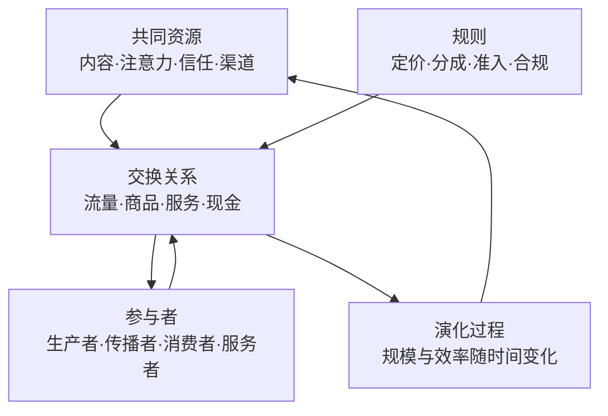

# 什么是文化生态圈：从交换到共同演化

## 是什么

先做一个区分。**市场**指买者与卖者相互作用、交换商品与服务的制度化安排，它可以是一个集市、一间交易所，也可以是一套线上撮合系统（F-022）。而**文化生态圈**不是某个具体市场，它是**以同一文化主题为核心、由内容生产、传播、社群、交易、服务等参与者围绕共同资源与规则相互作用并共同演化的系统**（F-013）。

这一说法直接借用了罗闻全（2004）的生态类比：市场参与者的策略在竞争中被模仿或淘汰，环境变化又不断产生新机会，二者**共同演化**（F-013）。把这一类比落到文化主题上，就得到本主题的技术定义——生态圈是**一套会自己长出结构、也会自己衰减结构的活体**，而不是一张静态的合作名单。

生态圈与一次性交换的关键差别在**时间维度**：一次性交换只关心这笔交易是否划算；生态圈关心的是**这套交换关系下一轮还存在吗、参与者会变强还是变弱**。

## 机制

生态圈的要素可归纳为五类（F-014），这五类构成一条闭环的解释链：

| 要素 | 内容 | 在本主题中的落点 |
|---|---|---|
| **参与者** | 生产者、传播者、消费者、服务者 | 内容创作者、渠道方、社群成员、服务承接方 |
| **资源** | 内容、注意力、信任、渠道 | 可复用、可积累、可被消耗的四类存量 |
| **规则** | 定价、分成、准入、合规 | 决定收益分配与准入资格的显性契约 |
| **交换关系** | 流量、商品、服务、现金的流向 | 三条现金流的实际载体 |
| **演化过程** | 规模与效率随时间变化 | 谁被模仿、谁被淘汰、新机会从哪长出 |

**第一，交换关系不是单向的，而是环状的。** 现金流入系统后，会回流至内容生产、渠道维护与用户服务，形成「投入—产出—再投入」的循环（F-016）；衡量这条循环的两个指标是**回流量**与**回流速度**（F-016）。这一点将在 [02 流量变现](./02-traffic-monetization.md) 与 [04 利他现金流](./04-altruistic-cash-flow.md) 中被反复使用。

**第二，生态圈里的分工是被市场规模撑开的。** 斯密（1776）指出分工受市场范围限制：市场越大、交换越便利，专业化分工越深（F-020）。本主题所说的「多形态商业圈」，本质上就是文化生态圈内部把**内容生产、分销、服务**等环节分化出去的结果——圈越大，一个环节越可能独立成一个可持续的角色。

**第三，价格在圈内承担双重功能。** 价格既传递稀缺信息，又提供行为激励（F-021，哈耶克 1945）。在文化生态圈中，定价不只是「收多少钱」，它同时是**收益分配的载体**与**参与者决策的信号**：一个分成比例变动，会同时改变各方的收入与进入意愿。

**第四，注意力是这个圈里最硬的稀缺品。** 注意力在信息供给远大于需求的环境下具有稀缺属性，其总量受人**人均可用时间**约束，分配由供给方的可见性与需求方的选择共同决定（F-019、F-024）。这意味着内容供给的增长不会凭空创造注意力，只会加剧对同一份时间的竞争。

**第五，现金流是本生态圈的代谢系统。** 现金流指一定期间内现金与现金等价物的流入与流出；在经营语境中，收入与支出按时间排列形成现金流序列，其**规模与时间分布共同决定资金周转状况**（F-015）。三条现金流——流量变现（注意力→现金）、渠道变现（点位与分成→现金）、利他现金流（先予后取→持续回流）——分别对应注意力与信息市场、分销与中间层结构、信号与信任机制（F-018）。

把上述要素合起来看：**「现金流有效场域」指交易与交换关系集中发生的制度空间（含参与者、规则、价格信号与信任关系）内，现金流的规模、速度与信息反映程度达到可自我维持的状态**（F-017）。注意「可自我维持」四个字——这正是本主题与「做一单赚一单」的分水岭。

一个常见的追问是：这套说法与「市场如何运转」的一般理论是什么关系？答案是**同源**。[市场机制包](../../../../sheke/markets/efficient-markets/concepts/00-what-is-a-market.md) 讨论的是市场的一般定义、参与者与功能；本包只是把这套一般机制**收窄到一个文化主题上**。而「共同演化」的表述与适应性市场假说（AMH）一致——效率不是开关，而是随竞争与参与者演化的动态状态（见 [efficient-markets 08 行为金融与 AMH](../../../../sheke/markets/efficient-markets/concepts/08-behavioral-finance-and-amh.md)），这条主线在本包的 [洞察](../insights.md) 第 4 条中被展开。

### 六、为什么用「生态圈」而非「产业链」或「平台」

三个词常被混用，但机制含义不同：

| 说法 | 隐含结构 | 缺什么 |
|---|---|---|
| **产业链** | 线性：上游→中游→下游 | 缺**闭环**——只描述单向流动，没有描述现金回流 |
| **平台** | 双边：撮合两侧交易 | 缺**演化**——平台是制度空间（对应 F-017 的场域），不必然含共同演化 |
| **生态圈** | 网络 + 反馈：参与者与环境互相改变 | 需要**同时**满足交换关系闭环（F-016）与演化过程（F-014） |

**辨析的意义**：若把「生态圈」当成「产业链」来经营，容易只顾把环节串起来，却忘了检验**现金是否流回上游**（F-016）；若把「生态圈」当成「平台」来经营，容易只建撮合规则，却忽略**参与者本身会随竞争被模仿与淘汰**（F-013）。用「生态圈」这个词，就是要**同时**背上闭环与演化这两个约束——这也是本包把「现金流有效场域」（F-017）与三条现金流（F-018）分开讲的原因：前者是空间与状态，后者是空间里的实际流动。

## 与老子思想的映射

本包的价值基线以**帛书甲乙本用字为准**。凡帛书与通行本有异者，一律并列标注，不混称。

- **「德经」在前，是生态圈的阅读起点。** 帛书甲、乙两本出土于湖南长沙马王堆三号汉墓，墓葬年代据墓中纪年木牍考订为西汉文帝前元十二年（公元前 168 年，F-001）；两本篇序均为《德经》在前、《道经》在后（F-003），德经首段作「上德不德，是以有德」（F-012）；通行本（王弼本）相反，为《道经》在前（F-006）。这一篇序差异对生态圈的启示是直白的：帛书把**「德」（已落地的行为与效用）**放在「道」（抽象原理）之前来读——换成经营语言，就是**先看现金流是否真的回流，再谈原理是否漂亮**。
- **「恒」而非「常」。** 帛书甲、乙本与北大汉简本用「恒」，传世本作「常」，系避汉文帝刘恒讳改字（F-009）。生态圈的「可自我维持」是**恒常状态**而非某一期的偶然高峰——用帛书用字来说，追求的是「恒」，而不是某一期的「常」。
- **「弗」而非「不」，且多句末语气词。** 帛书（尤以乙本为甚）多用「弗」对应传世本的「不」，并多在句末用「也」「者」「矣」（F-012）。这一用字习惯**在表达上**的意义在于：帛书的否定多为**明确的判断句**——「弗为」是一句断言，而不是含糊的省略。
- **「邦」而非「国」。** 帛书甲本与郭店楚简本作「邦」（甲本可辨「邦」字约二十二处），帛书乙本与传世本作「国」，传世本「国」为避汉高祖刘邦讳改字（F-008）。本包不使用「国」字回改的引文，凡涉此字一律按帛书甲本作「邦」并标注。
- **「水善利万物而有静」而非「不争」。** 传世本作「水善利万物而不争」，帛书甲本作「水善利万物而**有静**」，帛书乙本此处残损（F-011）。这一异文对生态圈尤其关键：传世本的「不争」是**态度**，帛书甲本的「有静」更近于**状态**——系统在利万物之后仍保持自身的稳定与秩序，而不是靠压制竞争来维持。本包据此把「利他现金流」的基线设为**先予后取而不失自身的稳态**（详见 [04 利他现金流](./04-altruistic-cash-flow.md)）。

> 说明：以上映射是**解释性判断**，不是对《老子》原意的定论；文本异文的客观陈述见 [事实清单](../facts.md)。帛书与通行本异文凡有争议（如「有静/不争」「免成/晚成」），本包一律并置两侧，不替读者裁决。相关异文背景可参见同组知识包 [帛书阅读](../../boshu-reading/index.md)。

## 算例/数字指路

本篇不含算例，可参见 [examples/index.md](../examples/index.md)。生态圈闭环的自查工具见同目录的 [生态圈闭环评分卡](../examples/04-ecosystem-loop-scorecard.md)。

## 常见误读

- **误读一：把「生态圈」等同于「平台」或「联盟」。** 生态圈的定义核心是**共同演化与闭环**（F-013、F-016），而不是「拉了多少合作方」。一份签了字的联盟名单，若没有交换关系的持续发生与现金回流，就不是生态圈，只是一张名单。
- **误读二：把「多形态商业圈」理解为「什么赚钱做什么」。** 分工受市场范围限制（F-020）：分化出来的每个环节都必须能**独立维持现金流**才有意义。盲目铺开形态而不检验各形态的闭环，等于把注意力与现金同时摊薄。
- **误读三：把「共同演化」理解为「一起赚钱」。** 生态类比同时包含**被模仿与被淘汰**（F-013）。共同演化的中性含义是「参与者与环境互相改变」，其中既有增长也有衰减；忽略淘汰的一端，就会高估系统的稳定性。
- **误读四：把「有效场域」当作「完全有效」。** 即便在市场机制更成熟的环境里，完全信息有效在逻辑上也不可达——参与者若失去投入信息的动力，信息就无法进入价格（格罗斯曼—斯蒂格利茨悖论）。本包的立场见 [洞察](../insights.md) 第 4 条：「有效」是有程度、有边界的状态。
- **误读五：把注意力短缺当作「内容不够多」的问题。** 注意力总量受人**人均可用时间**约束，内容供给的增长不改变时间总量（F-024）。因此注意力问题通常是**分配与可见性**问题，而不是产能问题。

## 小结

- 文化生态圈 = 以同一文化主题为核心、由多类参与者围绕**共同资源与规则**相互作用并**共同演化**的系统（F-013）。
- 五个要素构成闭环解释链：参与者、资源、规则、交换关系、演化过程（F-014）。
- 现金流是这套系统的代谢：判断健康度看**回流量与回流速度**，而非单期流入规模（F-015、F-016）。
- 「现金流有效场域」指现金流的规模、速度与信息反映程度达到**可自我维持**的状态（F-017）。
- 价值基线取帛书：德经在前先看实效（F-003）、用「恒」不用「常」（F-009）、「有静」而非「不争」（F-011）。

下一步建议按 [01 帛书老子经营哲学基线](./01-boshu-laozi-baseline.md) 建立文本基线，再进入 [02 流量变现](./02-traffic-monetization.md)、[03 渠道变现](./03-channel-monetization.md) 与 [04 利他现金流](./04-altruistic-cash-flow.md) 三条现金流。

> **边界声明**：本篇为通识教育材料，**不推荐任何平台、项目或产品，不承诺收益，不预测市场**，不构成经营、投资、法律或财税建议。判断性内容见 [洞察](../insights.md)，事实出处见 [事实清单](../facts.md)。

## 事实卡

| 编号 | 一句话 | 出处 |
|------|--------|------|
| F-001 | 马王堆帛书《老子》甲乙本出土与墓葬年代（前 168 年） | S2 |
| F-003 | 帛书甲乙本篇序均为德经在前、道经在后 | S1、S2 |
| F-006 | 通行本篇序为道经在前（37 章）、德经在后（44 章），共 81 章 | S6 |
| F-008 | 「邦/国」避讳异文：帛书甲本作「邦」，传世本作「国」 | S1、S2、S3、S6 |
| F-009 | 「恒/常」避讳异文：帛书用「恒」，传世本作「常」 | S1、S2、S3 |
| F-011 | 关键异文：「有静/不争」与「免成/晚成」 | S1、S3、S4 |
| F-012 | 帛书「弗/不」与句末语气词；道经、德经首段原文 | S1、S6 |
| F-013 | 罗闻全（2004）生态类比与「文化生态圈」定义 | S33 |
| F-014 | 生态圈五要素：参与者、资源、规则、交换关系、演化过程 | S33、S36 |
| F-015 | 现金流定义：规模与时间分布共同决定周转 | S36 |
| F-016 | 现金流闭环与观察指标（回流量、回流速度） | S36 |
| F-017 | 场域与「现金流有效场域」的可自我维持含义 | S10、S22 |
| F-018 | 三条现金流骨架：流量、渠道、利他 | S8、S15、S36 |
| F-019 | 注意力稀缺与人均时间约束 | S36 |
| F-020 | 分工受市场范围限制（斯密 1776） | S7 |
| F-021 | 价格的双重功能：传递信息与提供激励（哈耶克 1945） | S10 |
| F-022 | 市场的定义与制度化安排 | S7、S8、S9、S36 |
| F-024 | 注意力总量受时间约束，分配呈竞争状态 | S36 |
