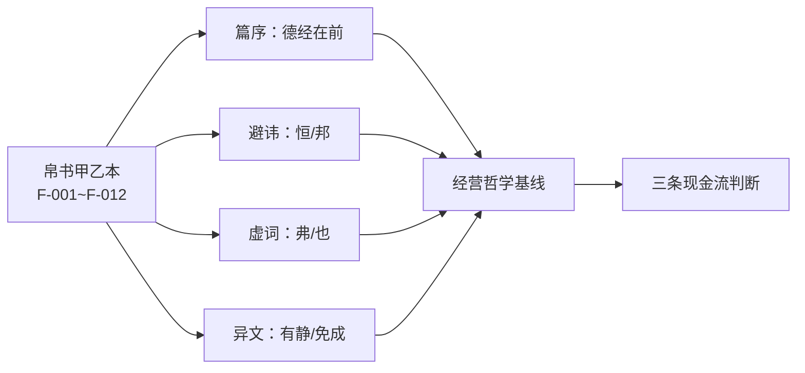

# 帛书老子经营哲学基线

## 是什么

本主题的全部价值判断，都建立在一个明确的前提上：**以帛书甲乙本用字为准，不以通行本（王弼本）用字为准**。凡帛书与通行本有异者，一律**并列标注、分别说明**，不混称、不回改、不默认通行本为「正字」。

之所以要立这条基线，是因为「老子如何指导经营」这类讨论中，最常出问题的不是推理，而是**引文来源**：多数人背的是通行本，而通行本经过汉唐以来的避讳改字与传抄润色，若干关键字的语义已经被改弱或改向。若基线不立，后面三条现金流的价值排序就会建立在错误的字面上。

因此本篇只做一件事：把帛书的**文本事实**逐条摆出来，并说明每条在经营判断上意味着什么。使用这些基线，是为了让本包的结论**可溯源、可复核**，而不是为了让引文显得古雅。

## 机制

### 一、文本载体：四套系统的关系

先把「帛书」放进出土文本的谱系里，才能说清它的证据地位。

- **马王堆帛书《老子》甲、乙两本**出土于湖南长沙马王堆三号汉墓；该墓下葬年代据墓中出土纪年木牍考订为**西汉文帝前元十二年（公元前 168 年）**（F-001）。
- **帛书甲本**字体介于篆隶之间，**不避汉高祖刘邦讳**；**帛书乙本**为隶书，**避「邦」字讳**（F-002）。
- **郭店楚简本**为节选本，分甲、乙、丙三组，篇幅约 2000 字，无《道经》《德经》之分，亦无统一篇序（F-007）。
- **北大汉简本**简背题「老子上经」「老子下经」，上经为德、下经为道；上经 44 章，下经 33 章（F-005）。
- **通行本**（王弼本）、河上公本、傅奕本篇序为《道经》在前（37 章）、《德经》在后（44 章），全书共 81 章（F-006）。

**机制含义**：帛书不是「更早的通行本」，而是一套**独立的传本证据**。它的价值在于提供了一组**未经汉唐避讳与润色的用字**，可以用来校验通行本里哪些字是「后改的」。对本主题而言，这一点决定了引文的可信度等级。

### 二、避讳：传本断代的硬证据

避讳用字是传本断代的证据之一（F-010）：

- **「邦/国」**：郭店楚简本与帛书甲本作「**邦**」（甲本可辨「邦」字约二十二处），帛书乙本、北大汉简本及河上公本、王弼本作「**国**」；传世本「国」为避汉高祖刘邦讳改字（F-008）。
- **「恒/常」**：郭店楚简本、帛书甲本与乙本、北大汉简本用「**恒**」，河上公本、王弼本作「**常**」；传世本「常」为避汉文帝刘恒讳改字（F-009）。
- 据此可推定抄写时段：**帛书甲本不避「邦」讳**，其抄写年代推定约在公元前 206 年至前 195 年间；**帛书乙本避「邦」讳**，抄写年代推定约在公元前 179 年至前 169 年间（各家估计略有差异，无直接纪年证据）（F-010）。

**机制含义**：避讳是**有方向的**——改字只会朝着「避开当朝君主名讳」的方向发生，不会反向改回。因此「帛书作邦、传世作国」这一组差异，可以用来说明**谁先谁后**，而不是「两种写法都行」。这为下文的异文取舍提供了方法论。

### 三、篇序：帛书德经在前

帛书甲、乙本篇序均为**《德经》在前、《道经》在后**；《德经》对应通行本第三十八至八十一章，《道经》对应通行本第一至三十七章（F-003）。帛书乙本篇末还存有篇题与字数记录，作「德三千卌一」「道二千四百廿六」（F-004）。

**机制含义**：篇序不是排版偏好，而是**阅读顺序**。帛书把「德」（已落地的效用与行为）置于「道」（抽象原理）之前，等于要求读者**先看结果，再看原理**——这正是本包在三条现金流上反复使用的判断顺序。

### 四、虚词与语气：帛书的判断句形态

帛书道经首段作「道，可道也，非恒道也。名，可名也，非恒名也」，德经首段作「上德不德，是以有德」；帛书（尤以乙本为甚）多用「**弗**」字对应传世本的「**不**」，并多在句末用「**也**」「**者**」「**矣**」等语气词（F-012）。

**机制含义**：虚词不是装饰。「弗」与「也」使帛书的句子更接近**明确的判断句与断言**；而通行本删去语气词后，句子往往产生**多种断句可能**，语义随之浮动。做引文时，带语气词的版本断句更清晰、歧义更少。

### 五、异文：两组必须并列的关键差异

| 传世本 | 帛书 | 其他传本 | 争议 |
|---|---|---|---|
| 水善利万物而**不争** | 甲本作「水善利万物而**有静**」（乙本此处残损） | — | 「有静」释读与「不争」的取舍 |
| 大器**晚成** | 乙本作「大器**免成**」 | 北大汉简本作「**勉成**」，郭店楚简本作「**曼成**」 | 「免训无/不」与「免通晚」两读并存 |

上表两条均出自 F-011。**机制含义**：这两组异文是「引文必须并列标注」的典型场景——它们不是错别字，而是**不同的思想读法**。本包在使用时一律给出来源本，不合并为一句「老子说」。

## 与老子思想的映射

以下逐条把帛书用字落到经营判断上。**每条均以帛书甲乙本用字为准，凡与通行本有异者并列标注。**

**1. 德经在前 → 先算现金流，再谈理念。**
帛书甲、乙本篇序为《德经》在前、《道经》在后（F-003），德经首段作「上德不德，是以有德」（F-012）；通行本相反（F-006）。
**经营映射**：判断一个文化生态圈是否成立，先看**现金是否真的回流**（德，已落地），再看原理是否自洽（道，抽象）。顺序颠倒，就会出现「模式讲得很通、账上却没有回流」的典型失败。

**2. 「恒」而非「常」→ 追求可持续状态，而非某一期高峰。**
帛书用「恒」，传世本作「常」，系避汉文帝刘恒讳改字（F-009）。
**经营映射**：「恒」强调**持续不变的状态**，「常」易被读成「常规、经常」。生态圈的健康标准应设定为**恒常的回流能力**，而不是某一期的流量峰值。

**3. 「邦」而非「国」→ 引文口径统一到帛书甲本。**
帛书甲本作「邦」（可辨约二十二处），传世本作「国」（避刘邦讳改字）（F-008）。
**经营映射**：这是一条**纪律性**映射——凡引此字，本包一律按帛书甲本作「邦」并标注，不做回改。经营文档中的概念定义同理：**术语必须锁定一个口径并显式声明**，否则讨论会在同词异义中空转。

**4. 「弗」而非「不」，且多句末「也/者/矣」→ 判断要下成断言。**
帛书多用「弗」对应传世本的「不」，并多在句末用语气词（F-012）。
**经营映射**：帛书句式更接近**明确的判断**（「弗为」是一句断言）。落到决策上，就是要求把含糊的「尽量避免过度扩张」改写成可检验的判据，例如「当回流现值低于让渡成本现值时，不加规模」（见 [04 利他现金流](./04-altruistic-cash-flow.md)）。

**5. 「水善利万物而有静」而非「不争」→ 利他之后的稳态。**
传世本作「水善利万物而**不争**」，帛书甲本作「水善利万物而**有静**」，帛书乙本此处残损（F-011）。
**经营映射**：这是本包最关键的一条。「不争」是一种**态度**；「有静」更近于一种**状态**——利万物之后，系统仍保持自身的秩序与稳定，而不是靠压制竞争来维持。据此，利他现金流的基线不是「不争利」，而是**先予后取、予而不失自身的稳态**（对应 F-082 的价值基线，详见 [04 利他现金流](./04-altruistic-cash-flow.md)）。

**6. 「大器免成」而非「晚成」→ 不刻意求成的交付观。**
传世本作「大器晚成」，帛书乙本作「大器**免成**」，北大汉简本作「**勉成**」，郭店楚简本作「**曼成**」（F-011）。
**经营映射**：「免成」若读作「无/不」，指向**不刻意完成**——好的器物不必靠外力强成；这与前文「大方无隅……大象无形」的排比逻辑一致。经营上对应的是**把让渡物做成可持续维护的公共资产，而非一次性打造爆款**。注意本包**不裁决**「免训无/不」与「免通晚」两读哪一为是，两者并置。

**7. 道经首段「非恒道也」→ 规则随场域变化。**
帛书作「道，可道也，非恒道也。名，可名也，非恒名也」（F-012）。
**经营映射**：「非恒道也」提示**可被言说的规则不是恒定不变的规则**。生态圈的定价、分成与准入规则都必须**随场域演化而重估**，不存在一劳永逸的「标准打法」。

> 以上 1–7 条为**解释性判断**，不是对《老子》原意的定论；文本异文本身的客观陈述见 [事实清单](../facts.md)。相关出土文献背景参见同组知识包 [老子世系](../../laozi-lineage/index.md) 与 [帛书阅读](../../boshu-reading/index.md)。

## 算例/数字指路

本篇不含算例，可参见 [examples/index.md](../examples/index.md)。

## 常见误读

- **误读一：把「帛书更好」当作「帛书就是原文」。** 帛书甲乙本只是**早期传本**，其本身也存在抄写差异与残损（如乙本「有静」句残损，F-011）。正确表述是「以帛书用字为准立基线」，而不是「帛书等于老子原稿」。
- **误读二：把「恒」与「常」当作同义通用。** 二者在传本中是**避讳改字关系**（F-009），不是自由选择。「恒」是持续不变，「常」易被读作常规——两者在经营判据上会产生不同的时间口径。
- **误读三：把异文合并引用。** 例如写成「老子说水善利万物而不争」而不标注帛书甲本作「有静」（F-011），就是把两套文本混称。本包纪律：**凡异文必并列、必标注来源本**。
- **误读四：把篇序差异当作无关紧要的排版问题。** 德经在前是**阅读与判断顺序**（F-003）；把它当成排版细节，会丢掉「先看实效」这一基线。
- **误读五：把避讳断代结论当成直接纪年证据。** 抄写年代的推定系据字体与避讳推断，**无直接纪年证据，各家估计略有差异**（F-010）。引用时必须保留这一限定。

## 小结

- 本包基线：**以帛书甲乙本用字为准**，异文一律并列标注、不混称。
- 版本谱系：帛书甲本（不避「邦」讳）、帛书乙本（避「邦」讳）、郭店楚简本（节选）、北大汉简本（德上道下）、通行本（道前德后，81 章）（F-001、F-002、F-005、F-006、F-007）。
- 关键异文四条：**恒/常**（F-009）、**邦/国**（F-008）、**有静/不争**（F-011）、**免成/晚成**（F-011）。
- 关键用字一条：帛书多用「**弗**」与句末「也/者/矣」（F-012）。
- 关键篇序一条：帛书**德经在前**，先实效后原理（F-003）。

下一步按 [00 什么是文化生态圈](./00-what-is-a-culture-ecosystem.md) 建立生态圈定义，或直接进入 [02 流量变现](./02-traffic-monetization.md)。

> **边界声明**：本篇为通识教育材料，**不推荐任何平台、项目或产品，不承诺收益，不预测市场**，不构成经营、投资、法律或财税建议。异文背景可参见同组知识包 [帛书阅读](../../boshu-reading/index.md)。

## 事实卡

| 编号 | 一句话 | 出处 |
|------|--------|------|
| F-001 | 马王堆帛书《老子》甲乙本出土与墓葬年代（前 168 年） | S2 |
| F-002 | 帛书甲本不避「邦」讳、乙本避「邦」讳 | S2 |
| F-003 | 帛书甲乙本篇序均为德经在前、道经在后 | S1、S2 |
| F-004 | 帛书乙本篇末字数记录「德三千卌一」「道二千四百廿六」 | S2 |
| F-005 | 北大汉简本篇题「老子上经/下经」，上经 44 章、下经 33 章 | S3 |
| F-006 | 通行本篇序为道经在前（37 章）、德经在后（44 章），共 81 章 | S6 |
| F-007 | 郭店楚简本为节选本，分甲乙丙三组，约 2000 字 | S4、S5 |
| F-008 | 「邦/国」避讳异文：帛书甲本作「邦」，传世本作「国」 | S1、S2、S3、S6 |
| F-009 | 「恒/常」避讳异文：帛书用「恒」，传世本作「常」 | S1、S2、S3 |
| F-010 | 避讳用字作为传本断代证据与抄写年代推定区间 | S2 |
| F-011 | 关键异文：「有静/不争」与「免成/晚成（勉成/曼成）」 | S1、S3、S4 |
| F-012 | 帛书「弗/不」与句末语气词，道经与德经首段原文 | S1、S6 |
| F-082 | 价值基线：帛书「上德不德」「上德无为而无以为也」→ 不自居、不妄为 | S1、S6 |
