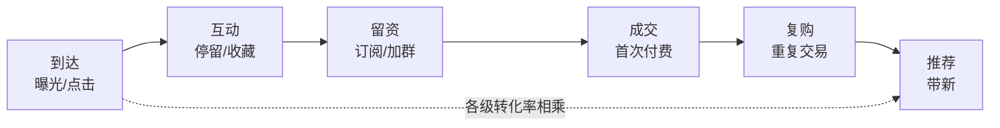

# 流量变现：注意力如何转化为现金

## 是什么

**流量**指单位时间内到达某一内容、页面或渠道的访问或互动次数；常见口径包括曝光量、点击量、独立访客数与活跃用户数（F-023）。

**流量变现**指的是把这批到达行为**逐级筛选并折算为现金**的过程。关键在「折算」二字：流量本身不是收入，它只是**候选接触**；只有当接触沿一条可核算的链路走完转化、留存与复购，才可能落到现金上。

因此本篇不讨论「怎么把流量做大」，而讨论**流量到现金之间那道漏斗的结构**：哪一级在流失、单位用户值多少钱、为了拿到这个人花了多少钱、以及这笔钱多久能回来。

## 机制

### 一、注意力的硬约束

注意力在信息供给远大于需求的环境下具有稀缺属性；**注意力的总量受人均可用时间约束**，其分配由供给方的可见性与需求方的选择共同决定（F-019）。进一步地，内容供给的增长**不改变人均可用时间总量**，故注意力的分配呈竞争状态（F-024）。

**机制含义**：流量市场是一个**零和程度很高**的注意力分配市场。你的曝光增加，通常对应别人曝光的减少，而不是总量的等比放大。这决定了两件事：①流量的边际获取成本会随竞争上升；②单纯提高内容产量不是解决注意力问题的办法，**改变可见性与分配效率**才是。

### 二、转化漏斗：把「流量」拆成可核算的级数

**转化漏斗（funnel）** 指用户从触点到达、互动、留资到成交的分阶段流失结构；**各阶段转化率相乘构成总体转化率**（F-025）。

这意味着一个反直觉的结论：**总体转化率是各级转化率的乘积，因此任何一级的塌陷都会等比压缩最终结果**。若某一级长期低位，先修这一级，收益远大于在其他级上做加法。漏斗是分级的，这不是修辞——它是**乘法结构**。

### 三、CAC、LTV 与判据

- **获客成本（CAC）** 指为获取一位新用户所付出的全部营销与渠道费用，等于统计期内的获取支出除以同期新增用户数（F-026）。
- **用户生命周期价值（LTV）** 指一位用户在与平台的关系存续期间为平台带来的净贡献总和，通常由客单价、复购频次与毛利率估算（F-027）。
- **留存率** 指某一时点的新增用户在后续某时点仍然活跃的比例；**留存曲线**描述留存率随时间的衰减（F-028）。
- 商业分析中常用的判据是 **LTV 与 CAC 的比值**；比值大于 1 表示单位用户的净贡献为正，但**比值随口径（是否计入运营成本、是否折现）变化**（F-031）。

**机制含义**：CAC 与 LTV 是一对**时间错配**的变量——CAC 发生在前、一次性支出；LTV 发生在后、分摊到整个存续期。因此「LTV/CAC > 1」只是必要条件，**回流速度**才是决定资金能否周转的变量（这与 F-015 的「现金流规模与时间分布共同决定周转」一致）。留存率的作用是把 LTV 从「假设」变成「可观测」：留存曲线衰退越快，LTV 的实际取值越低。

### 四、广告与品牌的信号功能

**广告与品牌可作为质量信号**：在信息不对称条件下，卖方通过广告投入与品牌声誉向买方传递质量信息，降低买方的不确定性（斯彭斯 1973 信号传递，F-032）。

**机制含义**：推广费并不只是「买流量」，它同时在**发出信号**。信号是否有效，取决于**信号成本对低质量方是否更高**（这一条件在 [04 利他现金流](./04-altruistic-cash-flow.md) 中正式展开，对应 F-045）。若推广成本对劣质供给同样低廉，则该推广只买到曝光，买不到信任。

### 五、与本包主线的接驳

流量变现是三条现金流里**最先接触用户**的一条，但它**不是最可持续的一条**。按本包的 [洞察](../insights.md) 第 1 条：三条现金流共用同一份**信任资产**，流量是这份资产的**第一次兑现**——若兑现过程透支信任（例如用夸大宣传换一次性转化），则渠道与复购两条现金流的空间同步收窄。

## 与老子思想的映射

以下映射均以**帛书甲乙本用字为准**，凡异文并列标注。

**1. 「弗」而非「不」→ 判据要写成可检验的断言。**
帛书多用「弗」对应传世本的「不」，并多在句末用「也」「者」「矣」（F-012）。
**经营映射**：把「尽量别亏本获客」这类含糊表述，改写成帛书式的明确断言：**当 LTV 口径下的净贡献不覆盖 CAC 时，弗加投放**。判据一旦写成断言，就可被复算、被复核。

**2. 「恒」而非「常」→ 看留存曲线，不看单期峰值。**
帛书用「恒」，传世本作「常」（避汉文帝刘恒讳改字，F-009）。
**经营映射**：流量峰值是「常」（某期的常态波动），留存曲线才是「恒」（持续状态）。判断流量质量的指标应是**留存曲线的形态**，而非某一期的曝光量（对应 F-028）。

**3. 「有静」而非「不争」→ 在注意力竞争中保持自身稳态。**
传世本作「水善利万物而不争」，帛书甲本作「水善利万物而**有静**」（乙本此处残损，F-011）。
**经营映射**：注意力分配是竞争状态（F-024），「不争」在这种结构里并不可行。帛书甲本「有静」给出的方向是：**在竞争中利他（提供真实效用），同时保持自身节奏与成本的稳定**——即不因对标他人流量峰值而打乱自己的投入周期。

**4. 德经在前 → 变现先看回流，再看规模。**
帛书甲、乙本篇序为《德经》在前、《道经》在后，德经首段作「上德不德，是以有德」（F-003、F-012）；通行本相反（F-006）。
**经营映射**：把「已回流」（德）排在「讲增长故事」（道）之前。流量项目的评估顺序应为：**先看单位用户的净贡献是否为正，再看绝对流量规模**。

**5. 「邦」而非「国」→ 术语口径先锁定。**
帛书甲本作「邦」（可辨约二十二处），传世本作「国」（避刘邦讳改字，F-008）。
**经营映射**：流量指标口径极易混用（曝光、点击、独立访客、活跃用户，F-023 已明确是四种口径）。做核算前必须先**锁定一个口径并全篇一致**，否则「转化率」的分母可以随意伸缩，数字就失去意义。

> 以上映射为**解释性判断**；文本异文的客观陈述见 [事实清单](../facts.md)。帛书与通行本异文凡有争议，一律并置两侧，不替读者裁决。

## 算例/数字指路

本篇对应算例见 [流量漏斗与 LTV/CAC（教学算例）](../examples/02-traffic-funnel-and-ltv-cac.md)；算例总览见 [examples/index.md](../examples/index.md)。

需要指出的是，[事实清单](../facts.md) 中已内嵌两个**教学算例**条目，可作为核算口径的入口：F-029（获取支出 10000 元、新增用户 200 人，则 CAC 为 50 元/人）与 F-030（客单价 100 元、年复购 2 次、毛利率 40%、平均存续 2 年，LTV 约 160 元）。二者均为**教学算例，非真实经营数据**（F-084）。完整的多级漏斗与回收周期推演，见 [流量漏斗与 LTV/CAC 教学算例](../examples/02-traffic-funnel-and-ltv-cac.md)。

## 常见误读

- **误读一：把流量直接当作收入。** 流量只是候选接触，中间隔着漏斗的**乘法结构**（F-025）。把曝光量当作已完成变现，会系统性高估商业能力。
- **误读二：把 LTV/CAC 当固定安全线。** 该比值**随口径变化**（是否计入运营成本、是否折现，F-031）。不同口径下的「2.0」和「3.0」不可直接比较；跨团队对标前必须先对齐口径。
- **误读三：把留存当作虚荣指标。** 留存率是 LTV 的**实测来源**（F-027、F-028）——留存曲线塌陷时，任何基于「平均存续期」的 LTV 估算都会失真。
- **误读四：把推广费只当成本。** 广告与品牌在信息不对称下兼具**信号**功能（F-032）。但信号有效的前提是差异成本（F-045），否则只是买曝光。
- **误读五：认为「内容做得更多」就能解决流量问题。** 注意力总量受人**人均可用时间**约束，内容供给增长不改变时间总量（F-024）。问题在分配与可见性，不在产能。
- **误读六：承诺或暗示收益。** 本包不推荐任何平台、项目或产品，不承诺收益，不预测市场；所有数字均为**教学算例**（F-083、F-084）。

## 小结

- 流量是候选接触，不是收入；变现是一条**乘法结构的漏斗**（F-023、F-025）。
- 注意力总量受**人均可用时间**约束，其分配是竞争状态（F-019、F-024）。
- 核算三件套：**CAC**（F-026）、**LTV**（F-027）、**留存率**（F-028）；常用判据为 **LTV/CAC**，但比值随口径变化（F-031）。
- 广告与品牌兼具**质量信号**功能，其效力取决于差异成本条件（F-032、F-045）。
- 基线取帛书：判据写成断言（F-012）、看留存曲线而非峰值（F-009）、竞争中以「有静」保稳态（F-011）。

下一步进入 [03 渠道变现](./03-channel-monetization.md)，或参见 [01 帛书老子经营哲学基线](./01-boshu-laozi-baseline.md) 复核引文口径。

## 事实卡

| 编号 | 一句话 | 出处 |
|------|--------|------|
| F-003 | 帛书甲乙本篇序均为德经在前、道经在后 | S1、S2 |
| F-006 | 通行本篇序为道经在前（37 章）、德经在后（44 章） | S6 |
| F-008 | 「邦/国」避讳异文：帛书甲本作「邦」，传世本作「国」 | S1、S2、S3、S6 |
| F-009 | 「恒/常」避讳异文：帛书用「恒」，传世本作「常」 | S1、S2、S3 |
| F-011 | 关键异文：「有静/不争」与「免成/晚成」 | S1、S3、S4 |
| F-012 | 帛书「弗/不」与句末语气词 | S1、S6 |
| F-015 | 现金流定义：规模与时间分布共同决定周转 | S36 |
| F-019 | 注意力稀缺与人均时间约束 | S36 |
| F-023 | 流量的定义与四种常见口径 | S36 |
| F-024 | 注意力总量受时间约束，分配呈竞争状态 | S36 |
| F-025 | 转化漏斗与各级转化率相乘 | S36 |
| F-026 | 获客成本 CAC = 获取支出 ÷ 新增用户数 | S36 |
| F-027 | 用户生命周期价值 LTV 的构成（客单价、复购、毛利率） | S36 |
| F-028 | 留存率与留存曲线的衰减 | S36 |
| F-029 | 教学算例：支出 10000 元、新增 200 人 → CAC 50 元/人 | S36 |
| F-030 | 教学算例：客单价 100 元、年复购 2 次、毛利率 40%、存续 2 年 → LTV 约 160 元 | S36 |
| F-031 | LTV/CAC 判据及口径依赖 | S36 |
| F-032 | 广告与品牌作为质量信号（斯彭斯 1973） | S15 |
| F-045 | 信号有效性条件：差异成本（低质量方成本更高） | S15 |
| F-083 | 通识教育定位：不含产品/平台/项目推荐，不构成建议 | S36 |
| F-084 | 教学算例声明：所有数字均为说明机制的教学算例 | S36 |
