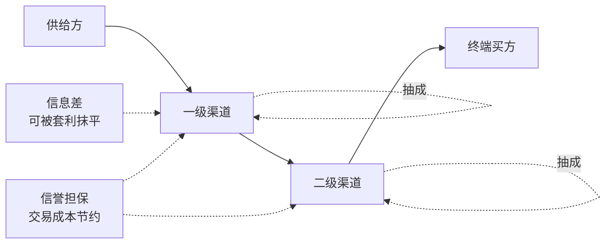

# 渠道变现：点位、分成与中间层

## 是什么

**渠道**指商品或服务从供给方向需求方转移所经过的中间环节，包括实体渠道（门店、场地、集市）与线上渠道（平台、社群、私域）（F-033）。

**渠道变现**就是把**这些中间环节本身**折算成现金的过程，其收益形式通常有三类：**分成**（按成交额或毛利抽成）、**点位费**（场地、展位、货架费）、**服务价差**（渠道采购价与终端售价之差）。

与 [流量变现](./02-traffic-monetization.md) 的关键差别在于：流量变现的收益来自**注意力的转化**，渠道变现的收益来自**位置与关系的中介价值**。前者靠曝光效率，后者靠**结构位置**。因此渠道变现的核心问题不是「曝光够不够」，而是：**我占的这个位置，值多少钱、还能值多久、别人能不能替代我**。

## 机制

### 一、渠道分层与分成

**渠道分层**指同一商品经由一级、二级等多层中间环节到达终端；**每层抽取的价差称为分成或抽成，分成比例以成交额或毛利为基数**（F-034）。

**机制含义**：分层是**乘法结构的成本叠加**。若每层抽成比例相同，层数每增加一级，供给方到手比例就按比例下降。因此「多铺一层渠道」并不必然提高总收益——只有当新增这一层带来的**增量需求超过其抽成成本**时，铺开才划算。

### 二、点位稀缺：场地费的经济实质

**渠道点位**（场地、展位、货架）具有**排他性与稀缺性**；场地费、进场费、货架费是渠道方对**点位占用**收取的费用（F-037）。

**机制含义**：点位费的定价依据不是「服务成本」，而是**该位置的排他性**——同位置只能容纳有限供给。因此点位费本质是**稀缺租金**：谁占住，谁就获得了排他收益；一旦点位供给增加（新场地、新货架、新栏目），租金随之下降。这与「分成」不同：分成随成交波动，点位费则**与成交无关、先收后付**，是**刚性支出**。

### 三、代理与分销的三种法律形态

**代理与分销**的常见法律形态包括：**经销**（买断转售）、**代销**（受托代售）与**居间**（撮合收费）；三种形态在**库存风险、定价权与结算时点**上不同（F-038）。

| 形态 | 库存风险 | 定价权 | 结算时点 |
|---|---|---|---|
| 经销（买断转售） | 渠道承担 | 渠道较大 | 先付后销 |
| 代销（受托代售） | 供给方承担 | 供给方较大 | 售后结算 |
| 居间（撮合收费） | 双方均不承担 | 双方自主 | 撮合成交时 |

**机制含义**：三种形态的选择，本质是**风险的重新分配**。选择哪一种，取决于谁的现金流更承受得起时间错配——这与 [04 利他现金流](./04-altruistic-cash-flow.md) 中的回流周期分析直接相关。

### 四、渠道冲突

**渠道冲突**指同一供给方的不同渠道在价格、客户与库存上的竞争关系；常见表现包括**串货、跨渠道比价与终端价格失控**（F-039）。

**机制含义**：渠道冲突的根源是**同一标的在不同渠道的价格不唯一**。一旦终端用户可跨渠道比价，高价渠道的加价空间即被击穿，渠道层级越多、冲突越难协调。

### 五、中间层为什么存在：交易成本与信誉

这是本篇最重要的机制部分，它回答了「中间商凭什么收钱」。

- **一价定律（law of one price）**：在无摩擦、可自由交易的市场中，同一资产（或等价资产）应有同一价格，价格偏离会被套利纠正（马歇尔 1890，F-035）。
- **渠道价差**指同一标的在不同渠道的报价差异；差异的表现来源包括**信息成本、交易成本、渠道层级与服务内容的差别**（F-036）。
- **交易成本**（搜寻、缔约、履约、监督成本）与渠道层级的数量相关：**交易成本较高时中间层存在空间，较低时供给方与需求方可以更直接地交易**（科斯 1960 的制度与交易成本视角，F-040）。
- **中间层的信息与信誉功能**：当终端买方难以核验商品质量时，**具备信誉的中间层以自身声誉作担保，承担质量甄别功能**（与阿克洛夫 1970 逆向选择问题相对，F-041）。
- **渠道竞争的收敛取向**：竞争者发现可获利的渠道价差后，更多供给与资金进入该渠道，**价差收窄**（与格罗斯曼—斯蒂格利茨 1980 关于竞争抹平超额收益的表述一致，F-042）。

**机制含义**：中间层的收钱理由只有两类——
1. **降低交易成本**（把搜寻、缔约、履约的麻烦替终端承担了）；
2. **提供信誉担保**（用自己的声誉为质量背书，解决信息不对称）。
凡不落在两类的收益，都是**信息差与时点差**，而信息差会被竞争抹平（F-042），这与 [efficient-markets 03 竞争、套利与均衡](../../../../sheke/markets/efficient-markets/concepts/03-arbitrage-and-equilibrium.md) 中「竞争抹平超额收益」是同一机制。

**结论**：渠道变现的可持续来源不是「找到一个高分成渠道」，而是**点位背后是否沉淀了别人拿不走的东西**（信誉、服务能力、独有信息）——这就是本包 [洞察](../insights.md) 第 3 条的判断。

## 与老子思想的映射

以下映射均以**帛书甲乙本用字为准**，凡异文并列标注。

**1. 「有静」与「不争」并列 → 渠道取舍要讲稳态。**
传世本作「水善利万物而不争」，帛书甲本作「水善利万物而**有静**」（乙本此处残损，F-011）。
**经营映射**：渠道价差会被竞争抹平（F-042）。与 [05](./05-cash-flow-effective-field.md)、[06](./06-multi-form-business-circle-and-loop.md) 一致，此处对两读**并列不裁决**：传世本「不争」偏重**不把价差与点位当作必争之物**，帛书甲本「有静」偏重**利万物之后保持自身的秩序**。两读共同的取向是——把渠道铺开而不失自身的定价与品质标准（F-042、F-047），而非靠一味让价或抢夺可被抹平的点位与价差来维持关系。

**2. 德经在前 → 先看分成到手的现金，再看渠道数量。**
帛书甲、乙本篇序为《德经》在前、《道经》在后，德经首段作「上德不德，是以有德」（F-003、F-012）；通行本相反（F-006）。
**经营映射**：渠道考核的第一列应是「**实际回流的现金**」（德），而不是「签约渠道数」（道）。签约量是抽象规模，回流量才是已落地实效。

**3. 「弗」而非「不」→ 给渠道设退出条件，而非模糊偏好。**
帛书多用「弗」对应传世本的「不」（F-012）。
**经营映射**：帛书句式更近**断言**。对应到渠道管理，就是把「尽量不做纯信息差渠道」改写成可执行判据：**当某渠道的收益来源只剩信息差、且其衰减期短于收回投入的周期时，弗续约**。

**4. 「恒」而非「常」→ 用稳定性而非某期抽成判断渠道。**
帛书用「恒」，传世本作「常」（避汉文帝刘恒讳改字，F-009）。
**经营映射**：「恒」指向**持续状态**。评价渠道应看**长期抽成与结算稳定性**，而不是某一次谈下来的高分成点。

**5. 「邦」而非「国」→ 跨渠道术语与口径必须锁定。**
帛书甲本作「邦」（可辨约二十二处），传世本作「国」（避刘邦讳改字，F-008）。
**经营映射**：渠道价差、分成基数（成交额还是毛利）都是易混口径（F-034、F-036）。跨渠道结算前必须**锁定一个基数口径**，否则同一笔交易在不同渠道会被算出不同结果。

**6. 「大器免成」而非「晚成」→ 渠道关系是长期维护，不是一次打造。**
传世本作「大器晚成」，帛书乙本作「大器**免成**」，北大汉简本作「**勉成**」，郭店楚简本作「**曼成**」（F-011）。本包**不裁决**「免训无/不」与「免通晚」两读。
**经营映射**：渠道信誉与点位关系属于**需要持续维护的资产**，而非一次性签下的合同。与其追求「一次谈成最好的渠道」，不如把渠道按**可维护性**排序。

> 以上映射为**解释性判断**；文本异文的客观陈述见 [事实清单](../facts.md)。异文凡有争议，并置两侧，不替读者裁决。渠道结构的市场机制部分，可参见 [efficient-markets 04 市场失灵](../../../../sheke/markets/efficient-markets/concepts/04-market-failure.md) 中关于交易成本与信息不对称的讨论。

## 算例/数字指路

本篇对应算例见 [渠道分成与场地现金流（教学算例）](../examples/01-channel-split-and-venue-cash-flow.md)。该算例演示了**分层抽成与刚性点位费并存**时，回流周期如何被拉长；所有数字均为**教学算例，非真实经营数据**（F-084）。

## 常见误读

- **误读一：认为「渠道越多越好」。** 分层是乘法结构的成本叠加（F-034）。新增渠道只有在其**增量需求超过抽成成本**时才有意义。
- **误读二：把渠道价差当作长期资产。** 价差会被竞争抹平（F-035、F-042）。依赖信息差的渠道收益**自带衰减期**，必须标注衰减预期并同步建信誉与服务能力。
- **误读三：把点位费当作可变成本。** 点位费是**稀缺租金**，且与成交无关、先收后付（F-037），属**刚性支出**。把它与分成混在一起算，会在成交低谷期误判资金安全。
- **误读四：忽略代理形态的风险分配差异。** 经销、代销、居间在**库存风险、定价权与结算时点**上不同（F-038）。选错形态可能把库存风险与资金占用同时揽到自己身上。
- **误读五：把渠道冲突当作执行问题。** 其根源是**同一标的跨渠道价格不唯一**（F-039）；不解决价格与权责结构，只靠管理协调无法根治。
- **误读六：把中间层一概视为「多余加价」。** 中间层的收钱理由有两类——**降低交易成本**（F-040）与**提供信誉担保**（F-041）。不落在两类的收益才是可被抹平的部分。
- **误读七：承诺或暗示渠道收益。** 本包不推荐任何平台、项目或产品，不承诺收益，所有数字均为**教学算例**（F-083、F-084）。

## 小结

- 渠道变现的收益来自**中间层位置**，形式为分成、点位费与服务价差（F-033、F-034、F-037）。
- 分层是**乘法结构的成本叠加**；点位费是**与成交无关的刚性稀缺租金**（F-034、F-037）。
- 三种代理形态（经销、代销、居间）本质是**风险的重新分配**（F-038）。
- 中间层存在的两个正当理由：**降低交易成本**（F-040）与**信誉担保**（F-041）。
- 渠道价差会被**竞争抹平**（F-035、F-042）；可持续性来自不可替代的信息与信任（见 [洞察](../insights.md) 第 3 条）。
- 基线取帛书：以「有静」保自身标准（F-011）、先看回流现金（F-003）、给渠道设断言式退出条件（F-012）。

下一步进入 [04 利他现金流](./04-altruistic-cash-flow.md)，或回看 [02 流量变现](./02-traffic-monetization.md) 的核算口径。

## 事实卡

| 编号 | 一句话 | 出处 |
|------|--------|------|
| F-003 | 帛书甲乙本篇序均为德经在前、道经在后 | S1、S2 |
| F-006 | 通行本篇序为道经在前（37 章）、德经在后（44 章） | S6 |
| F-008 | 「邦/国」避讳异文：帛书甲本作「邦」，传世本作「国」 | S1、S2、S3、S6 |
| F-009 | 「恒/常」避讳异文：帛书用「恒」，传世本作「常」 | S1、S2、S3 |
| F-011 | 关键异文：「有静/不争」与「免成/晚成」 | S1、S3、S4 |
| F-012 | 帛书「弗/不」与句末语气词 | S1、S6 |
| F-033 | 渠道定义：实体渠道与线上渠道 | S36 |
| F-034 | 渠道分层与分成（以成交额或毛利为基数） | S36 |
| F-035 | 一价定律：价格偏离被套利纠正（马歇尔 1890） | S8、S36 |
| F-036 | 渠道价差的来源：信息成本、交易成本、层级与服务差别 | S8、S36 |
| F-037 | 渠道点位的排他性与稀缺性，场地费/进场费/货架费 | S13、S36 |
| F-038 | 代理与分销三形态：经销、代销、居间 | S36 |
| F-039 | 渠道冲突：串货、跨渠道比价、终端价格失控 | S36 |
| F-040 | 交易成本与渠道层级的关系（科斯 1960） | S12 |
| F-041 | 中间层的信息与信誉担保功能 | S14 |
| F-042 | 渠道竞争的收敛取向：价差收窄 | S17 |
| F-083 | 通识教育定位：不含产品/平台/项目推荐，不构成建议 | S36 |
| F-084 | 教学算例声明：所有数字均为说明机制的教学算例 | S36 |
