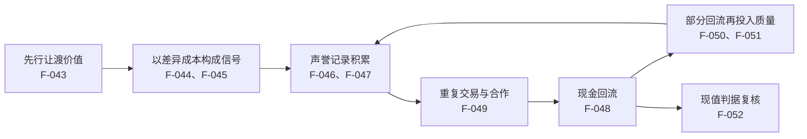

# 利他现金流：先予后取的时间结构

## 是什么

**利他现金流**指供给方**先行让渡部分价值**（免费内容、试用、补贴、无偿服务）以换取**后续现金回流**的机制；其时间结构为「**先予后取**」（F-043）。

要把它与两种常见做法区分开：

- 它不是**慈善**——慈善不要求回流；
- 它也不是**促销**——促销是「临时降价换当期成交」，而利他现金流的让渡必须能**形成可观察的东西**（记录、声誉、关系），否则只是买了一次性接触。

所以利他现金流本质上是一项**时间投资**：在 `t=0` 付出确定的成本，在 `t>0` 收回不确定的现金。它的全部技术难度，都集中在**这段时间差里发生了什么**。

## 机制

### 一、让渡为什么能换来回流：信号传递

**信号传递（斯彭斯 1973）**：信息优势方以**高成本、难伪造的行动**自证质量；免费或低价提供高质量内容可作为一种能力与诚意的信号（F-044）。

**信号的有效性条件**：信号成本对**低质量方高于对高质量方**（差异成本），否则信号可被模仿而失去区分力（F-045）。

**机制含义**：这解释了「先予」为什么可能管用，也划出了它的失效边界——
- 管用的情形：让渡物本身**难以伪造**（持续更新的内容库、可追溯的履约记录、公开承诺），低质量方模仿成本更高；
- 失效的情形：让渡物**人人可复制**（例如一次性的折扣券），此时信号无区分力，用户只记住「便宜」，不形成信任。

### 二、让渡要解决的是什么问题：逆向选择

**逆向选择（阿克洛夫 1970）**：信息不对称条件下，买方按平均质量出价，使优质供给退出、劣质供给留下（**柠檬市场**）；**声誉制度是对该问题的常见回应**（F-046）。

**机制含义**：利他现金流的**真正功能**不是「便宜」，而是**在陌生人之间建立第一笔可核验的质量证据**。它把「我质量好」这句无法自证的话，换成一份**看得见、留得住、可追溯**的实物记录，从而把买方从「按平均质量出价」拉回到「按你个体的证据出价」。

### 三、信任与声誉不是一回事

**信任与声誉是两个概念**：信任是交易一方对另一方行为的**主观预期**，声誉是关于该方过往行为的**公共记录**；声誉的积累依赖**重复交易与可观察的历史**（F-047）。

**机制含义**：这一区分极具实操价值——
- **信任**是内部状态，无法直接管理，只能被影响；
- **声誉**是外部记录，**可以被建设**：留痕、公开、可核验。
因此「经营信任」的正确姿势是**经营声誉记录**；凡不产生可观察记录的「诚意」，都不构成声誉资产。

### 四、让利的经济学表述：让渡消费者剩余

**消费者剩余（马歇尔 1890）**：买方愿意支付的最高价格与实际支付价格之差；**用户剩余让渡**指供给方主动扩大买方的剩余，以换取重复交易与推荐（F-048）。

**机制含义**：让渡不是「白送」，而是**主动把一部分消费者剩余转移给用户**，用这部分剩余购买**复购意愿与推荐行为**。它是一笔明确的交换，只是支付方式不是现金。

### 五、回流为什么可能发生：重复关系中的合作条件

**重复关系中的合作条件**：当交易关系持续且双方可观察对方行为时，短期让利可以在后续交易中回收；**关系终止的可能性越低，合作越容易维持**（F-049）。

**机制含义**：这一条给出了利他现金流的**回收前提**——
1. 双方能**继续见面**（关系可延续，不是一锤子买卖）；
2. 双方能**看见对方的行为**（可观察）；
3. 关系**终止的概率低**（预期能收回）。

若三条不成立（例如一次性流量、无留痕、无复购可能），先予就大概率**收不回来**。

### 六、回流如何累积：复利与飞轮

- **复利**指收益按周期并入本金后继续产生收益的累积方式；在利润率固定且收益全部再投入的算例中，资金规模随时间呈指数增长（**教学算例，非收益承诺**，F-050）。
- **飞轮效应**指系统中**多个环节互为输入与输出、形成正反馈循环**；市场本身被视为参与者行为与价格相互反馈的系统（罗闻全 2004 的反馈回路表述，F-051）。

**机制含义**：利他现金流的长期形态是**飞轮**——让渡形成信号 → 信号积累声誉 → 声誉带来更低成本的承接 → 承接产生回流 → 部分回流再投入质量维护。这正是本包 [洞察](../insights.md) 中「**利他现金流飞轮**」模式的机制基础。注意飞轮的关键在**闭环**：任一环节断掉，正反馈就不成立。

### 七、可持续性的判据

**利他现金流的可持续性判据**：让渡成本可由后续现金回流覆盖，且**回流的现值不低于让渡成本的现值**（净现值为正）；该判据为**财务分析口径，不构成任何收益承诺**（F-052）。

**机制含义**：这条判据把「利他」从价值观争论拉回到可核算的层面：
- 若回流现值 < 让渡成本现值 → 不是利他现金流，是**净支出**，需要重新设计承接动作或缩短回流周期；
- 若回流现值为正但**周期过长** → 结构上可行、资金上可能撑不住（呼应 [00 篇](./00-what-is-a-culture-ecosystem.md) 中「回流速度」的判据，F-016）。

### 八、为什么它是地基而不是并列项

三条现金流（[流量](./02-traffic-monetization.md)、[渠道](./03-channel-monetization.md)、利他）看似并列，实则共用一份前置资本——**信任 / 声誉记录**（F-047）。没有可观察的声誉，流量只能带来一次性接触（F-046），渠道只会把你当作可替换的供货位（F-041）。因此本包的排序是：**利他是地基，流量与渠道是它的两次兑现**（见 [洞察](../insights.md) 第 1 条）。

## 与老子思想的映射

以下映射均以**帛书甲乙本用字为准**，凡异文并列标注。

**1. 「上德不德，是以有德」→ 利他的基线是「不自居」。**
帛书德经首段作「上德不德，是以有德」（F-012）；本包价值基线据此设定为：帛书本「上德不德」「上德无为而无以为也」表述了**不自居、不妄为**的行为取向（F-082）。
**经营映射**：让渡价值时**不自我标榜**——利他的效力来自**可观察的记录**（F-047），而非宣传口径。把让渡说成「我们在做善事」，反而削弱其作为信号的可信度（信号一旦被怀疑为表演，差异成本优势就消失，F-045）。

**2. 德经在前 → 先予（德）是起点，取（道）是后话。**
帛书甲、乙本篇序为《德经》在前、《道经》在后（F-003、F-012）；通行本相反（F-006）。
**经营映射**：帛书把「德」（已落地者）置于「道」（原理）之前。「**先予后取**」正是这一顺序的直接体现：先给出已落地的价值，再谈回流。

**3. 「恒」而非「常」→ 让渡要能持续，不是一次活动。**
帛书用「恒」，传世本作「常」（避汉文帝刘恒讳改字，F-009）。
**经营映射**：声誉是**长期记录**（F-047），因此让渡物必须是**可长期维护**的（持续更新的内容、稳定的服务），而不是一场为期三天的活动。一次性活动产生「常」，持续维护才产生「恒」。

**4. 「弗」而非「不」→ 判据写成断言。**
帛书多用「弗」对应传世本的「不」，句末多用「也」「者」「矣」（F-012）。
**经营映射**：把「别做亏本的利他」改写成断言：**当回流的现值低于让渡成本的现值时，弗扩大让渡规模**（F-052）。

**5. 「有静」而非「不争」→ 让渡之后仍保自身稳态。**
传世本作「水善利万物而不争」，帛书甲本作「水善利万物而**有静**」，帛书乙本此处残损（F-011）。
**经营映射**：这是本篇最关键的一条。「不争」容易被读成**无底线让利**；帛书甲本「有静」给出的是**利万物之后仍保持自身秩序**——让渡价值的同时，**必须保住自身的现金流稳态**（对应 F-052 的净现值判据）。否则利他从「先予后取」退化为「只予不取」。

**6. 「大器免成」而非「晚成」→ 不刻意打造，靠持续积累。**
传世本作「大器晚成」，帛书乙本作「大器**免成**」，北大汉简本作「**勉成**」，郭店楚简本作「**曼成**」（F-011）。本包**不裁决**「免训无/不」与「免通晚」两读。
**经营映射**：声誉不是靠一次「里程碑式的大动作」造出来的，而是靠**重复交易中持续积累的可观察记录**（F-047、F-049）。

**7. 「邦」而非「国」→ 让渡口径必须明示。**
帛书甲本作「邦」（可辨约二十二处），传世本作「国」（避刘邦讳改字，F-008）。
**经营映射**：让渡物是「免费」还是「低价」、是「永久」还是「限时」，必须在**事前写明口径**。口径含糊的让渡会被用户按最宽解释预期，反而造成信任损耗。

> 以上映射为**解释性判断**；文本异文的客观陈述见 [事实清单](../facts.md)。帛书异文凡有争议，一律并置两侧，不替读者裁决。相关文本背景参见同组知识包 [帛书阅读](../../boshu-reading/index.md)。信号与逆向选择的市场机制部分，可参见 [efficient-markets 04 市场失灵](../../../../sheke/markets/efficient-markets/concepts/04-market-failure.md)。

## 算例/数字指路

本篇对应算例见 [利他现金流「先予后取」（教学算例）](../examples/03-altruistic-cash-flow-give-first.md)；算例总览见 [examples/index.md](../examples/index.md)。

[事实清单](../facts.md) 中已内嵌两条可作入口的**教学算例**条目：F-050（复利：收益按周期并入本金后的累积，**教学算例，非收益承诺**）与 F-052（回流现值与让渡成本现值的比较）。二者均为说明机制的教学材料，**非真实经营数据**（F-084）；完整的让渡—回流周期推演见 [利他现金流「先予后取」教学算例](../examples/03-altruistic-cash-flow-give-first.md)。

## 常见误读

- **误读一：把利他当成「无底线让利」。** 帛书甲本作「有静」而非「不争」（F-011）；让渡必须**保住自身现金流稳态**，并以现值判据复核（F-052）。只予不取不是利他现金流，是净支出。
- **误读二：把让渡做成一次性促销。** 促销只换当期成交；利他现金流要求让渡**形成可观察的声誉记录**（F-047），否则用户只记得「便宜」，不形成信任（F-045）。
- **误读三：把「信任」当成可以经营的内部状态。** 信任是主观预期，**声誉才是可建设的公共记录**（F-047）。要经营的是记录，不是感觉。
- **误读四：忽略回收的三个前提。** 重复关系中的合作依赖「关系可延续、行为可观察、终止概率低」（F-049）。在一次性流量上做先予，大概率收不回。
- **误读五：把飞轮当作自动发生的。** 飞轮是**正反馈闭环**（F-051），任一环节断掉即失效；「部分回流再投入质量」这一环尤其常被省略（回流全部用于拉新）。
- **误读六：把复利当收益承诺。** F-050 的指数形态是**在「利润率固定且收益全部再投入」假设下的教学算例**，**不构成任何收益承诺**（F-050、F-084）。
- **误读七：承诺或暗示收益、推荐具体项目。** 本包不推荐任何平台、项目或产品，不承诺收益，不预测市场，不构成经营或投资建议（F-083）。

## 小结

- 利他现金流 = **先行让渡价值、后取现金回流**，其时间结构为「先予后取」（F-043）。
- 让渡若要换来回流，必须构成**有效信号**——差异成本条件是关键（F-044、F-045）。
- 它要解决的真问题是**逆向选择**：用可核验的证据把买方从「按平均质量出价」拉回来（F-046）。
- **信任 ≠ 声誉**：前者是主观预期，后者是可建设的公共记录（F-047）；让渡的经济学表述是**让渡消费者剩余**（F-048）。
- 回收前提：关系可延续、行为可观察、终止概率低（F-049）；长期形态是**复利与飞轮**（F-050、F-051），并以**净现值判据**复核可持续性（F-052）。
- 基线取帛书：「上德不德」——不自居（F-082、F-012）；「有静」——予而不失自身稳态（F-011）。

回看 [00 什么是文化生态圈](./00-what-is-a-culture-ecosystem.md) 可把三条现金流放回整体结构；[01 帛书老子经营哲学基线](./01-boshu-laozi-baseline.md) 提供全部引文的用字口径。

## 事实卡

| 编号 | 一句话 | 出处 |
|------|--------|------|
| F-003 | 帛书甲乙本篇序均为德经在前、道经在后 | S1、S2 |
| F-006 | 通行本篇序为道经在前（37 章）、德经在后（44 章） | S6 |
| F-008 | 「邦/国」避讳异文：帛书甲本作「邦」，传世本作「国」 | S1、S2、S3、S6 |
| F-009 | 「恒/常」避讳异文：帛书用「恒」，传世本作「常」 | S1、S2、S3 |
| F-011 | 关键异文：「有静/不争」，帛书甲本作「有静」（乙本残损） | S1、S3、S4 |
| F-012 | 帛书「弗/不」与句末语气词；德经首段原文 | S1、S6 |
| F-016 | 现金流闭环与观察指标（回流量、回流速度） | S36 |
| F-041 | 中间层的信息与信誉担保功能 | S14 |
| F-043 | 利他现金流定义：先行让渡价值，时间结构为「先予后取」 | S15 |
| F-044 | 信号传递（斯彭斯 1973）：高成本、难伪造的行动自证质量 | S15 |
| F-045 | 信号有效性条件：差异成本（低质量方成本更高） | S15 |
| F-046 | 逆向选择（阿克洛夫 1970）：柠檬市场与声誉制度 | S14 |
| F-047 | 信任与声誉是两个概念，声誉依赖重复交易与可观察历史 | S14、S16 |
| F-048 | 消费者剩余（马歇尔 1890）与用户剩余让渡 | S8 |
| F-049 | 重复关系中的合作条件：可延续、可观察、终止概率低 | S16 |
| F-050 | 复利：收益按周期并入本金的累积（教学算例，非收益承诺） | S27、S36 |
| F-051 | 飞轮效应：多环节互为输入输出的正反馈循环（罗闻全 2004） | S33 |
| F-052 | 可持续性判据：回流现值 ≥ 让渡成本现值（财务分析口径） | S36 |
| F-082 | 价值基线：帛书「上德不德」「上德无为而无以为也」→ 不自居、不妄为 | S1、S6 |
| F-083 | 通识教育定位：不含产品/平台/项目推荐，不构成建议 | S36 |
| F-084 | 教学算例声明：所有数字均为说明机制的教学算例 | S36 |
