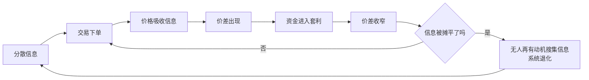

# 现金流有效场域：价格、信息与信任

## 是什么

**场域**在本主题中指交易与交换关系集中发生的制度空间，包含参与者、规则、价格信号与信任关系；**现金流有效场域**则指上述空间内现金流的规模、速度与信息反映程度达到**可自我维持**的状态（F-017）。

三个维度缺一不可：

| 维度 | 问的问题 | 对应机制 |
|---|---|---|
| **规模** | 场内现金流的量级是否足够支撑再投入 | 现金流序列（F-015）、闭环回流量（F-016） |
| **速度** | 从投入到回流的时间是否短于刚性支出的周期 | 回流速度与现金流的时间分布（F-015、F-016） |
| **信息反映程度** | 价格是否把场内的分散信息压了进来 | 价格发现与信息入价（F-053、F-054） |

> ⚠️ 这里的「有效」与有效市场假说（EMH）的「有效」在字面上重合，含义却需分开讲：EMH 说的是**价格反映信息的程度**（[EMH 三种形态](../../../../sheke/markets/efficient-markets/concepts/05-emh-three-forms.md)），本主题说的有效场域还额外要求**现金流能自我维持**。两者共用同一套机制语言（套利、竞争、信息成本），但检验对象不同——一个看价格，一个看现金流循环。

本页是本主题与 [efficient-markets](../../../../sheke/markets/efficient-markets/index.md) 知识包耦合的**总接口页**：05 讲场域如何被「价格—信息—信任」三件事撑起，[07](./07-efficiency-boundary-and-market-failure.md) 讲它在哪些地方失灵，[08](./08-dialogue-with-emh-amh.md) 讲它的「有效」为何不是二值开关。

## 机制

### 第一层：价格发现——把分散知识压进价格

价格有双重功能：**传递稀缺信息**与**提供行为激励**（哈耶克 1945，F-021）。价格发现指市场通过交易把分散信息聚合进价格的过程——价格是无数买卖决策合成的结果（F-053）。甲知道东边缺货、乙知道西边积压，双方各自下单，缺货的一侧价高、积压的一侧价低，价差本身就是一条**被写进价格里的信息**。

这条机制对生态圈的直接含义是：**没有真实交易，就没有价格发现**。只有曝光、点赞、讨论而没有成交的「场」，其信息反映程度是低的——因为它没有把「谁愿意为这个内容付出多少」这一最硬的信息编码进价格。

### 第二层：信息入价是渐进的，不是瞬时的

私有信息通过交易**逐步**被价格吸收：掌握私有信息的交易者通过下单把信息传递进市场，私有信息逐步转化为公共信息（F-054）。注意「逐步」二字——信息入价是一条**收敛过程**，而不是一步到位。这正是生态圈里「先发优势」有窗口期的机制解释：早一步把内容与渠道的信息变成成交数据，就先一步吃到信息尚未摊平的那段价差。

### 第三层：套利把偏离拉回，但拉回要有成本

套利指在同一或相关标的上同时买卖以锁定价差的交易，一价定律的偏离构成套利的对象（F-055）。无套利假设则说明：若不存在无风险套利机会，价格之间须满足特定关系；这一假设不需要关于投资者偏好的信息，只检验价格之间的**自洽性**（F-056）。

套利机制的推论是**竞争抹平超额收益**：可获利机会被更多资金进入后价差收窄，超额收益衰减；发现者获得的超额收益对应其承担的信息成本与风险（F-057）。所以渠道价差、信息差这类收益**自带衰减期**——它不是一个可以无限期占住的资产。

### 第四层：完全有效在逻辑上不可达

**格罗斯曼—斯蒂格利茨悖论（1980）**：若价格已反映全部信息，则无人有成本搜集信息的动机；若无人搜集信息，价格又无法反映这些信息；故完全信息有效的市场**不能存在**（F-058）。

因此均衡只能是**部分有效**：价格须足够有信息量以补偿信息采集者，又不能完全揭示信息，使信息生产具有回报；效率的表现形式是**有程度、有边界、因市场而异**（F-059）。

这张图最后一条回路说明：**必须给信息采集者留下可观的回报空间**，否则该环节会退化（F-058、F-059）。这与 [insights.md](../insights.md) 的洞察 4 一致——「可观的空间本身是系统维持活跃的条件之一」。

### 第五层：信任是价格之外的信号装置

价格不是场域里唯一的信息载体。**信息不对称**指交易一方掌握另一方不知道的关键信息；其后果之一是**逆向选择**——签约前按平均质量定价使优质供给退出（F-060，阿克洛夫 1970 的柠檬市场）。信任与声誉是两个概念：**信任**是交易一方对另一方行为的**主观预期**，**声誉**是关于该方过往行为的**公共记录**；声誉的积累依赖重复交易与可观察的历史（F-047）。

在生态圈里，信任承担了两件价格做不了的事：

1. **降低甄别成本**——当终端买方难以核验内容或服务质量时，具备信誉的一方以自身声誉作担保承担质量甄别功能（F-041 的中间层逻辑）；
2. **压缩回流周期**——信任存量高时，「先予后取」的让渡更容易被承接为复购与推荐（F-043、F-049）。

所以本页标题里的「价格、信息与信任」不是三个并列词，而是**一条接力链**：价格传递信息 → 信息摊平后价差收窄 → 信任接棒成为可持续的差异化来源。

### 第六层：场域的失灵边界

有效场域不是万能的，它的边界由两类经典失灵划出：

- **外部性（庇古 1920）**：经济活动对未直接参与交易的第三方产生的影响；负外部性对应过度生产，正外部性对应供给不足（F-061）；
- **公共品（萨缪尔森 1954）**：具有非排他性与非竞争性，对应搭便车问题与私人供给不足；文化通识内容的传播具有**近似公共品**的属性（F-062）。

这两条把「哪些环节该由场域自行运转、哪些环节需要别的制度安排」的问题摆上台面，详见 [07 效率边界与市场失灵](./07-efficiency-boundary-and-market-failure.md)。

## 与老子思想的映射

> **前置声明（防伪因果）**：以下映射是**价值取向的对齐**，不是「老子这样说过，所以商业上必然成功」的因果论证。文本只提供判断取向，不提供任何结果保证。文本用字一律以**帛书甲乙本**为准；凡帛书与传世本有异者**并列标注、不混称**。

### 一、不自居的效果观：帛书「上德不德」与「弗」字

帛书德经首段作「上德不德，是以有德」；帛书本（尤以乙本为甚）多用「弗」字对应传世本的「不」，并多在句末用「也」「者」「矣」等语气词（F-012）。帛书本「上德不德，是以有德」「上德无为而无以为也」表述的是**不自居、不妄为**的行为取向（F-082）。

映射到有效场域上，这一取向提醒的是：**场域的有效性来自机制本身，而非来自主持者对「有效」的自称**。声称自己「高效」并不提升效率；把价格信号、履约记录、回流速度做扎实，效率才可能真的显现。这与 F-053 的口径一致——价格是无数买卖决策**合成**的结果，不是谁宣示的。

### 二、水喻：帛书「有静」与传世本「不争」并读

第 8 章以水为喻：帛书甲本作「水善利万物而**有静**」，传世本作「水善利万物而**不争**」，帛书乙本此处**有残损**（F-011）。两读并列、不混称：

- 传世本「不争」偏重**不与人争夺**（竞争取向的抑制）；
- 帛书甲本「有静」偏重**利养万物而保持虚静**（内在状态）。

放到场域里，两读指向同一件事的两个侧面：**先利他地输出（善利万物），但不把价差、点位当作必须占住的争夺对象（不争/有静）**。这与 F-057「竞争抹平超额收益」在**取向**上对齐——既然价差必然被磨平，把身位押在「占住价差」上就与水的取向相悖；更稳的做法是把身位放在可观察的**信任记录**上（F-047）。

### 三、恒与常：帛书「恒」对应传世本「常」

郭店楚简本、帛书甲本与乙本、北大汉简本用「**恒**」，河上公本、王弼本作「**常**」；传世本「常」为避汉文帝刘恒讳改字（F-009）。帛书道经首段作「道，可道也，非**恒**道也。名，可名也，非**恒**名也」（F-012）。

用字差别带来取向差别：**「常」近于常规、经常，「恒」近于恒常、持久**。映射到现金流上，判据应当落在**可持续性与时间结构**（回流速度、闭环的现值判定，F-015、F-016），而不是落在「这一期数字是否好看」这种「常」的尺度上。这也是 [insights.md](../insights.md) 洞察 2 的出处：瓶颈在回流速度，不在流入规模。

### 四、德经在前：帛书篇序对判断顺序的提示

帛书甲、乙本篇序均为**《德经》在前、《道经》在后**（F-003），与通行本（道经在前 37 章、德经在后 44 章，F-006）相反。这一篇序不改变章句内容，却提示了一种**判断顺序**：先问「怎么落地、怎么持存」（德），再谈「为什么如此」（道）。

映射到本页：先回答「现金流能否自我维持」（规模、速度、闭环判据），再讨论「这个模式的道理是否成立」——**把可持续性检验放在叙事之前**。

### 五、无为与自然：帛书用字下的取向

帛书用「弗」而少用传世本的「不」（F-012），这一用字习惯本身带有**克制断定**的味道。第 57 章方向的「无为」「自然」，在本页不作因果断言，只作为**取向**使用：场的规则一旦清晰（定价、分成、准入），就让价格与信任这两套自发装置去运转，而非靠不断加码的细则去强行拉拽。

> 以上五条均为**价值取向对齐**，不构成对任何商业模式成败的预测或保证。

## 算例/数字指路

本页涉及的量化推演见本包算例 [生态圈闭环记分卡（教学算例）](../examples/04-ecosystem-loop-scorecard.md)。该算例把场域的规模、速度与信息反映程度拆成可打分项，用于**教学演示**，其中的转化率、复购率、留存率等数字均为**教学算例**，不代表任何真实平台的费率、行情或个体经营数据（F-084）。

读算例时建议带着本页的三个维度对照：

| 本页维度 | 在算例中对应的观测项 | 提醒 |
|---|---|---|
| 规模 | 回流量、再投入额 | 规模是分子，单看会误判 |
| 速度 | 投入日 → 首次回流日 → 回流完成日 | 速度是分母，瓶颈常在此 |
| 信息反映程度 | 成交价是否随供需变动 | 只曝光不成交，信息反映度为低 |

判据上可对照 F-059「部分有效」的口径：**不要问「这个场有没有效」（二元），要问「哪个环节最不透明、可改进空间最大」**。

## 常见误读

- **把「有效」当开关**：直觉问「这个模式成不成立」；机制上，有效是**有程度、有边界、因市场而异**的状态（F-058、F-059）。可分析的问题不是「是否有效」，而是「在什么阶段、什么尺度、什么环节上更接近有效」（配合 [08](./08-dialogue-with-emh-amh.md)）。
- **把「有效」当「价格正确」**：EMH 说的「有效」是**信息反映效率**，不等于价格等于真实价值；泡沫可以在信息已充分反映的情况下形成（见 [EMH 三种形态](../../../../sheke/markets/efficient-markets/concepts/05-emh-three-forms.md)）。同理，场域「有效」不等于「这门生意一定赚钱」。
- **把场域当成流量池**：流量只是**注意力维度的输入**；若没有价格发现（F-053）与信任沉淀（F-047），流量只会带来一次性接触，无法转化为可自我维持的现金流。
- **把信任当软性修辞**：信任是**主观预期**，声誉是**可观察的公共记录**（F-047）；后者可被审计、可被追踪，前者不可。做规划时应优先建设可观察的那一半。
- **把价差当长期资产**：信息差与点位差会被竞争抹平（F-055、F-057）；若渠道收益只来自信息差，须为其标注衰减预期。
- **用「老子说过」充当保证**：这是伪因果。文本提供**价值取向**，机制提供**约束条件**，两者都不提供收益承诺。
- **把「完全有效」当追求目标**：完全信息有效在逻辑上不可达（F-058）；把「让价格反映一切」当目标，方向本身就错了。

## 小结

- **现金流有效场域** = 场域内现金流的**规模、速度、信息反映程度**达到可自我维持（F-017）；
- 价格发现的机制是**把分散信息压进价格**（哈耶克 1945，F-053），且信息入价是**渐进**的（F-054）；
- 套利与竞争会**抹平**价差与超额收益（F-055、F-057），因此**完全有效在逻辑上不可达**，均衡只能是**部分有效**（F-058、F-059）；
- **信任**是价格之外的第二套装置，与声誉分工：主观预期 vs 公共记录（F-047）；
- 场域的失灵边界由**外部性**与**公共品**划出（F-061、F-062），详见 [07](./07-efficiency-boundary-and-market-failure.md)；
- 帛书取向（「上德不德」F-082、「有静」F-011、「恒」F-009、德经在前 F-003）对齐的是**不自居、重时存、先落地后论道**，是价值取向而非因果保证。

## 事实卡

| F 编号 | 一句话内容 |
|---|---|
| F-017 | 场域 = 参与者、规则、价格信号与信任关系构成的制度空间；有效场域指现金流规模、速度与信息反映程度达到可自我维持 |
| F-015 | 现金流序列由其规模与时间分布共同决定 |
| F-016 | 现金流闭环指流入回流至再投入环节；观察指标为回流量与回流速度 |
| F-041 | 具备信誉的中间层以声誉作担保承担质量甄别功能 |
| F-047 | 信任是主观预期，声誉是公共记录；声誉依赖重复交易与可观察历史 |
| F-053 | 价格发现：价格是无数买卖决策合成的结果（哈耶克 1945） |
| F-054 | 私有信息通过交易逐步被价格吸收，渐次转化为公共信息 |
| F-055 | 套利指同时买卖以锁定价差；一价定律的偏离构成其对象 |
| F-056 | 无套利假设只检验价格之间的自洽性，不需偏好信息 |
| F-057 | 竞争抹平超额收益，发现者的超额收益对应其信息成本与风险 |
| F-058 | 格罗斯曼—斯蒂格利茨悖论：完全信息有效的市场不能存在 |
| F-059 | 均衡只能是部分有效：效率有程度、有边界、因市场而异 |
| F-060 | 信息不对称的后果之一是签约前的逆向选择 |
| F-061 | 外部性：对未参与交易第三方的影响；负外部性对应过度生产 |
| F-062 | 公共品具非排他性与非竞争性，对应搭便车与私人供给不足 |
| F-009 | 「恒/常」避讳异文：帛书各本用「恒」，传世本作「常」 |
| F-011 | 「水善利万物而不争」（传世）↔ 「水善利万物而有静」（帛书甲本，乙本残损） |
| F-012 | 帛书德经首段「上德不德，是以有德」；多用「弗」对应传世「不」 |
| F-082 | 价值基线：帛书本表述不自居、不妄为的行为取向 |
| F-006 | 通行本篇序为道经在前、德经在后，共 81 章 |
| F-003 | 帛书甲乙本篇序均为德经在前、道经在后 |
| F-084 | 教学算例声明：包内数字均为说明机制的教学算例 |

## 相关概念

- [06 多形态商业圈与现金流闭环](./06-multi-form-business-circle-and-loop.md) — 三条现金流如何在场域内成环。
- [07 效率边界与市场失灵](./07-efficiency-boundary-and-market-failure.md) — 场域的失灵清单。
- [08 与 EMH/AMH 对话](./08-dialogue-with-emh-amh.md) — 「有效」为何不是二值。
- [09 治理与合规边界](./09-governance-and-compliance.md) — 该由谁管、管到哪一步。
- 市场机制侧：[价格发现与信息](../../../../sheke/markets/efficient-markets/concepts/02-price-discovery-and-information.md)、[套利与均衡](../../../../sheke/markets/efficient-markets/concepts/03-arbitrage-and-equilibrium.md)、[市场失灵](../../../../sheke/markets/efficient-markets/concepts/04-market-failure.md)。
- 文本侧：[帛书阅读](../../boshu-reading/index.md)、[老子谱系](../../laozi-lineage/index.md)。
- 事实与洞察：[facts.md](../facts.md)、[insights.md](../insights.md)。
