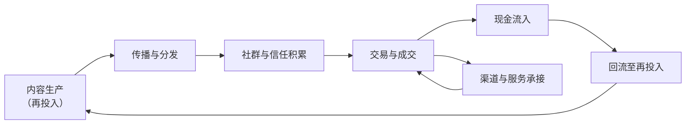

# 多形态商业圈与现金流闭环

## 是什么

本主题所称「文化生态圈」，沿用罗闻全（2004）以生态系统类比市场的那套语言：参与者的策略在竞争中被模仿或淘汰，环境变化又产生新机会，二者共同演化——即**适应性市场假说**（F-013）。落到本主题，它指以同一文化主题为核心、由内容生产、传播、社群、交易、服务等参与者围绕共同资源与规则相互作用并共同演化的系统。

在这个系统里有两个要点：

- **多形态商业圈**：生态圈内部会分化出多种形态的经营单元——内容生产、分销、服务、社群运营、线下空间等。这不是设计者硬拆出来的，而是**分工受市场范围限制**（斯密 1776）的自然结果：市场越大、交换越便利，专业化分工越深（F-020）。
- **现金流闭环**：系统内产生的现金流入能够**回流至再投入环节**（内容生产、渠道维护、用户服务），形成「投入—产出—再投入」的循环；闭环的观察指标为**回流量**与**回流速度**（F-016）。

一句话：**多形态是分工的产物，闭环是分工能否延续的检验**。

## 机制

### 一、生态圈的五个要素

生态圈的要素可归纳为五类（F-014）：

| 要素 | 内容 | 在本主题的实例 |
|---|---|---|
| **参与者** | 生产者、传播者、消费者、服务者 | 讲者、剪辑者、听众、答疑者 |
| **资源** | 内容、注意力、信任、渠道 | 通识内容、用户时长、声誉记录、分销关系 |
| **规则** | 定价、分成、准入、合规 | 章节定价、渠道抽成、内容准入、合规边界 |
| **交换关系** | 流量、商品、服务、现金的流向 | 曝光 → 留资 → 成交 → 复购 |
| **演化过程** | 规模与效率随时间变化 | 冷启动、成长期、稳态、衰退 |

把五要素画出来，就能看清：**现金流不是系统的全部，而是系统代谢的血液**——它从交换关系里流出，又必须回到资源再生产里去。

### 二、现金流与闭环

**现金流**指一定期间内现金与现金等价物的流入与流出；在经营语境中，收入与支出按时间排列形成**现金流序列**，其**规模与时间分布共同决定**资金周转状况（F-015）。

由此得出闭环的第一个要点：**闭环不是「有收入」，而是「收入能回到产出」**（F-016）。很多看起来红火的场域，收入是流向了场外而非回流至内容再生产——那不是闭环，是**单向抽取**。

闭环的第二个要点是**速度**：在再投入为刚性的结构里，回流周期长于支出周期时，流入规模越大，资金缺口越大。规模是分子，速度是分母（F-015、F-016）。

### 三、三条现金流骨架

本主题以三条现金流为骨架（F-018）：

| 现金流 | 变现对象 | 对应市场机制 |
|---|---|---|
| **流量变现** | 注意力 → 现金 | 注意力与信息市场（F-019） |
| **渠道变现** | 渠道与点位（场地、代理、分销关系）→ 现金 | 分销与中间层结构 |
| **利他现金流** | 先行让利 → 持续现金回流 | 信号与信任机制（F-043 起） |

三条现金流共用同一套底层机制，但**时间结构不同**：流量变现最快但最易被摊平；渠道变现依赖点位与关系，容易被复制；利他现金流最慢，却是唯一**自我加厚**的一条——因为它在过程中积累声誉（F-047）。

### 四、注意力的稀缺约束

注意力在信息供给远大于需求的环境下具有**稀缺属性**；注意力的总量受**人均可用时间**约束，其分配由供给方的可见性与需求方的选择共同决定（F-019）。内容供给的增长不改变人均可用时间总量，故注意力分配呈**竞争状态**（F-024，口径与上一节一致）。

这条约束意味着：**流量变现的天花板不由内容供给决定，而由用户时间决定**。把所有增长押在「做更多内容」上，会撞上时间这面墙。

### 五、价格的双重功能与市场的定义

价格具有双重功能：**传递稀缺信息**与**提供行为激励**（哈耶克 1945，F-021）。在文化生态圈中，定价既是收益分配的载体，也是参与者决策的信号。

市场是买者与卖者相互作用、交换商品与服务的**制度化安排**，可表现为集市、交易所或线上撮合系统（瓦尔拉斯 1874；马歇尔 1890，F-022）。所以「多形态商业圈」的每一形态，本质上都是一个**小型市场**——有供需、有价格、有规则，也就都有可能出现 [07](./07-efficiency-boundary-and-market-failure.md) 讲的失灵。

### 六、利他现金流：先予后取的时间结构

**利他现金流**指供给方先行让渡部分价值（免费内容、试用、补贴、无偿服务）以换取后续现金回流的机制；其时间结构为「**先予后取**」（F-043）。它之所以能成立，靠的是三条机制：

1. **信号传递（斯彭斯 1973）**：信息优势方以高成本、难伪造的行动自证质量；免费或低价提供高质量内容可作为一种能力与诚意的信号（F-044）；
2. **差异成本条件**：信号有效的前提是**信号成本对低质量方高于对高质量方**，否则信号可被模仿而失去区分力（F-045）；
3. **重复关系中的合作条件**：当交易关系持续且双方可观察对方行为时，短期让利可以在后续交易中回收；关系终止的可能性越低，合作越容易维持（F-049）。

与之相对的风险是**逆向选择（阿克洛夫 1970）**：信息不对称条件下，买方按平均质量出价使优质供给退出、劣质供给留下（F-046）。声誉制度是对该问题最常见的回应——而**信任（主观预期）与声誉（公共记录）是两个概念**，声誉的积累依赖重复交易与可观察的历史（F-047）。

**消费者剩余让渡**是利他现金流的另一半：买方愿意支付的最高价格与实际支付价格之差即消费者剩余（马歇尔 1890）；供给方主动扩大买方的剩余，以换取重复交易与推荐（F-048）。

### 七、闭环的两个放大器：复利与飞轮

**复利**指收益按周期并入本金后继续产生收益的累积方式；在利润率固定且收益全部再投入的算例中，资金规模随时间呈指数增长（**教学算例，非收益承诺**，F-050）。

**飞轮效应**指系统中多个环节互为输入与输出、形成正反馈循环；市场本身被视为参与者行为与价格相互反馈的系统（罗闻全 2004 的反馈回路表述，F-051）。

### 八、可持续性判据

利他现金流的可持续性判据是：让渡成本可由后续现金回流覆盖，且**回流的现值不低于让渡成本的现值**（净现值为正）；该判据为**财务分析口径**，不构成任何收益承诺（F-052）。

> 这条判据是本页最重要的纪律：**闭环是否成立是一个可算的会计问题，不是一个信念问题**。

## 与老子思想的映射

> **前置声明（防伪因果）**：以下为**价值取向的对齐**，不是「老子这样说过，所以商业上必然成功」的因果论证。文本不提供结果保证。用字以**帛书甲乙本**为准，凡与传世本有异者**并列标注、不混称**。

### 一、先予后取：第 81 章方向与帛书用字

第 81 章关于「为人而己愈有」的方向（先予人、己反得益）与利他现金流的「先予后取」在**取向**上一致（F-043）。这一取向下，本页的净现值判据（F-052）不是对取向的否定，而是对取向的**约束**：让渡若不设边界，取向就会退化为无回报的支出。

用字上须并列标注：帛书本（尤以乙本为甚）多用「**弗**」字对应传世本的「**不**」（F-012）。读「先予后取」时，可用这一用字习惯提醒自己：**判断语气宜克制**——不予保留地断言「必然回流」，正是帛书用字所要避免的那种断定。

### 二、循环与返回：第 40 章方向与闭环

第 40 章关于「**反**」（返回、循环）的方向，与闭环的「投入—产出—再投入」（F-016）以及飞轮的正反馈（F-051）在**结构**上同构：系统的存续依赖**回到起点**。闭环断裂即「反」的中断——收入不再返回再生产，循环随之瓦解。

### 三、分配与再投入：第 77 章方向

第 77 章关于**损减有余、补足不足**的方向，映射到闭环上是**回流分配**问题：回流量不能全部用于拉新（有余者更余），须定额回流至质量维护与售后（不足者得补）。[insights.md](../insights.md) 的「利他现金流飞轮」把这一动作固化为第 4 步：**把回流的一半再投入信任台账**。

### 四、水喻：帛书「有静」与传世本「不争」并列

第 8 章：帛书甲本作「水善利万物而**有静**」，传世本作「水善利万物而**不争**」，帛书乙本此处**有残损**（F-011）。两读并列：传世本偏重**不与人争**，帛书甲本偏重**利养而虚静**。

映射到多形态商业圈：**先利他地输出（善利万物），但不以占住点位与价差为要（不争/有静）**。这与 F-057「竞争抹平超额收益」在取向上呼应——既然价差会被磨平，把身位押在可观察的声誉记录上，比押在点位上更贴合水喻。

### 五、不自居：帛书「上德不德」

帛书德经首段作「上德不德，是以有德」；帛书本「上德无为而无以为也」表述的是**不自居、不妄为**的行为取向（F-012、F-082）。映射到闭环规划上：闭环的成立来自**现金流自己的循环**，而非来自对外宣告「我们已形成闭环」。这与 F-016 的观察指标（回流量、回流速度）一致——**指标可测，宣告不可测**。

### 六、恒与常、德经在前

传世本作「**常**」处，帛书作「**恒**」（F-009）。「恒」近于恒常、持久，「常」近于常规、经常——判据应落在**可持续性**（现值、速度）而非单期数字。

帛书甲、乙本篇序均为**德经在前、道经在后**（F-003），通行本相反（F-006）。这一篇序提示的判断顺序是：先检验**能否持存**（现金流闭环是否成立），再讨论**道理是否完满**。

> 以上均为**价值取向对齐**，不构成任何经营建议、收益承诺或投资建议。

## 算例/数字指路

本页的闭环推演见本包算例 [生态圈闭环记分卡（教学算例）](../examples/04-ecosystem-loop-scorecard.md)。该算例把多形态商业圈的产出与再投入按周期汇总，给出「回流量 / 回流速度 / 净现值」三个观测项。

算例中出现的复利推演（对应 F-050）、飞轮增速（对应 F-051）、让渡与回流的现值比较（对应 F-052）均为**教学算例**：其中的转化率、复购率、增长率等数字只是**说明机制**的假设值，不代表任何真实平台费率、行情数据或个体经营数据（F-084）。

读算例的纪律：**先看周期，再看规模**（F-015、F-016）；**先看现值判据是否成立，再看增速是否好看**（F-052）。

## 常见误读

- **把三条现金流当三笔并列收入**：机制上，**利他是地基而非并列项**——没有可观察的声誉记录，流量只带来一次性接触，渠道只把你当作可替换的供货位（F-046、F-047，见 [insights.md](../insights.md) 洞察 1）。
- **把「有收入」当「成闭环」**：闭环要求收入**回流至再投入**（F-016）；收入流向场外的，是抽取而非闭环。
- **用规模掩盖周期**：回流周期未缩短就不断加大再投入，时间错配被流水总额掩盖，缺口在刚性支出月暴露（F-015、F-052）。
- **把让渡做成一次性促销**：免费动作缺少可追溯的质量记录与后续承接，用户只记得「便宜」，不形成信任存量（F-045、F-047）。
- **把复利当收益承诺**：复利口径以「利润率固定且收益全部再投入」为前提（F-050），是教学算例，不是承诺。
- **把飞轮当永动机**：飞轮依赖各环节互为输入输出（F-051）；任一环节断裂，正反馈即转为负反馈。
- **用「老子说过」当保证**：伪因果。取向不保证结果。
- **忽略注意力的时间约束**：注意力总量受人均可用时间约束（F-019、F-024），内容的无限增长撞的是用户时间这面墙。

## 小结

- **多形态商业圈** = 生态圈内部分工深化的结果，其边界由「分工受市场范围限制」决定（F-020）；
- **现金流闭环** = 流入回流至再投入，观察指标为**回流量与回流速度**（F-016）；规模是分子、速度是分母（F-015）；
- **三条现金流骨架**：流量变现（注意力）、渠道变现（渠道与点位）、利他现金流（先予后取）（F-018）；
- 利他现金流靠**信号（F-044、F-045）＋重复关系（F-049）＋声誉（F-047）**成立，并须通过**净现值为正**的判据（F-052）；
- 两个放大器是**复利（F-050）**与**飞轮（F-051）**，二者均为教学算例口径；
- 帛书取向（「弗」F-012、第 40 章「反」、第 77 章分配、「有静」F-011、「恒」F-009、德经在前 F-003）对齐的是**先予后取、循环返回、留有余地、先持存后论道**——价值取向而非因果保证。

## 事实卡

| F 编号 | 一句话内容 |
|---|---|
| F-013 | 罗闻全 2004 以生态系统类比市场；文化生态圈沿用这一生态类比 |
| F-014 | 生态圈五要素：参与者、资源、规则、交换关系、演化过程 |
| F-015 | 现金流序列由其规模与时间分布共同决定 |
| F-016 | 现金流闭环指流入回流至再投入；观察指标为回流量与回流速度 |
| F-018 | 三条现金流骨架：流量变现、渠道变现、利他现金流 |
| F-019 | 注意力在信息过剩下具稀缺属性，总量受人均可用时间约束 |
| F-020 | 分工受市场范围限制（斯密 1776） |
| F-021 | 价格的双重功能：传递稀缺信息与提供行为激励（哈耶克 1945） |
| F-022 | 市场是买者与卖者相互作用的制度化安排（瓦尔拉斯 1874；马歇尔 1890） |
| F-024 | 内容供给增长不改变人均可用时间总量，注意力分配呈竞争状态 |
| F-043 | 利他现金流的时间结构为「先予后取」 |
| F-044 | 信号传递：以高成本、难伪造的行动自证质量（斯彭斯 1973） |
| F-045 | 信号的有效性条件：差异成本，否则信号可被模仿 |
| F-046 | 逆向选择（阿克洛夫 1970）：劣质供给把优质供给挤出（柠檬市场） |
| F-047 | 信任是主观预期，声誉是公共记录；声誉依赖重复交易与可观察历史 |
| F-048 | 消费者剩余（马歇尔 1890）；用户剩余让渡换取重复交易与推荐 |
| F-049 | 重复关系中的合作条件：关系越持续、越可观察，短期让利越易回收 |
| F-050 | 复利口径：收益按周期并入本金再投入（教学算例，非收益承诺） |
| F-051 | 飞轮效应：多环节互为输入输出，形成正反馈循环（罗闻全 2004） |
| F-052 | 利他现金流可持续性判据：回流现值不低于让渡成本现值（净现值为正） |
| F-009 | 「恒/常」避讳异文：帛书各本用「恒」，传世本作「常」 |
| F-011 | 「水善利万物而不争」（传世）↔ 「水善利万物而有静」（帛书甲本，乙本残损） |
| F-012 | 帛书德经首段「上德不德，是以有德」；多用「弗」对应传世「不」 |
| F-082 | 价值基线：帛书本表述不自居、不妄为的行为取向 |
| F-003 | 帛书甲乙本篇序均为德经在前、道经在后 |
| F-006 | 通行本篇序为道经在前、德经在后，共 81 章 |
| F-084 | 教学算例声明：包内数字均为说明机制的教学算例 |

## 相关概念

- [05 现金流有效场域：价格、信息与信任](./05-cash-flow-effective-field.md) — 闭环所在的制度空间。
- [07 效率边界与市场失灵](./07-efficiency-boundary-and-market-failure.md) — 多形态商业圈各自的失灵清单。
- [08 与 EMH/AMH 对话](./08-dialogue-with-emh-amh.md) — 生态类比的来源与「效率是状态」。
- [09 治理与合规边界](./09-governance-and-compliance.md) — 规则与准入的边界。
- 市场机制侧：[市场失灵](../../../../sheke/markets/efficient-markets/concepts/04-market-failure.md)、[行为金融与适应性市场](../../../../sheke/markets/efficient-markets/concepts/08-behavioral-finance-and-amh.md)。
- 文本侧：[帛书阅读](../../boshu-reading/index.md)、[老子谱系](../../laozi-lineage/index.md)。
- 事实与洞察：[facts.md](../facts.md)、[insights.md](../insights.md)。
