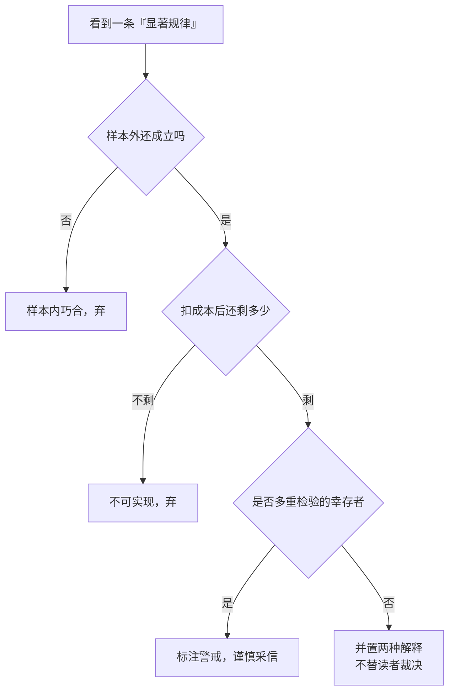

# 效率边界与市场失灵：生态圈的失灵清单

## 是什么

[05](./05-cash-flow-effective-field.md) 讲了场域如何被价格、信息与信任撑起；本页讲它**在哪里卡壳**，以及「卡壳」到什么程度才值得动手。

**效率边界**的结论有两条（来自 [efficient-markets](../../../../sheke/markets/efficient-markets/concepts/04-market-failure.md) 与 [套利与均衡](../../../../sheke/markets/efficient-markets/concepts/03-arbitrage-and-equilibrium.md)）：

1. **完全信息有效在逻辑上不可达**（F-058，格罗斯曼—斯蒂格利茨悖论）；
2. **均衡只能是部分有效**：价格须足够有信息量以补偿信息采集者，又不能完全揭示信息，使信息生产具有回报；效率是**有程度、有边界、因市场而异**的（F-059）。

**市场失灵**则指在满足特定条件时，市场自发配置资源**无法达到帕累托最优**的情形——它不是「市场总是坏的」，而是说：**价格机制这台机器，在若干特定情境下会卡壳**。本页把这台机器的卡壳点逐条搬到文化生态圈里。

> 读前提醒：**「失灵」是边界条件下的例外，不是常态**。多数场景里价格与竞争仍是最有效的协调工具（F-057）；把失灵当成「市场无用」的证据，是本章最常见的误读。

## 机制

### 一、先把边界画出来：信息入价与套利的三段论

生态圈的效率，首先由这三条机制界定：

- **价格发现**：价格是无数买卖决策合成的结果，把分散知识压进价格（哈耶克 1945，F-053）；
- **信息入价是渐进的**：私有信息通过交易**逐步**被价格吸收，逐步转化为公共信息（F-054）；
- **套利与竞争抹平偏离**：套利以价差为对象（F-055），无套利假设只检验价格之间的自洽性（F-056），竞争则使超额收益衰减（F-057）。

三段论合起来说清一件事：**任何可被识别的价差，都有被抹平的倾向**。生态圈里「发现一个好渠道就可以长期依靠」的直觉，在这一段就已被否证。

### 二、失灵清单之一：信息不对称与逆向选择

**信息不对称**指交易一方掌握另一方不知道的关键信息；其后果之一是在签约前按平均质量定价、使优质供给退出（F-060，阿克洛夫 1970 的柠檬市场）。

生态圈的对应表现：

| 失灵环节 | 表现 | 诊断问句 |
|---|---|---|
| **内容质量不可核验** | 标题党、夸大宣传挤走认真做内容的供给者 | 用户能否在购买前核验质量？若能核验的成本有多高？ |
| **渠道抽成不透明** | 供给方无法判断抽成基数与口径 | 分成以成交额还是毛利为基数、是否可查？ |
| **服务承诺不可观察** | 售后与履约记录不在公共视野内 | 是否有可追溯的履约留痕（F-047）？ |

诊断口径：**先问「可信的公共记录是否存在」**。若不存在，逆向选择就会持续发生——这不是道德问题，而是**信息结构问题**。

### 三、失灵清单之二：外部性

**外部性（庇古 1920）**：经济活动对未直接参与交易的第三方产生的影响；**负外部性对应过度生产，正外部性对应供给不足**（F-061）。

生态圈的对应表现：

- **负外部性**：误导性内容对外部读者造成的误导、对公共讨论质量的稀释、对个人信息的过度采集；这类影响不在交易双方的账上，因此会被**过度生产**；
- **正外部性**：优质通识内容的传播提升了外部读者的认知水平，收益由未付费者获得，因此会被**供给不足**。

诊断口径：**问「这笔交易的收益与成本，有没有落在第三方身上」**。落在第三方身上的成本，需要制度回应（见 [09](./09-governance-and-compliance.md)）；落在第三方身上的收益，需要补贴或公共融资补足。

### 四、失灵清单之三：公共品与搭便车

**公共品（萨缪尔森 1954）**具有**非排他性**与**非竞争性**，对应**搭便车**问题与私人供给不足；**文化通识内容的传播具有近似公共品的属性**（F-062）。

这是文化生态圈最需要澄清的一条：通识内容的**社会价值**高于其**私人可变现价值**。这意味着——

- 用纯商业口径要求通识内容自我造血，会系统性地**供给不足**；
- 而一旦转为纯公益供给，又可能失去可持续的现金流闭环（F-016）。

出路不是二选一，而是**分层**：可变现层（课程、咨询、活动）与公共层（基础通识内容的传播）用不同的资金来源与考核口径，见 [09](./09-governance-and-compliance.md) 的公共品供给安排。

### 五、效率边界里的「异象」：不是漏洞，是争议

生态圈的效率不是二值，市场层面的证据同样是**正反并置**的。两条最常被引用的异象：

**（1）规模与价值异象**：法玛与弗伦奇 1993 年发现小市值股票与高账面市值比（价值股）长期取得超额收益，构成三因子模型（市场、规模、价值）的基础；对该收益的解释存在**风险补偿**与**定价错误**两种（F-070）。

- **EMH 一方（法玛）**：这是风险补偿——小盘股与价值股风险更高，高收益是应得的对价，市场依然有效；
- **挑战一方**：这是定价错误——投资者系统性高估成长股、低估价值股。

**（2）动量异象**：杰加迪什与蒂特曼 1993 年发现过去 3–12 个月表现好的标的在随后数月倾向继续跑赢，是**最难用风险补偿解释**的异象之一；哈维、刘、朱 2016 年提出**数据挖掘与多重检验警戒**，主张新因子的 t 值门槛应远高于 2（F-071）。

**必须并列两侧**：同一组数据，两种解释，谁都难以彻底说服对方——这正是 [联合假设问题](../../../../sheke/markets/efficient-markets/concepts/05-emh-three-forms.md)（EMH 必须与某个定价模型绑定检验）的鲜活演示。**本页不替读者裁决**：2013 年诺贝尔经济学奖同时颁给观点对立的法玛与席勒（F-070），本身就说明「非黑即白」在此不成立。

这张安检流程图对应 F-071 的警戒口径：**看到「某因子年化跑赢 X%」的宣称时，先过这三道门**。

### 六、一条反直觉的推论：效率必须留有余地

由 F-058 直接推出：**若某一环节的信息被完全摊平，参与者将失去投入动力，该环节反而退化**。可观的超额空间本身是系统维持活跃的条件之一（F-058、F-059）。这解释了一个常见困惑：为什么某些「不透明」的环节反而比「透明到底」的环节更有生命力——**低效率未必需要被立刻消除**。

## 与老子思想的映射

> **前置声明（防伪因果）**：以下为**价值取向的对齐**，不是「老子这样说过，所以商业上必然成功」的因果论证。用字以**帛书甲乙本**为准，凡与传世本有异者**并列标注、不混称**。

### 一、损减有余、补足不足：第 77 章方向与失灵校正

第 77 章关于**损减有余、补足不足**的方向，与失灵校正在**取向**上一致：负外部性（有余的成本落在第三方）需要被**收**，正外部性与公共品（不足的供给）需要被**补**（F-061、F-062）。这一取向在 [09](./09-governance-and-compliance.md) 具体化为「对负外部性设硬约束、对正外部性用补贴或公共融资补足」。

### 二、克制断定：帛书「弗」字与「异象不等于定律」

帛书本（尤以乙本为甚）多用「**弗**」字对应传世本的「**不**」，并多在句末用「也」「者」「矣」等语气词（F-012）。这一用字习惯带有**克制断定**的味道。

映射到本页最要紧的纪律上：**看到异象不等于看到定律**。F-070、F-071 两条异象都**存在对立解释与数据挖掘警戒**，若把「某个统计显著」直接断言为「市场无效」，正是帛书用字所要避免的那种**绝对断定**。科学的表述方式与「弗」字的克制，在这一点上恰好同向。

### 三、不自居、不妄作：帛书「上德不德」

帛书德经首段作「上德不德，是以有德」；帛书本「上德无为而无以为也」表述的是**不自居、不妄为**的行为取向（F-012、F-082）。映射到失灵治理上：**先判断失灵类型与严重程度，再比较干预成本与干预自身的失灵风险**（见 [09](./09-governance-and-compliance.md)）；不妄作，是指不因为「有失灵」就立刻加码管制。

### 四、水喻：帛书「有静」与传世本「不争」并列

第 8 章：帛书甲本作「水善利万物而**有静**」，传世本作「水善利万物而**不争**」，帛书乙本此处**有残损**（F-011）。两读并列：传世本偏重不与人争，帛书甲本偏重利养而虚静。

映射到失灵问题上：**失灵处正是「争」最密集之处**（价差被争、点位被争、用户时间被争）。两读合起来提供的取向是——**先把价值输出做扎实（善利万物），再把资源投向能沉淀声誉的环节，而非一味争夺可被磨平的价差**（F-057、F-047）。

### 五、恒与常：帛书「恒」与边界的动态性

传世本作「**常**」处，帛书作「**恒**」（F-009）。「恒」近于恒常、持久——效率边界**随时间与参与者变化**（F-059，以及 [AMH](../../../../sheke/markets/efficient-markets/concepts/08-behavioral-finance-and-amh.md) 的动态观），不是一张固定的清单。用帛书用字读这层意思，恰好提醒：**边界是恒动之物，分期复核比一次判定更贴近实情**。

### 六、德经在前：先落地、后论道

帛书甲、乙本篇序均为**德经在前、道经在后**（F-003），通行本相反（F-006）。映射到失灵清单的用法上：先**逐条诊断能不能落地持存**（哪一环失灵、严重到什么程度），再讨论**理论上的效率叙事**。

> 以上均为**价值取向对齐**，不构成经营建议、投资建议或政策建议。

## 算例/数字指路

本页的失灵诊断口径见本包算例 [生态圈闭环记分卡（教学算例）](../examples/04-ecosystem-loop-scorecard.md)。该算例把三条失灵线索转成可打分的观测项：

| 失灵线索 | 算例中的观测项 | 对应 F |
|---|---|---|
| 信息不对称 | 质量是否可核验、履约记录是否可查 | F-060、F-047 |
| 外部性 | 负外部性行为是否被记录、正外部性供给是否被补足 | F-061 |
| 公共品 | 通识内容的资金来源是否分层 | F-062 |

算例中的评分、比例、增速均为**教学算例**，不代表任何真实平台或个体的经营数据（F-084）。异象部分（F-070、F-071）在本包中**只作方法论示范**，用于说明「显著 ≠ 定律」，**不构成任何策略或标的提示**。

## 常见误读

- **把「市场失灵」当「市场无用」**：失灵是**边界条件**下的例外（F-061、F-062 各有前提），多数场景价格机制仍是最有效的协调工具（F-057）。
- **把异象当「有效市场被推翻」的证据**：异象也可能是**风险补偿**或**样本内巧合**；须看样本外、看成本、看多重检验（F-070、F-071）。
- **只引一侧、不引另一侧**：法玛与席勒 2013 年同年获诺贝尔经济学奖（F-070、F-074）；**任何只引用一方的读法都是选择性引用**。
- **把「发现无效」当「可以获利」**：错误定价可能先变得更错、套利者受资金与做空约束（见 [行为金融与有限套利](../../../../sheke/markets/efficient-markets/concepts/08-behavioral-finance-and-amh.md)）——**价格错了 ≠ 你能赚钱**。
- **追求「完全透明」「完全有效」**：完全信息有效在逻辑上不可达（F-058）；把透明推到底，反而会使该环节退化（F-059）。
- **把通识内容当纯商业品考核**：其社会价值高于私人可变现价值，纯商业口径会系统性地供给不足（F-062）。
- **用「老子说过」为管制背书**：伪因果。取向不等于政策结论；干预须比较市场失灵成本与干预成本（见 [09](./09-governance-and-compliance.md)）。
- **把失灵清单当固定清单**：效率边界随时间与参与者演化（F-059）——**清单要分期复核**。

## 小结

- **效率边界两条**：完全信息有效不可达（F-058）；均衡只能是部分有效，效率有程度、有边界、因市场而异（F-059）；
- **信息入价是渐进的**（F-054），**竞争会抹平超额收益**（F-057）——这是生态圈失灵分析的底座；
- **失灵清单（生态圈版）**：信息不对称与逆向选择（F-060）、外部性（F-061）、公共品与搭便车（F-062）；
- **异象是争议而非漏洞**：规模/价值异象（F-070）与动量异象（F-071）**各有两种解释**，且受数据挖掘警戒约束；本页**正反并置、不替读者裁决**；
- **反直觉推论**：效率必须留有余地——完全摊平会使环节退化（F-058、F-059）；
- 帛书取向（第 77 章分配、「弗」F-012、「上德不德」F-082、「有静」F-011、「恒」F-009、德经在前 F-003）对齐的是**补不足、克制断定、不妄作、恒动复核、先落地后论道**——价值取向而非因果保证。

## 事实卡

| F 编号 | 一句话内容 |
|---|---|
| F-053 | 价格发现：价格是无数买卖决策合成的结果（哈耶克 1945） |
| F-054 | 私有信息通过交易逐步被价格吸收，渐次转化为公共信息 |
| F-055 | 套利指同时买卖以锁定价差；一价定律的偏离构成其对象 |
| F-056 | 无套利假设只检验价格之间的自洽性，不需偏好信息 |
| F-057 | 竞争抹平超额收益，发现者的超额收益对应其信息成本与风险 |
| F-058 | 格罗斯曼—斯蒂格利茨悖论：完全信息有效的市场不能存在 |
| F-059 | 均衡只能是部分有效：效率有程度、有边界、因市场而异 |
| F-060 | 信息不对称的后果之一是签约前的逆向选择 |
| F-061 | 外部性：对未参与交易第三方的影响；负外部性对应过度生产，正外部性对应供给不足 |
| F-062 | 公共品具非排他性与非竞争性，对应搭便车与私人供给不足；文化通识内容近似公共品 |
| F-070 | 规模与价值异象（法玛与弗伦奇 1993）；风险补偿与定价错误两种解释并存，法玛与席勒 2013 同年获诺奖 |
| F-071 | 动量异象（杰加迪什与蒂特曼 1993）；哈维、刘、朱 2016 提出数据挖掘与多重检验警戒 |
| F-009 | 「恒/常」避讳异文：帛书各本用「恒」，传世本作「常」 |
| F-011 | 「水善利万物而不争」（传世）↔ 「水善利万物而有静」（帛书甲本，乙本残损） |
| F-012 | 帛书德经首段「上德不德，是以有德」；多用「弗」对应传世「不」 |
| F-082 | 价值基线：帛书本表述不自居、不妄为的行为取向 |
| F-003 | 帛书甲乙本篇序均为德经在前、道经在后 |
| F-006 | 通行本篇序为道经在前、德经在后，共 81 章 |
| F-084 | 教学算例声明：包内数字均为说明机制的教学算例 |

## 相关概念

- [05 现金流有效场域：价格、信息与信任](./05-cash-flow-effective-field.md) — 失灵的场域底座。
- [06 多形态商业圈与现金流闭环](./06-multi-form-business-circle-and-loop.md) — 失灵对闭环的冲击。
- [08 与 EMH/AMH 对话](./08-dialogue-with-emh-amh.md) — 效率为何不是二值。
- [09 治理与合规边界](./09-governance-and-compliance.md) — 失灵之后的制度回应。
- 市场机制侧：[市场失灵](../../../../sheke/markets/efficient-markets/concepts/04-market-failure.md)、[证据之争](../../../../sheke/markets/efficient-markets/concepts/07-evidence-for-and-against.md)、[行为金融与适应性市场](../../../../sheke/markets/efficient-markets/concepts/08-behavioral-finance-and-amh.md)。
- 文本侧：[帛书阅读](../../boshu-reading/index.md)、[老子谱系](../../laozi-lineage/index.md)。
- 事实与洞察：[facts.md](../facts.md)、[insights.md](../insights.md)。
