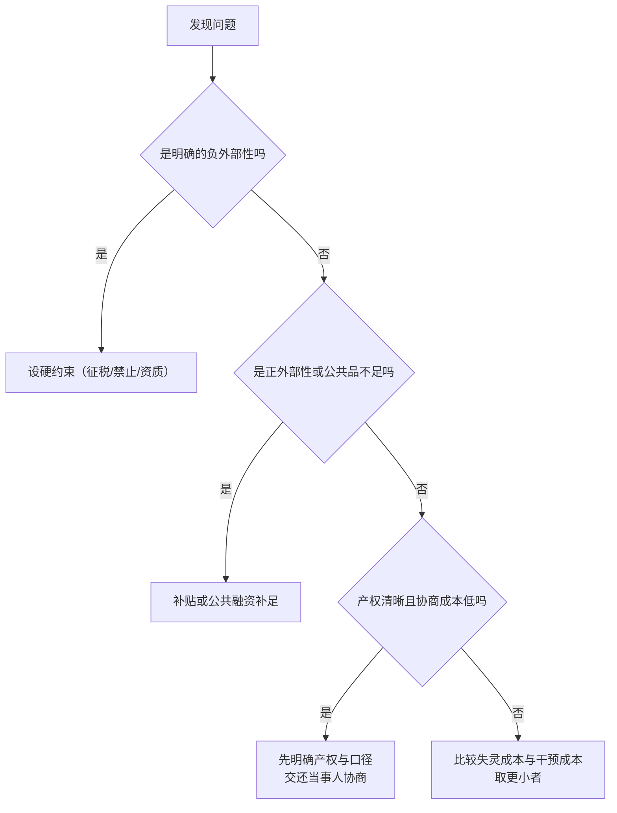

# 治理与合规边界：最小干预与守界

## 是什么

[07](./07-efficiency-boundary-and-market-failure.md) 列出了失灵清单；本页讲**失灵之后该做什么、做到哪一步为止**。

**治理**在这里指生态圈内部与外部为维持秩序而设的规则与执行机制；**合规边界**指业务模式须遵循的最低法律与监管要求。本页的核心命题是：**干预要有边界**——不是「管得越多越稳」，也不是「一概不管」。

判断顺序是三问（对应 [insights.md](../insights.md) 洞察 5）：

1. **该由谁管**——产权与规则可否先明确，让可协商的问题回到参与者之间？
2. **管到哪一步**——负外部性设硬约束，正外部性用补贴或公共融资补足，而非一律加码管制；
3. **值不值得管**——比较市场失灵成本与干预自身的失灵成本，取相对更小者（F-081）。

> ⚠️ 免责前提：本页是**通识教育材料**，不含具体产品、平台或项目的推荐，不构成投资建议、经营建议、法律意见或财税建议（F-083）。具体条文以监管部门最新发布为准（F-078）。

## 机制

### 一、制度的第一功能：降低信息不对称

**强制信息披露的制度功能是降低信息不对称**：使公开信息可信、可比、及时，降低全体参与者的信息成本（F-075）。它直接对应阿克洛夫 1970 的逆向选择问题——若不解决信息不对称，优质供给会被劣质供给挤出（F-060、F-046）。

生态圈的对应设计：

| 披露对象 | 最低要求（通识口径） | 对应 F |
|---|---|---|
| 定价 | 收费须明示，口径可核验 | F-078 |
| 分成 | 分成基数（成交额/毛利）与比例可查 | F-075 |
| 资质 | 业务模式须取得相应经营资质 | F-078 |
| 个人信息 | 处理须取得同意，遵循最小必要 | F-078 |

> 关键判断：**信息披露不是让生意变得「好看」，而是把不可核验的信息变成可核验的**。凡是写不出来的口径，通常也是经不起核验的口径。

### 二、制度的第二功能：维护信任与抑制极端逆向选择

**禁止内幕交易与反欺诈的制度功能**是维护市场信任与流动性，抑制信息优势的不当利用与逆向选择的极端形式（F-076）。柠檬市场的逻辑说明：若不惩罚欺诈，**好的供给会被坏的供给挤出市场**（F-046）。

生态圈的对应表现：

- **反欺诈**：针对不实宣传、虚假承诺、伪造履约记录；
- **反不当信息优势**：针对利用未公开的规则变动或内部渠道关系获取不当利益——这与[强式有效在现实中不成立](../../../../sheke/markets/efficient-markets/concepts/05-emh-three-forms.md)是同一件事的两面（F-060、F-064）。

### 三、制度的第三功能：消费者保护

**消费者保护的核心工具**包括知情权、选择权、公平交易权与救济渠道；广告与宣传内容的真实性受法律约束（F-077）。

生态圈里的落地要点：

- **知情权** ↔ 定价与分成明示（F-078）；
- **选择权** ↔ 不设强制捆绑、不做诱导性默认；
- **公平交易权** ↔ 条款对等、责任清晰；
- **救济渠道** ↔ 争议处理路径可查可达。

### 四、外部性的制度回应

**外部性的制度回应**有两条路径（F-079）：

- **庇古式（庇古 1920）**：对负外部性征税或收费、对正外部性补贴，使私人成本与社会成本重新对齐；
- **科斯式（科斯 1960）**：产权清晰且交易成本较低时，当事人可通过协商**内部化**外部性。

生态圈的应用：**负外部性（误导宣传、隐私侵害）设硬约束**；**正外部性（优质通识内容）用补贴或公共融资补足**。而**当事人少、协商成本低**的场景（如两个社群共用场地的时间冲突），优先交还给当事人协商，而不是先设细则。

### 五、公共品的供给安排

**公共品供给的制度安排**：具有非排他性与非竞争性的内容通常需要**税收或公益融资**供给（萨缪尔森 1954）；**文化通识教育具有公共品属性**（F-080）。

这正是 [07](./07-efficiency-boundary-and-market-failure.md) 讲的分层问题的制度解：通识内容的**社会价值高于其私人可变现价值**（F-062），因此——

- **公共层**（基础通识传播）：以公共融资或公益机制补足，考核其**覆盖与质量**；
- **可变现层**（课程、咨询、活动、空间）：按现金流闭环的判据运行（F-016、F-052），考核其**回流与可持续性**。

> 不分层的后果在两端都会显形：公共层按商业考核则供给不足，可变现层按公益考核则难以持存。

### 六、干预的判断标准：两把尺子

**干预的判断标准**是比较**市场失灵成本**与**政府失灵成本**，取相对更小者；干预的收益须大于其扭曲成本（F-081）。

「政府失灵」不是修辞，而是三条具体风险：

1. **信息问题**：监管者不比场内参与者更懂分散信息（哈耶克 1945 的知识分散，F-053）；
2. **激励问题**：规则执行者可能被俘获，或追求自身目标；
3. **知识问题**：即使动机纯正，也可能因不了解局部情况而「好心办坏事」（如过细的限价导致供给减少）。

对应到生态圈的治理动作，排序应当是：

### 七、价值基线与边界声明

**价值基线**：帛书本「上德不德，是以有德」「上德无为而无以为也」表述了**不自居、不妄为**的行为取向；本主题据此把利他现金流的价值基线设定为**先予后取、不强取**（F-082）。落到治理上，这层取向对应的是**最小干预**：能不干预时把规则做清晰，能不代劳时把选择交还给参与者。

**通识教育定位**：本知识包为文化主题与市场机制的通识教育材料，不含具体产品、平台或项目的推荐，不构成投资建议、经营建议、法律意见或财税建议（F-083）。

**教学算例声明**：本包中出现的收益率、转化率、CAC、LTV、分成比例等数字均为说明机制的教学算例，不代表任何真实平台费率、行情数据或个体经营数据（F-084）。

### 八、合规自查表（通识口径）

| 检查项 | 通识口径的问题 | 对应 F |
|---|---|---|
| 资质 | 业务模式是否需要相应经营资质？ | F-078 |
| 收费 | 定价与分成是否明示、口径是否可核验？ | F-075、F-078 |
| 宣传 | 宣传内容是否真实、可证？ | F-077 |
| 个人信息 | 是否取得同意、是否遵循最小必要？ | F-078 |
| 内幕/不当信息优势 | 是否利用未公开信息获取不当利益？ | F-076 |
| 消费者救济 | 争议处理路径是否可查可达？ | F-077 |
| 负外部性 | 是否产生落在第三方身上的成本？ | F-061、F-079 |
| 公共品供给 | 通识内容的资金来源是否分层？ | F-062、F-080 |

> 本表为**通识自查口径**，不是法律意见；任何具体业务与合规问题应以监管部门最新发布与专业意见为准（F-078、F-083）。

## 与老子思想的映射

> **前置声明（防伪因果）**：以下为**价值取向的对齐**，不是「老子这样说过，所以治理必然有效」的因果论证。用字以**帛书甲乙本**为准，凡与传世本有异者**并列标注、不混称**。

### 一、无为＝干预边界，而非不作为

帛书德经首段作「上德不德，是以有德」；帛书本「上德无为而无以为也」表述的是**不自居、不妄为**的行为取向（F-012、F-082）。

这里必须澄清一个流行误读：「无为」**不是不作为**，而是**先问该由谁管、管到哪一步为止**的判断顺序（见 [insights.md](../insights.md) 洞察 5）。帛书用「**弗**」字对应传世本的「**不**」（F-012），这一用字习惯本身就在提示**克制断定**——「不是不管」，与「一定不管」是两回事。

映射到治理上：**能不干预时把规则做清晰（产权、分成口径、争议处理），能不代劳时把选择交还给参与者**；只有面对明确的负外部性才设硬约束（F-079、F-081）。

### 二、不自居：治理者的位置

「上德不德」的取向是**不自居**（F-082）。映射到治理者身上：规则的权威来自**规则本身的清晰与可执行**，而不是来自治理者的自我声张。一个不断宣告自己「管得好」的治理结构，反而更可能滑向 F-081 所说的「政府失灵」。

### 三、损减有余、补足不足：第 77 章方向与补贴正外部性

第 77 章关于**损减有余、补足不足**的方向，与外部性的制度回应同构：**对负外部性征收或收费（损有余），对正外部性与公共品补贴或公共融资补足（补不足）**（F-079、F-080）。这一条也是本页「分层供给」的取向来源。

### 四、水喻：帛书「有静」与传世本「不争」并列

第 8 章：帛书甲本作「水善利万物而**有静**」，传世本作「水善利万物而**不争**」，帛书乙本此处**有残损**（F-011）。两读并列。

映射到治理：**传世读「不争」**提醒治理者不与参与者争夺利益身位；**帛书甲本读「有静」**提醒治理者的重心在**营造秩序、而非频繁动作**。两读合起来，恰是「最小干预」的取向表达。

### 五、恒与常：帛书「恒」与制度的持续复核

传世本作「**常**」处，帛书作「**恒**」（F-009）。「恒」近于恒常、持久。映射到治理上：**规则要有恒定性**（口径不朝令夕改），而**判断要按期复核**（失灵清单与干预力度随时间与参与者演化，F-059）。两者并不矛盾——**恒定的是原则，复核的是力度**。

### 六、德经在前：先落地、后论道

帛书甲、乙本篇序均为**德经在前、道经在后**（F-003），通行本相反（F-006）。映射到治理设计上：先做**可执行的合规与规则落地**（资质、明示、救济路径），再讨论**理论上的制度优劣**（哪套主义更好）。顺序颠倒会产生「理念正确、执行失败」的方案。

> 以上均为**价值取向对齐**，不构成法律意见、经营建议或政策建议。

## 算例/数字指路

本页的治理口径与 [生态圈闭环记分卡（教学算例）](../examples/04-ecosystem-loop-scorecard.md) 的合规与信任项对应。算例中的分成比例、合规评分、回流周期等均为**教学算例**，不代表任何真实平台费率或个体经营数据（F-084）。

算例中的两项与治理直接相关：

| 算例观测项 | 治理含义 | 对应 F |
|---|---|---|
| 分成口径是否可核验 | 披露制度的最低要求 | F-075、F-078 |
| 履约记录是否可追溯 | 声誉资产的可观察性 | F-047、F-076 |

读算例的纪律：**先看规则是否清晰（F-079），再看是否需要加码干预（F-081）**。

## 常见误读

- **把「无为」读成「不作为」**：帛书「无为」给治理划定的是**干预边界**，而非放弃治理（F-082，见 [insights.md](../insights.md) 洞察 5）。
- **认为「管得越多越稳、规则越细越安全」**：过度干预的扭曲成本可能**高于**其纠正的失灵成本（F-081）。
- **在没有明确产权与分成口径时先加细则**：把本可协商的问题变成合规负担，反而压制优质内容的私人供给（F-079、F-080、F-081）。
- **把通识内容当纯商业品考核**：其公共品属性决定了纯商业口径会系统性供给不足（F-062、F-080）。
- **把信息披露当公关**：披露的功能是**让信息可核验**（F-075），不是让形象更好看。
- **把消费者保护当负担**：知情权、选择权、公平交易权与救济渠道的缺位，最终会通过信任流失反噬现金流闭环（F-077、F-047）。
- **用「老子说过」为管制或放松管制背书**：伪因果。取向不替任何具体政策结论裁决；干预须过 F-081 的两把尺子。
- **忘记边界声明**：本页是通识材料，不构成任何专业意见；具体条文以监管部门最新发布为准（F-078、F-083）。

## 小结

- **制度的三项功能**：强制信息披露降低信息不对称（F-075）、禁止内幕交易与反欺诈维护信任（F-076）、消费者保护保障知情权与救济（F-077）；
- **合规边界的一般原则**：业务须有相应资质、收费须明示、个人信息处理须取得同意并遵循最小必要（F-078）；
- **外部性的制度回应**：庇古式征税/补贴（F-079）与科斯式协商/产权内部化（F-079）；
- **公共品的供给安排**：通识教育具公共品属性，须以税收或公益融资供给，并与可变现层**分层**（F-080、F-062）；
- **干预的判断标准**：比较市场失灵成本与政府失灵成本，取相对更小者（F-081）；
- **价值基线**：帛书「上德不德」（F-082）对齐**先予后取、不强取、不自居**；帛书「弗」（F-012）对齐**克制断定**；「恒」（F-009）对齐**原则恒定、力度复核**；德经在前（F-003）对齐**先落地后论道**——价值取向而非因果保证；
- **边界声明**：本包为通识教育材料，不推荐产品/平台/项目，不构成投资、经营、法律或财税建议；包内数字均为教学算例（F-083、F-084）。

## 事实卡

| F 编号 | 一句话内容 |
|---|---|
| F-075 | 强制信息披露的制度功能是降低信息不对称，使公开信息可信、可比、及时 |
| F-076 | 禁止内幕交易与反欺诈的制度功能：维护市场信任与流动性，抑制信息优势的不当利用 |
| F-077 | 消费者保护的核心工具：知情权、选择权、公平交易权与救济渠道 |
| F-078 | 合规边界一般原则：须有相应资质、收费须明示、个人信息处理须经同意且最小必要 |
| F-079 | 外部性的制度回应：庇古税/补贴；产权清晰且交易成本低时可协商内部化（科斯 1960） |
| F-080 | 公共品供给的制度安排：通常需税收或公益融资供给；文化通识教育具公共品属性 |
| F-081 | 干预的判断标准：比较市场失灵成本与政府失灵成本，取相对更小者 |
| F-082 | 价值基线：帛书本「上德不德」「上德无为而无以为也」表述不自居、不妄为；据此设定先予后取、不强取 |
| F-083 | 通识教育定位：不含具体产品/平台/项目推荐，不构成投资、经营、法律或财税建议 |
| F-084 | 教学算例声明：包内数字均为说明机制的教学算例 |
| F-061 | 外部性：对未参与交易第三方的影响；负外部性对应过度生产，正外部性对应供给不足 |
| F-062 | 公共品具非排他性与非竞争性，对应搭便车与私人供给不足；文化通识内容近似公共品 |
| F-060 | 信息不对称的后果之一是签约前的逆向选择 |
| F-046 | 逆向选择（阿克洛夫 1970）：劣质供给把优质供给挤出 |
| F-047 | 信任是主观预期，声誉是公共记录；声誉依赖重复交易与可观察历史 |
| F-053 | 价格发现：价格是无数买卖决策合成的结果（哈耶克 1945） |
| F-059 | 均衡只能是部分有效：效率有程度、有边界、因市场而异 |
| F-064 | EMH 三形态：弱式、半强式、强式（强式在现实中基本不成立） |
| F-009 | 「恒/常」避讳异文：帛书各本用「恒」，传世本作「常」 |
| F-011 | 「水善利万物而不争」（传世）↔ 「水善利万物而有静」（帛书甲本，乙本残损） |
| F-012 | 帛书德经首段「上德不德，是以有德」；多用「弗」对应传世「不」 |
| F-003 | 帛书甲乙本篇序均为德经在前、道经在后 |
| F-006 | 通行本篇序为道经在前、德经在后，共 81 章 |

## 相关概念

- [05 现金流有效场域：价格、信息与信任](./05-cash-flow-effective-field.md) — 治理所维护的场域秩序。
- [06 多形态商业圈与现金流闭环](./06-multi-form-business-circle-and-loop.md) — 规则与准入在闭环中的位置。
- [07 效率边界与市场失灵](./07-efficiency-boundary-and-market-failure.md) — 干预的失灵基础。
- [08 与 EMH/AMH 对话](./08-dialogue-with-emh-amh.md) — 效率的动态性与复核节奏。
- 市场机制侧：[市场失灵](../../../../sheke/markets/efficient-markets/concepts/04-market-failure.md)、[对我们的含义：投资、政策与治理](../../../../sheke/markets/efficient-markets/concepts/09-implications.md)。
- 文本侧：[帛书阅读](../../boshu-reading/index.md)、[老子谱系](../../laozi-lineage/index.md)。
- 事实与洞察：[facts.md](../facts.md)、[insights.md](../insights.md)。
