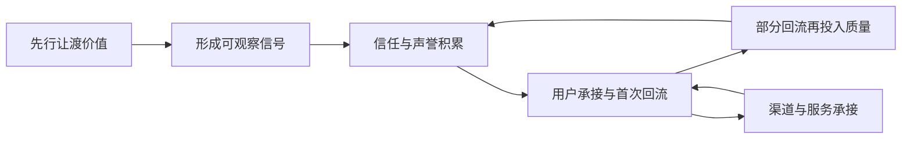

# 架构洞察（Architecture Insights）

> 基于 [事实清单](facts.md) 提炼。每条洞察按「**陈述 / 证据 / 反常识 / 行动**」四元组组织；事实以 F 编号溯源，洞察为**解释性判断**，不构成投资建议、经营建议或收益承诺。理论争议处并置两侧（F-011、F-070、F-071），不替读者站队。

## 洞察 1：三条现金流不是三笔并列收入，而是同一份「信任资产」的三次变现

| 四元组 | 内容 |
|--------|------|
| **陈述** | 流量变现、渠道变现、利他现金流看似三条独立路径，实则共用一份前置资本——**信任**。信任存量决定流量能否转化、渠道能否被接受、让利能否被记住；三条现金流是这份信任资产在不同环节的兑现方式，而非三本各自独立的账。 |
| **证据** | F-043（利他现金流的时间结构为「先予后取」）、F-044/F-045（信号传递与其差异成本条件）、F-046（信息不对称下的逆向选择与柠檬市场）、F-047（信任与声誉是两类不同概念）、F-060（信息不对称是交易失灵的核心）。 |
| **反常识** | 直觉把「做流量、找渠道、搞利他」当作三条平行的赚钱路，先挑最快的一条做；而机制上，**利他是地基而非并列项**——没有可观察的声誉记录，流量只能带来一次性接触，渠道只会把你当作可替换的供货位（F-046、F-047）。反过来，信任存量高时，同一份流量可以在渠道与复购上被反复兑现。 |
| **行动** | 规划生态圈时先画「信任台账」再画现金流表：①这份信任由哪些可观察的重复行为积累（内容质量、履约记录、售后响应）？②每条现金流分别消耗还是补充这份信任？③哪条现金流正在透支信任（如用夸大宣传换一次性转化）？ |

## 洞察 2：闭环的瓶颈在「回流速度」，不在「流入规模」

| 四元组 | 内容 |
|--------|------|
| **陈述** | 现金流闭环能否维持，取决于回流量**与回流速度**两个变量；在再投入为刚性的结构里，回流周期长于支出周期时，流入规模越大，资金缺口越大。规模是分子，速度是分母，两者必须同时看。 |
| **证据** | F-015（现金流序列由其规模与时间分布共同决定）、F-016（闭环的观察指标为回流量与回流速度）、F-052（可持续性判据为回流现值不低于让渡成本现值）、F-050（复利依赖收益按周期再投入）、F-051（飞轮的正反馈依赖各环节互为输入输出）。 |
| **反常识** | 直觉盯着「流量峰值」与「月流水」，把规模当作健康度；而闭环的可持续性由**时间结构**决定——一笔三个月后才回流的投入，即使总额更大，也可能撑不过当月的刚性支出（F-015、F-052）。因此在瓶颈期，**压缩回流周期比拉高流入规模更有效**，而这一动作往往被误判为「增长放缓」。 |
| **行动** | 建立「回流周期」指标并单列：①把每条现金流拆成「投入日 → 首次回流日 → 回流完成日」；②优先设计缩短首次回流日（如降低首次成交门槛、缩短交付链）；③在周期未缩短前，不把再投入规模当作加速手段。 |

## 洞察 3：渠道价差会被竞争抹平——可持续的渠道变现靠不可替代的信息与信任

| 四元组 | 内容 |
|--------|------|
| **陈述** | 渠道价差（包括分成差、点位差、信息差）属可被竞争侵蚀的收益来源；价差一旦被识别，更多参与者进入使价差收窄。可持续的渠道变现依赖的是**难以复制的东西**：独有的信息、可观察的声誉担保、以及由此形成的交易成本节约。 |
| **证据** | F-035（一价定律：价格偏离会被套利纠正）、F-036（渠道价差的来源含信息成本与交易成本）、F-040（交易成本与渠道层级的关系）、F-041（信誉中间层承担质量甄别功能）、F-042（竞争使渠道价差收窄）、F-057/F-058/F-059（竞争抹平超额收益与格罗斯曼—斯蒂格利茨悖论）。 |
| **反常识** | 直觉认为「找到一个高分成渠道就可以长期依靠」；机制上，**靠信息差的渠道收益自带衰减期**——价差被同行发现即开始收窄（F-035、F-042）。因此渠道能力的分水岭不是「拿到多少个点位」，而是**点位背后是否沉淀了别人拿不走的东西**（F-041）。 |
| **行动** | 对每条渠道做一次「价差来源体检」：①这条渠道的收益来自信息差、点位稀缺还是服务与信誉？②若是信息差，请标注其衰减预期，并同步建设声誉与服务能力；③把「渠道数量」考核替换为「渠道可替代性」考核——被替换后还剩什么。 |

## 洞察 4：「有效」是程度与边界，不是开关——把 EMH/AMH 迁移到生态圈

| 四元组 | 内容 |
|--------|------|
| **陈述** | 「现金流有效场域」的「有效」不是二元的成立与否，而是**有程度、有边界、随时间演化**的状态。完全信息有效的场域在逻辑上不可达，可持续的均衡是「留有余地」的部分有效。 |
| **证据** | F-058/F-059（格罗斯曼—斯蒂格利茨悖论：完全有效不可能，均衡只能是部分有效）、F-051（反馈回路与飞轮）、F-074（AMH：效率是随竞争与参与者演化的动态状态）、F-063/F-064（EMH 的含义与三形态）、F-053/F-054（信息入价与其渐进性）。 |
| **反常识** | 直觉问「这个模式到底能不能成立」（二元判断）；而按 AMH 式提问，真正可分析的问题是「**在什么阶段、什么尺度、什么环节上更接近有效**」（F-074）。更反直觉的是：**效率必须留有余地**——若某一环节的信息被完全摊平，参与者将失去投入动力，该环节反而退化（F-058）。可观的超额空间本身是系统维持活跃的条件之一。 |
| **行动** | 把「模式可不可行」的评审会改成三问：①在哪个环节信息最不透明（即效率最低、可改进空间最大）？②我们的优势是效率本身，还是容忍低效率带来的缓冲？③这套优势会随参与者增多而衰减到什么程度、需要多久？ |

## 洞察 5：帛书「无为」给生态圈治理划定的是干预边界，而非不作为

| 四元组 | 内容 |
|--------|------|
| **陈述** | 帛书本「上德不德」「无为而无以为」表述的取向是**不自居、不妄为**，落到生态圈治理上即：先判断失灵类型与严重程度，再比较干预成本与干预自身的失灵风险，能靠规则清晰与降低交易成本解决的，优先于直接管制。 |
| **证据** | F-082（价值基线：不自居、不妄为，先予后取）、F-079（外部性的制度回应与产权协商）、F-080（公共品的供给安排）、F-081（干预判据：比较市场失灵成本与政府失灵成本）、F-059（效率有边界）、F-061/F-062（外部性与公共品的失灵方向）。 |
| **反常识** | 直觉认为「平台管得越多越稳、规则越细越安全」；机制上，**过度干预的扭曲成本可能高于其纠正的失灵成本**（F-081），而通识内容这类近似公共品的环节，私人供给本就不足、加码管制会使供给更少（F-062、F-080）。帛书「无为」提供的不是「不管」，而是**先问该由谁管、管到哪一步为止**的判断顺序。 |
| **行动** | 治理动作按三步排序：①先明确产权与规则边界（内容归属、分成口径、争议处理），把可协商的问题交还给参与者（F-079）；②只对明确的负外部性（误导宣传、隐私侵害）设硬约束；③对正外部性（优质通识内容）用补贴或公共融资补足，而非用管制加码。 |

## 可迁移模式：利他现金流飞轮

### 触发场景

- 生态圈处于冷启动或增长停滞，信任存量不足，流量与渠道投入的转化持续走低。
- 生态圈内部出现「用夸大宣传换一次性转化」的短视行为，声誉被透支。
- 需要在多个彼此竞争的渠道之间分配有限资源，却拿不准哪条现金流应优先。

### 核心步骤

1. **选定让渡物**：确定要先行免费或低价提供的高质量价值单元（内容、工具、服务、诊断），要求是**自身可交付且对用户有实际效用**的，而非噱头。
2. **设置可观察的差异成本**：让这份让渡成为难以伪造的信号——持续更新、可追溯记录、公开承诺与履约留痕；使低质量模仿者承担更高成本（F-045）。
3. **缩短首次回流日**：为让渡物设计一条低门槛的后续承接动作（订阅、社群、咨询、轻量服务），把「投入 → 首次回流」的周期压到最短（F-016）。
4. **把回流的一半再投入信任台账**：将部分回流定额用于质量维护与售后，使声誉记录持续加厚，而非全部用于拉新（F-047）。
5. **按「不可替代性」而非「价差」配置渠道**：把资源投向能沉淀声誉与服务能力的渠道，对纯信息差渠道设定退出条件（F-041、F-042）。
6. **每个周期复核闭环判据**：比较回流的现值与让渡成本的现值，并复核回流速度是否改善；判据不成立时优先修周期，而非加规模（F-052）。

### 反模式

- **反模式一：把让渡做成一次性促销**——免费动作缺少可追溯的质量记录与后续承接，用户只记得「便宜」，不形成信任存量（F-045、F-047）。
- **反模式二：用规模掩盖周期**——回流周期未缩短就不断加大再投入，现金流序列的时间错配被流水总额掩盖，缺口在刚性支出月暴露（F-015、F-052）。
- **反模式三：把渠道价差当作长期资产**——依赖信息差与点位差的渠道收益，随同行进入与规则透明化收窄，未同步建设声誉与服务能力（F-035、F-042）。
- **反模式四：用加码管制替代规则清晰**——在产权与分成口径尚未明确时先加细则，把本可协商的问题变成合规负担，压制优质内容的私人供给（F-079、F-080、F-081）。

### 跨场景迁移示例

- **内容社区冷启动**：把「先行让渡」设为持续更新的免费通识课，「首次回流日」压缩为一次低门槛的答疑预约；不追求首月流水，而看回流周期与复听率是否改善（对应步骤 1、3、6）。
- **本地文化空间（书店/展馆）**：让渡物为免费共读与导览活动，差异成本来自稳定的主讲与场地记录，渠道按「可否沉淀本地社群」而非「点位费高低」取舍（对应步骤 2、5）。
- **知识型服务团队**：让渡物为公开的诊断清单与案例复盘，首次回流为一次付费轻咨询；把回流的固定比例用于更新案例库，形成声誉与内容的双向积累（对应步骤 3、4）。
- **区域农产品协作体**：让渡物为可追溯的种植记录与试吃，差异成本来自可核验的田间日志，渠道优先选择愿意共担品质责任的合作方，而非只比抽成高低（对应步骤 2、5）。

## 与市场机制知识包的接口

本包的机制层与 [efficient-markets](../../../sheke/markets/efficient-markets/facts.md) 深度耦合：价格发现与信息入价（F-053、F-054）、套利与均衡（F-055~F-057）、格罗斯曼—斯蒂格利茨悖论（F-058、F-059）、信息不对称与逆向选择（F-046、F-060）、外部性与公共品（F-061、F-062）、EMH 三形态（F-063~F-066）、随机游走与理性预期（F-067~F-069）、异象证据（F-070、F-071）、行为金融与 AMH（F-074）。其中**「有效是程度与边界」**与**「竞争抹平超额收益」**两条结论，是本包从市场机制迁移到文化生态圈的两根主线（见洞察 3、洞察 4）。
