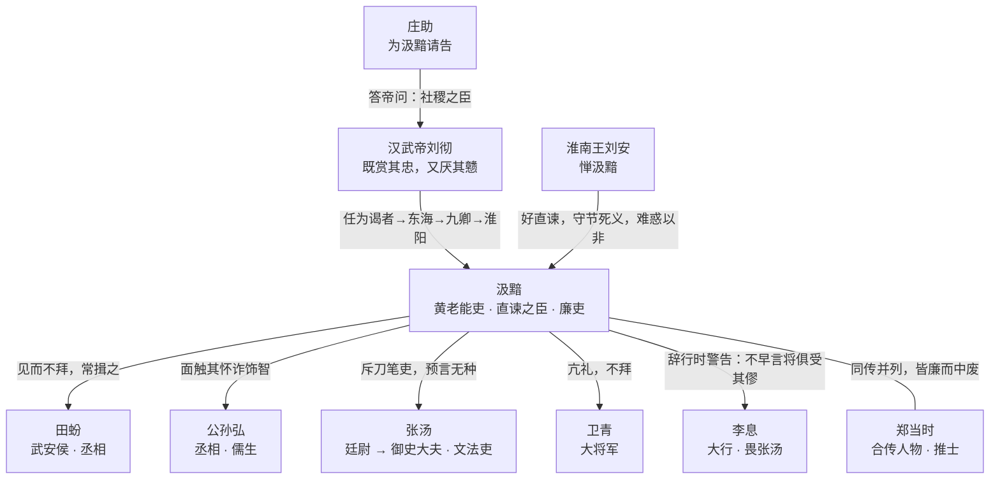

# 全书概览——汲黯是谁，怎么读

## 一、基本档案

| 项 | 内容 | 出处 |
|---|---|---|
| 名讳 | 汲黯，字长孺 | F1 |
| 籍贯 | 濮阳（今河南濮阳一带）；其先为古卫国贵族 | F1、F2 |
| 家世 | 「其先有宠于古之卫君。至黯七世，世为卿大夫」（《汉书》作「十世」） | F2 |
| 入仕 | 以父任，景帝时为太子洗马；武帝即位后为谒者 | F3、F4 |
| 生年 | 史无明文 | F30 |
| 卒年 | 《史记》「七岁而卒」→约前 112；《汉书》《资治通鉴》「十岁而卒」→约前 109 | F29、F30 |
| 最高职位 | 主爵都尉、右内史，列于九卿；终淮阳太守 | F10、F19、F25 |
| 史传 | 《史记》卷一百二十《汲郑列传》（与郑当时合传）；《汉书》卷五十《张冯汲郑传》 | F32、F37、F38 |

> 生卒是读汲黯的第一个「坑」：生年无考，卒年有两说。网络资料常直接写「（？—前 112）」，那是采用《史记》「七岁而卒」并系淮阳之任于元狩五年（前 118）的结果；若采《汉书》《资治通鉴》「十岁而卒」，卒年应约在前 109。两说各有史源，本束并列登记（F29、F30，详见 [异文对勘](../references/textual-variants.md)）。

## 二、时代坐标：四个正在切换的范式

汲黯的活动期跨越景帝、武帝两朝，恰好落在西汉治国范式整体换挡的时段。把他放回这四组张力中，许多「脾气故事」才会显影为制度冲突：

| 张力 | 旧范式 | 新范式 | 汲黯的位置 |
|---|---|---|---|
| 治国思想 | 黄老清静、与民休息 | 儒术独尊、制礼作乐 | 学黄老之言，治官理民好清静（F9） |
| 边疆政策 | 和亲、少事 | 征伐匈奴、招怀四夷 | 常言与胡和亲，无起兵（F18） |
| 官僚类型 | 功臣、长者、重厚少文 | 文法吏、刀笔吏、以文深小苛为能 | 斥张汤「刀笔吏不可以为公卿」（F17） |
| 选官逻辑 | 任子、军功、资历 | 儒生、策论、幸进 | 讥「陛下用群臣如积薪耳，后来者居上」（F22） |

这不是说汲黯「反对一切新事物」——他并不反对中央集权本身，也曾任右内史治理宗室贵人聚居之地而「官事不废」（F19）。他反对的是**以文法苛细替代治理实效、以征伐兴利替代民生休养**这两条具体路线。

## 三、三重身份，不能只取一面

1. **黄老能吏**：东海太守任上「择丞史而任之，其治，责大指而已，不苛小」，「多病，卧闺阁内不出」，岁余而「东海大治」；入朝后「治务在无为而已，弘大体，不拘文法」（F9、F10）。这是可验证的治理绩效，不是清谈。
2. **直谏之臣**：见田蚡「未尝拜，常揖之」；武帝招文学儒者，他当面说「陛下内多欲而外施仁义，奈何欲效唐虞之治乎」；斥张汤「天下谓刀笔吏不可以为公卿，果然」（F12、F13、F17）。武帝称其「戆」，又借庄助之口许为「社稷之臣」（F13、F15）。
3. **廉吏与「褊心」者**：他「内行修洁」「家无余赀财」，但也「性倨，少礼，面折，不能容人之过」，「合己者善待之，不合己者不能忍见，士亦以此不附焉」；见公孙弘、张汤后来居上，他「褊心，不能无少望」（F11、F22、F37）。太史公没有把他写成完人。

> 只读第一面，会得到「无为而治的管理大师」；只读第二面，会得到「敢骂皇帝的清官」；只读第三面，会得到「情商低的杠精」。三面合读，才是《史记》的写法：**能力、伦理、性格各有其真，也各有其限**。

## 四、史料结构：三层文本

```
第一层  叙事层：《史记·汲郑列传》汲黯段（母本）
          ↓ 异史对读
第二层  异史层：《汉书·张冯汲郑传》（字句异文、赞语）
          ↓ 编年定位
第三层  编年层：《资治通鉴》卷二十·汉纪十二（元狩五年条）
          ↓ 后世追加
第四层  流变层：地方纪念文章、廉洁教育叙事、百科与网络转述
```

- **母本**：《史记》汲黯段（不含郑当时附传与太史公曰），依次写家世、两次出使、东海治绩、性格、抗礼田蚡、面折武帝、社稷之臣、礼敬、斥张汤、反儒反文法、右内史、与卫青亢礼、淮南王惮黯、积薪之叹、浑邪王事件、免官、淮阳之任、警告李息、卒与身后（F1–F31）。
- **异史**：《汉书》大半沿《史记》而改字，重要异文有「七世/十世」「以庄见惮/以严见惮」「河南/河内」「七岁/十岁」等（F40）。
- **编年**：《资治通鉴》把「召拜淮阳太守」系于元狩五年（前 118），并载「十岁而卒」，为卒年推算提供了第二个锚点（F25、F29）。
- **流变**：地方纪念叙事增加了题诗退贿、悬印梁上、卧榻听讼、微服出访等细节，均不见于《史记》《汉书》，只能作后世形象层证据（F42）。

## 五、人物关系图



## 六、三个关键词

1. **戆（zhuàng）**——武帝被顶撞后的话：「甚矣，汲黯之戆也！」（F13）「戆」不是愚蠢，是**不知转弯的刚直**；它既是汲黯的政治资本，也是他「不得久居位」的原因。
2. **社稷之臣**——庄助答武帝：「使黯任职居官，无以逾人。然至其辅少主，守城深坚，招之不来，麾之不去，虽自谓贲育亦不能夺之矣。」武帝曰：「古有社稷之臣，至如黯，近之矣。」（F15）评价标准不是日常绩效，而是**危机时刻的不可夺**。
3. **卧而治之**——武帝命汲黯守淮阳：「顾淮阳吏民不相得，吾徒得君之重，卧而治之。」（F26）这四个字后来成为「卧治」典故，但它的前提是「得君之重」与「择丞史而任之」，不是字面上的躺着不管（详见 [黄老治术](02-huanglao-governance.md)）。

## 七、怎么读本束

- 想快速建立骨架：读[生平年表](01-life-chronology.md)，再用[阅读地图](../examples/01-reading-map.md)对照原文段落。
- 想学治理方法：读[黄老治术](02-huanglao-governance.md)，重点看「择人—责大指—不苛小—验结果」四步。
- 想理解直谏伦理：读[直谏与朝廷](03-zhijian-and-court.md)，区分「情绪顶撞」与「职位义务表达」。
- 想做文本核查：读[异文对勘](../references/textual-variants.md)与 [facts.md](../facts.md)，逐条回源。

## 关联阅读

- 《老子》与黄老谱系：[道家（Daojia）](../../../daojia/index.md)、[老子（Laozi）](../../../laozi/index.md)
- 儒家义理与「社稷之臣」的伦理资源：[儒家四书](../../../confucian/four-books/index.md)
- 同为「逆境中的直臣」样本：[王阳明生平](../../../yangming/biography/index.md)
