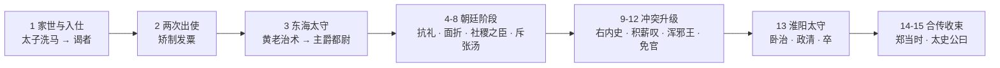
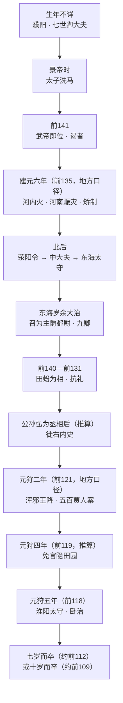

# 阅读地图与三轨读法

## 一、原文段落地图

《史记·汲郑列传》汲黯部分可按语义切成 15 段。读原文时按段落推进，不要从头到尾逐字硬啃：

| 段 | 内容 | 关键句 | 照应概念 |
|---|------|--------|----------|
| 1 | 家世、入仕、两次出使（东越、河内） | 「越人相攻，固其俗然」 | [年表](../concepts/01-life-chronology.md) |
| 2 | 矫制发粟、迁荥阳令、病归、中大夫 | 「臣请归节，伏矫制之罪」 | [决策案例·矫制](02-decision-casebook.md) |
| 3 | 东海太守、黄老治术、主爵都尉 | 「责大指而已，不苛小」 | [黄老治术](../concepts/02-huanglao-governance.md) |
| 4 | 性格总述 | 「性倨，少礼，面折」 | [直谏](../concepts/03-zhijian-and-court.md) |
| 5 | 抗礼田蚡、面折武帝「内多欲」 | 「陛下内多欲而外施仁义」 | [直谏](../concepts/03-zhijian-and-court.md) |
| 6 | 久病、庄助请告、社稷之臣 | 「招之不来，麾之不去」 | [直谏](../concepts/03-zhijian-and-court.md) |
| 7 | 武帝礼敬、不冠不见 | 「上不冠不见也」 | [直谏](../concepts/03-zhijian-and-court.md) |
| 8 | 斥张汤、刀笔吏之骂 | 「令天下重足而立，侧目而视」 | [直谏](../concepts/03-zhijian-and-court.md) |
| 9 | 反儒、反文法、徙右内史 | 「弘、汤深心疾黯」 | [年表](../concepts/01-life-chronology.md) |
| 10 | 与卫青亢礼、淮南王惮黯 | 「夫以大将军有揖客，反不重邪」 | [直谏](../concepts/03-zhijian-and-court.md) |
| 11 | 积薪之叹 | 「后来者居上」 | [合传与流变](../concepts/04-ji-zheng-legacy.md) |
| 12 | 浑邪王受降、五百贾人、免官 | 「庇其叶而伤其枝」 | [决策案例·受降](02-decision-casebook.md) |
| 13 | 淮阳太守、警告李息、卒与身后 | 「卧而治之」「七岁而卒」 | [黄老治术](../concepts/02-huanglao-governance.md) |
| 14 | 郑当时附传 | 「千里不赍粮」 | [合传与流变](../concepts/04-ji-zheng-legacy.md) |
| 15 | 太史公曰：翟公署门 | 「一死一生，乃知交情」 | [合传与流变](../concepts/04-ji-zheng-legacy.md) |

> 原文可在 [ctext.org《汲郑列传》](https://ctext.org/shiji/ji-zheng-lie-zhuan/zh)、[古诗文网](https://www.gushiwen.cn/guwen/bookv_46653FD803893E4FEDD221502C0D8A0D.aspx)、[24histories](https://24histories.com/shiji/120) 三处对照阅读；三处文字基本一致，个别字句差异见[异文对勘](../references/textual-variants.md)。

## 二、结构一眼图

这是一条「**能力展示→伦理冲突→代价与终局→史论收束**」的传记线，不是按时间平均铺开的年谱。

## 三、时间轴（一屏看完）

## 四、十句核心原文精读卡

### 1. 家世与入仕

> 汲黯字长孺，濮阳人也。其先有宠于古之卫君。至黯七世，世为卿大夫。（F1、F2）

- **白话**：汲黯字长孺，濮阳人；先祖受古卫国君主宠信，到汲黯已七代做卿大夫。
- **关键词**：世卿、卫地、父任。
- **注意**：《汉书》作「十世」，异文（F40）。

### 2. 东越出使

> 越人相攻，固其俗然，不足以辱天子之使。（F5）

- **白话**：越人互相攻打是当地习俗，不值得劳烦天子使者。
- **关键词**：便宜、边界感、「不至而还」。
- **读法**：这不是抗命，而是**对任务必要性的重新判断**。

### 3. 矫制发粟

> 臣过河南，河南贫人伤水旱万余家，或父子相食，臣谨以便宜，持节发河南仓粟以振贫民。臣请归节，伏矫制之罪。（F7）

- **白话**：我经过河南，见万余家遭水旱，甚至父子相食；我便宜行事，持节开河南仓赈济，现请交还符节、接受假传诏令之罪。
- **关键词**：便宜、持节、矫制、请罪。
- **读法**：**先救人、后请罪**，把程序责任个人化。

### 4. 东海治术

> 黯学黄老之言，治官理民，好清静，择丞史而任之。其治，责大指而已，不苛小。（F9）

- **白话**：汲黯学黄老之说，治理百姓喜好清静，选择丞史而任用；治理只责求大旨，不苛求小节。
- **关键词**：择任、责大指、不苛小。
- **读法**：四步治术的第一、二、三步全在这句。

### 5. 性格总述

> 黯为人性倨，少礼，面折，不能容人之过。……然好学，游侠，任气节，内行修洁，好直谏，数犯主之颜色。（F11）

- **白话**：汲黯性傲、少礼、当面驳人、容不得别人过错；但好学、任侠、重气节、私德干净、好直谏、屡犯君主脸色。
- **关键词**：面折、内行修洁、犯颜色。
- **读法**：太史公先写缺点，再写优点——**不是先扬后抑，而是先抑后扬**。

### 6. 面折武帝

> 陛下内多欲而外施仁义，奈何欲效唐虞之治乎！（F13）

- **白话**：陛下内心欲望很多，外表却施仁义，怎么能效法唐尧虞舜之治？
- **关键词**：内多欲、外施仁义、唐虞。
- **读法**：一句同时批评**动机**与**表演**，难怪武帝「变色而罢朝」。

### 7. 职位伦理

> 天子置公卿辅弼之臣，宁令从谀承意，陷主于不义乎？且已在其位，纵爱身，奈辱朝廷何！（F14）

- **白话**：天子设公卿辅弼之臣，难道是让他们阿谀顺从、把君主陷于不义？既在其位，纵然爱惜自身，又怎能辱没朝廷！
- **关键词**：辅弼、从谀承意、在其位。
- **读法**：这是汲黯直谏的**自我法理依据**，比「性格直」重要得多。

### 8. 社稷之臣

> 使黯任职居官，无以逾人。然至其辅少主，守城深坚，招之不来，麾之不去，虽自谓贲育亦不能夺之矣。（F15）

- **白话**：让汲黯任职办事，未必超过别人；但辅佐少主、坚守城池，召他不来、挥他不去，即使自比孟贲、夏育也不能夺其志。
- **关键词**：无以逾人、招之不来、麾之不去。
- **读法**：**日常绩效与危机品格的分离评价**，全篇最关键的一句。

### 9. 不冠不见

> 至如黯见，上不冠不见也。……上不冠，望见黯，避帐中，使人可其奏。（F16）

- **白话**：至于汲黯来见，皇帝不戴冠就不见他；皇帝曾在武帐中未戴冠，望见汲黯，避入帐中，派人批准其奏。
- **关键词**：不冠不见、避帐。
- **读法**：权力对人格的**被迫礼敬**，是直谏者的最高回报。

### 10. 积薪之叹

> 陛下用群臣如积薪耳，后来者居上。（F22）

- **白话**：陛下任用群臣像堆柴，后来的放在上面。
- **关键词**：积薪、后来居上、褊心。
- **读法**：既有制度洞察，也有个人不平；《史记》两笔都写。

## 五、三轨阅读计划

### 轨道 A：零基础（约 90 分钟）

1. 读本页「段落地图」与「时间轴」（10 分钟）
2. 读原文第 1—3 段（家世、出使、东海），配合第 1—4 张精读卡（20 分钟）
3. 读原文第 5—7 段（面折、社稷之臣、礼敬），配合第 5—9 张卡（25 分钟）
4. 读原文第 13 段（淮阳、卒），配合第 10 张卡（15 分钟）
5. 用[全书概览](../concepts/00-overview.md)的三重身份复盘（20 分钟）

### 轨道 B：进阶（约 3 小时）

1. 通读 15 段原文，标出所有对话（约 60 分钟）
2. 对读《汉书·张冯汲郑传》汲黯段，圈出异文（约 40 分钟）
3. 读《资治通鉴》元狩五年条，核对淮阳之任系年（约 20 分钟）
4. 读[黄老治术](../concepts/02-huanglao-governance.md)与[直谏与朝廷](../concepts/03-zhijian-and-court.md)（约 40 分钟）
5. 做[决策案例集](02-decision-casebook.md)的三案分析（约 40 分钟）

### 轨道 C：研读（约 2 周）

1. 第 1—2 天：三家注本《史记》汲黯段（关注「矫制」「贵大指」「陇断」等词训）
2. 第 3—4 天：《汉书》对读 + [异文对勘](../references/textual-variants.md)逐条核验
3. 第 5—6 天：《资治通鉴》卷二十相关条目 + 胡三省注
4. 第 7—9 天：现代研究（黄老—儒术转型、文法吏、武帝朝政治）
5. 第 10—12 天：写一篇 3000 字人物分析，必须区分「叙事层/史评层/流变层」
6. 第 13—14 天：用 [facts.md](../facts.md) 逐条回源，标注推断级别

## 六、读原文的三个提醒

1. **先分清谁在说话**：叙事（司马迁）、人物对白（汲黯/武帝/庄助）、史评（太史公曰）三层语气不同，不要混引。
2. **注意「上默然」的三种含义**：有时是默认，有时是不悦，有时是「不许」前的缓冲；要结合后文判断（F23、F24）。
3. **不要把合传读成单人传**：第 14—15 段（郑当时、太史公曰）是理解汲黯命运的必要部分，不是附录。

## 关联阅读

- [全书概览](../concepts/00-overview.md)
- [生平与仕宦年表](../concepts/01-life-chronology.md)
- [决策案例集](02-decision-casebook.md)
- [信源登记](../references/sources.md)
