# 技能清单与选型：按当前情况找工具（统一命名版）

> **命名规则**：本页把「文章口径」与「平台口径」分开。
>
> - **文章口径** = 22 位**共创博主显示名** + 一句话标签（传播名，F-019–F-040）；
> - **平台口径** = 技能市场里的**技能名 + 作者 handle**（安装与检索身份，F-079–F-094）。
>
> 同一技能可能有两层名字；检索时用「共创博主 + 技能名 + @作者」三元组。带 `*` 的技能名是**文章口径**——市场公开页未按作者或同名主题检索到（F-095）。

## 1. 七行速查：当前情况 → 可以先用

文章给出的第一张表只有七行，是最短路径（F-010）。下表把「可以先用」统一成平台可检索名：

| 当前情况 | 可以先用（平台口径） | 文章共创者 / 别名 | F |
|---|---|---|---|
| 只有想法，想检查需求依据 | 需求先验｜模拟用户调研（@张振东） | 阿东玩AI | F-019、F-079 |
| 准备上线，需要介绍素材 | 菜头应用首发素材包（@菜头Prompt） | 菜头Prompt.AI | F-028、F-085 |
| 产品能用了，缺少试用用户 | 首批用户获取（@anyu1888888） | 陈乔维Justin | F-035、F-089 |
| 不知道下一步先做什么 | 产品增长负责人（@花叔） | 花叔 | F-037、F-091 |
| 想在小红书推广，缺少选题 | 菜菜的冲浪Skill（@caibucai） | 蔡不菜（AI版） | F-033、F-087 |
| 移动 App 有人用，付费少 | 海明 App 商业化（@黄明远） | 海明Dev | F-039、F-093 |
| 反馈很多，不知道先改什么 | SignalMine｜用户反馈转增长实验（@Z_wk） | 许多的数码世界 | F-040、F-094 |

## 2. 五类 22 条全量清单（统一命名）

### 01 需求与产品构思（6 条，F-014）

| # | 统一技能名（平台口径） | 文章共创者 | 市场作者 | F |
|---|---|---|---|---|
| 1 | 需求先验｜模拟用户调研 | 阿东玩AI | @张振东 | F-019、F-079 |
| 2 | AI产品调研 | 北峰Agent | @北峰Agent | F-020、F-080 |
| 3 | 真需求诊断 `*` | yan（ai赚钱版） | —（未核到） | F-021、F-095 |
| 4 | 产品评审：收敛 MVP `*` | 设计师雪梨 | —（未核到） | F-022、F-095 |
| 5 | 真需求验证：测试购买 `*` | 南洋理工DAN讲AI | —（未核到） | F-023、F-095 |
| 6 | 西瓜业务产品化｜xigua-service-productization | 西瓜在创作 | @西瓜🍉 | F-024、F-081 |

### 02 产品构建与展示（3 条，F-015）

| # | 统一技能名（平台口径） | 文章共创者 | 市场作者 | F |
|---|---|---|---|---|
| 7 | 产品第一版 | 职场懒人 | @懒人哥 | F-025、F-082 |
| 8 | 产品官网设计与制作 `*` | 斑马MVP实验室 | —（未核到） | F-026、F-095 |
| 9 | 网页应用宣传物料 / 手机 APP 宣传物料制作（系列） | 空格的键盘 | @空格的键盘 | F-027、F-083、F-084 |

> 第 8 行：市场另有「高审美产品官网」@郑建勋（F-076 抓取时可见），但作者与文章共创者不一致，**不并入**本行，也不据此改写归属。

### 03 发布与内容传播（6 条，F-016）

| # | 统一技能名（平台口径） | 文章共创者 | 市场作者 | F |
|---|---|---|---|---|
| 10 | 菜头应用首发素材包 | 菜头Prompt.AI | @菜头Prompt | F-028、F-085 |
| 11 | 文字脚本转白板动画 `*` | 李叔聊AI | —（未核到） | F-029、F-095 |
| 12 | 笔记封面与标题设计 `*` | 是树小姐 | —（未核到） | F-030、F-095 |
| 13 | 多平台推广视频制作 `*` | 一起Vibe | —（未核到） | F-031、F-095 |
| 14 | GitHub星标增长器 | 塔斯海 | @常成（likely） | F-032、F-086 |
| 15 | 菜菜的冲浪Skill | 蔡不菜（AI版） | @caibucai | F-033、F-087 |

> 第 14 行：文章标签是「GitHub 项目诊断与介绍优化」，市场同名主题技能是「GitHub星标增长器」@常成；广场另登记「塔斯海｜内容选题咨询顾问」。按两层命名可解释为「博主塔斯海推荐作者常成的技能」，但归属仍标 `likely`，不写成唯一结论。

### 04 获客与增长诊断（4 条，F-017）

| # | 统一技能名（平台口径） | 文章共创者 | 市场作者 | F |
|---|---|---|---|---|
| 16 | 应用首发包助手 | 桃子AI | @桃子_0616（likely） | F-034、F-088 |
| 17 | 首批用户获取 | 陈乔维Justin | @anyu1888888 | F-035、F-089 |
| 18 | AI变现诊断 | 小E爱学习（AI提效） | @小E爱学习 | F-036、F-090 |
| 19 | 产品增长负责人 | 花叔 | @花叔 | F-037、F-091 |

> 第 16 行：文章标签是「应用冷启动方案」，市场对应作者名下是「应用首发包助手」；可能是同一技能的改名，也可能是同一作者的另一技能，标 `likely`，不把两者强行等同。
>
> 第 18 行：文章标签是「增长诊断与实验卡」，市场技能名是「AI变现诊断」；作者一致、主题相邻，按平台口径统一为「AI变现诊断」，文章标签保留为别名。

### 05 商业化与反馈迭代（3 条，F-018）

| # | 统一技能名（平台口径） | 文章共创者 | 市场作者 | F |
|---|---|---|---|---|
| 20 | AI应用定价算盘 | 古希腊掌管代码的神 | @古希腊掌管代码的神 | F-038、F-092 |
| 21 | 海明 App 商业化｜haiming-app-monetization | 海明Dev | @黄明远 | F-039、F-093 |
| 22 | SignalMine｜用户反馈转增长实验 | 许多的数码世界 | @Z_wk | F-040、F-094 |

**机械自检**：6 + 3 + 6 + 4 + 3 = 22；其中 15 行已匹配市场作者/同名主题，7 行仅文章口径（F-079–F-095，核验项 24）。

## 3. 22 → 24 → 25：口径归一模型

原来的「24/22/25 冲突」不是三套技能集合，而是**同一供给的三个聚合层级**：

| 层级 | 数字 | 构成 | 证据 |
|---|---|---|---|
| 文章精选清单 | **22** | 22 位共创者 × 1 行（系列族折叠为 1） | F-014–F-040 |
| 加速器集合卡片 | **24** | 22 + 空格的键盘 2 个额外平台变体（网页 / 手机 APP） | F-066、F-083、F-084、F-096 |
| 赏金广场条目 | **25** | 24 + 一起Vibe 1 条重复投稿条目 | F-073、F-075 |

**算术自检**：

- 22 + 2 = 24；
- 24 + 1 = 25；
- 反向：25 − 1 − 2 = 22，与清单逐行计数一致。

**证据强度**：`24` 的集合卡片是登录后页面，本次未直接采集；上述模型与已知系列族（空格 ×3、一起Vibe ×2）完全自洽，标 `modeled`（核验项 23）。正文统一以 **22 条精选行**叙事；提到 24/25 时注明层级。

## 4. 22 行两层命名映射（统一命名表）

先看状态分布与映射方向（图），再用下表查具体名称：

```mermaid
flowchart TB
    ROOT["22 行命名映射"]
    ROOT --> V["✅ verified：12 行"]
    ROOT --> L["⚠️ likely：3 行"]
    ROOT --> A["○ article-only：7 行"]
    V --> V1["#2 北峰Agent：AI产品调研｜@北峰Agent"]
    V --> V2["#6 西瓜在创作：西瓜业务产品化｜@西瓜🍉"]
    V --> V3["#7 职场懒人：产品第一版｜@懒人哥"]
    V --> V4["#9 空格的键盘：网页/APP 宣传物料｜@空格的键盘"]
    V --> V5["#10 菜头Prompt.AI：菜头应用首发素材包｜@菜头Prompt"]
    V --> V6["#15 蔡不菜（AI版）：菜菜的冲浪Skill｜@caibucai"]
    V --> V7["#17 陈乔维Justin：首批用户获取｜@anyu1888888"]
    V --> V8["#18 小E爱学习（AI提效）：AI变现诊断｜@小E爱学习"]
    V --> V9["#19 花叔：产品增长负责人｜@花叔"]
    V --> V10["#20 古希腊掌管代码的神：AI应用定价算盘｜@古希腊掌管代码的神"]
    V --> V11["#21 海明Dev：海明 App 商业化｜@黄明远"]
    V --> V12["#22 许多的数码世界：SignalMine｜@Z_wk"]
    L --> L1["#1 阿东玩AI：需求先验｜@张振东"]
    L --> L2["#14 塔斯海：GitHub星标增长器｜@常成"]
    L --> L3["#16 桃子AI：应用首发包助手｜@桃子_0616"]
    A --> A1["#3 yan（ai赚钱版）：真需求诊断｜未核到"]
    A --> A2["#4 设计师雪梨：产品评审｜未核到"]
    A --> A3["#5 南洋理工DAN讲AI：真需求验证｜未核到"]
    A --> A4["#8 斑马MVP实验室：产品官网设计与制作｜未核到"]
    A --> A5["#11 李叔聊AI：文字脚本转白板动画｜未核到"]
    A --> A6["#12 是树小姐：笔记封面与标题设计｜未核到"]
    A --> A7["#13 一起Vibe：多平台推广视频制作｜未核到"]
```

> **读图**：节点文字格式为「文章共创者：平台技能名｜@作者」。`verified` 为作者+技能名+主题三项匹配；`likely` 为作者或主题相邻但名称/归属未完全确认；`article-only` 为公开市场未检索到，保留文章口径。

| # | 统一技能名（平台） | 作者 handle | 文章共创者 | 文章标签（别名） | 状态 |
|---|---|---|---|---|---|
| 1 | 需求先验｜模拟用户调研 | @张振东 | 阿东玩AI | 需求先验：调研与验证 | likely（示例截图为张振东） |
| 2 | AI产品调研 | @北峰Agent | 北峰Agent | 产品判断：验证需求 | verified |
| 3 | —（未核到） | — | yan（ai赚钱版） | 真需求诊断 | article-only |
| 4 | —（未核到） | — | 设计师雪梨 | 产品评审：收敛 MVP | article-only |
| 5 | —（未核到） | — | 南洋理工DAN讲AI | 真需求验证：测试购买 | article-only |
| 6 | 西瓜业务产品化｜xigua-service-productization | @西瓜🍉 | 西瓜在创作 | 业务内容转互动产品 | verified |
| 7 | 产品第一版 | @懒人哥 | 职场懒人 | 调研结论转产品第一版 | verified |
| 8 | —（未核到） | — | 斑马MVP实验室 | 产品官网设计与制作 | article-only |
| 9 | 网页应用宣传物料 / 手机 APP 宣传物料制作 | @空格的键盘 | 空格的键盘 | 应用商店文案与截图 | verified（2 个公开变体） |
| 10 | 菜头应用首发素材包 | @菜头Prompt | 菜头Prompt.AI | 应用首发图文与脚本 | verified |
| 11 | —（未核到） | — | 李叔聊AI | 文字脚本转白板动画 | article-only |
| 12 | —（未核到） | — | 是树小姐 | 笔记封面与标题设计 | article-only |
| 13 | —（未核到） | — | 一起Vibe | 多平台推广视频制作 | article-only |
| 14 | GitHub星标增长器 | @常成 | 塔斯海 | GitHub 项目诊断与介绍优化 | likely |
| 15 | 菜菜的冲浪Skill | @caibucai | 蔡不菜（AI版） | 热点选题与推广内容 | verified |
| 16 | 应用首发包助手 | @桃子_0616 | 桃子AI | 应用冷启动方案 | likely |
| 17 | 首批用户获取 | @anyu1888888 | 陈乔维Justin | 首批用户获取计划 | verified |
| 18 | AI变现诊断 | @小E爱学习 | 小E爱学习（AI提效） | 增长诊断与实验卡 | verified（名称差异） |
| 19 | 产品增长负责人 | @花叔 | 花叔 | 增长瓶颈与优先行动 | verified |
| 20 | AI应用定价算盘 | @古希腊掌管代码的神 | 古希腊掌管代码的神 | AI 应用成本核算与定价 | verified |
| 21 | 海明 App 商业化｜haiming-app-monetization | @黄明远 | 海明Dev | App 付费流程与套餐优化 | verified |
| 22 | SignalMine｜用户反馈转增长实验 | @Z_wk | 许多的数码世界 | 用户反馈转增长实验 | verified |

**状态口径**：

- `verified`：作者 handle + 技能名 + 主题三项匹配；
- `likely`：作者/主题相邻，但技能名或归属不能完全确认；
- `article-only`：公开市场未检索到，保留文章口径，不推断平台身份。

## 5. 四步选型法（从文章结构提炼）

| 步骤 | 动作 | 判据 | 对应事实 |
|---|---|---|---|
| 1 | 定位阶段 | 我现在卡在需求、构建、发布、获客还是商业化？ | F-006、F-014–F-018 |
| 2 | 选一个技能 | 只选「眼前这一项」，用「共创者 + 技能名 + @作者」检索 | F-009、F-011、§4 映射表 |
| 3 | 备材料 | 产品链接/截图/说明/数据，至少给一样真实材料 | F-045、F-048、F-058 |
| 4 | 定验收 | 先写清「这次要拿到什么交付物、看哪个信号」 | F-042–F-060 |

> 第 4 步最容易被跳过。六个示例之所以可学，正是因为每个都给出了明确的交付物与验证信号（见 [02-six-skills-in-practice.md](02-six-skills-in-practice.md)）。
