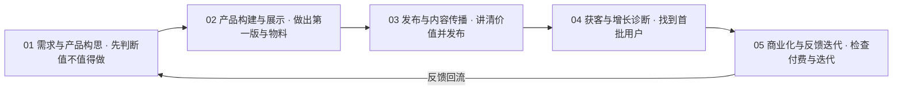

# 从想法到第一批用户：五阶段增长闭环怎么走

> 文章给的是「技能清单」，不是「流程规范」。本文把 22 条技能按五类分组还原成一条可执行链路，并用六个示例中的验证信号校准每一步的出口（F-009、F-014–F-018、F-042–F-060）。

## 1. 先开始：三步，不装全套

文章给出的开始方式只有三步（F-061）：

1. **打开对应技能页**——从七行速查表或 22 条清单里选「眼前这一项」（F-010、F-011）；
2. **安装技能**——在平台技能市场点「添加」，再「使用技能」（F-061、F-077）；
3. **提供材料、说明任务**——产品链接、截图、说明或数据，至少给一样真实材料（F-045、F-048、F-058）。

> 文章明确建议：先选眼前需要的一项，不必一次装全套（F-009）。

## 2. 五阶段闭环

| 阶段 | 目标 | 可用技能（平台口径；`*` = 文章口径未核到市场） | 最小交付物 | 出口信号 | 常见错误 |
|---|---|---|---|---|---|
| 01 需求与产品构思 | 判断需求是否成立、先做哪一版 | 需求先验｜模拟用户调研、AI产品调研、真需求诊断 `*`、产品评审 `*`、测试购买 `*` | 需求判断 + 取舍 + 验证计划（F-042） | 能说清「缺什么证据、找谁验证」（F-044） | 把「我觉得」当需求；一次想做全功能 |
| 02 产品构建与展示 | 把结论变成第一版与对外物料 | 产品第一版、产品官网 `*`、网页/APP 宣传物料 | 第一版 + 官网/商店物料（F-025–F-027） | 能演示、能给出体验入口 | 先做官网后做产品；物料与真实产品不符 |
| 03 发布与内容传播 | 讲清价值、准备首发内容 | 菜头应用首发素材包、白板动画 `*`、封面 `*`、推广视频 `*`、GitHub星标增长器、菜菜的冲浪Skill | 图文/视频/封面 + 文案包（F-045–F-047） | 发布前核对项补齐（真实截图、体验链接） | 直接发 AI 生成图，不补真实截图（F-047） |
| 04 获客与增长诊断 | 找到首批用户、定位增长卡点 | 应用首发包助手、首批用户获取、AI变现诊断、产品增长负责人 | 用户画像 + 试用任务 + 诊断报告（F-048–F-053） | 试用任务可观察、卡点定位到一级（F-050、F-052） | 追流量不看激活；留存数据缺失却硬估（F-053） |
| 05 商业化与反馈迭代 | 检查付费流程、把反馈变成实验 | AI应用定价算盘、海明 App 商业化、SignalMine｜用户反馈转增长实验 | 定价/付费墙方案 + 实验卡（F-058–F-060） | 有实施清单、测试场景与指标（F-060） | 先定价格后找价值；反馈只归类不实验 |

> **闭环的关键**：05 的反馈要回到 01 重新判断需求，而不是继续在 05 里调价格。这也是「反馈转增长实验」被单列的原因（F-040）。

## 3. 最小起步：三选一

文章结尾给出三种最小起步方式（F-062、F-072）：

| 起步方式 | 适合谁 | 第一份交付物 | 验收 |
|---|---|---|---|
| 一份首发素材 | 产品已能演示、缺介绍材料 | 6 图 + 文案包（F-046） | 真实截图与体验链接补齐（F-047） |
| 一组试用用户 | 产品已能用、缺用户 | 画像 + 试用任务 + 7 天计划（F-048） | 3 分钟结果、次日回访、付费意愿（F-050） |
| 一次最小实验 | 有反馈、不知道该改什么 | 反馈优先级 + 最小实验（F-040） | 实验能在一周内跑完并有指标 |

**不要同时开三条线**：每个起步方式对应一个阶段，混做会让「验证信号」互相污染。

## 4. 验证信号怎么定：从示例里抄结构，不抄数字

六个示例给了很多数字，但它们都是模拟数据（F-069）。可抄的是**信号结构**，不是具体阈值：

| 信号类型 | 示例中的写法 | 迁移时怎么用 |
|---|---|---|
| 时间型 | 3 分钟内得到结果（F-050） | 换成你自己产品的「首次价值时间」，并实测 |
| 回访型 | 第二天是否主动回来（F-050） | 定义回访口径（打开/完成关键动作），埋点采集 |
| 付费意愿型 | 是否愿意为稳定性和权限付费（F-050） | 用真实付费或明确的价格测试，不用口头「愿意」 |
| 漏斗型 | 注册 32,450 → 首次创建 18,760 → 未完成 13,690（F-052） | 定位到具体一级，不笼统说「转化低」 |
| 转化型 | 86 家付费 / 18,760 首次创建 ≈ 0.46%（F-059） | 分子分母口径先写清，再谈高低 |

> **纪律**：示例中的 42.2%、0.46%、3 分钟、20 位访谈等数字，只能在标明「模拟示例」时引用；不得写进真实业务汇报（核验项 10–14、19）。

## 5. 五个反模式

1. **把清单当流程**：22 条不是 22 步，按阶段选 1–2 个即可（F-009）。
2. **用单一名字当唯一标识**：文章用共创博主显示名、平台用作者 handle，同名/近名技能跨页不一致；检索与安装前用「共创者 + 技能名 + @作者」三元组回详情页核对（核验项 15–16、24）。
3. **拿模拟数据当结论**：六例全部标注模拟产品，不能引用其业务数字（F-069、F-071）。
4. **跳过验收**：没有「交付物 + 信号」的任务，做完也无法判断是否有效（F-042–F-060）。
5. **发布不补真实材料**：AI 生成的图文必须补真实产品截图与体验链接，并核对图片内容（F-047、F-071）。

## 6. 一页执行清单

- [ ] 我在五阶段中的哪一段？写一句话。
- [ ] 这次只选一个技能，写出「共创博主 + 技能名 + @作者 + 详情页链接」。
- [ ] 这个技能名是平台口径还是文章口径？若只有文章口径，是否已回平台搜索确认？
- [ ] 我提供的真实材料是什么？（链接/截图/数据/文档）
- [ ] 这次要拿到的交付物是什么？（报告/图文/表格/计划）
- [ ] 交付物的验收信号是什么？谁来测、什么时候测？
- [ ] 哪些数据现在没有？是否明确写「不估」而不是编一个数？
- [ ] 发布前是否补齐真实截图、体验链接并核对图片内容？
