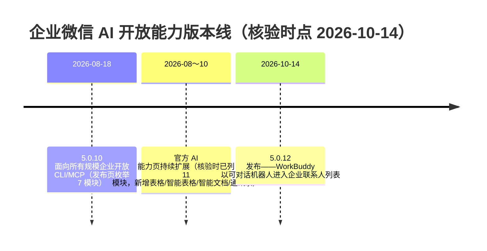

# 企业微信 5.0.10 版本更新总览

> 本篇是**事件事实层**：5.0.10 是什么、何时发布、更新了什么、版本处于什么时效位置。机制细节见 [01 AI 开放能力：CLI 与 MCP](01-ai-open-capability-cli-mcp.md)，产品功能见 [02 智能表格大圆与智能文档](02-smart-sheet-dayuan-and-smart-doc.md)；全部事实编号见[文章事实登记](../references/article-source.md)。

## 版本一句话

企业微信 **5.0.10** 版本的核心主题是「**把企业微信的办公能力通过 CLI 和 MCP 开放给 AI Agent**」：版本新功能介绍页把「AI开放能力」列为第一项重点功能，同步推出智能表格的 AI 分析报告，并增强智能文档（F-001、F-002、F-003）。

## 发布时间与开放范围

- **发布时间锚点：2026-08-18**。发布页本身未标注日期；IT之家当日报道，企业微信团队于该日宣布 5.0.10「正式面向所有规模的企业开放 CLI 与 MCP 能力」（F-019，媒体发布日，非官方新闻稿原页）。
- **取消门槛**：此次开放取消了企业人数、资质等门槛限制。报道给出的背景是——过去 AI 想读取企业内部资料、生成报告或创建文档，往往需要先对企微能力做二次封装；开放 CLI 后，Agent 可直接调用底层办公能力（F-020，媒体报道口径）。

## 两项重点功能

| 重点功能 | 一句话 | 详述 |
| --- | --- | --- |
| **AI 开放能力** | 新增多个核心模块的开放 CLI 和 MCP 接口，可在 Agent 中完成更多专业办公任务（F-002、F-003） | [01 机制篇](01-ai-open-capability-cli-mcp.md)：发布页枚举消息、邮件、文档、待办、日程、会议、微盘 7 个模块，给「向机器人最近会话发消息、发邮件、读纪要、下载微盘文件」等动作（F-004～F-010） |
| **智能表格 AI 分析报告** | 智能助理「大圆」分析表中数据，自动生成专业、好看的报告，**功能灰度中**（F-013） | [02 产品篇](02-smart-sheet-dayuan-and-smart-doc.md)：多维度逐步分析、对话式修改、数据更新报告实时更新（F-014～F-016） |

同版本还包含一项未列入「重点功能概览」的常规增强：**智能文档**新增描述字号与更多字色、页面颜色，并支持导出 Word、PDF、Markdown 与打印（F-017、F-018，详见[产品篇](02-smart-sheet-dayuan-and-smart-doc.md)）。

## 发布方描绘的 Agent 办公场景

IT之家在发布日报道中记录了三类典型任务（厂商发布会口径，属场景示例而非成效数字）（F-032）：

1. 自动查看产品信息文档、客户反馈文档与销售数据表格，提炼客户关注点、分析业务数据，最终生成提案 PPT；
2. 整合多份业务表格、分析经营数据，生成可交互的经营看板；
3. 输入经营目标后，进一步拆解销售动作。

## 版本时效位置（重要）

- 本束知识包是 **5.0.10 的时点快照**；核验时（2026-10-14）官方 [AI 开放能力页](https://work.weixin.qq.com/nl/index/aicli?from=new_intro)已演进到 11 个模块（F-021、F-027），能力清单以官方页现状为准，历史口径以本束为准。
- **5.0.10 已不是最新版本**：2026-10-14 腾讯宣布企业微信与 WorkBuddy 联合发布新版本——企微 5.0.12 中 WorkBuddy 进入企业联系人列表，WorkBuddy 5.8.0 支持企微账号登录并获消息、文档、会议、网盘等十大能力授权（F-031，上海证券报等多源）。

## 阅读路径

- 想让 Agent 接入企微 → [01 AI 开放能力：CLI 与 MCP](01-ai-open-capability-cli-mcp.md)
- 想了解大圆分析报告与文档导出 → [02 智能表格大圆与智能文档](02-smart-sheet-dayuan-and-smart-doc.md)
- 想核实每条说法 → [文章事实登记](../references/article-source.md)（F-001～F-033）与[核验报告](../references/verification.md)
