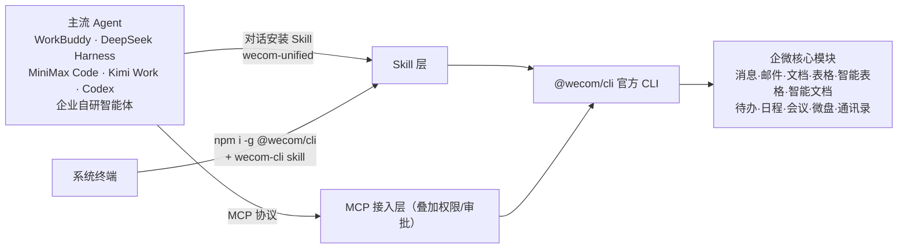

# AI 开放能力：CLI 与 MCP 双通道

> 本篇是**机制/能力层**：CLI 和 MCP 是什么关系、开放了哪些办公模块、如何把能力装进 Agent、安全边界在哪。操作级实测教程不在本束范围（发布页只给安装提示词，无端到端配置）。事实编号见[文章事实登记](../references/article-source.md)。

## 机制一句话

企业微信「面向 AI 场景提供官方开放能力，可通过 **CLI** 和 **MCP** 方式调用，支持 Agent 连接多种核心业务能力接口」（F-002、F-003，发布页与官方 AI 能力页一致）。

- **CLI**：企业微信官方命令行工具 `@wecom/cli`，可在终端直接调用企微接口，也是 Skill 化接入的底层（F-023、F-024）。
- **MCP**：模型上下文协议（Model Context Protocol）通道——Agent 通过 MCP 接入同一批企微能力；企业微信在 MCP 链路中叠加原有权限与审批机制（F-026）。

图示依据 F-021～F-024；节点清单为核验时点（2026-10-14）官方页现状。

## 兼容的 Agent 清单

官方 AI 能力页列出的可接入对象（F-022）：

- **WorkBuddy**（腾讯自家 AI 办公智能体；5.0.12 起进一步深度互通，见[总览版本时效](00-wecom-5-0-10-release-overview.md#版本时效位置重要)）
- **DeepSeek Harness**、**MiniMax Code**、**Kimi Work**、**Codex**
- **企业自研智能体**（基于开放接口接入自建 Agent）

生态侧旁证：帮助中心另有 OpenClaw 接入企微智能机器人文档（`npx -y @wecom/wecom-openclaw-cli install`，docid 21657）；掘金介绍企微 CLI 开源项目的 Skill 体系（wecom-preflight、wecom-contact-lookup、wecom-get-todo-list 等）（F-033，二手/帮助旁证）。

## 模块能力矩阵：7 / 10 / 11 三个口径

模块数在三个时点来源中不一致，**这是功能持续上线的时间差，不是任何一方报错**（F-027）：

| 模块 | 发布页 W（5.0.10，2026-08-18） | 官方 AI 页现状（2026-10-14，F-021） |
| --- | --- | --- |
| 消息 | 向机器人的最近会话发送消息（F-004） | 查询机器人最近会话；向机器人所在会话发送消息 |
| 邮件 | 发送邮件；搜索、读取邮件内容（F-005） | 发送或回复邮件；检索邮件；读取邮件正文 |
| 文档 | 创建文档和表格；搜索、读取文档和表格内容（F-006） | 创建/检索/读取文档；编辑机器人创建的文档 |
| 表格 | （含在发布页「文档」口径内） | 创建/检索/读取表格；编辑机器人创建的表格 |
| 智能表格 | —（发布页未列开放能力） | 创建/检索/读取智能表格；编辑机器人创建的智能表格 |
| 智能文档 | —（发布页未列开放能力） | 创建/检索/读取智能文档；编辑机器人创建的智能文档 |
| 待办 | 创建待办；搜索、获取近期待办（F-007） | 创建/编辑/完成待办；检索；读取详情 |
| 日程 | 创建日程；搜索、读取日程信息（F-008） | 新建/编辑/检索日程；读取详情 |
| 会议 | 创建会议；搜索会议信息、读取会议纪要（F-009） | 新建/编辑/检索会议；读取会议详情和纪要 |
| 微盘 | 上传文件；搜索、下载微盘文件（F-010） | 上传至微盘；检索文件；下载至本地 |
| 通讯录 | 发布页未列 | 搜索通讯录成员；获取成员基础信息 |

- 发布页明确枚举 **7** 个模块（消息/邮件/文档/待办/日程/会议/微盘）（F-004～F-010）。
- IT之家发布日报道概括为「**十大**核心办公模块」，列举文档、表格、邮件、会议、日程、通讯录等（F-027，媒体概括口径）。
- 核验时官方页为 **11** 个模块卡片：文档系拆成文档/表格/智能表格/智能文档，并新增通讯录（F-021）。

**读法**：引用「开放了几个模块」时必须带时点；写程序/做方案以官方 AI 能力页现状为准，把发布页视为 5.0.10 时点快照。

## 两条安装路径与命令大小写口径

官方页给出的安装方式有两条，且涉及**两个不同的 Skill 包**（F-023）：

| 路径 | 步骤（官方原文口径） | 适用 |
| --- | --- | --- |
| ① 与 Agent 对话安装 | 复制提示词给智能体自动安装 Skill：`npx skills add WecomTeam/wecom-unified -y -g` → 创建智能机器人 | 已在使用支持 Skill 的 Agent |
| ② 系统终端安装 | 先装 CLI：`npm install -g @wecom/cli` → 再装 CLI Skill：`npx skills add WeComTeam/wecom-cli -y -g` → 创建智能机器人 | 终端/自研环境 |

安装指引见企业微信帮助 docid 21676；两条路径最后一步都是**创建智能机器人**完成安装（F-023）。

⚠️ **大小写口径（F-025，引用时务必保留来源原样）**：

| 出处 | 命令原文 |
| --- | --- |
| 5.0.10 发布页 W | `npx skills add wecomTeam/wecom-unified -y -g`（org 小写） |
| 官方 AI 页 O1（对话路径） | `npx skills add WecomTeam/wecom-unified -y -g`（驼峰） |
| 官方 AI 页 O1（终端路径） | `npx skills add WeComTeam/wecom-cli -y -g`（WeCom 大写 C） |
| npm 注册表 O3 | 包 `@wecom/cli`，Repository = `github.com/WecomTeam/wecom-cli`（canonical） |

GitHub 组织名大小写不敏感（请求会规范化/重定向），三种写法指向同一组织，但**规范写法以 npm 仓库字段 `WecomTeam` 为准**；`wecom-unified`（一体包）与 `wecom-cli`（终端配套 Skill）是两个不同包，不能互换名称。

**包真实性已核验**：`@wecom/cli` 在 npm 注册表真实存在，简介为 “the official cli for wecom”，MIT 许可，仓库指向 github.com/WecomTeam/wecom-cli，核验时（2026-10-14）最新版 1.3.4，发布协作者 wecom-bot（F-024）。

## 安全机制：MCP 链路上的四道闸门

据 IT之家发布日报道，企业微信在 MCP 接入链路中叠加原有权限与审批机制，共四项措施（F-026，**媒体转述**，未取得开发者文档逐字页，引用应保持此信源层级）：

1. **权限独立**：人员权限与 AI 操作权限独立配置，互不越界；
2. **关键动作审批**：AI 执行关键动作时需人工审批确认；
3. **授权有效期**：AI 授权支持设置有效期，到期自动回收；
4. **全程留痕**：AI 的所有数据调用与执行行为均被记录，可随时追溯。

接口文档与开发教程位于开发者中心：[接口文档 path/101805](https://developer.work.weixin.qq.com/document/path/101805)、[开发智能机器人教程](https://developer.work.weixin.qq.com/tutorial/%E5%BC%80%E5%8F%91%E6%99%BA%E8%83%BD%E6%9C%BA%E5%99%A8%E4%BA%BA)；帮助系列含机器人使用（21663）、Bot ID 与 Secret 获取（21677）、插件使用（21652）、长连接模式（21661）（F-030）。

## 边界提示

- 本束不构成安装实操指引：发布页未覆盖机器人创建、Bot ID/Secret 配置、长连接模式与逐接口调用，这些内容以官方帮助/接口文档为准。
- 模块清单、包版本（核验时 1.3.4）与兼容 Agent 列表均为时变信息，`stale_after: 2027-01-31` 前复核。
