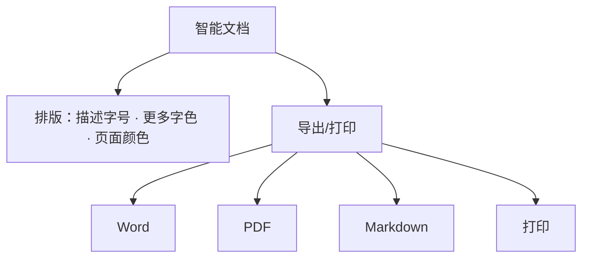

# 智能表格 AI 分析报告（大圆）与智能文档增强

> 本篇是**产品功能层**：5.0.10 除 AI 开放能力外的两个应用内更新。机制性的「智能表格开放接口」属于 [01 AI 开放能力](01-ai-open-capability-cli-mcp.md)，本篇讲终端用户直接使用的功能。事实编号见[文章事实登记](../references/article-source.md)。

## 智能表格：AI 分析报告与智能助理「大圆」

智能表格在 5.0.10 新增 **AI 分析报告**：由企业微信智能助理「**大圆**」分析表中数据，自动生成专业、好看的报告。发布页对该功能明确标注「**功能灰度中**」——即 5.0.10 发布时点该能力仍在灰度放量，并非所有租户可见（F-013，灰度状态以发布页时点为准）。

### 大圆是什么

企业微信官网对智能助理「大圆」的定位是：使用企业微信时可**随时唤起**，它能自然衔接当前功能和上下文，辅助用户更高效地使用企业微信（F-028，官网 AI 介绍）。智能表格分析报告是大圆在表格场景下的能力之一。

### 三个功能点

| 功能点 | 说明 | 事实 |
| --- | --- | --- |
| 自动多维分析 | 大圆能读懂业务数据，从核心指标到各个维度逐步分析，帮用户看清项目进展或业绩变化 | F-014；官网旁证「一键生成专业、美观的分析报告」（F-028） |
| 对话式改稿 | 报告生成后，可继续向大圆提出修改要求：增删分析内容、调整图表样式、切换风格 | F-015；官网旁证「可通过对话灵活调整报告」（F-028） |
| 随数据实时更新 | 表格中的数据有更新时，分析报告也会实时更新 | F-016，**仅发布页单源**（官网摘要未含此句），引用时保持单源标注 |

### 与 AI 开放能力的关系

注意区分两条产品线（F-021）：

- **用户侧（本篇）**：在智能表格界面内让大圆生成/修改分析报告，是 5.0.10 的灰度功能。
- **开发者侧（机制篇）**：核验时官方 AI 开放能力页已把「智能表格」列为独立开放模块，支持创建、检索、读取智能表格内容以及编辑机器人创建的智能表格——即 Agent 通过 CLI/MCP 操作智能表格。两者共同指向「表格数据 → AI 分析」的同一方向，但一个是内置功能、一个是开放接口，灰度/开放范围不应混为一谈。

## 智能文档：排版增强与多格式导出

5.0.10 的智能文档更新分两类（F-017、F-018，企业微信官网逐字旁证，F-029）：

- **排版**：新增**描述字号**，以及更多的**字色、页面颜色**。
- **导出与打印**：支持导出为 **Word、PDF、Markdown** 文件，同时支持**打印**。

官网原文为：「新增描述字号，及更多的字色、页面颜色。支持导出为 Word、PDF、Markdown 文件，也支持了打印」（F-029），与发布页逐字一致。

同样地，「智能文档」在核验时也已是独立的 AI 开放模块（创建/检索/读取/编辑机器人创建的智能文档，F-021）；开发者侧能力见 [01 AI 开放能力模块矩阵](01-ai-open-capability-cli-mcp.md#模块能力矩阵7--10--11-三个口径)。

## 边界提示

- AI 分析报告在 5.0.10 发布时为**灰度功能**，具体可用范围、灰度转正时间以企业微信官方公告为准。
- 「报告随数据更新实时刷新」仅见于发布页（F-016），未有第二信源，勿作为有独立背书的承诺引用。
- 本篇描述的是 5.0.10 时点（2026-08-18）功能；核验时（2026-10-14）版本已演进至 5.0.12，见[总览版本时效](00-wecom-5-0-10-release-overview.md#版本时效位置重要)。
