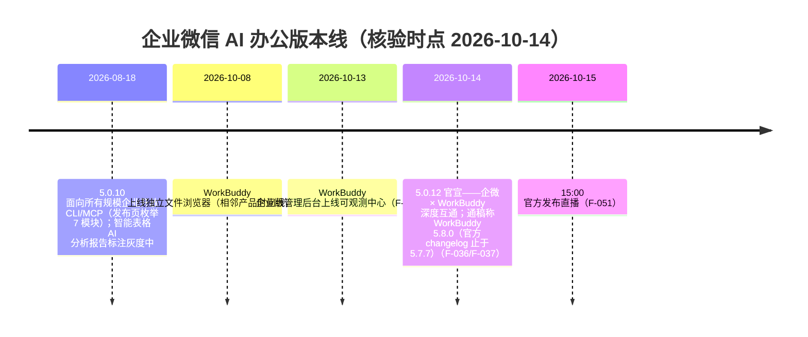

# 企业微信 5.0.12 版本更新总览

> 本篇是**事件事实层**：5.0.12 是什么、何时官宣、更新了什么、处于什么时效位置。互通机制与 AI 协作体系见 [01 WorkBuddy 深度互通与 AI 协作](01-workbuddy-deep-integration-and-ai-agent.md)，终端用户功能见 [02 频道、知识库与应用内协作](02-channels-knowledge-base-and-collaboration.md)，企业治理见 [03 企业安全与对外管理](03-security-and-external-management.md)；全部事实编号见[文章事实登记](../references/article-source.md)。

## 版本一句话

企业微信 **5.0.12** 的核心主题是「**企业微信 × WorkBuddy 联合打造 AI 办公工作台**」：WorkBuddy 以可对话机器人身份进入企业微信，可用企微账号登录并连接消息、邮件、文档、会议等工作上下文（F-001、F-002）。同期发布智能机器人升级、大圆技能与本地操作能力、灰度中的新协作形态「频道」，以及 AI 使用场景下的安全治理（F-001）。

## 发布时间、开放范围与直播

- **官宣日：2026-10-14**。发布页本身未标注日期；当日上海证券报、央广网、36 氪、每日经济新闻、鞭牛士等一致报道「腾讯宣布企业微信与 WorkBuddy 联合发布新版本」、企微推送 5.0.12（F-036）。
- **开放范围（媒体口径）**：互通能力面向企业微信**已认证企业**开放，提供限免体验名额，企业可领取、申请开通或统一采购（F-041，上证报）。
- **发布直播**：官方页面预告 **10 月 15 日 15:00** 直播详细讲解；微信派前一日推文以「明天下午 15:00，直播里看看」侧证同一时间（F-051，官方两渠道一致，无媒体报道该直播）。

## 五项重点功能

| 重点功能 | 一句话 | 详述 |
| --- | --- | --- |
| **企微 × WorkBuddy AI 办公工作台** | WorkBuddy 可用企微账号登录，连接消息、邮件、文档、会议等上下文（F-002） | [01 机制篇](01-workbuddy-deep-integration-and-ai-agent.md)：侧边栏领用、微盘互通、加入大圆列表；通稿称 WorkBuddy 5.8.0 获「十大能力」授权（F-037） |
| **智能机器人升级** | 在通讯录找到机器人发起对话、拉进群聊或频道，可与大圆协作（F-006～F-008） | [01 机制篇](01-workbuddy-deep-integration-and-ai-agent.md)：三入口与频道机器人配置指引（path/101906，正文未取得，F-047） |
| **大圆能力增强** | 新增技能、连接器（MCP），支持读写电脑本地文件、运行命令（F-009、F-010） | [01 机制篇](01-workbuddy-deep-integration-and-ai-agent.md)：均为官方单源；与 WorkBuddy 独立文件浏览器区分（F-043） |
| **新增「频道」（灰度中）** | 以事情为主题、成员共同参与的协作方式（F-018） | [02 产品篇](02-channels-knowledge-base-and-collaboration.md)：场景、链接/二维码邀请、消息存入与搜索（F-019、F-020） |
| **AI 场景安全治理** | 成员使用 AI 时遵循文件防泄漏、敏感行为预警、IP 访问限制等设置（F-028） | [03 治理篇](03-security-and-external-management.md)：另含新增「对外管理」、IP 文档场景灰度、截屏录屏拦截（F-029～F-033） |

除五项重点外，发布页还覆盖**效率工具与基础体验**（知识库、记录面聊、智能表格、智能文档、聊天体验）与**连接微信**（服务总结重点客户提醒），分别见[产品篇](02-channels-knowledge-base-and-collaboration.md)与[治理篇](03-security-and-external-management.md)。

## 灰度功能清单（以发布页文字为限）

| 功能 | 页面标注 | 事实 |
| --- | --- | --- |
| 频道 | 「（灰度中）」 | F-018 |
| IP 访问限制·文档场景 | 「功能灰度中」 | F-031 |
| 智能表格 AI 分析报告 | **5.0.12 页面未再标注灰度** | 5.0.10 页面曾标「功能灰度中」；本版只能确认**标注消失**，发布页未宣布 GA（F-050，跨版口径） |

## 版本时效位置

- 本束是 **5.0.12 的时点快照**（核验日 2026-10-14）；上一版本快照见同分组 [企业微信 5.0.10 版本新功能](../../wecom-5-0-10-release/index.md) 束——两束分工：5.0.10 束讲「能力如何通过 CLI/MCP 开放给 Agent」，本束讲「第三方 Agent（WorkBuddy）如何进入企业通讯录与协作流」。
- **开放能力页现状差**：5.0.12 发布页宣布幻灯片支持 CLI/MCP（F-017），但核验时官方 [AI 开放能力页](https://work.weixin.qq.com/nl/index/aicli?from=new_intro)仍列 11 个模块、未出现幻灯片（F-046）——引用时按「发布页前瞻」处理。

## 阅读路径

- 想了解 WorkBuddy 怎么进企微、大圆和机器人如何协作 → [01 WorkBuddy 深度互通与 AI 协作](01-workbuddy-deep-integration-and-ai-agent.md)
- 想了解频道、知识库、面聊、智能表格等能用什么 → [02 频道、知识库与应用内协作](02-channels-knowledge-base-and-collaboration.md)
- 想评估企业管理与数据安全 → [03 企业安全与对外管理](03-security-and-external-management.md)
- 想核实每条说法 → [文章事实登记](../references/article-source.md)（F-001～F-051）与[核验报告](../references/verification.md)
