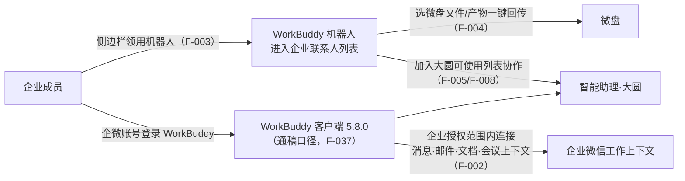

# WorkBuddy 深度互通与企业微信 AI 协作体系

> 本篇是**机制层**：AI Agent（WorkBuddy）与企业微信怎样打通账号与上下文、智能机器人有哪些入口、大圆如何扩展技能与本地操作、CLI/MCP 开放面在本版的增量。企业侧管控策略属[03 治理篇](03-security-and-external-management.md)；终端用户功能属[02 产品篇](02-channels-knowledge-base-and-collaboration.md)。事实编号见[文章事实登记](../references/article-source.md)。

## 互通架构：四件事

| # | 互通动作 | 说明 | 信源层级 |
| --- | --- | --- | --- |
| 1 | **侧边栏领用** | 在企微侧边栏领用 WorkBuddy 机器人，聊天中随时对话执行任务、访问任务结果（F-003） | 官方 + O4/O5/O7 |
| 2 | **账号登录与上下文连接** | WorkBuddy 可用企业微信账号登录，连接消息、**邮件**、文档、会议等上下文处理任务（F-002） | 官方 + 多媒体（媒体举例均无「邮件」，差异见 F-044） |
| 3 | **微盘互通** | WorkBuddy 处理任务时可选微盘内文档和文件，任务产物一键上传微盘（F-004） | ⚠️ 仅官方 |
| 4 | **与大圆协作** | WorkBuddy 机器人可添加至智能助理大圆的可使用列表，协作完成复杂任务（F-005；智能机器人节复现于 F-008） | ⚠️ 仅官方 |

媒体对互通意义的表述是：AI 不仅处理个人任务，还能在企业授权范围内参与企业日常协作与业务流程；企业无需更换平台、迁移数据或改变工作习惯即可引入 AI（O1，F-036/F-037）。

## 版本与授权口径：5.8.0 与「十大能力」

引用本版互通能力时必须带上以下三层口径（F-037、F-044）：

1. **版本号是通稿口径**：通稿称「最新 **5.8.0** 版本的 WorkBuddy 同步支持企业微信账号登录」；但 WorkBuddy [官方更新日志](https://www.workbuddy.cn/docs/workbuddy/Changelog)核验时（2026-10-14）最新仅列至 **5.7.7（2026-10-08）**，没有 5.8.0 条目——属通稿先行、产品文档未同步。
2. **「十大能力」无清单**：通稿称授权范围「包括消息、文档、会议、**网盘**在内的十大能力」，但没有任何信源列全十项；能力举例还有第二个版本——鞭牛士短讯写作「消息、文档、会议、**日程、微盘**」；发布页自己的表述则是「消息、**邮件**、文档、会议」。三处原文并存，不能互相替换。
3. **入口也有两种表述**：长版通稿写「进入企业微信通讯录/企业联系人列表」，短讯与微信派写「侧边栏找到并领取」；实际发布页两个入口都写（侧边栏领用 F-003 + 通讯录找到 F-006）。

互通的开通门槛是**已认证企业**，并提供限免体验名额，可领取、申请开通或统一采购（F-041）。

## 智能机器人：通讯录、群聊、频道三个入口

5.0.12 把智能机器人从「应用内能力」推进到「组织协作者」位置（发布页口径，除通讯录入口外均为官方单源）：

> **口径划界**：通稿与短讯说的「入口」是**领用/找到入口**——侧边栏领取（F-003）与通讯录找到（F-006）两个，媒体各取一面；本节标题的「三个入口」是**领用后的使用面**——通讯录单聊、拉入群聊、拉入频道（F-006/F-007）。两套口径计数对象不同，引用时不要互相替换。

- **通讯录可找**：可在通讯录找到机器人，直接发起聊天或拉入群聊沟通（F-006；「进入企业联系人列表」有 O1 等多媒体佐证）。
- **进频道**：可把机器人拉进频道；频道中的机器人能**感知频道内交流内容**并**主动发送内容**（F-007）。发布页「查看配置指引」指向开发者文档 [path/101906](https://developer.work.weixin.qq.com/document/path/101906)——该路径有效，但页面为 JS 渲染，核验时仅取得上下篇导航（上一篇 path/101904《智能助理调用智能机器人》、下一篇 path/101908《概述》），文档标题与配置步骤未逐字取得（F-047），引用时不得替它编造标题。
- **与大圆协作**：机器人可添加至大圆的可使用列表（F-008）。

## 大圆：技能、MCP 连接器与电脑本地操作

智能助理「大圆」在本版的三个增强（**全部仅官方发布页单源**，F-045）：

| 增强 | 发布页原文要点 | 事实 |
| --- | --- | --- |
| 技能 | 通过技能让大圆按照团队的工作方法处理任务 | F-009 |
| 连接器（MCP） | 通过 MCP 连接企业内外的更多平台和工具 | F-009 |
| 在电脑上工作 | 读写本地文件、运行命令，协助处理日常工作 | F-010 |

**产品边界提示**：F-010（大圆读写本地文件、运行命令）与 WorkBuddy 在 2026-10-08 上线的「独立文件浏览器」（本地文件右键用 WorkBuddy 打开、独立窗口查看 Word/Excel/PPT/PDF 并调 AI，F-043）是**两个产品的两项能力**，不要混写；后者来自上证报时间线，前者仅发布页单源。

## CLI/MCP 开放面的本版增量：幻灯片（前瞻口径）

截至 5.0.12 核验时（2026-10-14），企业微信已通过 CLI/MCP 开放 11 个办公模块（5.0.10 发布页时点为 7 个，机制详见 [5.0.10 束 01 篇](../../wecom-5-0-10-release/concepts/01-ai-open-capability-cli-mcp.md)）。5.0.12 发布页给出的增量是：

> **幻灯片支持通过 CLI 和 MCP 接口来读取和编辑。Agent 可以创建或导入幻灯片、搜索和读取幻灯片中的内容。**（F-017）

⚠️ **这是发布页前瞻，不是能力页现状**：核验同日访问官方 [AI 开放能力页](https://work.weixin.qq.com/nl/index/aicli?from=new_intro)，核心开放能力仍是消息、邮件、文档、表格、智能表格、智能文档、待办、日程、会议、微盘、通讯录 **11 个模块，没有「幻灯片」卡片**（F-046）。因此正确表述是「5.0.12 发布页宣布幻灯片 CLI/MCP 能力，核验时官方能力页尚未列出」，不能写成「已可通过 CLI/MCP 操作幻灯片」。

## 管理员侧：统一配置与多模型多 Agent

与上述互通配套的企业管理能力（多媒体一致，注意它属于 **WorkBuddy 管控面**，与发布页「企业安全管理」节的企微原生策略不是一套东西，F-042）：

- 管理员可统一配置企业的 WorkBuddy 机器人，进行**账号分配、用量管理、AI 算力采购**；
- 按员工组织身份设置不同访问权限，**限制 AI 访问高敏感信息**，界定数据流转路径与责任边界；
- 企业微信与 WorkBuddy 支持**多模型、多 Agent** 开放选择，按岗位和业务组合 AI 能力。

相邻的管理侧产品时间线：2026-10-13 WorkBuddy 企业版管理后台上线「可观测中心」，对企业内 Agent 使用情况做全链路数据采集、存储与分析（F-043）。企微原生的 AI 安全策略（文件防泄漏、对外管理、截屏管控等）见 [03 治理篇](03-security-and-external-management.md)。

## 边界提示

- 5.8.0 版本号、十大能力清单、频道机器人细节、大圆本地操作在核验日分别处于「通稿先行」或「官方单源」状态，做方案前应在 WorkBuddy 更新日志、企微开发者文档与 10-15 直播后材料中复核（F-037、F-045、F-051）。
- 本篇不构成机器人开发或 Skill 安装教程；CLI/MCP 的安装路径、命令口径与兼容 Agent 清单以 [5.0.10 束机制篇](../../wecom-5-0-10-release/concepts/01-ai-open-capability-cli-mcp.md)与官方 AI 开放能力页为准。
