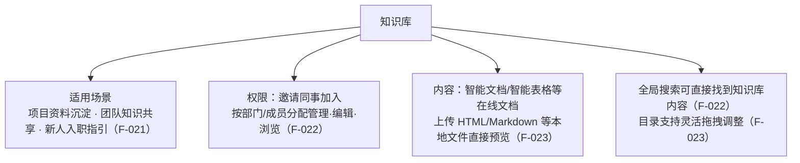

# 频道、知识库与应用内协作更新

> 本篇是**产品功能层**：5.0.12 中终端用户直接使用的协作与文档更新。机制性的机器人进频道、CLI/MCP 能力见 [01 机制篇](01-workbuddy-deep-integration-and-ai-agent.md)；治理相关设置见 [03 治理篇](03-security-and-external-management.md)。本篇功能在核验日（2026-10-14）**除智能表格 AI 报告有历史旁证外，均仅有官方发布页一个公开出处**（F-045），引用时保持此信源层级。事实编号见[文章事实登记](../references/article-source.md)。

## 频道：以事情为主题的协作（灰度中）

「**频道**」是 5.0.12 新增的协作形态，发布页定义为「以事情为主题，成员共同参与的一种协作方式」，明确标注**功能灰度中**（F-018）。

| 维度 | 发布页口径 | 事实 |
| --- | --- | --- |
| 场景 | 推进项目协作、收集产品意见、分享知识经验；可添加机器人进频道共同协作提效；官方另提供[场景示例页](https://page.weixin.qq.com/smartpage/p/b1_AW8AegaNAGEk03r1eTHS8eOznd6?p=HXPk2x) | F-019 |
| 加入方式 | 通过频道链接和二维码邀请成员加入 | F-020 |
| 消息沉淀 | 聊天消息可一键存入频道 | F-020 |
| 检索 | 频道支持搜索 | F-020 |
| 机器人 | 机器人在频道中可感知交流内容、主动发送内容；配置指引 path/101906（正文未取得，F-047） | F-007 |

灰度范围与转正时间以企业微信官方公告为准；2026-10-14 的媒体报道均未提及频道（F-045）。

## 文档：新增「知识库」

文档体系在本版新增「**知识库**」，定位是集中沉淀团队文档和资料、方便同事查找与共享（F-021）。

- **权限**：支持邀请同事加入，按部门、成员灵活分配管理、编辑、浏览权限（F-022）。
- **查找**：成员在全局搜索中可直接找到知识库内容（F-022）。
- **内容与目录**：可添加智能文档、智能表格等在线文档；支持上传 HTML、Markdown 等多种本地文件并直接预览；目录结构可灵活拖拽调整（F-023）。

## 记录面聊

面聊（面对面沟通/语音沟通记录）能力在本版形成「记录—沉淀—聚合」链路（均仅官方单源）：

- **沉淀到智能文档**：面聊总结可沉淀到智能文档，便于个性化编辑和分享（F-011）。
- **电脑端记录**：支持在电脑上记录面聊，首页点「+」即可开始；支持记录和同事的语音通话，沉淀和回顾工作讨论，也可按需关闭记录（F-012）。
- **列表聚合**：支持在消息列表中聚合展示面聊，让列表更清晰（F-013）。

## 智能表格：AI 报告延续 + 结构化增强

### AI 分析报告（注意灰度口径的跨版变化）

5.0.12 页面继续描述智能表格的一键分析报告：数据一键生成专业、美观的分析报告，可通过对话增删分析内容、修改图表样式、切换风格；表中数据变化时报告实时更新（F-014）。

⚠️ **灰度标注的跨版变化**：该功能在 5.0.10 发布页标注「功能灰度中」，5.0.12 同功能段落**未再出现灰度标注**。但发布页也**没有任何「已转正/全量开放」的表述**——本束只陈述「页面标注消失」这一事实，不替官方宣布 GA（F-050）。「报告随数据实时更新」一句在两个版本都仅见于官方发布页，属官方单源承诺（F-014）。

### 结构与基础功能

| 更新 | 说明 | 事实 |
| --- | --- | --- |
| 父子记录 | 在记录下方添加子记录，清晰展示项目中的层级关系 | F-015 |
| 跨表引用与联动 | 支持引用其他工作表的列数据作为选项、设置选项联动条件 | F-016 |
| 文件夹 | 新增文件夹，可分类整理工作表 | F-016 |
| 公式增强 | 新增 SORT（排序）等 **42 个函数**（发布页计数，单源） | F-016 |

## 智能文档：引用转发与 LaTeX

- **引用转发**：支持选中文档任意内容转发到聊天，不必整篇转发（F-024）。
- **LaTeX 公式**：支持添加 LaTeX 公式，数学公式的编辑和排版更方便（F-024）。

5.0.10 周期的描述字号、字色/页面颜色增强与 Word/PDF/Markdown 导出仍在，见 [5.0.10 束产品篇](../../wecom-5-0-10-release/concepts/02-smart-sheet-dayuan-and-smart-doc.md)。

## 聊天和基础体验

- **Office 文件快捷转在线文档**：对聊天中的 Word、Excel、PPT、PDF 文件长按/右键，可快捷转为在线文档共同协作编辑（F-025）。
- **HTML/Markdown 预览**：聊天中的 HTML、Markdown 文件支持预览渲染效果（F-026）——与知识库内 HTML/Markdown 上传预览（F-023）是同一渲染方向在两个入口的落地。
- **移动端输入**：支持在手机上全屏输入，输入长文本更方便（F-027）。
- **无障碍**：提升无障碍体验，支持适配设备上的旁白、屏幕朗读器功能（F-027）。

## 边界提示

- 本篇除 AI 分析报告外均为**官方单源**（F-045）：频道实际体验、知识库容量与格式支持范围、42 个函数完整清单、面聊可用端等，以官方帮助中心与后续实测材料为准。
- 频道与 IP 访问限制文档场景是本版明确标注灰度的两项功能（F-018、F-031）；AI 报告的灰度状态只能确认「本版未标注」（F-050）。
