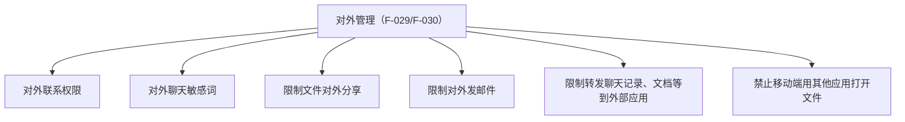

# 企业安全治理：AI 继承策略、对外管理与连接微信

> 本篇是**治理层**：5.0.12 让企业既有的安全管理边界覆盖到 AI 使用场景，并新增面向企业外协作的统一管控。机制篇中的 WorkBuddy 管理后台管控（账号分配/算力采购/高敏感信息限制，F-042）是**另一套管理面**，不要与本篇的企微原生策略混写。本篇功能在核验日（2026-10-14）均仅见官方发布页单源（F-045）。事实编号见[文章事实登记](../references/article-source.md)。

## 治理逻辑一句话

5.0.12 安全板块的主线是「**成员使用 AI 时，默认落在企业既有安全策略边界内**」：已生效安全管理的成员，使用 AI 功能时默认遵循文件防泄漏、文件敏感行为预警、IP 访问限制等设置（F-028）。即 AI 不创造新的豁免通道。

## AI 使用继承的三项既有策略

| 策略 | 在 AI 场景的含义（发布页口径） | 事实 |
| --- | --- | --- |
| 文件防泄漏 | 成员经 AI 接触/产出文件时受防泄漏规则约束（精细化维度见下节） | F-028、F-033 |
| 文件敏感行为预警 | 成员的文件敏感行为在 AI 使用中同样触发预警 | F-028 |
| IP 访问限制 | 成员仅可在指定 IP 网络下访问受控资源；本版新增**文档场景**（灰度中） | F-028、F-031 |

## 新增「对外管理」

「**对外管理**」统一管理成员与企业外的沟通协作，以及使用外部应用打开文件（F-029）。具体四类管控：

- **对外沟通四策略**：为成员设置对外联系权限、对外聊天敏感词、限制文件对外分享、限制对外发邮件（F-029）。
- **外部应用边界**：可限制成员转发聊天记录、文档等到外部应用；禁止移动端用其他应用打开文件，降低外泄风险（F-030）。

## 其余安全更新

| 能力 | 发布页口径 | 范围/状态 | 事实 |
| --- | --- | --- | --- |
| IP 访问限制·文档场景 | 开启后成员仅可在指定 IP 网络下访问文档 | **功能灰度中** | F-031 |
| 截屏/录屏管理 | 开启后可拦截成员在**苹果手机和电脑**上截屏；企业可记录截屏/录屏行为，留痕可追溯 | 平台范围仅述苹果手机与电脑 | F-032 |
| 文件防泄漏精细化 | 开启后可按**成员、文件格式、文件大小**精细化限制文件对外分享 | 既有能力细化 | F-033 |

## 连接微信：服务总结的重点客户提醒

面向连接微信的客户经营场景，本版更新「**服务总结**」：

- AI 将**每天自动总结重点客户**，并在**早上 9 点**提醒关注（F-034）；
- 还可结合业务需求**配置提醒规则**（F-034）。

该能力在核验日仅官方发布页一个出处（F-045），「重点客户」的判定规则、提醒触达端以官方后续说明为准。

## 规则文件更新

发布页声明同步更新了三份规则文件（F-035，链接均为官方域，本束只登记更新事实、不转述细则）：

- [隐私保护指引](https://work.weixin.qq.com/nl/privacy)
- [智能助理使用规则](https://work.weixin.qq.com/nl/act/p/4b15e2434c5e4ad0)
- [个人信息处理规则](https://work.weixin.qq.com/nl/act/p/7114200033b04e13)

## 边界提示

- **两套管理面不要合并**：本篇是企业微信原生安全策略在 AI/对外场景的延伸（F-028～F-033，仅官方单源）；WorkBuddy 机器人的账号分配、用量管理、算力采购、高敏感信息限制是互通方案的企业管理侧能力，出自媒体报道（F-042），详见 [01 机制篇](01-workbuddy-deep-integration-and-ai-agent.md)「管理员侧」一节。
- 平台范围（截屏管控仅述苹果手机与电脑）、灰度状态（IP 文档场景）、策略生效细则均以发布页文字为限；企业落地前应在管理后台与官方帮助中核对实际开关。
- 安全类报道的信源现状：2026-10-14 媒体只覆盖 WorkBuddy 管控线，无一家提及「对外管理」或三项策略名称（F-045），故本篇不提供媒体旁证。
