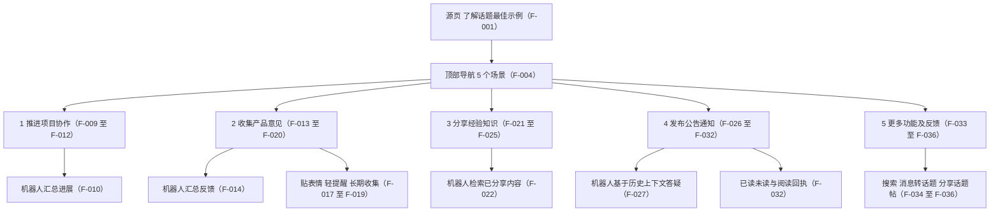

# 话题场景示例页总览：场景全景与信源边界

> 本篇是**源页定位层**：这是什么页、5 个场景怎么分、什么角色适用、信源有多强、页面没说什么。场景机制分别见 [01 推进项目协作](01-task-collaboration.md)、[02 收集产品意见](02-feedback-collection.md)、[03 分享经验知识与发布公告通知](03-knowledge-sharing-and-announcement.md) 与 [04 更多功能及反馈](04-general-capabilities-and-feedback.md)；全部事实编号见[文章事实登记](../references/article-source.md)。

## 源页定位

- 页面大标题「了解话题最佳示例」（F-001），平台标识「使用 智能文档 发布」（F-002），顶部标注「使用场景：」（F-003）——这是一份**用 5 个平行场景替「话题」功能做价值论证**的厂商场景说明，不是版本发布资讯，也不是操作手册/帮助文档。
- 结构：顶部导航 5 项，顺序为 🤝 推进项目协作 / 💬 收集产品意见 / 📘 分享经验知识 / 📣 发布公告通知 / ✨ 更多功能及反馈（F-004）；正文为分页形态，同一 smartpage 以 `?p=` 区分（F-007）；每页底部有「更多场景」交叉链接区，链向其余 4 个场景（F-006）；页脚有反馈入口「关于话题功能 你有什么想反馈吗？」＋按钮「我想反馈」（F-005）。
- **不是操作教程**：页面没有安装/配置/开通步骤；开通条件、套餐要求、客户端版本门槛、功能入口路径均**官方未给**（F-044），故本束不设 `examples/`（判定见 [log](../log.md)）。
- **功能名的口径**：源页自述功能名为「**话题**」；同分组 5.0.12 束登记的对应功能名为「**频道**」（F-018～F-020），二者关系**官方未给**，本束并置登记、不择一断言（F-045）。

## 5 场景全景

| 场景 | 适用对象 | 优势条目数 | 主打机制 | 事实 |
| --- | --- | --- | --- | --- |
| 推进项目协作 | 项目管理、产品经理、销售、商务等 | 3 | 机器人汇总工作进展；一事一帖不串线；脉络完整 | F-009～F-012 |
| 收集产品意见 | 产品经理、运营、客服、行政等 | 4 | 机器人汇总去重；一事一帖；贴表情/轻提醒/长期收集；进展与跟进同处 | F-013～F-020 |
| 分享经验知识 | 任何乐于分享知识、向往团队学习交流的人 | 4 | 机器人检索已分享内容；一主题一帖；互动低压力；可自由邀请加入 | F-021～F-025 |
| 发布公告通知 | 行政、人事、秘书、项目/团队负责人 | 6 | 机器人基于历史上下文答疑；通知独立不被冲走；答疑集中；可编辑；已读未读可见 | F-026～F-032 |
| 更多功能及反馈 | 未单列（功能清单页） | 3 项能力 | 搜索、消息转话题、分享话题帖 | F-033～F-036 |

> 五组「适用对象」均为**厂商描述性口径**（带「等」字，或为描述性短语），非规范性限制；页面未声明任何角色的准入或使用限制（F-046）。

## 场景全景图

> 图中每个节点均对应[文章事实登记](../references/article-source.md)中的 F 编号，无一条超出源页可支撑范围。

## 对照论证一览（群聊 vs 话题）

全页共 **8 组**「群聊：… ／ ✅ 话题：…」并列对照，分布在 3 个场景；分享经验知识（P3）与更多功能及反馈（P5）**无**此类对照（F-037）。

| 场景 | 优势 | 群聊侧（原文） | 话题侧（原文） | 事实 |
| --- | --- | --- | --- | --- |
| 推进项目协作 | 事项独立，讨论互不串线 | 多项工作的消息互相穿插，容易串线 | 一项工作一个帖子，一目了然 | F-011 |
| 收集产品意见 | 一事一帖，意见一目了然 | 你的消息容易被冲走；得到的意见夹在群聊中 | 一条意见一个帖子，一目了然 | F-015 |
| 收集产品意见 | 轻松互动，表达没有压力 | 同事们可能碍于社交压力，无法畅所欲言 | 贴表情+轻提醒 鼓励大家发声 | F-016 |
| 收集产品意见 | 进展清晰，跟进随时同步 | 事件进展需要建多个小群同步相关方 | 意见与跟进汇集在帖子及评论区 | F-020 |
| 发布公告通知 | 重要通知，不被聊天冲走 | 重要通知容易被冲走 | 一条通知一个帖 | F-028 |
| 发布公告通知 | 问答集中，不用重复解释 | 同样的问题反复答 | 答疑集中在评论区，所有人可见 | F-029 |
| 发布公告通知 | 信息留存，新人快速跟上 | 新人难同步 | 新人加入也一目了然 | F-030 |
| 发布公告通知 | 随时修改，无需另发更正 | 想修改通知只能重发一条 | 支持编辑修改话题帖 | F-031 |

## 信源属性与快照时效

- **单源**：源页位于厂商自有域名（`page.weixin.qq.com`）的 smartpage/智能文档发布形态；核验过程**未检得任何第三方独立信源**覆盖或转述该页（F-040）。
- **无日期/版本**：页面**未给出**发布日期、版本号、作者、更新时间中任何一项，页面自身不含官方时效锚点（F-041）。
- **可达性**：未登录访客**不可直读**——命中登录墙（企业身份／个人身份／扫码）；静态 HTML 不含正文标记，正文需企业微信登录态渲染后取得（F-042）。
- **快照基准**：以抓取日 **2026-10-16** 为快照基准日；`stale_after` 对齐同分组版本资讯束基线 **2027-01-31**，到期复核页面是否仍存续及内容漂移（F-047）。
- **零量化**：页面无提效倍数、工时、满意度等量化指标，亦无客户案例与规模数字（F-039）。

## 官方未给项清单

| 未给项 | 对读者的影响 | 事实 |
| --- | --- | --- |
| 开通条件 | 无法判断自己的组织能否启用 | F-044 |
| 套餐要求 | 无法判断是否需要付费或特定版本 | F-044 |
| 客户端版本门槛 | 无法判断在哪个端、哪个版本可用 | F-044 |
| 功能入口路径 | 无法据此找到并开始使用 | F-044 |
| 话题内容器人的来源与权限范围 | 无法判断机器人从哪添加、能读什么数据 | F-044 |

> 另有链接目标未取得：4 处「（点击查看API接口文档）」锚文本目标 URL 与内容（F-038）、页脚「我想反馈」按钮指向地址（F-005）——本束只登记存在性与锚文本，不转述目标页内容。

## 阅读路径

- 想看项目/任务型协作怎么用 → [01 推进项目协作](01-task-collaboration.md)
- 想收集意见与反馈 → [02 收集产品意见](02-feedback-collection.md)
- 想做知识沉淀与公告发布 → [03 分享经验知识与发布公告通知](03-knowledge-sharing-and-announcement.md)
- 想看搜索/转话题/分享等通用能力与反馈入口 → [04 更多功能及反馈](04-general-capabilities-and-feedback.md)
- 想核实每条说法与信源距离 → [文章事实登记](../references/article-source.md)（F-001～F-047）与[核验报告](../references/verification.md)
