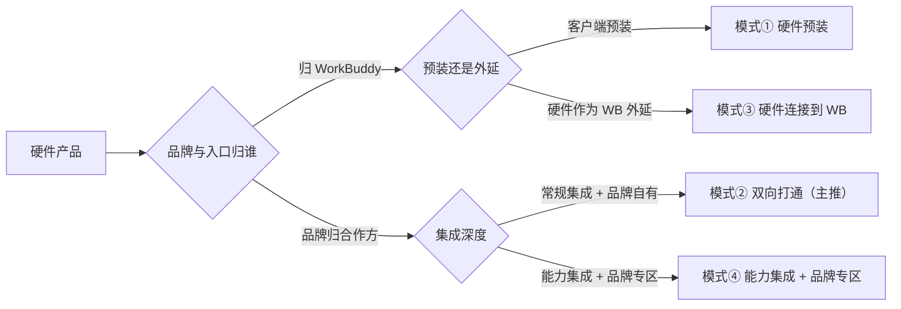

# 合作模式与商业模式：三方分工、四模式选择与结算口径

本篇是「战略与商务」的第三篇，回答三方怎么分工、四种模式怎么选、商业与结算怎么走。上承 [硬件价值与六类触点](01-hardware-value-and-six-touchpoints.md)。

## 三方协同

硬件合作是 **WorkBuddy · 硬件伙伴 · 终端用户** 的三方共赢（F-040），各方各有所出、各有所得（F-041 ~ F-045）：

| 角色 | 带来什么 | 得到什么 |
| --- | --- | --- |
| WorkBuddy | Agent 内核、标准 SDK 与 API、Skills 生态、品牌与技术背书、长期迭代与维保（F-041） | 与硬件伙伴共建的场景与用户资产、生态影响力、合理的能力对价（F-042） |
| 硬件伙伴 | 硬件形态与工业设计、真实使用场景、渠道触达能力、用户与运营经验（F-043） | 开箱即用的 AI 灵魂、差异化产品卖点、多元商业增收路径、快速落地不重复造轮子（F-044） |
| 终端用户 | 真实场景使用反馈，驱动硬件与 AI 能力共同迭代（F-045） | 开箱即得的 AI 助理、跨端一致的记忆与工作节奏、数字员工级日常协同（F-045） |

## 模式决策：先答三个问题

合作归属由三个问题决定：**① 谁进谁**（硬件装进 WorkBuddy 还是 WorkBuddy 装进硬件）、**② 品牌与入口归谁**、**③ 用户与数据分成归谁**（F-046）。沿下图从左向右回答，即可落到四种模式之一：① 硬件预装、② 双向打通（主推）、③ 硬件连接到 WB、④ 能力集成 + 品牌专区（F-047）。白皮书 §4.2 的 ASCII 决策图整理如下（分支与 F-046、F-047 一致）：

四种模式可按五个维度对照（F-048 ~ F-051）：

| 维度 | ① 硬件预装 | ② 双向打通（主推） | ③ 硬件连接到 WB | ④ 能力集成 + 品牌专区 |
| --- | --- | --- | --- | --- |
| 装入方向 | WB 装进硬件（F-048） | WB ↔ App 双向互通（F-049） | 硬件装进 WB（F-050） | 能力 / 品牌装进 WB（F-051） |
| 品牌 / 入口 | WB 主导（F-048） | 合作方 + WB 双入口（F-049） | WB（F-050） | 合作方品牌（WB 内品牌专区）（F-051） |
| 集成深度 | 应用层预装（F-048） | OpenAPI 双向调用（F-049） | Claw / Connector / 蓝牙（F-050） | Skill + Connector + 专家（F-051） |
| 典型硬件 | PC / 平板 / 云桌面 / 终端（F-048） | 有自有 App 的智能设备（F-049） | 键盘 / 鼠标 / 耳机等外设（F-050） | SaaS / 工具 / 内容伙伴（F-051） |
| 独家性 | 非独家（F-048） | 非独家（F-049） | 头部精选、收敛不铺量（F-050） | 非独家（F-051） |

## 怎么选：起步模式

白皮书建议：**双向打通**接入轻、双方各有入口、可快速验证效果，从已回收的伙伴意向看近七成伙伴以它起步（F-052，`厂商自宣口径`）；「硬件预装」适合有海量设备的大厂，通常涉及 WorkBuddy 侧付费或分成投入，门槛与周期相对较高（F-053）。实践中两种组合最常见：双向打通 + 能力集成 / 品牌专区、双向打通 + 硬件连接（F-054）。

## 四种模式详解

| 模式 | 谁适合 | 怎么做 | 事实 |
| --- | --- | --- | --- |
| ① 硬件预装 | 有海量存量设备 / 用户、有系统级或应用商店分发入口的 PC / 平板 / 终端大厂 | WB 预装到伙伴设备 + 应用市场分发；无自有算力 → WB 提供产品（可按行业场景定制）与厂商集采会员；有自有算力 → 算力分成或 license 结算 | F-055、F-056 |
| ② 双向打通（主推） | 有自有 App、希望与 WB 双向互通、共同放大体验的伙伴 | 两条同步推进：伙伴 App 经 Task OpenAPI 调 WB；伙伴 App 经自家 OpenAPI 向 WB 开放信息资产；两条都要做 | F-058、F-059 |
| ③ 硬件连接到 WB | 具备 WiFi / 蓝牙能力、希望用户在 WB 上完成设备使用与管理的设备厂商 | 硬件通过 WB 交付软件服务、绑定到 WB 账侧成为可调度物理节点；**只与行业内头部重点伙伴合作** | F-060 |
| ④ 能力集成 + 品牌专区 | 有软件能力 / 内容 / 服务的 SaaS、工具、内容伙伴 | 三形态任选或组合：Skill（agent skill 挂进 WB）、Connector（数据 / 能力做成 connector）、专家（以「专家 / 专家团」入驻专家中心）；另可配置独立品牌落地页 / 专区 | F-061、F-062 |

模式①另有说明：涉及角色较多、决策周期长；建议设备体量有限的团队优先从模式②验证（F-057）。

## 合作范本

两个合作范本如下，其商务结构均为框架性参考、具体金额与结算周期以双方协议为准（F-065）：

| 范本 | 模式 | 合作方画像 | 合作形态 | 商务结构（`商务框架性参考`） |
| --- | --- | --- | --- | --- |
| A · 双向打通 | 模式② | 有自有 App 的智能设备品牌 | Task OpenAPI 把 WB 能力接入自有 App，同时向 WB 开放自家数据 | 会员 / 积分采购 + 算力用量结算（F-063） |
| B · 外设接入 WB | 模式③ | 具备蓝牙 / WiFi 能力的外设厂商 | 厂商提供 Claw / Connector 能力，支持蓝牙轻量化接入 | 品牌授权 + 算力分成 + 联合投放（F-064） |

## 商业模式与三条路径

WorkBuddy 对硬件伙伴开放**自助接入**：伙伴可通过开放平台（open.workbuddy.cn）自助申请并完成接入，接入环节目前不收费；完成接入即可对外说明「适配 WorkBuddy」「兼容 WorkBuddy」（F-066、F-067）。商业基本原则是「硬件方卖硬件、WorkBuddy 卖 AI 能力，各自独立结算」（F-068），三条路径可单选或组合：

| 商业路径 | 机制 | 限定 | 事实 |
| --- | --- | --- | --- |
| 个人会员 / 积分采购 | 硬件方预付采购会员额度或积分，随硬件赠送 / 兑换给最终用户，按采购规模阶梯定价；仅限赠送、不可转售或对外售卖 | 阶梯价以协议为准 | F-069 |
| 算力 / 能力分成 | 硬件侧调用 WorkBuddy Agent 能力，按 Task 用量 / API 调用量 / 订阅席位分成 | 分成比例一事一议 | F-070 |
| 品牌授权费 | 适用于「WorkBuddy 认证」标识授权、战略集成、定制专区，一次性或年度授权费 | 授权费以协议为准 | F-071 |

> 三条路径的额度、比例与费用均为框架性参考（`商务框架性参考`，F-069 ~ F-071）。

## 结算口径

六条结算基本口径：

| # | 口径 | 事实 | 标注 |
| --- | --- | --- | --- |
| 1 | 会员 / 积分采购为预付费，需卷入商务对接，企业需具备腾讯云 UIN | F-072 | `商务框架性参考`，价格以协议为准 |
| 2 | 权益发放必须通过 API 直充至最终用户账号，不允许直接向用户发放兑换码 | F-073 | 已核验 |
| 3 | 用户身份基于 OAuth 授权后颁发的 open_id 唯一标识 | F-074 | 已核验 |
| 4 | 合作数据每月对账，看板实时可查 | F-075 | 已核验 |
| 5 | 具体阶梯价、分成比例、授权费通过商务窗口一事一议 | F-076 | `商务框架性参考` |
| 6 | 商业化分级、二次付费规则与数据分账说明，以开放平台官网公示及双方商务协议为准 | F-077 | `商务框架性参考`，`以官网为准` |

## 合作分层与边界

| 层级 | 门槛 | 权益 |
| --- | --- | --- |
| L1 接入级 | 开放平台自助申请、完成接入即达，目前不收费（F-078） | 可用「适配 / 兼容 WorkBuddy」文字表述；不加 Logo、不做认证标识（F-078） |
| L2 认证级 | 需通过 WorkBuddy 官方认证标准（F-079） | 可用「WorkBuddy 认证」标识（产品与包装），并签署品牌授权合同（F-079） |

合作边界划四条：**硬件售卖**由合作方自主定价、渠道与销售，WB 不干涉；**软件保障**（账号 / 权益 / 能力稳定性）由 WB 承担；**联合 PR / 市场宣推**开放但需双方评估；**联名款**不在常规分层内，单独沟通（F-080）。

技术方案适用范围：第三部分的技术接入方案（OAuth 2.0 授权、Assistants 与 Tasks 接口、本机能力）主要服务**模式②与模式③**，亦可用于模式①的 App 内 AI 能力实现；模式④的 Connector 另有独立文档（F-081）。

> 事实出处与核验：[事实登记](../references/article-source.md)、[核验报告](../references/verification.md)。
