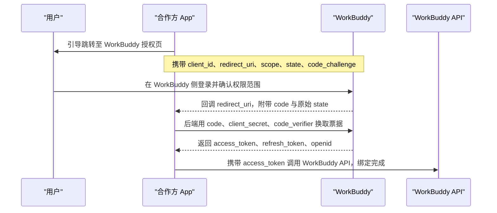

# WorkBuddy OAuth 2.0 授权码流程与票据生命周期

本篇回答一个具体问题：硬件合作方要拿到 WorkBuddy 的个人票据，OAuth 2.0 授权码 + PKCE 到底怎么走？换票、刷新与撤销分别怎么做？用户身份又如何标识？事实取自白皮书 §8 授权登录（F-119 ~ F-131）。其中「授权流程」解决如何合法拿到票据，「刷新与撤销」解决票据失效后如何维持或终止访问，「用户标识」解决合作方如何在自身系统里区分不同用户。需注意，本篇的端点、参数与 scope 名均为白皮书发行日的快照，实际以官网开发者文档最新版本为准（F-113，`以官网为准`）。

## 一、授权模式总述

WorkBuddy 采用标准 OAuth 2.0 授权码流程并支持 PKCE（F-119）。其关键特征是：用户在 WorkBuddy 侧完成登录与权限确认，合作方应用后端通过 code 换取个人票据，**全程不接触用户密码**（F-119）。把密码留在 WorkBuddy 一侧、让合作方只拿到可过期、可撤销的票据，是本流程最核心的安全收益。由于硬件端通常不具备安全保管长期凭据的条件，「密码不进合作方、票据可撤销」这一设计把授权风险收敛到了后端（F-119、F-127）。

## 二、前置准备三项

在发起授权之前，合作方需完成三项准备（F-120 ~ F-122）：

| 前置项 | 内容 |
| --- | --- |
| 注册应用 | 在 WorkBuddy 开放平台注册应用，获取 client_id 与 client_secret（F-120） |
| 登记回调地址 | 登记授权回调地址 redirect_uri（F-121） |
| 勾选权限范围 | 按业务需要勾选 scope：assistant.read、assistant.write、task.read、task.write；如需本机能力再勾选 local.execute 与 local.file.read；如需积分再勾选 credit.read（F-122） |

scope 采用「按需最小勾选」的做法：基础能力（助理与任务）对应 assistant.read/write 与 task.read/write 四项；本机能力对应 local.execute 与 local.file.read；积分相关对应 credit.read（F-122）。

## 三、授权流程五步

完整流程共分五步（F-123），可用下面的时序图表示：



五步的文字对应关系是：① 合作方 App 引导用户跳转至 WorkBuddy 授权页，携带 client_id、redirect_uri、scope、state、code_challenge；② 用户在 WorkBuddy 侧登录并确认权限范围；③ WorkBuddy 回调 redirect_uri，附带 code 与原始 state；④ 合作方 App 后端用 code、client_secret 与 code_verifier 换取 access_token、refresh_token 与 openid；⑤ 合作方 App 携带 access_token 调用 WorkBuddy API，绑定完成（F-123）。其中前两步在 WorkBuddy 侧完成，避免合作方经手用户凭据；后三步在合作方后端完成，用 code 换票之后才具备真正的调用能力（F-123）。

## 四、换取个人票据

### 授权页跳转链接

授权页为 GET 请求，端点为 `https://open.workbuddy.cn/oauth/authorize`，参数如下（F-124）：

```
GET https://open.workbuddy.cn/oauth/authorize
  ?response_type=code
  &client_id=YOUR_CLIENT_ID
  &redirect_uri=https%3A%2F%2Fyourapp.com%2Fcallback
  &scope=assistant.read assistant.write task.read task.write
  &state=RANDOM_STATE
  &code_challenge=CODE_CHALLENGE
  &code_challenge_method=S256
```

其中 response_type 固定为 code；scope 按需勾选；state 用于回传原始状态；code_challenge_method 固定为 S256（F-124）。

### 使用授权码换取票据

换票为 POST 请求，端点为 `https://open.workbuddy.cn/oauth/token`，请求头 `Content-Type: application/x-www-form-urlencoded`，参数如下（F-125）：

```
POST https://open.workbuddy.cn/oauth/token
Content-Type: application/x-www-form-urlencoded

grant_type=authorization_code
&code=RECEIVED_CODE
&redirect_uri=https%3A%2F%2Fyourapp.com%2Fcallback
&client_id=YOUR_CLIENT_ID
&client_secret=YOUR_CLIENT_SECRET
&code_verifier=CODE_VERIFIER
```

### 返回结构

换票成功后返回 access_token、refresh_token、token_type、expires_in、scope 与 openid（F-126）：

```
{
  "access_token": "eyJhbGciOi...",
  "refresh_token": "rt_xxx",
  "token_type": "Bearer",
  "expires_in": 7200,
  "scope": "assistant.read assistant.write task.read task.write",
  "openid": "o_xxx"
}
```

其中 token_type 为 Bearer、expires_in 为 7200 秒（F-126）。这几个字段各自决定了后续行为：access_token 用于调用接口，refresh_token 用于票据续期，openid 用于用户隔离，expires_in 用于判断何时需要刷新（F-126）。

## 五、票据保管纪律

个人票据应保存在合作方 App 后端，不建议下发到硬件端或前端；硬件与前端应通过合作方后端间接调用 WorkBuddy API（F-127）。由于票据代表用户身份、可用于调用该用户的全部开放接口，一旦下发到端侧，凭据泄露与合规风险都会被显著放大（F-127）。因此，把换票得到的三元组（access_token、refresh_token、openid）落到受控的服务端存储，是接入前的必备设计（F-127、F-126）。

## 六、刷新与撤销

### 刷新票据

刷新票据同样走 POST /oauth/token，参数为 grant_type=refresh_token、refresh_token、client_id、client_secret（F-128）：

```
POST /oauth/token
grant_type=refresh_token
&refresh_token=rt_xxx
&client_id=YOUR_CLIENT_ID
&client_secret=YOUR_CLIENT_SECRET
```

### 撤销授权（两条路径）

- **用户侧**：用户可在 WorkBuddy 后台随时撤销合作方应用的授权，此后老票据立即作废（F-129）。
- **合作方侧**：合作方应用主动撤销可调用 POST /oauth/revoke（F-129）。

### 401 处理

接口若返回 401 invalid_token，应引导用户重新完成授权（F-130）。刷新与撤销共同决定了票据的生命周期：正常情况下用 refresh_token 续期，由用户或合作方主动终止则票据立即失效（F-128、F-129）。

## 七、用户标识三级

合作方在自身系统中标识用户时，会用到三级用户标识（F-131）：

| 标识 | 含义 | 粒度 | 对开发者可见 |
| --- | --- | --- | --- |
| openid | 用户在合作方 App 下的唯一标识 | 每个应用 | 是（F-131） |
| unionid | 同一开发者跨 App 的用户统一标识 | 每个开发者 | 是（F-131） |
| uid | WorkBuddy 平台用户唯一标识 | 全局 | 否（F-131） |

实用含义是：openid 适合做单个应用内的用户主键（粒度按应用隔离），unionid 适合在同一开发者的多个应用之间打通同一用户，而 uid 是平台内部标识，对开发者不可见（F-131）。这也是合作方侧区分不同用户、并为每个用户隔离数据的基础（F-131）。

## 八、收尾提示

本篇的端点、参数与 scope 名均为白皮书发行日（2026 年 08 月）的快照，实际接口与参数以官网开发者文档的最新版本为准（F-002、F-113，`以官网为准`）。接口调用示例见 [接口调用](06-assistant-and-task-apis.md)，开放平台的整体能力构成见 [开放平台与核心概念](04-open-platform-and-core-concepts.md)。

---

- 事实出处与核验：[事实登记](../references/article-source.md)、[核验报告](../references/verification.md)。
