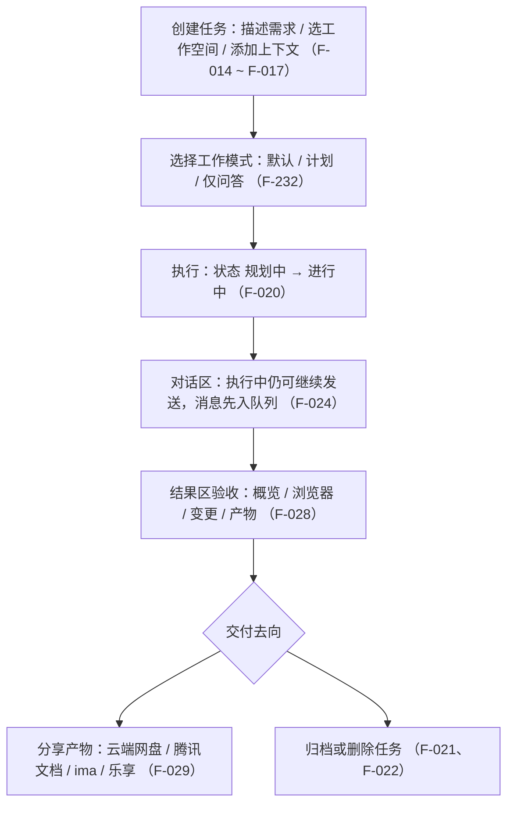

# 任务模型与工作流：创建、管理与验收

WorkBuddy 的最小单位是「任务」：用一句话描述需求即可，它自主规划和执行（F-014）。下文按「创建 → 执行 → 对话/队列 → 结果区验收 → 分享或归档」展开，并单列三种工作模式。

## 任务生命周期

## 一、创建任务

| 维度 | 说明 | 引用 |
|---|---|---|
| 描述方式 | 创建任务的核心是理解自然语言，一句话描述需求即可自主规划和执行 | F-014 |
| 提示词模板 | 按场景（日常办公、代码开发、设计创意）提供模板；悬停模板时输入框显示灰色预览文案，仅预览、不入草稿、不被发送 | F-015 |
| 工作空间 | 点击输入框左下角「选择工作空间」指定目录；也可直接开始，WorkBuddy 会在默认目录生成结果 | F-016 |
| 添加上下文 | 四种方式：`@` 引用文件/文档/规则、Ctrl/Cmd+V 粘贴截图、上传或拖拽文件、补充说明（目标、输入、输出格式、约束条件） | F-017 |

示例任务包括生成分析报告、整理图片、根据会议纪要生成 PPT、调研 AI 行业趋势等（F-014）。

## 二、任务列表、状态与检索

左侧任务列表分「任务」（最近访问或更新）与「空间」（按工作空间整理）两个板块；空项目不显示，分组默认只展示部分任务（F-018）。

全局搜索覆盖任务/空间/产物三类对象，快捷键 Cmd+K（Windows 对应 Ctrl+K），并分「全部/任务/空间/产物」四类独立排序（F-019）。

| 项 | 文档可配置项 | 引用 |
|---|---|---|
| 任务状态 | 进行中、已完成、失败、待处理、规划中、已归档 | F-020 |
| 侧边栏状态标记 | 三种（进行中、已完成未读、待确认）；聚合优先级为 待确认 > 已完成未读 > 进行中 | F-020 |
| 管理菜单 | 悬停任务行点「⋯」或右键；菜单分三组（任务自身：置顶/重命名/分享任务；打开与批量；收尾：归档/删除） | F-021 |
| 删除提示 | 普通任务：「删除后，这些任务将从你的所有设备中移除，且无法恢复」；运行中任务：「该任务正在执行中，删除将立即终止运行」 | F-022 |

## 三、对话区怎么用

- 顶部操作从左到右：对话内搜索、分享任务（自动生成公开链接）、历史提问、显示详情面板（F-023）。
- 模型执行时可继续发送消息：消息先进入输入框上方「队列」，可编辑、删除、拖动排序；点击发送立即发出以引导会话，但不打断当前输出（F-024）。
- 对话中链接有三种打开方式：直接打开（内置浏览器）、在浏览器打开、复制链接。链接打开方式默认「按需」（本地预览内开、普通网页走系统浏览器），可改为「始终内置」或「始终外部」（F-025，**文档可配置项**）。
- 支持上传的文件类型：PDF、Word、TXT、Markdown、RTF、Excel、CSV、TSV、PPT、常见图片（JPG/PNG/GIF/BMP）、ZIP/RAR 压缩包及各类编程语言代码文件（F-026）。
- 隐私授权边界：所有文件处理默认在本地完成，原始数据不上传云端；服务端仅处理数据片段、用后即弃，不保存也不用于模型训练；只能访问主动勾选授权的文件夹，敏感目录自动拦截、高危操作二次确认（F-027）。

## 四、结果区怎么验收

右侧结果区提供四类内容（F-028）：

| 视图 | 内容 | 引用 |
|---|---|---|
| 概览 | 工作空间文件 | F-028 |
| 浏览器 | 多页签浏览 | F-028、F-030 |
| 变更 | 本次任务的文件修改 | F-028、F-031 |
| 产物 | 任务生成的文件与交付物 | F-028 |

- 多浏览器页签：导航栏右侧「+」新建页签，各页签保持独立浏览状态（网址、前进/后退历史），关当前页签自动选中相邻页签（F-030）。
- 变更视图显示本次修改涉及的文件列表、每个文件改动情况及选中文件的具体变更内容，适合代码开发 / 脚本生成 / 配置调整时先行核对（F-031）。
- 产物分享（预览右上角分享图标）支持上传到：我的云端网盘、腾讯文档、ima 知识库、乐享知识库（F-029）。

## 五、三种工作模式

发起任务时可切换三种模式（F-232，**文档可配置项**）：

| 模式 | 行为 |
|---|---|
| 默认（Agent） | 高效执行，可修改文件 |
| 计划（Plan） | 先规划，等确认后执行 |
| 仅问答（Ask） | 只问答，不执行 |

Plan 的流程为「开启 Plan → 围绕关键变量提问补信息 → 审阅方案（右侧面板查看完整 Plan）→ 确认执行 / 调整计划」，**确认前不会开始执行**（F-233）。

## 边界与缺口

本节事实均取自官方文档页「`/docs/workbuddy/`」（**核验时点 2026-10-15**），其中附件类型（F-026）与产物分享去向（F-029）为**桌面端**口径；App 端与小程序端的能力集合不同（**三端差异**），详见 [09-multidevice-and-tencent-ecosystem](09-multidevice-and-tencent-ecosystem.md)。本地文件与命令的权限边界、记忆、Worktree 与并行任务，见 [02-agent-execution-and-permissions](02-agent-execution-and-permissions.md)。
