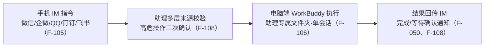

# 云助理、定时任务与企业智能体

> 本篇回答：WorkBuddy 如何被远程控制、如何按时间自动执行周期性工作，以及企业侧如何把 Agent 托管到云端运行平台。三者的共同点是任务不再被逐条紧盯，配置项与安全边界因而更关键。

## 1. 助理（远程控制）：把手机变成电脑端的遥控器

助理是远程控制功能，可通过手机即时通讯软件（微信 / 企业微信 / QQ / 钉钉 / 飞书）远程控制电脑上的 WorkBuddy 执行任务（F-105）。它与普通任务同为「任务」，但在工作目录、会话数量、历史保留三个维度上被刻意区分（F-106）：

| 维度 | 助理（远程任务） | 普通任务 |
| --- | --- | --- |
| 工作目录 | 固定使用「助理」专属文件夹，不可自由指定 | 可自由指定工作目录 |
| 会话数量 | 仅一个会话集中处理 | 支持多个并行任务 |
| 对话历史 | 保留完整对话历史、不可清空 | 可清空历史重新开始 |

配置路径统一为「左下角头像 → 设置 → 助理设置」，电脑需保持开机并运行 WorkBuddy；微信客服号可扫码直接绑定，企业微信 / QQ / 飞书 / 钉钉通常需先在对应平台完成应用或机器人配置（F-107）。安全边界有三层：绑定身份支持灵活换绑不同移动端平台；每条远程指令执行多层来源校验；涉及文件删除、系统配置修改、批准命令执行等高风险任务需确认后方可执行（F-108）。解绑入口在助理设置卡片右侧「解绑」，解绑后该平台配置从本地删除、不再接收指令，但**已执行任务历史保留在本地不清除**，其他已绑定平台不受影响（F-109）。

## 2. IM 机器人接入矩阵

接入矩阵为「微信助理 / 微信客服号 / 企微助理 / QQ 机器人 / 飞书 / 钉钉机器人 / 元宝派」（F-013、F-105）。各通道要点（凭证字段不逐条罗列）：

- **微信助理**（推荐）：扫码即绑，项目 / 文件 / 凭证 / 工具均用电脑本地环境，无需额外配置；支持文字、图片、文件、语音四类消息（F-053 ~ F-055）。
- **微信客服号**：扫码即绑，无需创建开放平台应用或填 App ID / App Secret；最低版本要求为端 WorkBuddy ≥ 4.6.4、手机微信 ≥ 8.0.70（F-050 ~ F-052）。
- **企微助理**：支持群聊 @机器人 下发团队协作任务；接入分长连接（推荐，填 Bot ID 与 Secret）与 URL 回调两模式；私有化部署企业微信需额外填写自定义 WebSocket 地址（形如 `ws://<网关>:<端口>/im_openws?bizid=1`），留空则回落公有云默认地址（F-056 ~ F-058）。
- **QQ 机器人**：前提是 QQ 账号已完成实名认证；AppSecret 不支持明文保存、二次查看将强制重置；高危操作会先在 QQ 中发送确认消息（F-059 ~ F-061）。
- **飞书 / 钉钉机器人**：均要求先在对应平台具备创建应用（或企业管理员）权限，并支持 WebSocket 长连接与 URL 回调两种模式（F-044 ~ F-049）。
- **元宝派**：把 WorkBuddy 添加到元宝社区圈子，派内 @机器人 下发任务、结果与产物实时分享；接入需先在元宝 App 创建 Bot 获取凭据，再在助理设置中注册并回元宝确认关联（F-062、F-063）。

## 3. 定时任务：三种来源与一条云端边界

定时任务按设定时间自动执行周期性工作并集中保存每次运行的结果与产物；按来源分**本地**（电脑端创建、本机执行）、**项目**（项目中创建）、**云端**（云端沙箱执行、卡片带云端标识）三类（F-110）。创建方式有三种：手动新建（精确指定时间 / 权限 / 推送渠道）、从任务新建（一句话描述需求）、从模版新建（从常见场景快速上手），配置项含名称、提示词、模型 / 专家 / 技能 / 连接器、工作空间、权限、重复、时间、有效期与「消息推送到企业微信」（F-111）。

执行权限分两档：**完全访问权限**（推荐、无人值守、工具调用无需逐次确认）与**默认权限**（敏感操作需确认，人不在电脑前任务会停在等待确认状态）；重复规则可选间隔 / 单次 / 每天 / 每周 / 每双周 / 每月 / 每年（F-112）。

企业微信推送有两条硬约束：可选助理的企业微信 bot 或独立 bot，但**助理的 bot 必须选 WebSocket 长连接方式，URL 回调方式无法推送**；推送仅作结果通知、不写入助理对话上下文、失败也不影响任务本身执行（F-113）。

云端定时任务的边界同样明确（F-114）：编辑时无需选工作空间和权限、不支持推送到企业微信、云端沙箱无法访问本机文件；删除云端任务后已产生的云端会话仍保留；离线时只能查看、联网后才能操作。运行记录可按状态（成功 / 失败 / 运行中）与任务类型（本地 / 项目 / 云端）筛选，失败原因常见为连接器未授权、登录已失效、电脑离线错过执行时间；本地任务执行期间请勿关闭电脑或退出客户端（F-115）。

## 4. 企业智能体 CloudAgent：Agent / Runtime / Session

企业智能体是**云端 AI Agent 运行平台**，提供全生命周期管理：创建管理 Runtime、以 ACP / SSE 协议实时对话、管理版本与快照（Checkpoint / Version）、发布部署产物（F-120）。其三个核心概念构成一个自洽模型（F-121）：

| 概念 | 定义 |
| --- | --- |
| Agent | 定义模型 / 角色 / 技能工具的完整配置 |
| Runtime | 独立云端沙箱，含完整 Linux 文件系统与终端、Manifest 配置，可含一个或多个 Session |
| Session | 独立对话历史与上下文 |

创建 Agent 需登录分配了**企业坐席**的个人账号（F-122，企业版专属），从右上角「企业智能体」进入企业后台；基础配置含名称、模型（Auto 或内置模型）与 System Prompt，添加的技能 / 专家 / MCP 自动同步到 Manifest。Manifest 为声明式 JSON，`manifestVersion` 当前 1.0，必填 `id` / `name` / `manifestVersion`，且 `system_prompt` 与 `system_prompt_file` 互斥，能力配置含 rules / skills / plugins / mcp / subagents（F-123）。`workspaces[].name` 必填并映射到 `/workspace/<name>/`，可选 Git 仓库 URL、源码包 URL、ref 与初始化命令；`secrets` 经安全通道注入、不写入沙箱文件，系统自动注入 `AGENTOS_RUNTIME_ID`（F-124）。渠道接入支持企微 AIBot、QQ 机器人、飞书与钉钉，每条记录对应一个 Bot → Session 绑定；凭据加密存储与代理注入，运行时由代理层解密注入请求头（F-125）。Session 超过 10 分钟无访问自动休眠、再次访问自动唤醒；删除 Session 会永久清除对话记录和文件；Runtime 状态分运行中、休眠、失败；**Agent 评测消耗个人积分**（F-126）。

## 相关阅读

- [09 多端协同与腾讯生态：桌面 / App / 小程序三端差异](09-multidevice-and-tencent-ecosystem.md)
- [核验报告：口径分层与三端差异对照](../references/verification.md)
- 同组关联：[WorkBuddy 沙箱公网端点](../../workbuddy-sandbox-public-endpoint/index.md)（云端沙箱机制）、[企业微信 5.0.12 版本快照](../../wecom-5-0-12-release/index.md)（企微集成侧）
