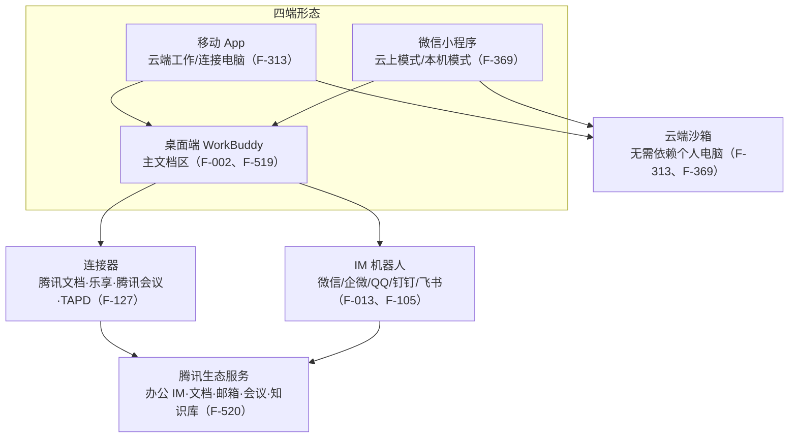

# 多端协同与腾讯生态

> 本篇回答：桌面端 / App / 小程序同名功能页差在哪，手机如何作为桌面端 Agent 的远程控制台，以及 WorkBuddy 如何接入腾讯生态与各 IM 机器人。核心提示：**未注明端别时不要引用「设置里有 X」「面板里有 Y」——三端能力集合并不一致。**

## 1. 四种入口形态

WorkBuddy 是「腾讯出品的全场景 AI 办公工作台……完美连接腾讯办公生态」（F-518，官网宣传口径）。入口四类：桌面端（主文档区 `/docs/workbuddy/`）、移动 App（`/docs/workbuddyapp/`）、微信小程序（`/docs/workbuddymini/`），以及官网首页下载入口——桌面端 Mac / Windows / Linux（系统应用商店）/ 鸿蒙电脑版，移动端 iOS / Android / 鸿蒙手机版扫码与小程序扫码体验（F-519，官网口径）。

## 2. 移动 App：两种执行模式

App 是桌面端 WorkBuddy 的移动配套产品：可用文字、语音、图片及文件下达任务，两种执行模式为**云端工作**（云端沙箱，不依赖电脑）与**连接电脑**（远程操控桌面端）（F-313）。核心能力含多模态输入、双模式执行、任务管理与技能扩展（SkillHub）；首次打开可选「QQ / 微信 / 其他」授权登录，并申请相机 / 麦克风 / 存储相册 / 通知四项系统权限（F-314）。

## 3. 微信小程序：云上 / 本机两模式

微信小程序是 WorkBuddy 移动端入口：同样支持文字、语音、图片及文件下达任务，两种执行环境为**云上模式**（云端沙箱）与**本机模式**（远程操控桌面端）（F-369、F-370）。进入方式为扫码或微信搜索「腾讯 WorkBuddy」（F-371）；首次打开请求微信授权，勾选协议后点「**授权手机号登录**」，且登录的微信账号需与电脑端一致才能连接本机（F-372、F-373）。

## 4. 三端差异对照表（本篇核心）

下表按主题归并三端差异（与核验报告「口径 2」一致），每格后 F 编号为出处。

| 主题 | 桌面端 | App 端 | 小程序端 |
| --- | --- | --- | --- |
| 执行环境命名 | 工作空间（本地目录）（F-315） | **云端工作 / 连接电脑**（F-313、F-315） | **云上模式 / 本机模式**（☁ / 🖥）（F-369、F-315） |
| 欢迎区形象 | 桌面工作台 | **WorkBuddy 吉祥物**（F-341） | **虾虾吉祥物**（F-341、F-390） |
| 工具面板入口 | 侧边栏「专家·技能·连接器」（F-222） | 输入栏 `+`：拍照 / 手机文件 / 定时任务 / **专家中心**（F-324、F-327） | 输入栏 `+`：摄像头 / 手机文件 / **微信文件** / 添加技能 / **ima 知识库**（F-376、F-379） |
| 发起任务方式 | 自然语言 + 模板 + 选工作空间 + @ 上下文（F-014 ~ F-017） | 直接输入 / 场景标签 / 侧边栏新建 / **系统分享入口** / **语音输入**（F-333 ~ F-335） | 直接输入 / 快捷入口 / 侧边栏新建（**仅三节**）（F-383、F-384） |
| 专家页名 | 专家中心（F-141） | 页名「**专家**」（F-338） | 页名「**专家中心**」，标注「专家（Agent 型）/ 专家团（Team 型）」（F-338、F-387） |
| 模型选择页 | 功能说明 `Model`（三档模式 + 内置模型）（F-194） | slug `features/Model`，仅能力标签与推荐场景，**未列倍率**（F-344、F-345、F-399） | slug `features/Select-Model`，**给出具体倍率表**，且「首句话发送后模型选择才可显现」（F-345、F-396、F-397、F-399） |
| 定时任务添加方式 | 本地 / 项目 / 云端三类来源，可推送企业微信（F-110、F-113） | 页面内 `+`，**无选模型/技能项**（F-329、F-332） | 右下角 `+`，**支持选择不同模型与技能**（F-381、F-332、F-382） |
| 设置页集合 | 通用 / 套餐与积分 / 外观 / 快捷键 / 智能体 / 模型 / 助理设置 / 数据与安全等（F-219） | 含注销账号、主题和语言、分享日志 / 清除日志 / 意见反馈、隐私清单（F-322、F-323） | 「切换登录账号 / 我的分享 / 关注服务号 / 使用帮助」，**暂不支持换绑手机号**（F-323、F-401、F-403） |
| 多端协同建联 | 面板选「连接移动端」（F-348） | 面板选「**App**」分页，系统通知，右上角新建（F-349、F-352） | 面板选「**小程序**」分页，**微信订阅通知**（一次授权只推一次），左上角新建，额外含「连接腾讯文档」「连接 ima 知识库」（F-352、F-393 ~ F-395） |
| 产物分享 | 可上传到云端网盘 / 腾讯文档 / ima / 乐享（F-029） | 「产物查看与分享」四节（查看 / 分享 / 导出 / 重新生成）（F-353 ~ F-356） | 「产物分享」**明显更简**，**分享链接有效期 30 天**（F-356、F-404、F-405） |
| 任务执行末节 | — | 末节「**重新生成**」（F-363、F-364、F-412） | 末节「**查看引用来源**」（F-364、F-412） |
| 微信文件打开 | — | 操作「预览 / 插入输入框」，前置为已安装并登录 App（F-365 ~ F-368、F-415） | 操作「查看 / 加入对话」，前置为**已在微信中登录过小程序**（F-413 ~ F-415、F-368） |

## 5. 多端协同：手机 = 桌面端 Agent 的远程控制台

多端协同把手机变成桌面端 Agent 的「远程控制台」，离开工位仍可接管（F-346、F-391）。核心六项：一键建联、远程续聊、远程停止、状态可视化、远程配置、任务通知（F-347、F-392）。前置条件：桌面端登录并运行，在侧边栏「连接移动端」面板打开「允许移动端连接此设备」；移动端同账号、两端联网，并开启「允许锁屏运行」（关闭 / 熄屏继续 / 屏幕常亮，F-348、F-092）。首次建联：桌面端面板按「App」或「小程序」分页扫码后选设备（F-349、F-393）。**远程配置以电脑端为准，手机上只做选用**（F-350）。通知含完成 / 中断 / 等待回答 / 等待审批四类，同账号多台手机同时收到（F-351）；两端同步含置顶任务、工作空间增删、设备名称，电脑产物自动回传手机（F-351、F-395）。**小程序走微信订阅通知、一次授权只推一次**，每次互动补充下一次推送机会（F-394、F-395）。

## 6. 腾讯生态打通与 IM 机器人

连接器对接外部服务，支持 QQ 邮箱、腾讯文档、腾讯乐享、腾讯会议、TAPD、腾讯网盘等（F-127）；IM 机器人矩阵为「微信助理 / 微信客服号 / 企微助理 / QQ 机器人 / 飞书 / 钉钉机器人」（F-013、F-105）。飞书与钉钉机器人均需具备创建应用或企业管理员权限，并支持 WebSocket 长连接与 URL 回调两种模式（F-044 ~ F-049）。小程序端另提供「连接腾讯文档」「连接 ima 知识库」（F-395）。

## 7. 小程序用例三则

- **拍照生成笔记**：课堂上快速记录板书——本机模式拍摄黑板照片并语音输入「整理成笔记，保存到电脑桌面」，电脑端自动梳理为结构化笔记文档（F-416、F-417）。
- **微信文件跨端处理**：外出时收到微信文件、需结合电脑本地文件一起处理——把文件转发到小程序并描述需求，电脑端读取本地文件完成分析、生成结果并推送回小程序（F-418、F-419）。
- **云端定时任务**：每天定时执行重复工作（行业早报、待办汇总、竞品监控）——云上模式设置定时任务，云端按时执行并推送结果；示例为**早上 8:00 行业早报、早上 9:00 今日待办汇总、晚上 10:00 竞品监控日报**，且不依赖电脑是否开机（F-420、F-421）。

## 相关阅读

- [07 云助理、定时任务与企业智能体](07-cloud-agent-and-automation.md)
- [核验报告：口径 2 三端差异 / 口径 3 企业版边界](../references/verification.md)
- 同组关联：[WorkBuddy 沙箱公网端点](../../workbuddy-sandbox-public-endpoint/index.md)（云端沙箱）、[腾讯 Buddy 家族产品观察](../../tencent-buddy-family/index.md)（产品矩阵）
