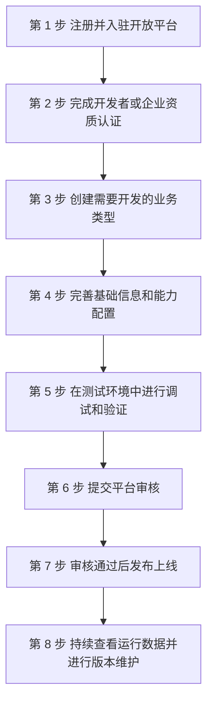

# WorkBuddy 开放平台是什么：五类业务类型与八步快速开始

本文归纳 D1 页（`https://open.workbuddy.cn/docs/what-is-open-platform`，页面标题「开放平台概述」）的三节内容：**平台简介、快速开始、平台优势**。核验时点 2026-10-16；信源为厂商自有开发者文档**单源**，本束**未在本机实跑**任何注册、入驻、调试或发布流程。

## 一、开放平台是什么

文档把开放平台定位为「面向 WorkBuddy 生态业务的一站式工作台」（F-001）。开发者**入驻并通过相应的资质审核后**，即可在开放平台进行业务开发管理（F-002）。

由此可读出一条前置关系：**「入驻 + 资质审核」是使用开放平台开发业务的前提**——审核通过之前，业务开发管理尚未开放。资质审核的三种档位与材料见 [01-onboarding-and-qualification](01-onboarding-and-qualification.md)。

> 边界提示：以上均为**文档声称**（厂商自述），本束未在平台实跑，**不得**读作「功能已验证可用」。

## 二、能开发哪些业务类型

开放平台支持开发的业务类型共 **5 类**（F-003）：

| # | 业务类型 | 本页所能提供的信息 | 展开位置 |
|---|---|---|---|
| 1 | 技能 | 仅名目（F-003） | [02-skill-development-and-marketplace](02-skill-development-and-marketplace.md) |
| 2 | 专家 | 仅名目（F-003） | [04-expert-and-expert-team](04-expert-and-expert-team.md) |
| 3 | 专家团 | 仅名目（F-003） | [04-expert-and-expert-team](04-expert-and-expert-team.md) |
| 4 | 连接器 | 仅名目（F-003） | [03-connector-development-and-access-modes](03-connector-development-and-access-modes.md) |
| 5 | 外部应用接入 | 仅名目（F-003） | [06-third-party-app-access](06-third-party-app-access.md) |

要点与纪律：

- 五类名称**按 D1 原文登记**（技能 / 专家 / 专家团 / 连接器 / 外部应用接入，F-003），本表「展开位置」列仅为同束导航，**不代表**被指向页面已在本页内容中展开。
- D1 页**只列名目**，**未给**各业务类型的创建入口、字段、能力配置或审核要求——这些细节分散在 D4～D9，本文不据名称推断（口径纪律：文档未写明处一律标「**官方未给**」）。
- 五类中「外部应用接入」与其下游的第三方应用类型划分（硬件接入 / Buddy 应用 / 积分应用）为**不同层级**，后者见 [06-third-party-app-access](06-third-party-app-access.md)，本文不合并两类。

## 三、八步快速开始：从入驻到上线

「快速开始」节列出开发者使用开放平台**通常需要经过 8 个步骤**（F-004）。把八步按其文档顺序画为**上架流程**如下（节点文本取自逐步事实，未增删语义）：

逐步对应的文档原文与事实编号：

| 步骤 | 文档原文（摘要） | 事实编号 |
|---|---|---|
| 第 1 步 | 注册并入驻开放平台 | F-005 |
| 第 2 步 | 完成开发者或企业资质认证 | F-006 |
| 第 3 步 | 创建需要开发的业务类型 | F-007 |
| 第 4 步 | 完善基础信息和能力配置 | F-008 |
| 第 5 步 | 在测试环境中进行调试和验证 | F-009 |
| 第 6 步 | 提交平台审核 | F-010 |
| 第 7 步 | 审核通过后发布上线 | F-011 |
| 第 8 步 | 持续查看运行数据并进行版本维护 | F-012 |

阅读要点：

- 第 2 步（资质认证）与第 1 步（入驻）在文档中**分列为两步**；两者都与 [01-onboarding-and-qualification](01-onboarding-and-qualification.md) 描述的三档认证相关，本文不在此重述其材料与规则。
- 第 5～7 步构成「**调试 → 提交审核 → 审核通过后上线**」的因果链：文档用词是「审核通过后发布上线」（F-011），**并未**把「提交审核」与「通过审核」视为同一动作。
- 各步骤的**界面入口与所需时长**：D1 页**未给出**任何界面路径或时长——凡文档未给出者一律标「**官方未给**」，**不得**据常识补全或写成「默认无等待」。个别环节的时限口径分散在对应业务页（如收入变现、第三方应用接入），归属各自页面，见 [09-monetization-and-revenue](09-monetization-and-revenue.md) 与 [06-third-party-app-access](06-third-party-app-access.md)。

## 四、平台优势怎么表述

「平台优势」节给出的表述（F-013、F-014、F-015、F-016）属于**厂商宣传口径**，按原文分层登记如下：

| 表述 | 原文摘要 | 事实编号 |
|---|---|---|
| 价值转化 | 开发者可将行业 know how、业务系统和服务能力快速转化为 WorkBuddy 生态中的标准化产品 | F-013 |
| 成本收益 | 收益包含降低开发与运营成本 | F-014 |
| 渠道能力 | 提供统一的发布渠道和用户触达能力 | F-015 |
| 演进承诺 | 将持续完善开发工具、开放接口和生态服务，为开发者提供更加高效、稳定和安全的开发体验 | F-016 |

**引用纪律**：

- 以上四条均为**厂商自述的宣传类声明**（核验报告第六节将 F-014～F-016 归类为「宣传类」，操作类事实可靠度高于宣传类）。
- 「高效、稳定、安全」是**演进承诺与目标表述**（F-016），**不是**可验收的现状断言；本文**不**将其读作「已达成的安全等级」或「功能已验证可用」。
- 文档页**未给**任何支撑数字（如成本下降幅度、触达规模、稳定性指标）——这些一律「**官方未给**」。

## 五、已知边界与去哪查

- **来源边界**：本文只覆盖 D1 一页。D1 页实测为服务端渲染、正文可读；页面字节数等页级数字见 [页级采集台账](../references/source-manifest.md)，引用须带核验时点 2026-10-16。
- **未采集页**：站点侧栏另有 7 篇 `/docs/` 页**本次未采集，仅登记入口**（`api-token` / `contact` / `developer-profile` / `legal-basis-and-examples` / `operations-data` / `service-categories-individual` / `service-categories-enterprise`）——未采集 ≠ 不存在，**不得**据名称推断其能力；清单与纪律见 [采集台账](../references/source-manifest.md) 与 [10-boundaries-versions-and-known-gaps](10-boundaries-versions-and-known-gaps.md)。
- **版本与时效**：文档站未见统一版本号；版本口径须与同组束并列登记，不得择一，详见 [核验报告](../references/verification.md) 第三节口径⑤。
- **相关同组束**（可选交叉参照，均为同厂商自述）：[官方站点与四区文档](../../workbuddy-official-docs/index.md)、[分享能力接入与推广管理](../../workbuddy-open-platform-sharing-and-promotion/index.md)。

下一步：资质认证怎么做，见 [01-onboarding-and-qualification](01-onboarding-and-qualification.md)。
