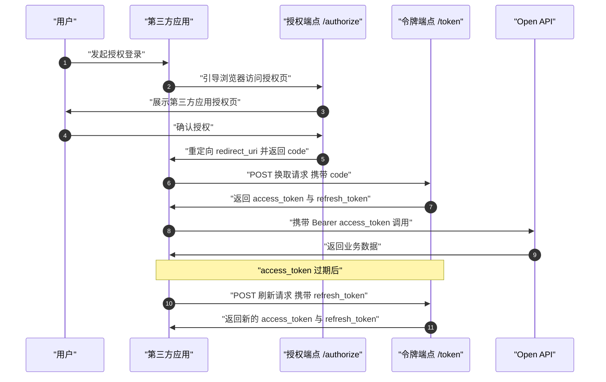

# Open API 认证授权与返回码约定

> 本篇是 [D10 `/docs/openapi`](https://open.workbuddy.cn/docs/openapi) 页的**第一半原子化概念文档**，回答「调用 Open API 前的准备工作是什么、OAuth 2.1 授权码怎么换取 `access_token` / `refresh_token`、返回码规范怎么看」；第二半（七类接口目录）见 [Open API 接口目录与形态边界](08-openapi-endpoint-catalog.md)。
> 信源为本束 F 编号事实表（F-001～F-439，逐条见 [来源代号与 F 编号事实登记](../references/article-source.md)）；**未在本机实跑**任何接口调用，本束未注册账号、未申请认证与资质、未提交审核、未调用任何真实接口。

## 一、准备工作

- 接入 WorkBuddy OAuth2.1 认证授权之前，需在 WorkBuddy 开放平台**注册开发者账号**，并拥有一个**已创建的第三方应用**（如硬件应用或 Buddy 应用），随后获得相应的 `clientId` 与 `clientSecret`（F-357）。
- `clientSecret` 属应用密钥，文档明确要求**严禁在前端或客户端代码中暴露**（F-365、F-369）。
- **官方未给**：`clientId` / `clientSecret` 的获取页面路径、生成与轮换机制。本束**本次未采集** `api-token`、`developer-profile` 等页，仅登记入口（见 [边界、版本与已知缺口](10-boundaries-versions-and-known-gaps.md)），**不得据名称推断能力**。

## 二、OAuth 2.1 授权码流程

### 2.1 概述

WorkBuddy 开放平台**基于 OAuth 2.1 授权码流程**实现第三方应用授权；用户授权登录后，第三方可获取用户的接口调用凭证（`access_token`），后续通过调用 WorkBuddy Open API 获取用户基本开放信息并帮助用户实现开放功能（F-358）。

### 2.2 请求用户授权（`/authorize`）

引导用户在浏览器中访问「第三方应用授权页」；用户确认后，该页重定向至 `redirect_uri`，同时通过 `code` 参数返回授权码（F-359）。

请求示例（F-360；`HOST` 为 `https://www.workbuddy.cn`，请求头 `Accept: text/html`）：

```
GET /openapi/v2/authorize?response_type=code&client_id=CLIENT_ID&redirect_uri=REDIRECT_URI&scope=SCOPE&state=STATE
HOST: https://www.workbuddy.cn
Accept: text/html
```

「第三方应用授权页」参数（逐字照抄，来源 F-361）：

| 名称 | 类型 | 必填 | 示例值 | 描述 |
| --- | --- | --- | --- | --- |
| response_type | String | 是 | code | 固定值 code，表示授权码模式 |
| client_id | String | 是 | app_7a3f2b... | 应用注册后获得的应用 ID |
| redirect_uri | String | 是 | https://example.com/callback | 回调重定向地址，需要在「硬件接入」或「Buddy 应用」中配置的「OAuth 回调地址」集合内 |
| scope | String | 否 | user.task.readable user.task.invokable | 用户权限范围，多个「scope」以空格分隔。必须在「硬件接入」或「Buddy 应用」中配置的「授权列表」集合内，不传则为应用的完整「授权列表」 |
| state | String | 建议 | a1b2c3_random_xyz | 随机字符串，用于防 CSRF 攻击和回调状态保持。回调时原样返回 |

### 2.3 重定向回调响应

用户确认授权后，平台将重定向至 `redirect_uri`，携带以下参数（F-362、F-363）：

| 名称 | 类型 | 示例值 | 描述 |
| --- | --- | --- | --- |
| code | String | auth_c0d3_xyz789 | 授权码，一次性使用，有效期 **10 分钟** |
| state | String | a1b2c3_random_xyz | 与请求中的 state 一致。应用应校验该值以防范 CSRF 攻击 |

回调示例（F-363）：`GET https://example.com/callback?code=auth_c0d3_xyz789&state=a1b2c3_random_xyz`。

### 2.4 换取接口调用凭证（`/token`）

接口元信息（F-364）：`POST https://www.workbuddy.cn/openapi/v2/token`；`Content-Type: application/x-www-form-urlencoded`；**权限要求：无（使用 `client_secret` 进行应用身份验证）**。

请求体（逐字照抄，来源 F-365）：

| 名称 | 类型 | 必填 | 示例值 | 描述 |
| --- | --- | --- | --- | --- |
| grant_type | String | 是 | authorization_code | 固定值 authorization_code |
| code | String | 是 | auth_c0d3_xyz789 | 上一步获取的授权码，一次性使用 |
| client_id | String | 是 | cb_7a3f2b1c | 应用 ID |
| client_secret | String | 是 | sk_live_abc123... | 应用密钥，严禁在前端或客户端代码中暴露 |
| redirect_uri | String | 是 | https://example.com/callback | 必须与 /authorize 获取授权码阶段回调地址参数完全一致（字节级） |

响应体（逐字照抄，来源 F-366）：

| 名称 | 类型 | 示例值 | 描述 |
| --- | --- | --- | --- |
| access_token | String | eyJhbGciOiJSUzI1NiIs... | 访问令牌，用于调用 Open API |
| token_type | String | Bearer | 令牌类型，固定值 Bearer |
| expires_in | Number | 3600 | access_token 有效期，单位：秒 |
| refresh_token | String | eyJhbGciOiJIUzI1NiIsInR5cCI6IkpXVCJ9... | 刷新令牌，用于在 access_token 过期后获取新令牌。仅在 authorization_code 模式下返回 |
| scope | String | user.profile.readable user.task.readable | 实际授予的权限范围 |
| open_id | String | op_9f8e7d6c5b4a | 用户的 open_id |

响应示例（F-367）：

```json
{
  "access_token": "eyJhbGciOiJSUzI1NiIsInR5cCI6IkpXVCJ9...",
  "token_type": "Bearer",
  "expires_in": 3600,
  "refresh_token": "eyJhbGciOiJIUzI1NiIsInR5cCI6IkpXVCJ9...",
  "scope": "user.profile.readable user.task.readable",
  "open_id": "op_9f8e7d6c5b4a"
}
```

### 2.5 刷新 Access Token

使用 `refresh_token` 刷新 `access_token`（F-368～F-370）。接口同为 `POST https://www.workbuddy.cn/openapi/v2/token`；`Content-Type: application/x-www-form-urlencoded`；权限要求无（使用 `client_secret` 进行应用身份验证）。

请求体（逐字照抄，来源 F-369）：

| 名称 | 类型 | 必填 | 示例值 | 描述 |
| --- | --- | --- | --- | --- |
| grant_type | String | 是 | refresh_token | 固定值 refresh_token |
| refresh_token | String | 是 | def50200a1b2... | 上一次获取的 refresh_token |
| client_id | String | 是 | app_7a3f2b1c | 应用 ID |
| client_secret | String | 是 | sk_live_abc123... | 应用密钥，严禁在前端或客户端代码中暴露 |

刷新响应体字段与换取响应体**一致**（`access_token`、`token_type`、`expires_in`、`refresh_token`、`scope`、`open_id`，F-370）。

### 2.6 凭证有效期：两处官方口径并列（不择一）

> 同一厂商文档内部存在**两种口径**，本节**并列表述、不择一、不替官方判定**（登记见 [核验报告](../references/verification.md) 第四节 ②、第五节第 4 项）。

| 口径 | F 编号 | 来源页面 › 章节 | 原话摘要 |
| --- | --- | --- | --- |
| 口径一：`24 小时` | **F-285** | D9「第三方应用」› 授权认证 › Token 类型一览 | access_token 用于调用 Open API 的凭证，**有效期 24 小时**，过期后需重新获取；refresh_token 用于刷新 access_token，**有效期 60 天**，需安全存储在服务端，不得暴露在前端或客户端代码中 |
| 口径二：`expires_in: 3600` | **F-366**（响应体示例另见 **F-367**） | D10「Open API 接口」› 认证授权 API › 换取接口调用凭证（access_token） | 换取响应体含 `expires_in`（Number，**示例 3600**，access_token 有效期，**单位秒**；本页口径与 D9 的 24 小时不一致） |

- 两处**各自保留原话与各自来源页面，不合并、不换算**：口径一为 24 小时（即 86,400 秒），口径二示例为 3,600 秒；文档**未声明**二者关系，须并列呈现并带核验时点 2026-10-16。
- 授权码 `code` 的有效期另有明确口径：**一次性使用、有效期 10 分钟**（F-362）。
- ACP 通道 token 的有效期为**第三处独立口径**（「通常为 3 天、不过也有可能很短」），见 [接口目录](08-openapi-endpoint-catalog.md) ACP 小节（F-402），与本条 `access_token` 口径**不是同一凭证**。
- **官方未给**：token 撤销（revocation）机制，文档未给出（见 [核验报告](../references/verification.md) 第五节第 8 项）。

### 2.7 换取凭证链路（时序）



> 图中 `code` 一次性、10 分钟有效（F-362）；`client_secret` 与全部令牌均须在**服务端**处理，严禁前端暴露（F-365、F-369）；`expires_in` 的口径冲突见 2.6。

## 三、返回码规范

所有 Open API **遵循统一的返回码规范**；调用接口出现异常时，可根据 HTTP 状态码、业务码和排查建议定位问题（F-438）。

返回码规范表（**逐条照抄**，共 24 行，来源 F-439；本束**未在本机实跑**，不对各码实际触发场景做验证）：

| HTTP 状态码 | 业务码 | 描述 | 排查建议 |
| --- | --- | --- | --- |
| 200 | success | 请求成功 | 暂无 |
| 201 | success | 请求成功 | 暂无 |
| 400 | invalid_request | 请求参数错误（缺参/格式非法/body 解析失败/参数越权组合） | 确认传入的参数是否合法、必填是否补齐 |
| 400 | unsupported_grant_type | 不支持的 grant_type | 使用受支持的 grant_type |
| 400 | unsupported_response_type | response_type 非 code | 固定使用 response_type=code |
| 400 | invalid_grant | 授权码/refresh_token 失效或不匹配；核销码已用/过期/耗尽 | 重新走授权流换新码；核销类视为终态勿重试 |
| 400 | invalid_scope | 应用无绑定 scope 或请求 scope 越权 | 给应用绑定 scope，请求 scope 收敛到绑定集内 |
| 400 | authorization_pending | 设备授权轮询中，用户尚未操作 | 按 interval 正常轮询等待 |
| 400 | slow_down | 设备授权轮询过快 | 轮询间隔增加 5 秒后再试 |
| 400 | expired_token | device_code 过期/已消费 | 重新发起 device_auth 获取新 device_code |
| 401 | invalid_token | 鉴权未通过（缺 Bearer / 验签失败 / 缺 subject·client） | 确认鉴权三元组合法有效、token 未过期 |
| 401 | invalid_client | 应用凭据无效或状态非 active | 核对 client_id/client_secret 及应用状态 |
| 401 | unauthorized_client | 应用状态非 active（device_auth 场景） | 确认应用已启用 |
| 401 | Unauthorized | paysign 缺登录态（uid 为空） | 确认已登录并带上有效登录态 |
| 403 | access_denied | 不允许访问该资源（未授权 / 应用非 active / 下游 403） | 确认是否拥有合法权限、用户已授权该应用 |
| 403 | insufficient_scope | token scope 不满足端点要求 | 按 WWW-Authenticate 提示补足 scope |
| 403 | forbidden | LocalAssistant 身份缺失或下游 401/403 | 检查 token；确已授权仍 403 则带 request_id 反馈 |
| 403 | PermissionDenied | paysign 的 X-Service-Id 不在白名单 | 使用已登记的 X-Service-Id 或联系平台加白 |
| 404 | not_found / not found | 访问的资源不存在（应用/会话/批次/兑换码/消息） | 确认资源标识正确、未被删除 |
| 409 | invalid_request | 资源状态冲突（device user_code 已处理，防重复） | 该请求已处理，勿重复提交 |
| 412 | invalid_request | 前置条件不满足（scene=client 但用户无 active 授权） | 先完成用户对应用的授权再取 code |
| 429 | rate_limited | 请求数超过限制，收到 429 时按指数退避重试（1s → 2s → 4s） | 请求超频，降低调用频率、退避重试 |
| 500 | server_error / server error / InternalServerError | 服务内部错误 | 服务端错误，携带 request_id 联系开发者 |
| 502 | server error | LocalAssistant 下游异常（非 401/403/404） | 服务端/下游问题，重试并反馈 request_id |
| 503 | server_error / temporarily unavailable / InternalServerError | 服务处于不可用状态（依赖客户端未配置 / 业务暂不可用） | 服务端配置缺失或临时不可用，联系开发者 |

> 表内 `device_auth`、`paysign`、`X-Service-Id` 等场景在原文中与返回码并列出现，其对应流程不在本束已采集的 D1～D10 正文范围内，**本束不据此推断未采集能力**。
> 兑换码核销 API 另有一张**单行**返回码表（仅 `200 核销成功`，F-437），见 [接口目录](08-openapi-endpoint-catalog.md)；会话产物 API 另有独立错误响应表（F-429、F-430），同样见该篇。

## 四、边界与未给

- **端与形态**：`/authorize` 为浏览器侧授权页（`Accept: text/html`，F-360）；`/token` 为服务端换取/刷新端点（F-364、F-368）。授权码与令牌均**须在服务端处理**，`client_secret` 严禁前端或客户端代码暴露（F-365、F-369）。
- **集合约束**：请求 `scope` 必须在应用配置的「授权列表」集合内（F-361）；`redirect_uri` 必须落在配置的「OAuth 回调地址」集合内（F-361）。
- **官方未给**：全局限流/配额数字（仅单接口分页上限有值，见 [接口目录](08-openapi-endpoint-catalog.md)）；token 撤销机制；`clientId`/`clientSecret` 的生成与轮换机制。
- **未采集**：`api-token` 等 7 篇 `/docs/` 页本次未采集、仅登记入口，**不得据名称推断**功能细节、字段、权限或门槛（见 [边界、版本与已知缺口](10-boundaries-versions-and-known-gaps.md)）。

## 相关

- [Open API 接口目录与形态边界](08-openapi-endpoint-catalog.md)（D10 第二半，七类接口逐类参数表）
- [边界、版本与已知缺口](10-boundaries-versions-and-known-gaps.md)（跨页汇总：五类口径分层、未采集 7 篇、版本时效三方并列）
- [来源代号与 F 编号事实登记](../references/article-source.md)、[核验报告](../references/verification.md)、[页级采集与覆盖台账](../references/source-manifest.md)
