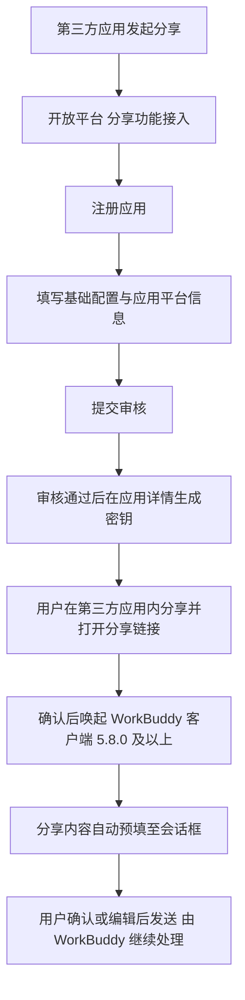

# 分享能力接入：第三方应用把内容分享进 WorkBuddy

WorkBuddy 开放平台于 2026-10-14 在「平台公告」栏目发布公告 A1（标题见 F-017、发布时间与栏目见 F-018，`公告口径`，`核验时点 2026-10-15`），宣布上线「分享能力接入」，**目的**是支持第三方应用将内容分享至 WorkBuddy（F-019）。

## 能力范围

完成接入后，用户可在第三方应用内将**文本、图片、音频、文件、资源链接**等内容一键分享至 WorkBuddy（F-020）；分享内容会**自动预填到会话框**，用户确认或编辑后发送，即可由 WorkBuddy 继续处理（F-021，`公告口径`）。

## 接入四步

| 步骤 | 公告给出的操作 | 事实 |
| --- | --- | --- |
| 1 注册应用 | 进入「第三方接入 → 分享功能接入」，点击「注册应用」 | F-022 |
| 2 填写配置 | 按「基础配置 → 应用平台信息」两步填写，登记 PC 端（Windows 应用 / macOS 应用）的应用标识与签名信息；**支持保存草稿** | F-023 |
| 3 提交审核 | 提交后**即时生成应用 ID**，审核将于 **7 个工作日内**完成 | F-024 |
| 4 接入开发 | 审核通过后在应用详情**生成密钥**，并参照《PC 端开发手册》进行接入 | F-026 |

该能力对应的平台模块入口为「分享功能接入」`/app-feature/all`（F-009，`未采集`——该入口在公告页侧边栏可见，其独立页本次未采集，不据名称推断功能细节）。**术语说明**：本能力在公告标题中称「**分享能力接入**」（F-017），在平台界面菜单中称「**分享功能接入**」；步骤 1 中的「**第三方接入 → 分享功能接入**」为公告原文给出的界面菜单路径（F-022），本束未采集「第三方接入」分组下的其他入口，不据名称推断。

## 接入链路（Mermaid）

上链路节点逐一对应该四步事实（F-022 ~ F-026）、用户流程（F-027）与版本门槛（F-028）。

## 审核机制

- 提交审核后**即时生成应用 ID**，审核于 **7 个工作日内**完成（F-024，`公告口径`）。
- 审核结果通过**三处同步通知**：开放平台通知中心、WorkBuddy 端内消息中心、开发者邮箱（F-025）。
- 审核**细则**（通过 / 驳回判据）公告**未给出**（F-061，`平台现状`），不得据公告推断。

## 用户使用流程

用户在已接入的第三方应用内发起分享 → 打开分享链接并确认 → **唤起 WorkBuddy 客户端**（F-027，`公告口径`）。

## 版本要求

用户需安装 WorkBuddy **5.8.0 及以上**版本，低于该版本将无法唤起（F-028，`版本时效`，`核验时点 2026-10-15`）。该门槛与同组产品文档版本线（5.7.7）的落差，见 [03-boundaries-versions-and-policy.md](03-boundaries-versions-and-policy.md)。

## 开放对象与支持范围

- **开放对象**：面向**已通过企业认证的开发者**开放，应用创建与密钥生成均在开放平台完成（F-029，`开放门槛`）。不得写成对任意个人开发者开放。
- **支持范围**：当前支持 **PC 端接入**（Windows 应用 / macOS 应用）（F-030，`端边界`）。
- **移动端**（Android / iPhone / 鸿蒙应用）公告原话为「**将陆续开放**」，属**规划态**（F-031，`端边界`），不得写成已支持。

## 品牌规范

在应用分享入口展示 WorkBuddy 标识时须遵循 WorkBuddy 品牌设计规范，该标识**仅表示已接入分享能力**（F-032）。该品牌设计规范公告未展开，仅登记为指引入口（F-062，`未采集`）。

## 公告未给出的信息

公告为**上线通知**，正文**未**给出接口字段、请求参数、错误码、审核细则与配额数字（F-061，`平台现状`）；如需接口级内容，须另立新束学习《PC 端开发手册》（F-062）。跨篇阅读：推广侧能力见 [02-promotion-management.md](02-promotion-management.md)，边界与口径落差汇总见 [03-boundaries-versions-and-policy.md](03-boundaries-versions-and-policy.md)，事实出处见[事实登记](../references/article-source.md)与[核验报告](../references/verification.md)。
