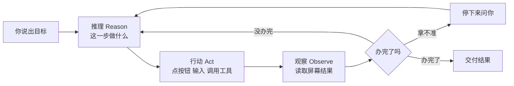

# Agent 解剖：模型外面围着哪几块

先给三个词一句白话释义，后文不再解释：

- **ReAct**：Reason + Act 的缩写，意思是「先想一步，再动手，看完结果接着想」，循环到办完为止。
- **闸门**：在不可逆动作前拦住 Agent、要求人确认的那道关卡。
- **运行时**：负责把 Agent 叫醒（定时任务）、维持循环（转圈）、记录消耗（记账）的那层程序。

## 起点：模型只会读进来、写出去

课程给出的起点很朴素——模型本身只会「读进来、写出去」（F-022）。它没有手、没有眼睛、不会记住你昨天说过什么，也不会自己在早上八点醒来。

课程把开课前收集到的问题归成 7 件事，包括怎么拆需求、怎么让它记住我、怎么接工具、怎么让它自己跑起来、跑错了怎么办（F-021）。这 7 件事都不是模型能自己解决的，需要围着它补上部件。

## 围着模型的五类部件

课程把补齐的部件归纳为五类（F-023）：

| 部件 | 一句话职责 | 没有它会怎样 | 在你手机上的位置 |
|------|------------|--------------|------------------|
| 记忆 | 让它记得你 | 每次都要重新交代偏好，任务之间不连续 | App 的「记忆」页与 App 目录内的 Markdown 文件 |
| 技能 | 告诉它怎么做 | 只会通用点击，遇到「设闹钟」这类事没有章法 | 源码的 skills 目录（技能说明书） |
| 工具 | 替它动手 | 只能聊天，不能打开 App、点按钮、输入文字 | 读屏与点击那一层（源码 hands 目录） |
| 闸门 | 替你把关 | 付款、发送、删除都可能直接执行 | 弹确认与权限请求 |
| 运行时 | 叫醒、转圈、记账 | 不会定时提醒，长任务中断后无法续跑 | App 后台与系统通知 |

这五类在小满 App 里已经做好，装上即可使用（F-025）。课程同时指出：**模型不在手机上**，需要你自己去火山方舟开通，再把 Key 填进 App（F-026）。这也解释了为什么第一课一半时间花在配置上——你装的是一副身体，大脑要自己接。

## ReAct 循环：一次任务长什么样

这个图有三个实操含义：

1. **每一轮都要「看一次屏幕」**。看屏幕不是免费的——课程说明手机操作时的截图会发给你配置的模型做判断（F-068）。所以步数直接决定成本，这一点在 [05 任务设计](05-task-prompt-design.md) 里会变成可操作的设计规则。
2. **「拿不准就问」是循环里的正常分支**，不是失败。课程明确付款、发送、删除前都会先问你（F-067）。
3. **循环可能被打断**。滑块、验证码、权限被系统回收都会让循环停住，恢复方式是人工处理后说「继续」（F-053）。

## 七件事与五部件的对应关系

课程的 7 件事是「学员的问题」，五部件是「课程的答案」。把两者接起来看，更容易知道自己该改哪里：

| 学员的问题 | 由哪个部件承担 | 你能改的地方 |
|------------|----------------|--------------|
| 怎么拆需求 | 你 + 任务书 | 提示词与停止条件，见 [05](05-task-prompt-design.md) |
| 怎么让它记住我 | 记忆 | 直接对它说「记住……」或「忘记……」，见 [04](04-memory-and-reminders.md) |
| 怎么接工具 | 工具 + 技能 | 源码里的技能说明书与工具层，见 [06](06-trae-read-project.md) |
| 怎么让它自己跑起来 | 运行时 | 定时任务与通知权限 |
| 跑错了怎么办 | 闸门 + 运行时 | 确认弹窗、错误提示、重试与「继续」 |
| 怎么换个做事习惯 | 技能 + 记忆 | 改技能说明书或加一条偏好 |
| 怎么换个模型 | 配置 | 设置页的聊天模型与操作模型 |

## 两张模型的配置不是重复劳动

App 要填两个模型：聊天模型与操作模型，操作模型要能看图，两者填同一个也可以（F-028）。这不是形式主义——它对应 Agent 的两种能力：

- **聊天模型**负责理解你的话、规划下一步、组织回报。
- **操作模型**负责看屏幕截图，判断「按钮在哪、这一页是不是我要的页」。

官方模型列表把 doubao-seed-2-1-pro-260915 的能力列为深度思考、文本生成、多模态理解、GUI 任务处理、工具调用与结构化输出（F-080）。**多模态理解**与 **GUI 任务处理**就是「操作模型要能看图」的官方依据。

## 用这个结构做排障

一旦你记住了「聊天」与「操作」是两条链，排障就不再靠猜：

| 现象 | 说明哪条链通 | 先查什么 |
|------|--------------|----------|
| 有回复，手机不动 | 聊天通，操作不通 | 操作模型配置、模型是否支持图片、无障碍服务是否被系统关掉（F-066） |
| 手机动了但不说话 | 操作通，聊天异常 | 聊天模型的 Key、额度与 429 限额（F-065） |
| 两条都不通 | 配置层 | Base URL、模型名、Key 与网络 |
| 做到一半停住 | 循环被打断 | 是否遇到滑块/验证码，处理后说「继续」（F-053） |

这张表的价值在于：**先把问题分到某一条链上，再去改配置**。否则你会在两个模型之间反复重填，而问题可能只是无障碍开关被系统关了。
