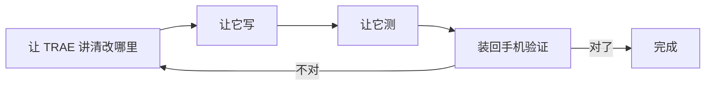

# 用 TRAE 读项目：先看懂户型图，再动墙

## 为什么必须读一次项目

模型接好之后，助理就能干活了。但你若想让它多会一件事、换一个做事习惯，就必须知道**该去哪个文件夹改**（F-035）。这就是读项目的全部目的——不是为了看懂每一行代码，而是为了知道改动的落点。

课程给的比喻是装修前的户型图（F-036）：水电怎么走不用懂，但你要知道厨房在哪、哪面墙不能砸。对非开发者，这个比喻比「理解架构」更实用，因为它把目标从「读懂」降到了「定位」。

## 四个房间

课程把源码画成一套房子，一个房间就是一个文件夹（F-037）。录屏看点进一步给出了四个关键房间的名字与职责（F-091）：

| 房间（目录） | 职责 | 你可能会为了什么进去 |
|--------------|------|----------------------|
| app | 手机界面 | 改按钮、改页面文案、改设置项 |
| core-memory | 记忆 | 改记忆的存取方式、记忆文件的位置 |
| skills | 技能说明书 | 加一个技能、改某个技能的做法 |
| hands | 读屏和点击 | 改它怎么找按钮、怎么输入、怎么判断页面 |

这四个房间的风险等级并不相同：

- **改 skills 风险最低**：技能说明书是文字规则，改错了回滚成本小。
- **改 app 风险中等**：界面改动容易验证，但可能牵扯状态与权限。
- **改 core-memory 风险中等偏高**：记忆格式一旦变化，旧记忆可能读不出来。
- **改 hands 风险最高**：它直接决定「点得准不准」，改完必须在真机上跑一遍完整任务。

课程还说明：用 TRAE 打开的是含 README.md、cli、skills 的那个 xiaoman 文件夹（F-040）。也就是说，**先认这三个标志物，再往下看**——打开错层级是新手最常见的第一个坑。

## 首次勘察：只让它讲，不让它改

讲师的习惯是：第一次让 AI 看项目，只让它讲，不让它改（F-038）。这条纪律看起来保守，实际是在保护两样东西——你的代码没被误改，以及你的理解没有被「已经改完了」跳过。

可直接复制的勘察提示词（F-041）：

```text
请阅读这个项目的 README.md 和目录结构，用不懂代码的人也能听懂的话告诉我：
1. 聊天、记忆、技能、手机操作这四块分别在哪个文件夹；
2. 我在手机上说一句话之后，程序大概经过了哪几步；
3. 如果以后想改助手的某个习惯，通常改哪里。
先只讲解，不要修改任何文件。
```

### 这次勘察的验收标准

不看它讲得多长，看三个可判定的结果：

- [ ] 它能指出四块各自的文件夹，且与你在目录里看到的一致
- [ ] 它能用「你说话 → 它看屏幕 → 它点击 → 它回报」的顺序讲清一次任务
- [ ] 它能说出「改习惯」应该落在 skills 还是 core-memory
- [ ] 你的工作区没有任何文件被修改（用版本控制的变更列表核对）

最后一条是硬验收。**「只讲不改」不是礼貌请求，而是可验证的约束**。

## 改一个技能的四步闭环

课程说「设闹钟」技能与「几分钟后提醒我」功能，都是按同一个顺序做出来的（F-039）：



这个闭环有两个容易省略的环节：

1. **「讲清改哪里」不能跳**。跳过它，你会得到一堆能运行但不知道影响范围的改动。
2. **「装回手机验证」不能省**。技能在电脑上跑通不等于在手机上跑通——读屏、点击、权限都是手机侧的行为。

第二节课的准备里，课程要求装好 Python 3.8 及以上与 adb、打开 USB 调试，目的就是「用一条命令把改好的技能推到手机上」（F-076）。这条准备不是形式主义，它决定了你能不能完成第四步。

## 改动落点的判断顺序

拿到一个「我想让它……」的需求，按下面的顺序判断，成本从低到高：

| 顺序 | 落点 | 判据 | 例子 |
|------|------|------|------|
| 1 | 记忆 | 只是「记住一个偏好或底线」 | 记住：不经我同意不付款 |
| 2 | 任务书 | 只是「这次要特殊处理」 | 这次预算可以到 80 |
| 3 | skills | 需要「多会一件事」或「换一套做法」 | 加一个设闹钟技能 |
| 4 | app | 需要「界面上多一个入口」 | 在设置页加一个开关 |
| 5 | hands | 需要「换一种看屏幕/点击的方式」 | 改按钮定位策略 |

绝大多数需求落在前三层。**只有当前三层都表达不了时，才动后面两层**——这是本包对二次开发成本的经验判断（属本包推断，不是课程原文）。

## 不该自己改的情况

- 仓库没有可用的许可证说明（缺口 G-07）：再分发与二次开发的边界不明，先确认许可。
- 改动涉及账号、支付、隐私数据的存储方式：这已经超出「改习惯」的范围，需要安全评审。
- 你还没有跑通第一课的四步：先确保基线可用，再动代码，否则无法区分「本来就坏」与「改坏了」。

## 验收清单

- [ ] 能在目录里指出 app、core-memory、skills、hands 四个位置
- [ ] 能用一句话讲出「用户说一句话之后程序经过哪几步」
- [ ] 勘察结束后工作区无改动
- [ ] 完成过一次「讲 → 写 → 测 → 装回手机」的完整闭环
- [ ] 知道自己想改的东西应该落在哪一层
