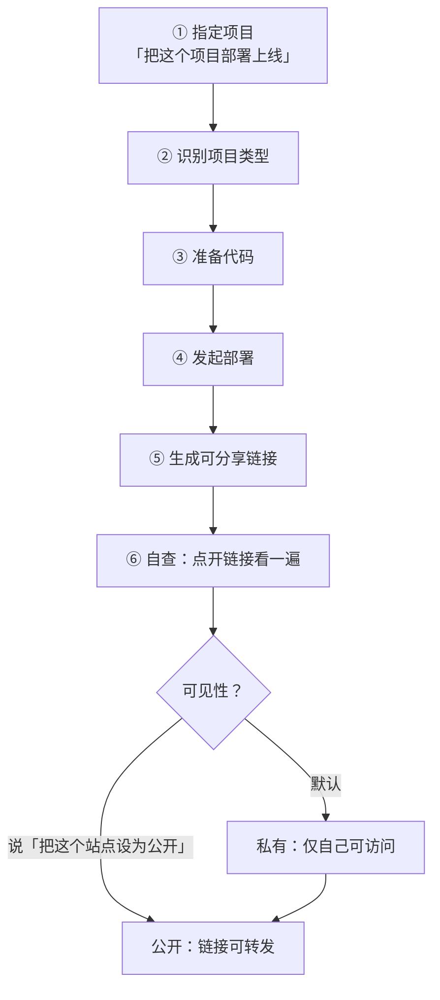
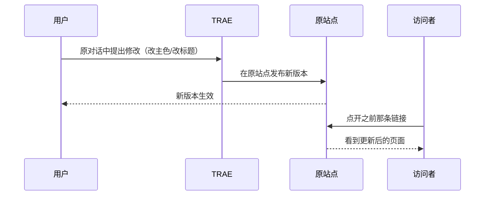

# 对话式部署工作流

## 六步链路

公告把部署压缩成一句话交互，但内部链路可拆为六步：



| 步骤 | 发生什么 | 用户需要提供 | 出处 |
|------|----------|--------------|------|
| ① 指定项目 | 用户说明要部署哪个项目 | 项目指向（"这个项目"即可） | F-005 |
| ② 识别项目类型 | 判断属于静态页 / 静态导出框架 / 无数据库 Node.js | 无 | F-006 |
| ③ 准备代码 | 备妥构建所需内容 | 无 | F-006 |
| ④ 发起部署 | 在云端构建并运行 | 无 | F-006、F-020 |
| ⑤ 生成链接 | 返回一个可分享的访问地址 | 无 | F-007 |
| ⑥ 自查 | 建议先自己点开看一遍 | 人的判断 | F-008 |

**与"给构建命令"的差别**：整条链路用户只说了一句话。公告的唯一示例指令是「把这个项目部署上线。」（F-023）——没有构建命令、没有环境变量、没有部署目标选择。

## 可见性：默认私有，显式公开

| 状态 | 谁能访问 | 如何切换 | 依据 |
|------|----------|----------|------|
| 默认（私有） | 仅创建者 | 部署完成即处于此态 | F-009 |
| 公开 | 持有链接的任何人 | 对 TRAE 说「把这个站点设为公开」 | F-010 |

三个要点：

1. **默认私有是安全默认**。刚部署完的页面常常是半成品（占位数据、调试文案、写死的测试账号），默认不外泄避免了"上线即翻车"。
2. **切换动作也是对话**，全文未提及需要进入独立控制台或权限面板（F-011）。
3. **"公开"的确切含义公告未定义**——是否可被搜索引擎收录、是否有访问口令、能否改回私有，均未说明（见 [缺口登记](../references/verification.md)）。

> ⚠️ 因为"公开"的边界未定义，涉及真实用户数据的页面（如报名信息）不建议依赖"默认私有"来兜底；把敏感数据放到需要鉴权的外部系统里，比赌一个未公开的可见性模型更稳。

## 原地迭代：版本发布而非重新分享



| 环节 | 机制 | 依据 |
|------|------|------|
| 提出修改 | 在原对话中说明要改什么 | F-012 |
| 触发发版 | 明确「重新部署」 | F-013 |
| 生效位置 | 在原站点上发布新版本 | F-014 |
| 对访问者的表现 | 原链接打到的就是新版本 | F-014 |

**为什么"原链接不变"重要**：链接一旦发到群里、写进文档、印在二维码上，它就变成了外部契约。重新分享一份新链接意味着所有下游分发点都要同步更新，而原站点原地发版把这个维护成本归零。

**代价**：没有版本号、没有回滚入口、没有灰度。改坏了，对外表现是"链接还在，但页面坏了"。公告未提回滚能力（见 [缺口登记](../references/verification.md)）——这意味着**改版前的自查（F-008）不是可选项**。

## 排障：失败留在同一段对话里

公告给了一条明确的排障路径（F-037）：

| 症状 | 可在对话中做的事 |
|------|------------------|
| 部署失败 | 查看**部署状态** |
| 部署失败 | 查看**构建日志** |
| 页面打开了但功能不对（如查不到天气） | 查看**运行日志** |
| 以上之后 | 排查 → 重试 |

这条设计的价值在于**上下文不丢**：构建日志和当初提需求的那段对话在同一个会话里，"日志里报 `Cannot find module`"和"我要求用哪个包"可以直接对上，不需要在工单系统和聊天窗口之间搬运信息。

一个值得记住的分诊顺序：

```
部署没成功         → 看构建日志（依赖/编译期错误）
部署成功但页面报错 → 看运行日志（运行时错误、外部接口失败）
两处都正常但结果不对 → 回到需求描述本身（逻辑理解偏差）
```

## 这条工作流适合谁

| 场景 | 契合度 | 理由 |
|------|--------|------|
| 把本地 Demo 发给朋友试用 | 高 | 一条指令拿到链接；默认私有先自查 |
| 小型展示型站点（活动页、作品集、工具页） | 高 | 静态产物即够 |
| 需要表单收集 + 即时通知 | 中 | 无数据库 Node.js 可承载，但数据落地需外部系统（见 [三个示例](03-three-demos-and-dependencies.md)） |
| 有登录、有持久化存储的业务系统 | 低 | 数据库不在支持范围（F-021） |
| 需要绑定自有域名对外 | 低 | 自定义域名在后续规划中（F-021） |

## 关联

- 支持范围与硬边界：[支持的形态与明确不支持项](02-supported-stacks-and-boundaries.md)
- 三个场景拆解：[三个示例与外部依赖](03-three-demos-and-dependencies.md)
- 事实出处：[事实登记](../references/article-source.md)
