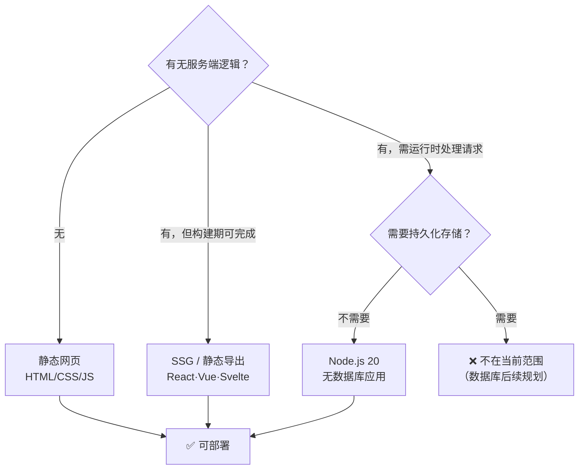

# 支持范围与硬边界

## 首发支持矩阵

| # | 形态 | 判定依据（构建产物视角） | 出处 |
|---|------|--------------------------|------|
| 1 | HTML / CSS / JavaScript 静态网页 | 本身就是可直接托管的静态文件 | F-017 |
| 2 | React / Vue / Svelte 等**可导出静态文件**的项目 | 构建后产出 `dist/` 一类静态目录 | F-018 |
| 3 | **无需数据库**的 Node.js 20 应用 | 需常驻进程，但状态可全放内存或外部服务 | F-019 |

共同的落脚点：**构建和运行都在云端完成**（F-020）。用户侧不需要本机装 Node、跑 `npm run build`、配反向代理。

### 三类形态的分水岭

## 明确不支持的项

| 能力 | 状态 | 出处 | 影响 |
|------|------|------|------|
| 数据库 | 后续规划 | F-021 | 无法承载需要持久化的业务（用户表、订单、内容库） |
| 自定义域名 | 后续规划 | F-021 | 只能使用平台分配的访问链接；品牌域名需另想办法 |
| 更多后端语言 | 后续规划 | F-021 | Go / Python / Java / Rust 后端暂不可用 |

这三条合起来划出了一个很清楚的边界：**"能给别人看"的站点可以，"要长期运营"的系统不行**。

### "不需要数据库"通常意味着什么

对报名、问卷这类需求，"无数据库"并不等于"无存储"，而是把存储外置。公告给的缴费路径是**飞书群机器人 Webhook + 群消息**（F-029、F-030、F-032）——数据最终落在飞书侧，而不是应用侧。

这带来一个必须自己想清楚的取舍：

| 方案 | 数据在哪 | 可查询性 | 可靠性依赖 |
|------|----------|----------|------------|
| Webhook 推群消息 | 群聊记录 / 多维表格 | 依赖群消息检索或表格视图 | 飞书可用性 + Webhook 有效性 |
| 外部托管数据库（超出公告范围） | 需自建 | 强 | 自建服务可用性 |

公告只覆盖前者。若业务要求"能导出、能统计、能对账"，需要在使用前就把数据落点设计好，而不是部署完再补。

## Node.js 20 的时效问题

公告指定运行时为 **Node.js 20**（F-019）。这一条本身是平台口径，但有一个公告没说的时间事实：

| 项 | 值 | 来源 |
|----|-----|------|
| Node.js 20.x 首发 | 2023-04-18（Iron） | F-043 |
| 进入维护期 | 2024-10-22 | F-043 |
| **End-of-life** | **2026-04-30** | F-043 |
| 公告发布日 | 2026-11-12 | F-001 |

也就是说，**公告发布时 Node.js 20 已经 EOL 半年以上**——按官方发布计划，该版本线不再接收安全更新。

这不否定平台的能力声明（F-019 记录的是"平台支持以 Node.js 20 运行"），但产生两个实际后果：

1. **依赖生态会先于平台漂移**：新版本 npm 包 / 框架要求 Node 22+ 时，平台侧仍是 20，安装或构建会失败。
2. **安全补丁存在滞后**：EOL 分支的漏洞不会被官方修复，若平台未自行 backport，风险随使用时长累积。

**可操作的建议**：优先让项目在 Node.js 20 上就能构建通过（不依赖 22+ 语法与 API）；把"平台何时升级运行时"列为待跟踪项，而不是默认它已是最新。

## 边界速查表

| 你想做的事 | 现在能不能 |
|------------|------------|
| 把静态作品集/活动页发出去 | ✅ |
| 用 Vite/Next(static export) 构建后部署 | ✅（需可导出静态文件） |
| 做一个带后端接口的小工具（无持久化） | ✅ |
| 表单收集后用飞书群机器人通知 | ✅（见 [三个示例](03-three-demos-and-dependencies.md)） |
| 做用户注册登录、订单系统 | ❌（需数据库） |
| 绑定自己的域名做品牌站 | ❌（自定义域名后续规划） |
| 部署 Python / Go 后端 | ❌（更多后端语言后续规划） |

## 关联

- 发布背景：[发布事实与产品定位](00-announcement-and-positioning.md)
- 操作链路：[对话式部署工作流](01-dialogue-driven-deploy-workflow.md)
- 核验过程与缺口：[P0 核验报告](../references/verification.md)
