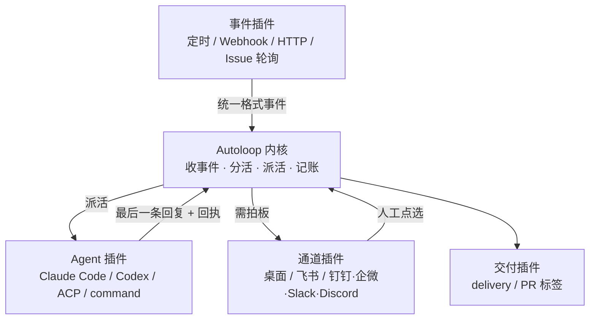

# 内核与五步流程

> Fact index：本篇声明对应 [信源与事实登记](../references/article-source.md) 的 F-010~F-023、F-043、F-049、F-052、F-058、F-059、F-061、F-062。

## 一、两层架构：一个确定的内核，一圈可换的插件

博文把架构画成两层：中间是中台内核 Autoloop，外围一圈是插件（F-010）。拆出去的方向有四个——**事件、Agent、通知通道、代码交付流水线**（F-011）；官方 README 的插件表把这四个方向落实为具体清单（F-052），仓库目录则按 `kernel/`、`host/`、`protocol/`、`worker/`、`cli/` 与 `bin/`、`plugins/`、`examples/recipes/`、`skills/agent-autoloop/`、`docs/`、`tests/` 与 `sim/` 分层（F-059）。

> 上图是教程依据 F-010/F-011/F-052 画的结构示意，**不是官方架构图**。官方措辞是插件「主动连进来」、账号凭据留在各自插件里（F-058），箭头只表示数据与控制流向。

## 二、内核只做四件事，并且被禁止做四件事

内核职责被压缩为四件：**收事件、按规则分活、把活派给 Agent、把每一步都记下来**（F-012）。

比职责清单更关键的是禁令。把 F-015、F-016、F-058 合起来看，内核被禁止的事恰好构成它的「确定性」：

| 禁令 | 出处 | 被移出去的能力 |
|------|------|---------------|
| 不对外发起网络连接 | F-015、F-058 | 所有联网与第三方服务调用 → 事件 / 通道 / 交付插件 |
| 不写死具体产品名 | F-016 | 新增 Agent 只需写适配插件，不改内核；作者称加了测试阻止往内核塞产品名或对外请求 |
| 不读系统时钟 | F-058 | 定时判定由事件插件送进来的事件承担 |
| 不用随机数 | F-058 | 决策只依赖输入事件 + `rules.json` + 已有记录 |

官方把结论写成「同样的输入永远得出同样的结果」，并补充零运行时依赖、凭据留插件（F-058）。**可以理解为**：确定性不是压测调优出来的，是被这四条禁令约束出来的——这是本知识包 5 条洞察中的第 1 条，落到工程上就是「先写禁止清单，再写功能清单，并用守护测试把禁令固化」。

## 三、内核规模与性能：取官方口径

博文给的是口语化近似（F-013、F-014），官方 README 给出测试环境与统计口径（F-061）：

| 指标 | 博文口径 | 官方实测口径（F-061） | 读法 |
|------|---------|---------------------|------|
| 内核行数 | 大概 1600 行 | 约 **1650 行（含空行和注释）** | 统计口径不同，取官方值 |
| 冷启动 | 不到 0.1 秒 | **88.78 ms**；110 万条事实时 99.8 ms | 官方补了数据量条件 |
| 空闲内存 | 60MB 左右 | **59.94 MB RSS** | 一致 |
| 1000 连接 | 170MB 出头 | **170.49 MB RSS**（1000 个同时等待的长轮询） | 官方补了连接形态 |
| 派活耗时 | 基本在 1.5 毫秒以内 | **派活 p99 1.82 ms** | ⚠️ 上界 vs 分位数，不可等同 |
| 运行时依赖 | 没有第三方依赖 | **0**；但需 Node.js 24+、Git、curl（F-044） | 「零依赖」指运行时 |

- 官方实测环境：**Apple M5 Pro、24 GB、Node 24.21.0**，写入逐条提交、事务落盘后才应答（F-061）。
- 另有两项容易漏掉的边界：持久化写入 2394 条/秒、排队 5000 时被挡下的心跳 p99 1.66 ms；历史变大后状态汇总变慢、日志与索引继续占盘，格式变化后首次启动需全量重建，110 万条用时 43.1 秒（F-061、F-062）。
- ⚠️ 该组数字为**作者单环境自测，无第三方独立复现**，引用时请保留环境与统计口径；完整对照见 [P0 核验报告](../references/verification.md) 的「成效数字溯源表」。

## 四、一件事怎么转起来：五步流程

| 步 | 名称 | 发生了什么 | 事实 |
|----|------|-----------|------|
| 1 | 事件进来 | 早上 9 点定时任务、GitHub Issue、业务系统报错等，先变成统一格式事件送进内核 | F-018 |
| 2 | 内核派活 | 按 `~/.agent-autoloop/rules.json` 决定哪个 Agent、去哪个目录、用哪个 Skill；同一件事短时间连续来多条消息会合成一轮 | F-019、F-049 |
| 3 | Agent 干活 | Agent 启动执行，结果放在**最后一条回复**里，这一轮结束 | F-020、F-034 |
| 4 | 分两支 | 可自行完成的走自动闭环（办完 / 半小时后复查 / 触发下一步）；需拍板的（删数据、重启服务、花钱、对外发消息）由内核经通道通知人工 | F-021 |
| 5 | 续上对话 | 人工点选后接上原来的对话继续；作者以飞书为自用通道，并以「批奏折」作比 | F-022 |

作者把流程概括为「事件、派活、执行、交付、批奏折」，并称与上一篇几乎没有区别（F-023，作者观点）。官方 README 的「一件事怎么转起来」与上表逐条对应（F-043 及配套段落），并把第 2、3 步细化为可编辑的规则字段与回执协议，见 [规则与回执实战](../examples/02-rules-and-receipts.md)。

### 「批奏折」分支为什么重要

第 4 步的两支划分，本质是**把不可逆动作留给人**：可以自行完成的直接闭环，涉及删除、重启、资金、对外发消息的必须发卡片（F-021）。这一步与 [挂起零消耗机制](02-four-mechanisms.md) 配套——卡片发出后 Agent 进程直接退出，等待期间不跑、不消耗 Token，人点选后从存档接回原会话（F-024、F-057）。

> 与常见「Agent 常驻会话轮询等人」的做法相比，可以理解为一次状态建模方式的更换：等待不再是一个运行中的进程，而是一条持久化记录。等待三天与等待三分钟的成本几乎相同。

## 五、从架构到机制：为什么还需要四个机制

五步流程看着简单，但要让它在断网、强杀、重复提交、恶意文本、Agent 互唤循环下仍然成立，需要四条额外约束（F-017）：

| 流程里的风险 | 对应机制 | 详见 |
|-------------|---------|------|
| 等人工回复时进程常驻、Token 常耗 | 挂起零消耗 | [02 内核四机制](02-four-mechanisms.md) |
| 写到一半崩溃、重复投递、状态算不清 | 事件溯源 | 同上 |
| 外部事件文字里夹带指令（Prompt 注入） | 指令数据分离 | 同上 |
| A→B→A 无限互唤 | 跳数熔断 | 同上 |

## 六、迁移到自己的编排层

把本页的设计动作抽象成四条可迁移的检查项（对应 I 阶段洞察 1、2、3）：

1. **先写禁止清单**：联网、时钟、随机、具体产品名一律不进编排层，并加守护测试。
2. **决策面收窄**：编排层只读「统一格式事件 + 一份规则 + 只追加记录」，其余信息经插件传入。
3. **人工介入点按「退出 + 存档 + 事件唤醒」设计**，不按「保持会话 + 轮询」设计。
4. **不可逆动作显式列白名单**，由通道插件推卡片，人工点选后接续而非重启任务。

## 边界提示

- 本篇为架构与流程教程，**非源码精读、非部署实测**；命令与配置的可照做版本见 [examples](../examples/index.md)。
- 「零依赖」「同样输入同样结果」是官方措辞（F-058）的前置约束下的结论，不表示任意环境都能复现同样的性能数字。
- 官方注明插件模板与场景样例存在「未连真实服务 / 未逐个跑过」的验证边界（F-054、F-055、F-067），见 [03 插件生态](03-plugin-ecosystem.md) 的三档分级。
