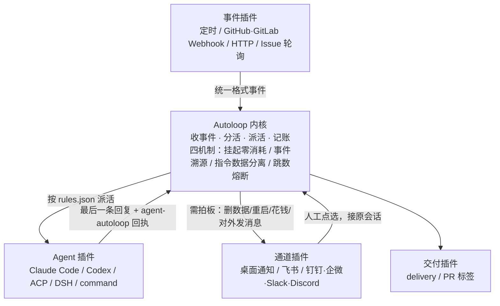

# Agent-Autoloop

> **来源**：微信公众号「数字生命卡兹克」，作者卡兹克，2026-11-04 08:19 发布于上海，标注原创
> **原文**：[《开源我这折腾了1年的「Agent自动化系统」，愿所有人都能感受Agent的魅力。》](https://mp.weixin.qq.com/s/T9_acg247gxzUNL4j5zrCw)
> **开源仓库**：https://github.com/KKKKhazix/agent-autoloop （MIT 许可证，F-065）
> **权威核验**：官方 `README.md` / `INSTALL.md`（`main` 分支，2026-11-06 快照）
> **P0 核验**：10 大项 **5 ✅ / 5 ⚠️ / 0 ❌**，核心声明无失败，详见 [核验报告](references/verification.md)

> **⚠️ 数据性质提示**：本包的核心事实来自开源项目官方文档，但**性能数字为作者单环境自测**（Apple M5 Pro / 24GB / Node 24.21.0，无第三方独立复现，F-061）；**公司虚实中台成效数字为作者自述、无独立佐证**（F-042）；官方另标注多项「未测 / 未逐个跑过」。本包所有实战命令**未在本机实测**。引用时请保留限定语。

> **⏰ 时效性提示**：项目作者自述「还只是 1.0.0 版本」（F-008），Windows 版待定、issue #17 在途（F-045），插件实测范围与 `deliver-review` 标签状态可能随 Release 变化。事实快照取于 2026-11-06，`stale_after: 2026-12-31`，复核项见 [核验报告](references/verification.md) 末节。

## 一句话定位

**Agent-Autoloop** 是一个极轻量的 Agent 自动化中台：把任务调度做成一个零外部依赖的**确定性内核**，把事件来源、Agent、通知通道、代码上线流水线全部拆成可插拔的**插件**，让命令行 Agent 在后台自己接活、跟进到底，平时不打扰人，遇到拿不准的事才发卡片找人拍板（F-043）。

它的设计动作是**做减法**：内核只做四件事（收事件、分活、派活、记账），并被禁止联网、读时钟、用随机数、写死产品名（F-012、F-015、F-016、F-058）。确定性不是测出来的，是被约束出来的。

## 核心版图



> 结构示意依据 F-010/F-011/F-052 绘制，**非官方架构图**。

## 60 秒快速开始（官方命令，未在本机实测）

```bash
# 前置：macOS / Linux、Node.js 24+、Git、curl、一个已登录的 CLI Agent
curl -fsSL https://raw.githubusercontent.com/KKKKhazix/agent-autoloop/main/install.sh | sh

agent-autoloop --version && agent-autoloop doctor
agent-autoloop try            # 演示试跑，会转给你一个「选颜色」的问题
agent-autoloop answer 1 2     # 非交互终端选择第 2 项
agent-autoloop status         # 看会话续接与轮数 / Token / 费用
```

高频 cron 用法请先读 [安装篇的用量与合规前置](examples/01-install-and-first-run.md)（F-064）：官方提示个人订阅额度主要为日常人工交互设计，高频自动化场景厂商通常更建议使用 API Key。

## 知识结构

```
agent-autoloop/
├── index.md                              ← 本页（bundle 入口）
├── concepts/
│   ├── index.md
│   ├── 00-project-overview.md              ← 发布事实、定位、设计来源、版本/平台边界
│   ├── 01-kernel-and-loop.md               ← 两层架构、四禁令、性能口径、五步流程
│   ├── 02-four-mechanisms.md               ← 四机制：类比→官方措辞→边界→自测命令
│   └── 03-plugin-ecosystem.md              ← 四类插件、回执协议、三档分级、用量合规
├── examples/
│   ├── index.md
│   ├── 01-install-and-first-run.md         ← 安装、验证、try→answer→status、WSL2、卸载
│   ├── 02-rules-and-receipts.md            ← rules.json、dry-run 预演、五类回执、why
│   └── 03-plugins-and-delivery.md          ← add / command 接入、deliver 演练、sim/benchmark
├── references/
│   ├── index.md
│   ├── article-source.md                   ← F-001~F-068 事实登记（双份）
│   └── verification.md                     ← 10 大项 P0 核验 + 勘误四张清单
└── log.md
```

共 14 个文件：根 index + log + 3 个子目录 index + 4 概念 + 3 实战 + 2 信源。

## 分层导航

### 概念层（4 篇）

1. [Agent-Autoloop 是什么](concepts/00-project-overview.md) — 发布时序、官方定位、设计来源与同组互链、阅读路线
2. [内核与五步流程](concepts/01-kernel-and-loop.md) — 四禁令、官方性能口径、事件到交付五步、「批奏折」分支
3. [内核四机制](concepts/02-four-mechanisms.md) — 挂起零消耗 / 事件溯源 / 指令数据分离 / 跳数熔断，含「断电也不丢」收窄
4. [插件生态](concepts/03-plugin-ecosystem.md) — 四类插件清单、回执协议、支持范围三档、用量合规

### 实战层（3 篇，命令来自官方文档，未实测）

1. [安装与首次试跑](examples/01-install-and-first-run.md)
2. [规则与回执](examples/02-rules-and-receipts.md)
3. [插件接入与交付演练](examples/03-plugins-and-delivery.md)

### 信源层（2 篇）

- [信源与事实登记](references/article-source.md) — F-001~F-068（博文 42 + 官方补充 26）
- [P0 核验报告与勘误清单](references/verification.md) — 5 ✅ / 5 ⚠️ / 0 ❌，勘误四张清单

## 5 条可迁移洞察

| # | 洞察 | 行动 |
|---|------|------|
| 1 | 内核的价值不在「能做什么」，而在「被禁止做什么」 | 设计编排层先写禁止清单并加守护测试 |
| 2 | 把「等待人」建模成持久化状态，长流程才可能零成本 | 分钟级人工介入按「退出 + 存档 + 事件唤醒」设计 |
| 3 | 事件溯源与指令数据分离是同一条原则的两个投影 | 把「什么能进决策」做成单一入口校验 |
| 4 | TTL 式跳数熔断是 Agent 互唤无中心循环的必要兜底 | 跳数随事件传递、执行方不可改、超限记录+通知 |
| 5 | 博文与官方 README 的「口径差」本身是最该教的内容 | 二手内容转知识库时把官方一手文档设为必查项 |

## 信任与生命周期

- **事实基数**：68 条（F-001~F-068 连续无跳号，博文 42 + 官方补充 26）
- **P0 核验**：10 大项 5 ✅ / 5 ⚠️ / 0 ❌；5 项 ⚠️ 均为口径差异、未测边界或博文未提的补充，**非核心声明失败**
- **勘误四张清单**：日期/版本表、成效数字溯源表、口径对照表、引文逐字核对表 —— 见 [核验报告](references/verification.md)
- **信源距离**：作者一手实测叙事 + 同一作者的开源项目官方一手发布，可公开核验；不属于厂商自宣营销稿
- **观点隔离**：作者观点（F-007/F-009/F-023）与作者自述（F-004/F-005/F-008/F-041/F-042）显式标注，不固化为客观结论
- **status**：`stable`（沿用 `blog-article-to-okf-wiki` 的 `stable` / `flagged` 二分；核心声明无失败，未触发 `flagged`。语义等价于本组资讯包惯用的 `verified`）
- **stale_after**：2026-12-31（快速迭代项目，年末复核 Windows 版进度、Release、性能数字、插件实测范围、`deliver-review` 标签）

## 已知边界与注意事项

1. **Windows 版待定**，WSL2 有 systemd、桌面通知、`command` 用量上报、约 1GB 内存占用等五项限制（F-045）
2. **性能数字为作者单环境自测**，无第三方独立复现；「派活 1.5ms 以内」应读作官方「p99 1.82 ms」（F-014、F-061）
3. **整机断电未单独测过**——官方只确认「进程被强杀，已确认的事不丢」（F-026、F-057）
4. **Agent 与 Webhook 支持范围分三档**：A 实测跑通 / B 仅本地模拟 / C 仅提供接入命令未逐个跑过（F-054、F-055）
5. **`deliver-review` 标签仅博文单源**，官方 README 只列 `deliver`（F-068）
6. **高频自动化的订阅额度与 API Key 合规提示**官方已给出，博文完全未提（F-064）
7. **公司虚实中台成效数字为作者自述**，官方仓库无对应记载（F-041、F-042）
8. **本包示例未在本机实测**；官方模板样例数据为虚构、脚本与回执仅用本地 HTTP 与假飞书 CLI 验证（F-067）

## 主题关联

- 与 [deepseek-harness-0-2](../deepseek-harness-0-2/index.md)、[deepseek-harness](../deepseek-harness/index.md)：博文将「一切皆插件」溯源到 DSH；本包是该理念在编排中台的实现（该短语为作者概括，非 DSH 官方定位）
- 与 [pi-agent-harness](../pi-agent-harness/index.md)、[pi-cli](../pi-cli/index.md)：博文将极简内核与 Extensions 设计溯源到 Pi
- 与 [oracle](../oracle/index.md)、[openviking](../openviking/index.md)：同属「命令行 Agent + 本机 CLI」生态；Oracle 是单次第二意见往返，Autoloop 是常驻事件驱动中台
- 与 [agent-runtime-protocol](../agent-runtime-protocol/index.md)：可对照「事件溯源 / Checkpoint」的通用运行时协议语义
- 与 [siemens-industrial-agent](../siemens-industrial-agent/index.md)：同组博文转化包，可对比 R→I→E→V 核验报告与勘误清单的写法

```{toctree}
:hidden:
:maxdepth: 2

concepts/index
examples/index
references/index
log
```
