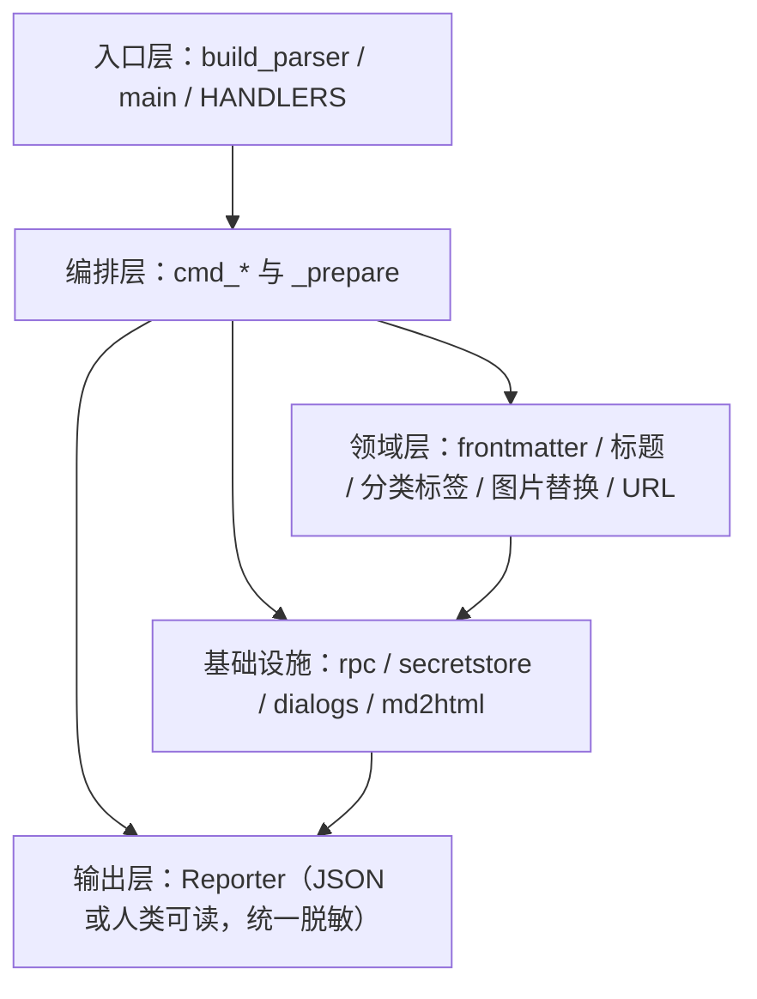
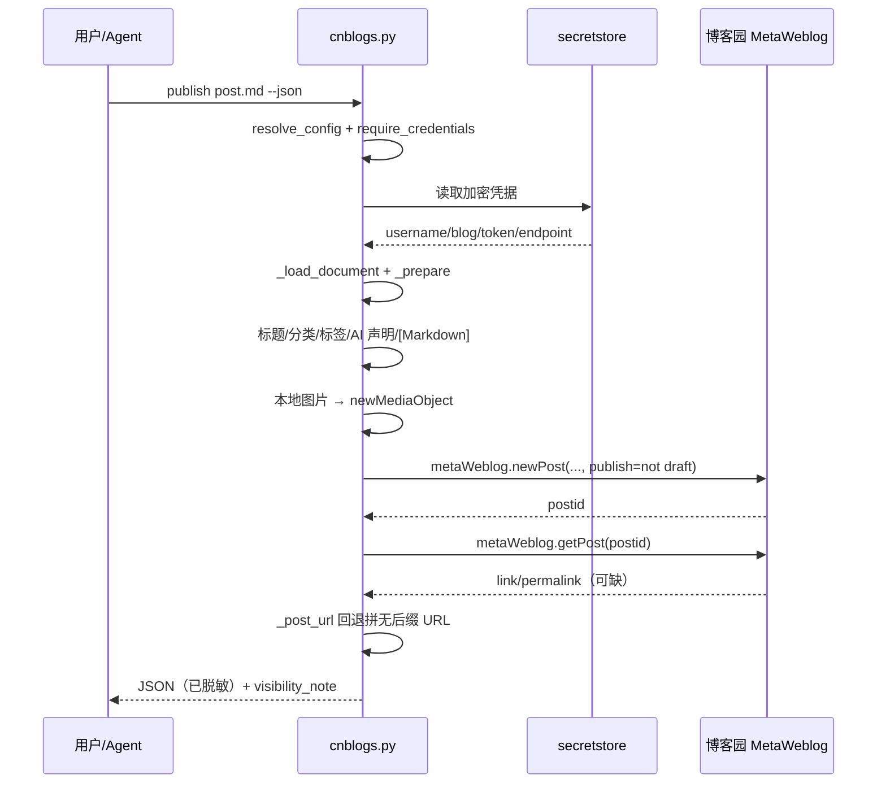

# 架构设计：单入口编排与三个薄模块

`cnblogs-publish` 没有采用"一个命令一个模块"的拆法，而是按**变化原因**分层：业务流程与 CLI 集中在 `cnblogs.py`，平台相关能力隔离到 `secretstore.py`（凭据后端）与 `dialogs.py`（原生对话框），纯函数式转换放进 `md2html.py`。

## 1.1 模块职责

| 模块 | 行数 | 顶层函数/类 | 职责 |
|---|---|---|---|
| `scripts/cnblogs.py` | 1,346 | 49 函数 / 4 类 | CLI 解析、配置、凭据编排、frontmatter、标题/分类/标签、图片上传、RPC、发布/更新/读取/删除、输出 |
| `scripts/secretstore.py` | 417 | 8 函数 / 5 类 | 4 种系统凭据后端的统一 get/set/delete 接口 |
| `scripts/dialogs.py` | 203 | 9 函数 / 1 类 | macOS/Windows/Linux/TTY 四类输入路径，令牌隐藏输入 |
| `scripts/md2html.py` | 350 | 10 函数 | 零依赖 Markdown→HTML 子集转换（HTML 兜底模式与本地预览） |

`cnblogs.py` 的 4 个类是 `UserError`（带退出码的业务异常）、`_TimeoutTransport` / `_TimeoutSafeTransport`（给 XML-RPC 连接注入超时）、`Reporter`（JSON/人类输出统一脱敏）。

## 1.2 分层视图

- **入口层**：`build_parser()` 定义 12 个子命令与公共选项 `--json`/`--blogid`/`--timeout`；`main()` 解析参数、加载配置、分发到 `HANDLERS`，并统一捕获异常。
- **编排层**：12 个 `cmd_*` 函数各自负责一个命令；发布与更新共享 `_prepare()`，避免两条路径的规则漂移。
- **领域层**：`parse_frontmatter`、`choose_title`、`normalize_list`、`ensure_md_category`、`upload_images`、`_post_url` 等纯逻辑，可在测试中独立调用。
- **基础设施层**：`rpc()` 构造 XML-RPC 代理；`secretstore` 与 `dialogs` 封装平台差异；`md2html` 无副作用。
- **输出层**：所有成功结果先经 `Reporter.emit()` 的 `redact_obj`，失败经 `_fail()` 的 `_scrub_identity`。

## 1.3 一次发布的数据流

关键点：`_prepare()` 在调用 RPC 之前完成所有本地变换；图片上传发生在 `newPost` 之前，且单张失败不阻塞；`getPost` 失败只产生 warning，URL 回退为按博客名拼接。

## 1.4 配置与凭据的分离

`resolve_config()` 只合并 `blogid` 与 `timeout` 两个命令行覆盖项到 7 键偏好配置；`require_credentials()` 单独从系统凭据库取身份。两者从不交叉写入——这是"配置文件可提交、凭据不可提交"的结构性保证。

## 1.5 关键设计取舍

| 取舍 | 选择 | 代价 |
|---|---|---|
| 依赖 | 只用标准库 | 需要自己实现 XML-RPC 超时、Markdown 子集、平台凭据调用 |
| 模块划分 | 平台代码薄而独立，业务代码集中 | `cnblogs.py` 较长（1,346 行），需靠函数命名维持可读性 |
| 发布/更新 | 共用 `_prepare()` | 更新路径需要先 `getPost` 回填元数据 |
| 错误处理 | 业务异常携带退出码，`main` 统一转换 | 所有命令必须通过 `UserError` 表达预期失败 |
| 输出 | JSON 与人类可读双通道，同一 payload | 每个命令都要维护两份展示文本 |

## 1.6 与其他 skill 的差异

与"每个子命令一个脚本"的 skill 相比，这里的入口只有一个 `cnblogs.py`，因此 Agent 只需记住一条调用路径；平台适配被压缩到两个模块，移植到新平台时改动面清晰。代价是单文件较大，阅读时应按"配置 → 凭据 → 解析 → 准备 → 命令"的顺序切入。

## 相关概念

- [项目概览](/concepts/00-overview.md)
- [发布流水线](/concepts/04-publishing-pipeline.md)
- [跨平台与测试](/concepts/07-cross-platform-and-tests.md)
