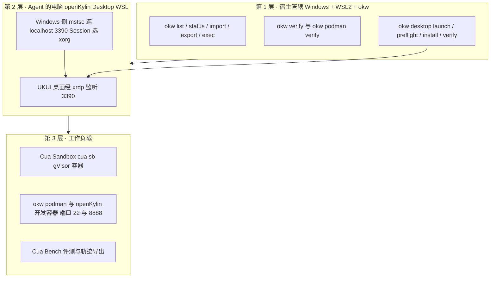

# cua × okw 最优解：给 Agent 一台可管理、可隔离、可复现的电脑（合成设计）

> ⚠️ **合成设计（synthesis）· 未在本机实测**
> 本章是**组合设计**，不是实测记录：它把 Cua 公开事实（挂 F 编号）与本仓 okw 文档（相对路径引用）拼成一套「宿主 ↔ Agent 的电脑 ↔ 工作负载」的方案草图，用于给出**选型判据与分工架构**。
> **本方案不构成可用性承诺**，也不代表任一路径已在本机运行过。凡未获证据支持的判断，一律标注为「**设计推断**」；涉及组合行为（Cua Linux Driver × UKUI/xrdp 会话）者标注为「**未验证**」。全文仅陈述设计与依据，不作可用性断言。

> **事实基础**：Cua 侧的每条具体陈述均带 F 编号，完整清单见 [references/second-article-facts.md](../references/second-article-facts.md)，核验结论见 [references/verification.md](../references/verification.md)。okw 侧陈述以仓库中 okw 文档为唯一依据（见文末「参考」），凡在该批文档中找不到依据者标注为「**待核**」，不编造命令或端口。

## 1. 问题与定位

**Cua 的命题**：给 AI Agent 一台属于它自己的电脑——Agent 不抢用户的鼠标，也不怕把宿主弄坏（F-004、F-136、F-137）。Cua Driver 为此提供「后台投递」机制：把点击与输入送到指定桌面窗口，而非操纵全局光标（F-078）。

**缺口（Windows 用户视角）**：Windows 原生桌面并不适合直接充当「Agent 的电脑」——Agent 一旦在用户本人的桌面上操作，就会抢占鼠标与焦点。文章给出的自测场景正是「Agent 在**后台**操作 Windows 桌面应用并自测、用户照常做自己的事」（F-092）；同时作者也判断，**只需跑命令、装依赖、跑测试时，普通容器就够**（F-128）。换言之，真正需要一台「专用电脑」的，是那些必须看屏幕、且需要与用户桌面隔离的任务（F-129）。

**okw 提供什么**：`okw` 是面向 Windows + WSL2 的 openKylin 开发工具包，按官方说明把已落机的操作经验封装为 CLI——WSL 发行版生命周期管理、环境验收、deb/dput 脚手架、rootless Podman 预检/安装/验收、本地离线 OCR，以及 openKylin Desktop WSL 的 UKUI 桌面（xrdp）预检/补齐/验收（[okw 指南](../../../../../../../../../../docs/tech/guides/openkylin-wsl-devkit/index.md)、[命令参考](../../../../../../../../../../docs/tech/guides/openkylin-wsl-devkit/02-command-reference.md)）。

**本章目标**：给出「宿主（Windows + WSL2 + okw）↔ Agent 的电脑（openKylin Desktop WSL）↔ 工作负载」的解耦分工与选型判据——即什么时候用哪一层、依据是什么、以及哪些环节**尚未验证**。

## 2. 分层架构分工（三层）

下图为本设计的**结构草图**（合成设计，未在本机实测）：



- **第 1 层（宿主管辖）**：okw 负责发行版的导入/导出/启停与只读验收，使「Agent 的电脑」可被创建、检查、回收。命令族包括 `okw list/status/import/export/unregister/exec`、`okw verify <name>`（[命令参考](../../../../../../../../../../docs/tech/guides/openkylin-wsl-devkit/02-command-reference.md)）。
- **第 2 层（Agent 的电脑）**：openKylin Desktop WSL 发行版内预装 UKUI 桌面，经 xrdp（默认端口 **3390**）供 Windows 侧 `mstsc` 连接；连接地址统一用 `localhost:3390`，登录窗 Session 需选 `xorg`（[桌面指南](../../../../../../../../../../docs/tech/guides/openkylin-wsl-devkit/08-desktop.md)）。此层为本章设计的**隔离载体**，用于承载需要图形界面又要求与用户桌面分离的任务。
- **第 3 层（工作负载）**：三选一或并存——Cua Sandbox（`cua sb`，gVisor 容器，见 F-113/F-117）用于命令任务；okw rootless Podman + openKylin 开发容器用于可复现开发环境（[rootless Podman 指南](../../../../../../../../../../docs/tech/guides/openkylin-wsl-devkit/03-podman-rootless.md)、[开发容器指南](../../../../../../../../../../docs/tech/guides/openkylin-wsl-devkit/05-openkylin-dev-container.md)）；Cua Bench 用于评测与训练（F-014、F-035、F-111）。

> **设计推断**：三层划分把「谁负责生命周期」「谁提供屏幕」「谁跑任务」解耦，任一层的替换不影响其余两层的契约——这是本设计相对「把一切都塞进同一台机器」的核心主张（对应可迁移判据表的列结构，见下节）。

## 3. 模块选型判据表

> 本表为**合成设计**：行是场景，列是「推荐组件 / 理由 / 依据」。依据列中的 Cua 条目挂 F 编号，okw 条目挂仓库相对路径链接。

| 场景 | 推荐组件 | 理由 | 依据 |
|---|---|---|---|
| **A 无 GUI 命令任务**（跑命令、装依赖、跑测试） | Cua Sandbox（`cua sb`，gVisor 容器）或 okw rootless Podman + openKylin 开发容器 | 无需图形栈时优先轻量隔离容器：gVisor 隔离性强于普通容器、开销小于虚拟机；作者亦判断「只需跑命令用普通容器就够」 | Cua：[F-113](../references/second-article-facts.md)、[F-117](../references/second-article-facts.md)、[F-128](../references/second-article-facts.md)；okw：[rootless Podman 指南](../../../../../../../../../../docs/tech/guides/openkylin-wsl-devkit/03-podman-rootless.md)、[开发容器指南](../../../../../../../../../../docs/tech/guides/openkylin-wsl-devkit/05-openkylin-dev-container.md) |
| **B 需 GUI 且要求隔离**（操作无 API 的桌面软件、看界面判断状态） | Cua Driver（后台投递）接入隔离桌面（Cua Fleets 云桌面，或第 2 层 UKUI 桌面） | 无 API 的界面必须「看屏幕」；后台投递不抢焦点；隔离可防污染宿主。本地 GUI 侧由 UKUI 桌面 + xrdp 承载 | Cua：[F-078](../references/second-article-facts.md)、[F-088](../references/second-article-facts.md)、[F-129](../references/second-article-facts.md)、[F-011](../references/article-source.md)、[F-048](../references/article-source.md)；okw：[桌面指南](../../../../../../../../../../docs/tech/guides/openkylin-wsl-devkit/08-desktop.md) |
| **C 可复现开发环境**（环境要能导出、复现、验收） | okw 发行版生命周期（`import/export`）+ rootless Podman + openKylin 开发容器 | 发行版可导出为 tar、再导入复现；okw 把验收脚本化（只读 preflight/verify），复现性优于手工环境 | okw：[命令参考](../../../../../../../../../../docs/tech/guides/openkylin-wsl-devkit/02-command-reference.md)（`okw import/export`）、[rootless Podman 指南](../../../../../../../../../../docs/tech/guides/openkylin-wsl-devkit/03-podman-rootless.md)、[开发容器指南](../../../../../../../../../../docs/tech/guides/openkylin-wsl-devkit/05-openkylin-dev-container.md) |
| **D 评测与训练**（造任务、评 Agent、导轨迹） | Cua Bench + Cua Fleets 机器池 | Bench 提供「数据生成 → 训练 → 评估」闭环与可复核评测；Fleets 池认领为毫秒级、空闲缩零，适合规模化评测 | Cua：[F-014](../references/article-source.md)、[F-035](../references/article-source.md)、[F-111](../references/second-article-facts.md)、[F-115](../references/second-article-facts.md)、[F-132](../references/second-article-facts.md)、[F-153](../references/second-article-facts.md)；okw：[开发容器指南](../../../../../../../../../../docs/tech/guides/openkylin-wsl-devkit/05-openkylin-dev-container.md)（本地复现评测目标环境） |

**可迁移性（设计）**：判据表的列结构（场景 / 推荐组件 / 理由 / 依据）对任意「宿主 + Agent 电脑 + 工作负载」组合成立——换用其他宿主或其他「Agent 的电脑」时，只需替换「依据」列，判据本身不变。

## 4. 组合路径（**设计**，非实测）

以下两条路径均为**设计**，未在本机执行；不得作为「已验证可用」的步骤使用。

### 4.1 GUI 路径（设计）

```text
okw desktop launch <name>                     # 启动发行版 → 等 localhost:3390 → 拉起 mstsc
        │  （Windows 侧 mstsc 连 localhost:3390，登录窗 Session 选 xorg）
        ▼
openKylin Desktop WSL 内的 UKUI 桌面           # 第 2 层「Agent 的电脑」
        │  在发行版内安装 Cua Driver（Linux 版）——具体安装与 MCP 注册细节：待核
        ▼
Cua Driver（Linux，按 MCP 接入 Agent）          # Agent 驱动 UKUI 应用、验证屏幕结果
        ▼
Agent（Claude Code / Codex / Cursor 等）        # 复刻 6×7 计算器闭环：算 6×7 并验证屏幕显示 42
```

- **okw 侧依据**：`okw desktop launch` 一键启动（启动发行版 → 等 `localhost:<port>` 就绪 → 拉起 `mstsc`），Session 选 `xorg`，默认端口 3390（[桌面指南](../../../../../../../../../../docs/tech/guides/openkylin-wsl-devkit/08-desktop.md)、[命令参考](../../../../../../../../../../docs/tech/guides/openkylin-wsl-devkit/02-command-reference.md)）。
- **Cua 侧依据**：Driver 安装（Linux）为 `/bin/bash -c "$(curl -fsSL https://cua.ai/driver/install.sh)"`（F-119）；Driver 可按 MCP 标准接入 Claude Code / Codex / Cursor 等 Agent，也可当普通命令行使用（F-094）；Driver 提供 CLI / MCP / SDK 三接入（F-010）；验收任务是「算 6 × 7 并验证屏幕显示 42」（F-095）。
- **待核**：Cua Driver 在 openKylin Desktop WSL 发行版内的**具体安装与 MCP 注册细节**在本仓 okw 文档与两篇源文中均未见依据，标注为「**待核 / 需实测**」。

### 4.2 headless 路径（设计）

```text
cua sb create ubuntu --name dev      # 起 gVisor 容器（非虚拟机）
cua sb exec dev uname -a             # 在沙箱内执行命令
cua sb screenshot dev                # 沙箱截屏（用于结果核验）
cua sb rm dev                        # 用完即弃
```

- **Cua 侧依据**：`cua sb create ubuntu --name dev` 起的是 gVisor 容器而非虚拟机（F-113）；`cua sb exec`（F-114）、`cua sb screenshot`（F-115）、`cua sb rm`（F-116）为同族命令。

> **边界声明**：以上两条路径均为**设计**，未在本机运行；不得表述为「可用」。路径中的命令本身可溯源到官方材料（F-112~F-116、F-119），但其**与 okw 桌面层的组合行为**无实测证据。

## 5. 前置条件

| 前置条件 | 说明 | 依据 |
|---|---|---|
| Windows + WSL2 | 宿主环境；okw 以此为切入点 | [okw 指南](../../../../../../../../../../docs/tech/guides/openkylin-wsl-devkit/index.md) |
| openKylin Desktop 镜像**已导入** | 须为**已预装桌面**的 Desktop WSL 发行版（如 `openKylin-3.0-desktop`）；最小镜像（无 xrdp）不适用桌面路径 | [桌面指南](../../../../../../../../../../docs/tech/guides/openkylin-wsl-devkit/08-desktop.md)（先在 PowerShell 运行 `wsl -l -v` 确认发行版名称） |
| okw 已安装 | 要求 Python 3.10 或更高版本；运行时零第三方依赖 | [okw README](../../../../../../../../../../apps/dev-tools/openkylin-wsl-devkit/README.md)（快速安装） |
| Cua CLI / Driver 可用 | CLI 安装 `curl -fsSL https://cua.ai/install.sh \| sh`；Driver 安装 macOS/Linux 用 `install.sh`、Windows 用 `install.ps1` | Cua：[F-112](../references/second-article-facts.md)、[F-119](../references/second-article-facts.md)、[F-120](../references/second-article-facts.md) |
| rootless Podman 就绪（走容器路径时） | okw 三步流程 `preflight` → `install --yes` → `verify` | [rootless Podman 指南](../../../../../../../../../../docs/tech/guides/openkylin-wsl-devkit/03-podman-rootless.md) |
| 网络与磁盘 | 发行版内 apt 与一般网络可用；导入/导出镜像需足够磁盘 | [命令参考](../../../../../../../../../../docs/tech/guides/openkylin-wsl-devkit/02-command-reference.md)、[okw 指南](../../../../../../../../../../docs/tech/guides/openkylin-wsl-devkit/index.md) |

## 6. 风险与未验证项清单

| # | 类型 | 项 | 说明 | 依据 / 验证路线 |
|---|---|---|---|---|
| 1 | **未验证** | Cua Linux Driver 对 UKUI/xrdp 会话的支持**未验证** | 无实测证据；需在 openKylin Desktop WSL 内实测 Driver 是否能枚举并驱动 UKUI 应用 | Cua：[F-050](../references/article-source.md)（后台投递有平台边界）；okw：[桌面指南](../../../../../../../../../../docs/tech/guides/openkylin-wsl-devkit/08-desktop.md)。验证路线：在 UKUI/xrdp 会话内实测 Cua Linux Driver |
| 2 | **未验证** | xrdp 是**远程会话**而非本地物理屏 | 截屏与输入假设可能与本地物理屏不同；「后台投递 / 截屏」在 xrdp 会话下的行为未验证 | okw：[桌面指南](../../../../../../../../../../docs/tech/guides/openkylin-wsl-devkit/08-desktop.md)；Cua：[F-088](../references/second-article-facts.md)、[F-115](../references/second-article-facts.md)。验证路线：实测 xrdp 会话下的截屏与输入投递 |
| 3 | **未验证** | 第 4 节两条组合路径**整体未在本机实测** | 均为设计推断，含合成成分 | 本章第 4 节。验证路线：按 4.1 / 4.2 逐条落地并记录结果 |
| 4 | **未验证** | 发行版内**嵌套 rootless Podman** 的平台限制 | 若走「开发容器内 live rootless」路径，WSL2 嵌套用户命名空间映射受限（实现需 `--privileged`，而容器契约禁止） | okw：[开发容器指南](../../../../../../../../../../docs/tech/guides/openkylin-wsl-devkit/05-openkylin-dev-container.md)（已知边界）。缓解：改用发行版侧 rootless（`okw podman verify`） |
| 5 | 风险 | WSL 发行版**按需停止** | 发行版停止 → xrdp 随之停止 → `localhost:3390` 无监听；「连不上」多半是发行版处于 `Stopped` | okw：[桌面指南](../../../../../../../../../../docs/tech/guides/openkylin-wsl-devkit/08-desktop.md)（FAQ、按需启动语义） |
| 6 | 风险 | okw **不安装桌面套件** | 只能作用于**已预装**桌面的 Desktop WSL 镜像；不含桌面套件的镜像不能走 GUI 路径 | okw：[桌面指南](../../../../../../../../../../docs/tech/guides/openkylin-wsl-devkit/08-desktop.md)（边界）、[okw 指南](../../../../../../../../../../docs/tech/guides/openkylin-wsl-devkit/index.md) |
| 7 | 风险 | **AGPL 组件与 `cuabot` 安全警告** | 可选 `cua-perception` 含 AGPL-3.0-only 的 OmniParser，重新分发或通过网络提供可能触发源码义务；npm 上的 `cuabot` 官方 README 措辞为 "Do not run it: it has known security issues." | Cua：[F-124](../references/second-article-facts.md)、[F-125](../references/second-article-facts.md)、[F-146](../references/second-article-facts.md)、[F-127](../references/second-article-facts.md)、[F-147](../references/second-article-facts.md) |
| 8 | 风险 | **Cua Fleets 付费**且**单价未获官方核验** | 云桌面集群按用量计费；单价仅第二篇单源，未在可达官方页检出 | Cua：[F-048](../references/article-source.md)、[F-132](../references/second-article-facts.md)、[F-153](../references/second-article-facts.md) |

> 计数：**8 项**——明确「未验证」**4 条**（#1~#4）、风险 **4 条**（#5~#8）。每条均标注验证路线或缓解方式。

---

## 参考

- 第二篇信源事实清单（Cua 侧 F-066~F-154）：[references/second-article-facts.md](../references/second-article-facts.md)
- 第一篇信源事实清单（Cua 侧 F-001~F-065）：[references/article-source.md](../references/article-source.md)
- 核验报告：[references/verification.md](../references/verification.md)
- okw 工具包 README：[apps/dev-tools/openkylin-wsl-devkit/README.md](../../../../../../../../../../apps/dev-tools/openkylin-wsl-devkit/README.md)
- okw 工具包指南：[docs/tech/guides/openkylin-wsl-devkit/index.md](../../../../../../../../../../docs/tech/guides/openkylin-wsl-devkit/index.md)
- okw 命令参考：[02-command-reference.md](../../../../../../../../../../docs/tech/guides/openkylin-wsl-devkit/02-command-reference.md)
- okw rootless Podman 指南：[03-podman-rootless.md](../../../../../../../../../../docs/tech/guides/openkylin-wsl-devkit/03-podman-rootless.md)
- okw 开发容器镜像指南：[05-openkylin-dev-container.md](../../../../../../../../../../docs/tech/guides/openkylin-wsl-devkit/05-openkylin-dev-container.md)
- okw 桌面指南（UKUI/xrdp）：[08-desktop.md](../../../../../../../../../../docs/tech/guides/openkylin-wsl-devkit/08-desktop.md)
- 束根索引与导航：[../index.md](../index.md)
- 延伸阅读：[01-five-core-modules.md](01-five-core-modules.md)、[05-scenarios-and-limitations.md](05-scenarios-and-limitations.md)
