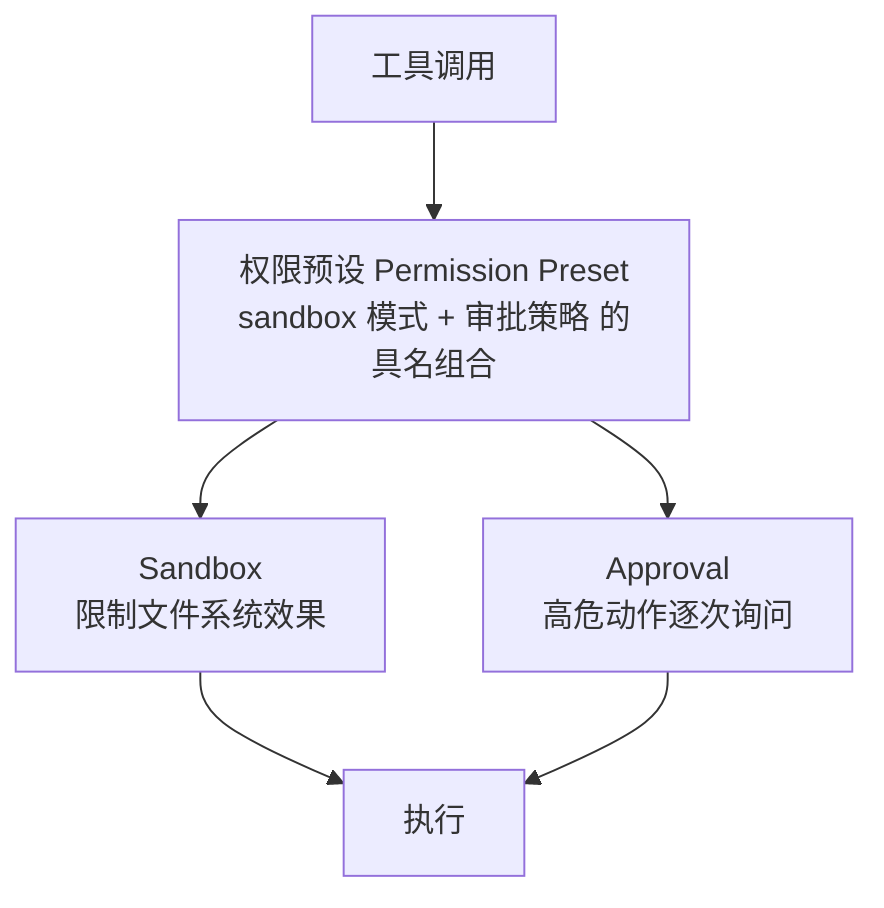

# 安全模型：沙箱、审批与权限预设

> ⚠️ **先读这一段**：官方 `SAFETY.md` 明确声明 Harness 是**未审计的实验性开发者预览**——它会执行模型生成的代码与命令、加载第三方插件。沙箱 / 审批 / 权限控制**只降低风险，不保证隔离**，不应作为不可信工作负载的唯一安全控制。建议一次性虚拟机或容器 + 最小权限 + 备份。

## 1. 三层控制

## 2. 沙箱

`ctx.sandbox` 是 `SandboxProvider` 抽象 seam，`ctx.sandboxPolicy` 是策略服务。

### 三档模式

| 模式 | 语义 |
|---|---|
| `read-only` | POSIX runner 仅额外授予 `/dev/null` 等必需接收器；Windows ACL runner **不授予任何显式可写根目录** |
| `workspace-write` | 工作区根 + 后端承诺的临时区；Windows 为每会话私有 `<temp>\dsh-<hash>` 子目录并改写受限子进程的 TMP/TEMP |
| `danger-full-access` | 绕过隔离，消费方直接 spawn 原始 argv，**不调 `ctx.sandbox`** |

策略**逐调用**携带：`SandboxPolicy { mode, workspaceRoot, sessionId }`——同一提供方可同时服务不同边界的消费者。

默认：`mode` = `read-only`（fail-safe），`workspaceRoot` = `process.cwd()`。

### 强制完整性是后端报告的事实

`SandboxEnforcement` 取 `full` / `partial`。当前 partial 情形：较旧 Landlock ABI、Windows ACL runner 的硬链接/读取不受限、AppContainer ACL 边界。

> **要求绝对保证的消费者必须拒绝 partial**——不能假设隔离一定生效。

### Fail-closed

无后端时 `ctx.sandbox.confine` 抛 `SandboxUnavailableError`（`SANDBOX_UNAVAILABLE`）。受限策略下"静默无隔离透传"永远不合法。

### 错误归因二分

| 类别 | 含义 |
|---|---|
| `runnerFailureRules` | runner 自身在执行前失败 → **基础设施故障** |
| `denialSignatures` | 沙箱正常生效、命令被拦 → **策略拒绝** |

先查前者再查后者，禁止用跨后端 union 判定拒绝。

**实务**：bash 工具描述里被拒操作会报 `[sandbox: file access denied under <mode> mode]`——这是策略拒绝，**不要换个方式重试**。

## 3. 审批

`ctx.approval`（`dsh-user-approval`）回答"这个具体操作能否继续"。

### 结果闭合

`ApprovalOutcome = 'allowed-once' | 'rejected' | 'cancelled' | 'unavailable'`

`allowed-once` **仅授权所问的那一个操作**。

### Fail-closed

`unavailable`（缺失应答者、抛异常、不合规返回值）**一律按拒绝处理**，绝不放行。

### 两种策略

| 策略 | 行为 |
|---|---|
| `ask`（默认） | 委派给应答者链；链无应答时落到 fail-closed 的 `unavailable` |
| `never` | 确定性地 `rejected`，且在服务内部、**waterfall 分发之前**强制执行——即使后来以 `prepend` 注册的应答者也无法绕过 |

`never` 是 CI / 无人值守场景的严格姿态。

### 审计

`approval/asked` + `approval/decided` 成对（`ApprovalRequestId` 品牌类型），**仅写日志，不进模型 transcript**。`ApprovalRequest` 有意省略工具参数，用 `callId` 关联已流式输出的工具调用。

应答者需在打开的轮次内应答。

## 4. 权限预设

`ctx.permissionPresets` 把 sandbox 模式 + approval 策略捆成具名预设，对应客户端里的单个 Permissions 选择器。

### 默认预设

| 预设 | sandbox | approval |
|---|---|---|
| `workspace-write` | `workspace-write` | `ask` |
| `danger-full-access` | `danger-full-access` | `never` |

`custom` 与 `auto` 是**保留名**，不可配置（配了就抛错）。

### 切换语义

`set(session, name)`：先追加仅记日志的 `permission/preset`，再经各 knob 自己的 setter 写入（`setSandboxMode` / `setApprovalPolicy`），且**仅在生效值变化时写**；重选当前预设不追加任何事件。

`current(session)` 优先取仍匹配的选择，其次第一个匹配的配置项，否则返回派生值 `CUSTOM_PRESET`（`'custom'`）——`custom` 只是派生展示值，不是切换目标，也不出现在事件 payload。

### 组合前提

该服务**要求**一个会施加隔离的 `ctx.shell` 执行器（有 `sandboxMode` 能力事实）。在不施加隔离的 bash 执行器之上组合会抛错——预设捆绑了沙箱模式。

`auto` 由 Auto review integration 通过固定的 `registerAuto(admit)` 钩子发布（`danger-full-access` + `ask`），仅在 effect 生命周期内存在，绝不进入 `defaultPreset` schema。

## 5. 部署建议

1. 一次性容器或虚拟机 + 最小权限 + 备份
2. 默认保持 `workspace-write` + `ask`
3. CI / 无人值守显式设 `never`（或更严的预设）
4. 开启 `tool-fs-observation-policy` 之类的观测策略，保留审计链
5. **不要**把 `danger-full-access` 当默认值

## 下一步

- [应用形态](10-application-forms.md)
- [源码路径与包清单](../references/source-map.md)
