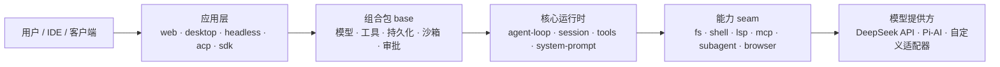

# DeepSeek Harness 0.2（dsh）源码精读

> **本束与 [deepseek-harness](../deepseek-harness/index.md) 的关系**：后者基于 **0.1.0-rc.5** 的旧镜像源码（ReactLoopAgent 状态机 + Phase 队列），本束基于 **0.2.1-rc.2** 官方仓库源码。两版之间架构已换代——0.2 引入了 **profile/组合包分层**、**能力 seam**、**session 事件日志**与**多应用形态**。旧束保留作历史对照，本束是当前主线教程。

DeepSeek Harness（命令行 `dsh`）是 DeepSeek AI 开源的 **agent harness**——模型外面那层负责"干活"的执行壳：读写文件、跑命令、管会话、接工具、控权限。它的架构主张只有一句：**一切皆插件（everything-is-a-plugin）**。

底层框架是 [Cordis](https://github.com/cordiverse/cordis)（Context / Service / Plugin / Fiber 四抽象 + 声明合并 + 依赖注入 + 瀑布事件）。产品里没有需要打补丁的特权内核：模型适配器、工具注册表、会话日志、乃至 agent loop 本身都是插件，都可以从配置里替换。



## 阅读路径

| 你的目标 | 建议顺序 |
|----------|----------|
| 第一次上手 | [入门指引](concepts/00-getting-started.md) → [应用形态](concepts/10-application-forms.md) → [Headless 实战](examples/00-headless-task.md) |
| 理解架构 | [架构总览](concepts/01-architecture-overview.md) → [Cordis 插件模型](concepts/02-cordis-plugin-model.md) → [Profile 与组合包](concepts/03-profile-and-bundle.md) |
| 理解运行时 | [Agent 循环](concepts/04-agent-loop.md) → [会话与持久化](concepts/05-session-and-persistence.md) → [工具系统](concepts/06-tool-system.md) → [LLM 抽象层](concepts/07-llm-abstraction.md) |
| 扩展开发 | [能力 seam 与子系统](concepts/08-capability-seams.md) → [写自定义工具](examples/02-custom-tool.md) → [写插件与组合包](examples/03-custom-plugin-bundle.md) |
| 生产部署 | [安全模型](concepts/09-security-model.md) → [MCP 集成](examples/01-mcp-integration.md) → [Python SDK 嵌入](examples/04-python-sdk-embedding.md) |

## 概念

* [入门指引——安装、运行与目录结构](concepts/00-getting-started.md)
* [架构总览——一切皆插件与能力缝](concepts/01-architecture-overview.md)
* [Cordis 插件模型——Context / Service / Plugin / Fiber](concepts/02-cordis-plugin-model.md)
* [Profile 与组合包——配置树的四层叠加](concepts/03-profile-and-bundle.md)
* [Agent 循环——轮次、步骤与事件序列](concepts/04-agent-loop.md)
* [会话与持久化——事件日志与 generation 发布](concepts/05-session-and-persistence.md)
* [工具系统——注册表、作用域与执行流水线](concepts/06-tool-system.md)
* [LLM 抽象层——适配器、内容块与流式协议](concepts/07-llm-abstraction.md)
* [能力 seam 与子系统地图](concepts/08-capability-seams.md)
* [安全模型——沙箱、审批与权限预设](concepts/09-security-model.md)
* [应用形态——CLI / Web / Desktop / Headless / ACP / Python SDK](concepts/10-application-forms.md)

## 示例

* [一次性 Headless 任务](examples/00-headless-task.md)
* [接入 MCP 服务器](examples/01-mcp-integration.md)
* [定义自定义工具](examples/02-custom-tool.md)
* [编写并安装自己的插件与组合包](examples/03-custom-plugin-bundle.md)
* [Python SDK 嵌入与子 Agent 委派](examples/04-python-sdk-embedding.md)

## 参考

* [源码路径与包清单登记](references/source-map.md)
* [事实登记 F-001~F-048](references/facts.md)

```{toctree}
:hidden:
:maxdepth: 7

concepts/index
examples/index
references/index
log
```

```{toctree}
:hidden:
:maxdepth: 7

concepts/00-getting-started
concepts/01-architecture-overview
concepts/02-cordis-plugin-model
concepts/03-profile-and-bundle
concepts/04-agent-loop
concepts/05-session-and-persistence
concepts/06-tool-system
concepts/07-llm-abstraction
concepts/08-capability-seams
concepts/09-security-model
concepts/10-application-forms
examples/00-headless-task
examples/01-mcp-integration
examples/02-custom-tool
examples/03-custom-plugin-bundle
examples/04-python-sdk-embedding
references/source-map
references/facts
log
```
