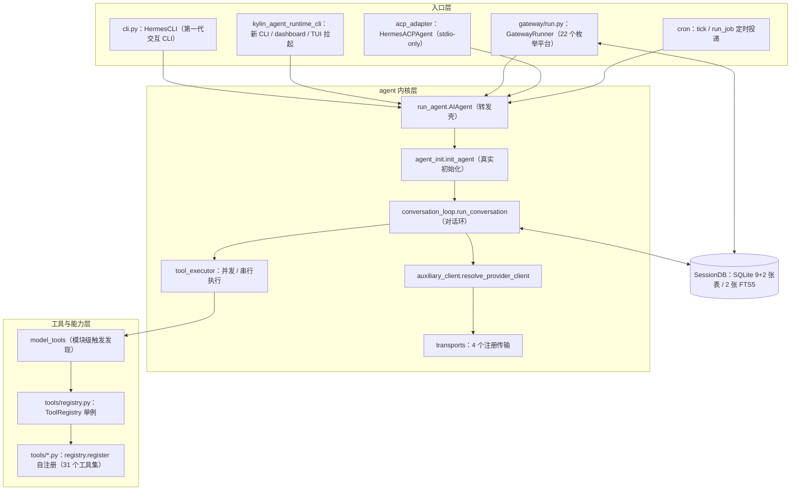

# 架构与模块地图：三代同层的代码结构

Kylin Agent Runtime 的代码库同时存在三个世代的结构，且三代同层共存、旧入口仍是分发主入口（I-1）：第一代是 14 个顶层单文件巨型脚本，第二代是承接模型适配、记忆、技能等新逻辑的 agent/ 内核包，第三代是 kylin_agent_runtime_cli/ 加 web/、ui-tui/ 的新交互层。最直观的反差是 `AIAgent.__init__` 已退化为转发壳，真实初始化全部在 `agent.agent_init.init_agent`（F-021、F-024）。

本篇给出三代结构对照、分层与主要数据流、工具发现依赖链、技术栈与规模表，以及一条避开转发壳的读码路径。

## 三代结构总览

| 世代 | 形态 | 代表模块 | 规模证据 |
|---|---|---|---|
| 第一代：遗产大脚本 | setuptools `py-modules` 平铺分发的 14 个顶层单文件 | run_agent、model_tools、toolsets、batch_runner、trajectory_compressor、toolset_distributions、cli、kylin_agent_runtime_bootstrap/constants/state/time/logging、utils | F-006、Q-008 |
| 第二代：agent 内核包 | 包化的对话内核与模型/记忆/技能子系统 | agent_init、conversation_loop、tool_executor、transports/、lsp/、user_profile/ 等 | Q-001：agent/ 120 个 py（根 86 + transports 11 + lsp 11 + user_profile 12） |
| 第三代：CLI 与前端层 | 新 CLI 包加两套前端加 TUI 网关 | kylin_agent_runtime_cli/（94 个 py）、web/（React 19）、ui-tui/（Ink 6）、tui_gateway/（8 个 py） | F-134、F-141、F-142、Q-001 |

新包通过被旧脚本 import 的方式挂载，形成"壳在旧层、肉在新层"：run_agent.py 里的 AIAgent 负责对外保持类名与签名兼容，函数体只做一次 `init_agent` 转发；cli.py 中的 HermesCLI 与新 CLI 包 main.py 两个万行级命令行并存（F-133、F-134、Q-008）。

分发配置同样反映三代并存。14 个 py-modules 的完整名单为 run_agent、model_tools、toolsets、batch_runner、trajectory_compressor、toolset_distributions、cli，以及 kylin_agent_runtime_bootstrap、kylin_agent_runtime_constants、kylin_agent_runtime_state、kylin_agent_runtime_time、kylin_agent_runtime_logging、utils（F-006）。packages.find.include 则收录 agent、tools、kylin_agent_runtime_cli、gateway、tui_gateway、cron、acp_adapter、plugins、providers 及各自的 `.*` 子包（F-007）。package-data 把 kylin_agent_runtime_cli 的 web_dist、tui_dist 与 install 脚本、gateway/assets、plugins 的 dashboard manifest 与 dist 一并打进 wheel（F-008）。

## 分层与主要数据流

三类入口——命令行（双 CLI）、消息网关（GatewayRunner）、ACP stdio 服务器（HermesACPAgent）——最终都汇入 AIAgent，再由 init_agent 装配对话环、工具执行器与模型传输，状态落 SessionDB：

入口侧的关键事实：console_scripts 共 4 个，`kylin-agent-runtime` 与兼容别名 `hermes` 走新 CLI 包 main，`hermes-agent` 走 run_agent:main，`hermes-acp` 走 acp_adapter.entry:main（F-005）；GatewayRunner 在 gateway/run.py:1401，提供 async start/stop 与 request_restart，没有 run 方法，模块级 start_gateway/main 负责进程装配（F-102、F-104）；HermesACPAgent 继承 acp.Agent，模块注释明示 stdio-only，由 entry.main 调 acp.run_agent 启动（F-118、F-119）。

## 关键依赖链：工具发现如何串起三代

工具体系是观察三代耦合的最好样本，链条 `tools/registry → tools/*.py → model_tools → run_agent/cli`（F-013 记录的结构注释与代码一致）：

1. `tools/registry.py` 定义 ToolRegistry 类与模块级单例 `registry = ToolRegistry()`（:544），ToolEntry 以 __slots__ 固定 name/toolset/schema/handler/check_fn 等字段（F-046、F-048）。
2. `discover_builtin_tools()`（:57）先 glob 扫描 tools/ 根的 *.py，排除 __init__.py、registry.py、mcp_tool.py，再用 AST 静态判定模块顶层是否含 `registry.register(` 调用，命中才 importlib 导入，模块导入时完成自注册（F-047）。
3. 第一代根脚本 model_tools.py 第 32 行导入 registry 与发现函数，第 180 行模块级直接调用 `discover_builtin_tools()`，并暴露 get_tool_definitions、coerce_tool_args、handle_function_call、get_all_tool_names 等函数给对话环（F-049）。
4. 对话环经 model_tools 拿到工具定义与分发函数；toolsets.py 以 31 个顶层工具集键组织工具，`_HERMES_CORE_TOOLS` 是 CLI 与全部消息平台共享的核心工具名列表（F-050、F-051、Q-003）。

与工具链的开放注册相反，网关内置平台走枚举硬连：Platform 枚举固定 22 个内置成员，GatewayRunner._create_adapter 以 if/elif 链逐个接适配器，platform_registry 只服务插件平台（F-108、F-110、I-2）。32 个 platforms 文件、21 个适配器实现、22 个枚举成员是三个不同口径，见 [网关与 Cron](/concepts/08-gateway-and-cron.md)（Q-002）。

## 技术栈

| 层 | 技术选型 | 证据 |
|---|---|---|
| 构建分发 | setuptools >= 61.0（setuptools.build_meta 后端），py-modules 与 packages.find 混排 | F-002、F-006、F-007 |
| 运行时语言 | Python >= 3.11，MIT | F-001 |
| 模型调用 | openai==2.24.0、httpx[socks]==0.28.1、pydantic==2.13.4、numpy==2.4.6，核心依赖全部 `==` 钉版 | F-003 |
| 调度 | croniter==6.0.0 | F-003 |
| 协议可选依赖 | agent-client-protocol==0.9.0（acp extra）、mcp extra、anthropic、bedrock 等均为可选 extra | F-004 |
| Web 服务 | fastapi==0.133.1 + uvicorn（web extra），dashboard 应用 app=FastAPI(title="Hermes Agent") | F-004、F-138 |
| Web 前端 | React 19.2 + Vite + Tailwind v4 + @xterm/xterm 6.0（4 个 addon），构建 tsc -b && vite build | F-141 |
| TUI | ink ^6.8 + React 19 + nanostores，esbuild 打包，tsx 跑 src/entry.tsx | F-142 |
| 状态存储 | SQLite，9 张普通表 + 2 张 FTS5 虚表（含 trigram 分词器支撑中日韩子串检索） | F-130、F-131、Q-006 |
| 测试 | pytest，-n auto 并发、--timeout=30、signal 超时法，integration / real_concurrent_gate 标记 | F-009 |

## 规模数字

按 Q-001 计数口径（递归统计 *.py，含 __init__.py，不含 .git 与 embeddings 产物）：

| 目录 | py 文件数 | 拆分口径 |
|---|---|---|
| tests/ | 1199 | 最大目录，覆盖 acp/agent/cli/cron/gateway/tools/run_agent 等包（F-149） |
| plugins/ | 118 | 17 个插件目录，含 8 个记忆后端与 8 个搜索后端（F-096、F-097） |
| agent/ | 120 | 根 86 + transports 11 + lsp 11 + user_profile 12 |
| kylin_agent_runtime_cli/ | 94 | 顶层 87 + proxy 7 |
| tools/ | 93 | 根 76 + environments 12 + computer_use 5 |
| gateway/ | 64 | platforms 直接子文件 32 个（Q-002） |
| skills/ | 33 | 另有 77 个 SKILL.md、递归 179 个目录（Q-005） |
| optional-skills/ | 48 | 17 个顶层分类（F-099） |
| scripts/ | 14 | 安装与运维脚本 |
| acp_adapter/ | 10 | ACP 服务器、会话、审批、事件 |
| tui_gateway/ | 8 | TUI 的 JSON-RPC 后端 |
| cron/ | 4 | 函数式调度 |
| providers/ | 2 | ProviderProfile 与发现机制（F-080） |

巨型脚本行数按 Q-008 的 `Measure-Object -Line` 口径：cli.py 13108、run_agent.py 3810、kylin_agent_runtime_state.py 3692、trajectory_compressor.py 1465、batch_runner.py 1278、model_tools.py 849、toolsets.py 771、mcp_serve.py 745；新 CLI 包 main.py 单文件 13434 行（F-134）。gateway/run.py 存在 lone-CR 混合换行，Measure-Object 口径 16612 行，ripgrep 口径至少 18249 行——引用行号一律以 ripgrep/Read 口径为准（Q-008）。

## 读码路径建议

1. **从 init_agent 而不是 AIAgent.__init__ 开始**。run_agent.py:326 的 AIAgent 在 349-416 行的 `__init__` 只有转发逻辑，docstring 明示 "Forwarder — see agent.agent_init.init_agent"；真实形参（enabled/disabled_toolsets、reasoning_config、request_overrides、prefill_messages、session_db、parent_session_id、iteration_budget 等）从 agent/agent_init.py:74 起（F-021、F-024）。
2. **对话环读 agent/conversation_loop.py:372**。模块级 `run_conversation(agent, user_message, ...)` 是一轮对话的实际主体，run_agent.py:3996 的同名方法是类上的入口（F-023、F-025）。
3. **工具链沿 tools/registry.py:57 → model_tools.py:180 → toolsets.py:78 读**，先理解 AST 预判加自注册，再看 31 个工具集的组合引用（F-047、F-049、F-051）。
4. **模型调用读 agent/auxiliary_client.py 的 resolve_provider_client（:3069）与 agent/transports/**，4 个注册传输把不同协议归一为 NormalizedResponse（F-063、F-064、F-066）。
5. **状态层读 kylin_agent_runtime_state.py:381 的 SessionDB**，建表 DDL 在 187-3453 区间，两张 FTS5 虚表在 326-358（F-129~F-131）。
6. **入口三选一按形态读**：交互读 cli.py:2609 的 HermesCLI 或新包 main.py:10547；服务化读 gateway/run.py:1401；编辑器/桌面代理读 acp_adapter/server.py:445（F-133、F-134、F-102、F-118）。

## 相关概念

- [Kylin Agent Runtime 总览](/concepts/00-overview.md) —— 定位、版本与 Hermes 血缘
- [Agent 核心对话环](/concepts/02-agent-core-loop.md) —— init_agent 之后的一轮对话细节
- [CLI 与 TUI](/concepts/03-cli-and-tui.md) —— 第三代交互层展开
- [工具体系](/concepts/04-tool-system.md) —— 自注册发现链与 31 个工具集
- [网关与 Cron](/concepts/08-gateway-and-cron.md) —— 平台双轨制与 32/21/22 口径
