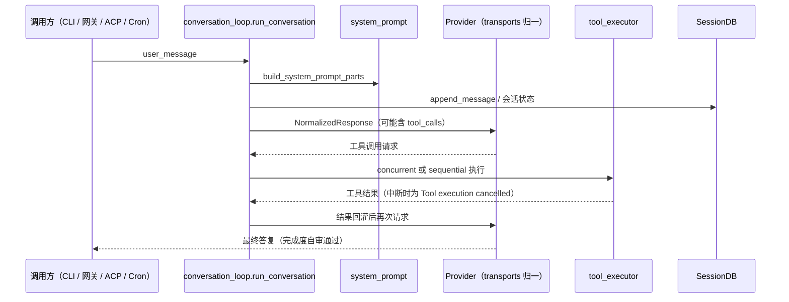

# Agent 核心对话环：转发壳、迭代预算与护栏纵深

对话环是 Kylin Agent Runtime 的主体机制，但入口类 AIAgent 本身不含初始化逻辑——`__init__` 是转发壳，真实装配在 agent/agent_init.py 的 init_agent；一轮对话的主体在 agent/conversation_loop.py 的模块级 run_conversation（F-021、F-024、F-025）。环内围绕"模型决策 → 工具执行 → 结果回灌"迭代，外层包着迭代预算、工具护栏、故障分类退避、完成度自审与安全纵深五套机制。

本篇按一轮对话的真实路径展开。第一个反差点：从 AIAgent.__init__ 函数体读不到任何真实逻辑，必须跳到 init_agent（I-1）。

## AIAgent：转发壳与真实初始化

AIAgent 定义于 run_agent.py:326，`__init__`（349-416 行）docstring 明示 "Forwarder — see agent.agent_init.init_agent"，函数体内导入并转发全部参数（F-021）：

```python
class AIAgent:                       # run_agent.py:326
    def __init__(self, ...):
        """Forwarder — see agent.agent_init.init_agent"""
        from agent.agent_init import init_agent
        # 转发全部参数给 init_agent
```

构造参数的关键默认值（F-022）：

| 参数 | 默认值 | 含义 |
|---|---|---|
| max_iterations | 90 | 工具调用迭代上限，与子代理共享同一预算池 |
| tool_delay | 1.0 | 工具调用间隔秒数 |
| prompt_profile | "full" | 提示词档位 |
| checkpoint_max_snapshots | 20 | 检查点快照数上限 |
| checkpoint_max_total_size_mb | 500 | 检查点总容量 |
| checkpoint_max_file_size_mb | 10 | 单文件检查点上限 |

形参按职能可分四组（F-022）：

- **平台与会话身份组**：platform、user_id、chat_id、thread_id、gateway_session_key，让同一个环能被 CLI 与 22 个枚举平台复用（F-108）；
- **回调组**：共 9 类 callback，覆盖流式输出、审批、工具进度等事件点；
- **韧性组**：credential_pool（凭证池轮换）、fallback_model（回退模型）、iteration_budget（共享迭代预算）、parent_session_id（父会话标识）；
- **检查点组**：checkpoint_max_snapshots / checkpoint_max_total_size_mb / checkpoint_max_file_size_mb 三个上限。

真正的初始化函数 init_agent 形参从 agent/agent_init.py:74 延续到 133 行之后，承接 enabled/disabled_toolsets、reasoning_config、request_overrides、prefill_messages、session_db、parent_session_id、iteration_budget 等真实装配项（F-024）。工具开关、推理参数、会话库注入都在此层完成，构造壳本身不做任何状态装配。

类上另有 run_conversation 方法（run_agent.py:3996）、chat 方法（:4019，返回字符串）与 main()（:4046）（F-023）。

## 一轮对话的路径

模块级对话函数是实际主体（F-025）：

```python
def run_conversation(agent, user_message, system_message=None,
                     conversation_history=None, task_id=None,
                     stream_callback=None,
                     persist_user_message=None) -> Dict[str, Any]
```

它在入口处做两件运行时绑定：`auxiliary_client.set_runtime_main(agent.provider, agent.model)` 绑定本轮主模型客户端，`kylin_agent_runtime_logging.set_session_context(agent.session_id)` 绑定会话日志上下文（F-025）。随后按"拼提示词 → 调模型 → 执行工具调用 → 结果回灌 → 再调模型"迭代，直到模型不再请求工具或触发预算/护栏终止。



## 系统提示词：stable / context / volatile 三段

`build_system_prompt_parts(agent, system_message=None) -> Dict[str, str]` 返回 stable、context、volatile 三键，把稳定身份、每轮上下文、易变信息分层拼装；同文件还有 build_system_prompt（:413）、invalidate_system_prompt（:433）、format_tools_for_system_message（:444）（F-026）。

提示词片段常量含 DEFAULT_AGENT_IDENTITY、KYLIN_AGENT_HELP_GUIDANCE、CHINA_WEB_ACCESS_GUIDANCE（中文网络访问指引）、MEMORY_GUIDANCE、SKILLS_GUIDANCE、KANBAN_GUIDANCE、TOOL_USE_ENFORCEMENT_GUIDANCE（F-027）。平台相关有两处硬编码表（F-028）：

- TOOL_USE_ENFORCEMENT_MODELS 列出 8 个模型族：gpt、codex、gemini、gemma、grok、glm、qwen、deepseek，命中时强化工具调用格式约束；
- PLATFORM_HINTS 字典含 19 个键：whatsapp、telegram、discord、slack、signal、email、cron、cli、sms、bluebubbles、mattermost、matrix、feishu、weixin、wecom、qqbot、yuanbao、api_server、webui。

上下文文件加载走 build_context_files_prompt，优先级为 .kylin-agent-runtime.md / HERMES.md → AGENTS.md → CLAUDE.md → .cursorrules；单文件上限 CONTEXT_FILE_MAX_CHARS = 20_000 字符，超长按头部 0.7、尾部 0.2 截断（F-029）。

## 迭代预算：父子共享的 IterationBudget

IterationBudget 类提供 consume()、refund()、used、remaining，内部以 threading.Lock 保护计数（F-030）。预算按父子代理两级分配：父代理上限取 AIAgent 的 max_iterations（默认 90），子代理取 delegation.max_iterations（默认 50），子代理消耗的是父代理传入的共享预算，因此 90 次是整条委派树的总盘子而非单代理额度（F-022、F-030）。

一轮迭代的终止条件由此分散在三处：预算耗尽（remaining 归零）、护栏控制器给出 block/halt、完成度自审给出 completed/await_user/await_approval/blocked 之一。refund() 的存在说明并非每次 consume 都计入——被判定为可退还的迭代会把额度还回预算池（F-030、F-033、F-037）。

## 工具执行：并发、串行与中断

工具执行有两个并列入口（F-031）：

- `execute_tool_calls_concurrent(agent, assistant_message, messages, effective_task_id, api_call_count=0)`（agent/tool_executor.py:355）；
- `execute_tool_calls_sequential(...)`（:819）。

执行被中断时，执行器为每个未完成的 tool call 追加文本 "Tool execution cancelled"，保证消息历史里每次调用都有对应结果位，不留下悬空工具请求（F-031）。

## 工具护栏：16 个幂等名、15 个变更名与失败阈值

工具先按副作用分两类（F-032）：

- IDEMPOTENT_TOOL_NAMES 是含 16 项的 frozenset，覆盖 read_file、search_files、web_search、web_extract、memory、browser_* 等只读工具；
- MUTATING_TOOL_NAMES 是含 15 项的 frozenset，覆盖 terminal、execute_code、write_file、patch、todo、skill_manage、浏览器写操作、send_message、cronjob、delegate_task、process。

`@dataclass(frozen=True) ToolCallGuardrailConfig` 给出失败计数阈值，ToolCallGuardrailController 在 before_call / after_call / reset_for_turn 三个时点执行（F-033）：

| 阈值字段 | warn | block/halt |
|---|---|---|
| exact_failure（同一工具同一参数精确失败） | 2 | 5（block） |
| same_tool_failure（同一工具失败） | 3 | 8（halt） |
| no_progress（无进展） | 2 | 5（block） |

## 故障分类与退避重试

FailoverReason 枚举有 18 个成员，覆盖 auth、billing、rate_limit、overloaded、server_error、timeout、context_overflow、model_not_found 等失败类别；classify_api_error 把原始异常归一为 ClassifiedError，供凭证池轮换与模型回退决策（F-034、F-072）。重试间隔走 `jittered_backoff(attempt, base_delay=5.0, max_delay=120.0, jitter_ratio=0.5)`，5 秒起步、120 秒封顶并叠加抖动（F-035）。流式请求另有 STREAM_DIAG_HEADERS 10 个响应头诊断表，配合 stream_diag_init、capture、log_stream_retry 记录重试原因（F-035）。模型输出侧的思维链清洗由 StreamingThinkScrubber 承担，开放标签名集合为 think、thinking、reasoning、thought、REASONING_SCRATCHPAD，以 feed() 逐块喂入、flush() 取出残量，保证思维链文本不外泄到最终消息（F-036）。消息进入历史前还经过 message_sanitization 清洗，该模块导出 11 个工具函数，处理代理对修复、非 ASCII 文本与图片剥离等问题（F-150）。

## 完成度自审、后台复盘与委派路由

完成度并非由"模型不再调工具"单方面决定。CompletionReviewer.review 对候选答复做自审，ReviewSettings 默认 enabled=True、max_attempts=2、max_reviews=8，decision 取值 {completed, continue, await_user, await_approval, blocked} 五种（F-037）。后台复盘由 spawn_background_review_thread 异步执行，可分别复盘记忆与技能，并经 build_memory_write_metadata 构造记忆写入元数据（F-038）。

委派路由 decide_delegation_hint 对用户消息打分：explicit_delegation（显式委派措辞）+4、implementation（实现类任务）+3、parallel/multi_angle（并行或多视角）+2 等，返回 DelegationRouterDecision（F-039）。需要特别注意默认开关：配置模型里默认 enabled=True，但 router_enabled=False、mainline_branch_enabled=False——即评分函数存在且自审体系开着，自动委派路由默认不启用，主线分支能力同样默认关闭（F-039）。

被委派任务中断后的恢复策略由 recovery_policy_for_tool(tool_name, args) -> str 给出：函数按工具名分支，返回四个策略名之一的字符串，取值域为 {resume_children, safe_retry, verify_effects, confirm_before_retry}——delegate_task 命中 "resume_children"（恢复子任务而非整轮重跑），其余策略分别对应可安全重试、重试前先核验副作用、必要时向用户确认；检查点经 task_checkpoint_context(db, task_run_id, ...) 上下文管理器写入 task_runs/task_subruns/task_checkpoints 三张表（F-040、F-130）。完整轨迹由 save_trajectory(trajectory, model, completed, filename=None) 以 JSONL 追加写入 trajectory_samples.jsonl，失败轨迹写 failed_trajectories.jsonl，供离线评测复用（F-041、F-149）。

## 安全纵深：脱敏、写黑名单与 hook allowlist

运行侧三道防线与供应链侧的精确钉版、懒安装共同构成纵深（I-5、F-003、F-004）：

| 防线 | 机制 | 关键数字与开关 | 证据 |
|---|---|---|---|
| 日志脱敏 | _PREFIX_PATTERNS 密钥正则、_SENSITIVE_QUERY_PARAMS 查询参数、RedactingFormatter 日志格式化器 | 36 条密钥正则（sk-、ghp_、xox、AIza、AKIA、hf_ 等）、16 个敏感参数；env HERMES_REDACT_SECRETS 默认 true | F-043、Q-010 |
| 写保护 | build_write_denied_paths 精确路径、build_write_denied_prefixes 目录前缀、is_write_denied、get_safe_write_root | 16 个精确路径（.ssh 密钥、.env、shell rc、.netrc 等）+ 9 个目录前缀；安全根由 env HERMES_WRITE_SAFE_ROOT 指定 | F-042 |
| Shell 钩子授权 | register_from_config 加载 ShellHookSpec，allowlist 文件逐钩子授权 | allowlist 文件 shell-hooks-allowlist.json；DEFAULT_TIMEOUT_SECONDS=60；钩子事件名取自 CLI 包 VALID_HOOKS（17 个钩子） | F-044、F-095 |

会话明细日志 session_detail_context、subscribe_session_details、write_session_detail 以 best-effort 逐次 flush，保证故障时也能留下最后一刻的执行证据（F-045）。

## 相关概念

- [架构与模块地图](/concepts/01-architecture-module-map.md) —— 对话环在三代结构中的位置
- [CLI 与 TUI](/concepts/03-cli-and-tui.md) —— 对话环的交互入口
- [工具体系](/concepts/04-tool-system.md) —— 31 个工具集与 8 个终端环境
- [模型与 Provider](/concepts/05-model-providers.md) —— 4 种传输、凭证池轮换与懒安装
- [记忆与上下文](/concepts/07-memory-and-context.md) —— 压缩引擎、画像治理与 SessionDB
