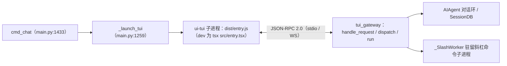

# CLI 与 TUI：双命令行、48 个子命令、Dashboard 与 Ink 界面

Kylin Agent Runtime 同时带着两套命令行：根目录 cli.py 中的 HermesCLI 是第一代交互式编排器，kylin_agent_runtime_cli/ 包是第三代命令行，main.py 单文件 13434 行、承载 48 个内置子命令并负责拉起 Web Dashboard 与 Ink TUI（F-133、F-134、F-135）。console_scripts 让新命令 `kylin-agent-runtime` 与旧别名 `hermes` 同指新包 main，`hermes-agent` 仍指旧 run_agent:main（F-005）。

本篇对照两套 CLI，展开子命令分组、setup 向导、Dashboard 服务与 TUI 的"Node 进程 ↔ Python JSON-RPC 网关"启动链。

## 两个 CLI 入口

| 维度 | 第一代：cli.py 的 HermesCLI | 第三代：kylin_agent_runtime_cli 包 |
|---|---|---|
| 关键类/函数 | HermesCLI（cli.py:2609）、ChatConsole（:2380）、_SkinAwareAnsi（:1581）、run()（:11875）、main()（:14235） | main()（main.py:10547）、build_top_level_parser（_parser.py:82） |
| 文件规模 | 13108 行（Q-008 的 Measure-Object 口径，混合换行偏少） | main.py 13434 行（F-134），包内 94 个 py（Q-001：顶层 87 + proxy 7） |
| 触发命令 | `hermes-agent`（console_scripts 指向 run_agent:main，F-005） | `kylin-agent-runtime`、`hermes`（别名，同指 kylin_agent_runtime_cli.main:main，F-005） |
| 承担职责 | 交互式对话编排，AGENTS.md 结构注释称其约 11k LOC（F-013） | 48 个子命令、setup、网关控制、Dashboard、TUI 拉起、皮肤引擎 |

两套 CLI 并存是三代架构同层的一部分：旧入口保留且仍随分发包发布，新交互能力全部长在新包里（I-1）。AGENTS.md 的结构注释把 run_agent.py 称作 AIAgent 核心对话环（约 12k LOC）、把 cli.py 称作 HermesCLI 交互编排器（约 11k LOC），这一注释描述的正是第一代结构（F-013）。

旧 CLI 的交互组件有三个：HermesCLI 承担会话级编排，ChatConsole（:2380）承担控制台输入输出，_SkinAwareAnsi（:1581）在 ANSI 渲染层感知皮肤。新包则把命令体系拆到 87 个顶层模块加 proxy/ 子包 7 个模块，setup、gateway、web_server、skin_engine、tools_config、cron、plugins 各占独立文件（F-137、F-143、F-144、Q-001）。

## argparse 分发机制

新 CLI 包用标准 argparse 分发，没有自定义命令框架（F-134）：

1. build_top_level_parser（_parser.py:82）调 add_subparsers(dest="command")（:229）创建子命令槽；
2. 每个子命令在注册 subparser 时以 set_defaults(func=...) 绑定处理函数；
3. main() 末尾执行 args.func(args) 完成分发（main.py:13427）；
4. 不带 command 时默认进 cmd_chat。

扩展点有两个例外口径：lsp 与 send 不是内置子命令，经 register_subparser 外挂注册；不存在独立的 tui 子命令，TUI 由顶层 `--tui` / `--tui-dev` flag 触发（F-135）。

## 48 个内置子命令

_BUILTIN_SUBCOMMANDS 是含 48 条名称的冻结集合（main.py:10406，F-135、Q-004）。按职责分组列举（集合完整名称以代码为准）：

| 分组 | 子命令 |
|---|---|
| 对话运行 | chat（默认子命令；`--tui` 进 TUI，`-z "..."` 单次问答，F-011）、acp（启动 ACP stdio 代理，F-119） |
| 模型与配置 | setup、model、fallback、config、migrate、postinstall、auth、login、logout、profile |
| 服务与接入 | gateway、proxy、cron、webhook、whatsapp、slack、pairing、kanban、hooks |
| 资产与能力 | skills、bundles、plugins、curator、memory、tools、computer-use、mcp |
| 观测与运维 | status、doctor、dump、debug、backup、checkpoints、import、sessions、insights、completion、logs、dashboard |
| 版本与生命周期 | version、update、uninstall、help、claw |

gateway 还是一组二级命令：run、start、stop、restart、status、install、uninstall、list、setup、migrate-legacy（F-136）。进程控制侧有 GatewayRuntimeSnapshot、ProfileGatewayProcess，并以 SIGUSR1 信号触发优雅重启（gateway.py:50-205，F-136）。cron 子命令经 _cron_api 与调度器通信，提供 cron_list/create/edit/tick/status（F-144）。

资产类子命令直接对应后端子系统：skills 与 bundles 操作技能与技能束，plugins 走 PluginManager 的 entry-points 组 "hermes_agent.plugins"，curator 触发技能策展，memory 管理记忆，tools 与 computer-use 操作工具开关与 CUA（Computer Use，电脑操作）驱动，mcp 管理 MCP（Model Context Protocol，模型上下文协议）服务器挂载（F-094、F-087、F-144）。运维类的 doctor 做环境体检，backup/checkpoints/import 操作检查点与数据，sessions/insights 查询会话与使用统计，logs 直读日志，completion 对接 shell 补全（F-135）。

README 记载的高频命令形态（F-011）：

```bash
kylin-agent-runtime setup          # 配置向导（README）
kylin-agent-runtime                # 默认 chat，交互式对话（README）
kylin-agent-runtime --tui          # 拉起 Ink TUI（README）
kylin-agent-runtime -z "问题"      # 单次问答后退出（README）
kylin-agent-runtime dashboard      # Web 控制台，端口 9119（README）
kylin-agent-runtime gateway status # 网关二级命令（CLI 源码，F-136；非 README 记载）
```

## setup 配置向导

首次配置走 run_setup_wizard(args)（kylin_agent_runtime_cli/setup.py:3131），向导原语含 prompt_choice、prompt_yes_no、prompt_checklist，模型供应商配置走 setup_model_provider（:789）（F-137）。README 给出的首发路径即先 setup 再对话（F-011）：

```bash
kylin-agent-runtime setup
kylin-agent-runtime
```

工具侧的可配置项在 tools_config.py 维护，含 CONFIGURABLE_TOOLSETS、_DEFAULT_OFF_TOOLSETS、TOOL_CATEGORIES、TOOLSET_ENV_REQUIREMENTS 与 install_cua_driver（F-144）。

## Web Dashboard：127.0.0.1:9119 的 FastAPI + SPA

Dashboard 后端在 kylin_agent_runtime_cli/web_server.py（F-138）：

- 应用对象 `app = FastAPI(title="Hermes Agent", version=__version__)`（:79），标题保留 Hermes 命名（I-3）；
- start_server(host="127.0.0.1", port=9119, open_browser=True, allow_public=False)（:4513），服务由 uvicorn.run（:4582）承载，默认只绑本机回环；
- mount_spa(app)（:3650）把 web/ 构建产物挂为 SPA（Single Page Application，单页应用）静态资源；
- cmd_dashboard（main.py:10282）启动前先构建 web/ 产物再开服务。

前端 web/ 的 package.json 声明 React 19.2、Vite、Tailwind v4、@xterm/xterm 6.0（4 个 addon）、@nous-research/ui 0.14，以及 lucide-react、motion、gsap、@react-three/fiber；构建脚本为 tsc -b && vite build（F-141）。命令行入口为 `kylin-agent-runtime dashboard`，README 注明默认端口 9119（F-011）。

分发链路上，wheel 的 package-data 打进 kylin_agent_runtime_cli 的 web_dist、tui_dist 与 install 脚本，以及 plugins 下各 dashboard 的 manifest 与 dist（F-008）。源码快照内不存在 web_dist/tui_dist 成品目录，成品只存在于构建后与 wheel 内（E-006）。allow_public 默认 False 意味着不加显式参数时 Dashboard 不接受外网网卡访问。

## TUI 启动链：flag → 子进程 entry.js ↔ tui_gateway JSON-RPC

TUI 不是 Python 渲染界面，而是 Node/Ink 前端进程加 Python JSON-RPC 后端的双进程结构。启动链如下（F-139、F-140）：



各环节事实：

- cmd_chat 识别 `--tui` flag 后调 _launch_tui（main.py:1433/1259），子进程执行 ui-tui 的 dist/entry.js，dev 模式经 tsx 跑 src/entry.tsx；wheel 内探测 tui_dist/entry.js，该目录在源码快照中不存在，只在打包产物中（F-139、E-006）。
- tui_gateway/ 是 TUI 的 Python 后端，说 JSON-RPC 2.0：server.handle_request（:464）、dispatch（:476）、run（:510），入口为 entry.main；服务端主动推送走事件帧 `{"jsonrpc":"2.0","method":"event"}`（F-140）。
- _SlashWorker 是驻留的斜杠命令子进程，让斜杠命令在独立进程中执行而不阻塞主会话（F-140）。

四种传输覆盖本地与远程调试场景（F-140）：

| 传输类 | 承载方式 |
|---|---|
| StdioTransport | 标准输入输出，本地双进程的默认通道 |
| TeeTransport | 在 stdio 之外分流一份流量，兼顾记录与透传 |
| WSTransport | WebSocket 通道，支撑远程/浏览器侧连接 |
| WsPublisherTransport | WebSocket 发布式通道，把事件帧广播给订阅方 |

- ui-tui 包名 hermes-tui、version 0.0.1、private，以 file:./packages/hermes-ink 本地依赖组织（packages 下仅 hermes-ink 一个包）；技术栈 ink ^6.8 加 React 19 加 nanostores，esbuild 打包，start 脚本为 tsx src/entry.tsx（F-142）。nanostores 承担前端状态管理，Ink 6 把 React 组件渲染为终端文本。

## 皮肤引擎

CLI 与 Dashboard 共享一套皮肤概念。skin_engine.py 定义 SkinConfig（:130）与 list_skins、load_skin、get_active_skin、set_active_skin、init_skin_from_config 一组函数；Dashboard 侧主题键 dashboard.theme 默认值为 default（web_server.py:4007）（F-143）。第一代 CLI 里的对应物是 _SkinAwareAnsi（cli.py:1581），在 ANSI 输出层感知皮肤（F-133）。

## 相关概念

- [Kylin Agent Runtime 总览](/concepts/00-overview.md) —— 九种运行形态与版本现状
- [架构与模块地图](/concepts/01-architecture-module-map.md) —— 双 CLI 在三代结构中的位置
- [Agent 核心对话环](/concepts/02-agent-core-loop.md) —— chat 子命令背后的迭代机制
- [ACP / MCP 协议](/concepts/09-acp-mcp-protocols.md) —— acp 子命令与 stdio 服务器
- [网关与 Cron](/concepts/08-gateway-and-cron.md) —— gateway 二级命令与 systemd 服务
