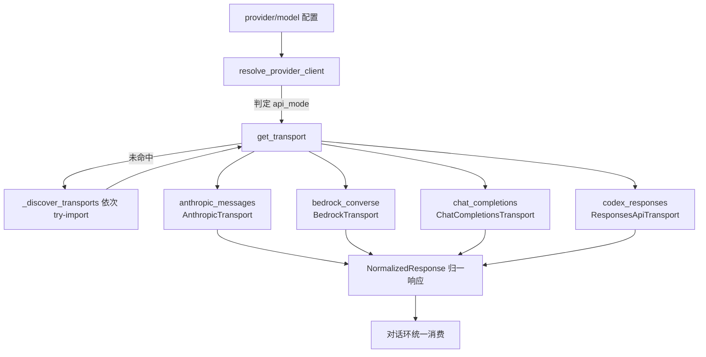

# 模型供应商层：四种协议传输、中央路由与凭证池

对话环本身不绑定任何一家模型厂商：它只面对归一化的消息、工具定义与响应结构，厂商差异被压在 `agent/transports/` 的传输（transport，一种 API 协议的数据通道）抽象之后，再由中央路由按 `provider` 配置选择客户端与协议。本文依次说明传输抽象与归一化类型、4 个注册传输、中央路由与辅助调用面、厂商适配与 OAuth、凭证池、模型元数据/定价/限流，以及供应链约束如何塑造这一层的形态（F-061~F-080，并回扣 F-003/F-004 与洞察 I-5）。

## ProviderTransport ABC 与归一化类型

`agent/transports/base.py:16` 的 `ProviderTransport(ABC)` 为每一种 API 模式（api_mode）占有同一条数据路径，抽象成员按调用次序排列（F-061）：

- 属性 `api_mode`：本传输处理的协议名字符串；
- `convert_messages(messages, **kwargs)`：把内部消息历史转为厂商报文；
- `convert_tools(tools)`：把工具 schema 转为厂商的函数调用格式；
- `build_kwargs(...)`：主入口，通常内部调用前两者再补模型专属参数，产出请求关键字参数；
- `normalize_response(response, **kwargs) -> NormalizedResponse`：把厂商响应归一化。

默认实现还有 `validate_response`（默认返回 True）、`extract_cache_stats`（默认 None）与 `map_finish_reason`（默认原样返回结束原因），供需要响应校验、提示缓存统计或结束原因映射的厂商覆写（F-061）。

归一化类型定义在 `agent/transports/types.py`：`@dataclass ToolCall`（id/name/arguments/provider_data，并兼容 `type`/`function`/`call_id` 等厂商风格属性）、`Usage`（token 用量）与 `NormalizedResponse`（content/tool_calls/finish_reason/reasoning/usage/provider_data 六字段）；工厂函数 `build_tool_call` 与 `map_finish_reason` 负责跨厂商构造与结束原因映射（F-062）。对话环只消费 `NormalizedResponse`，因此新增一家厂商等价于新增一个传输类，而不是改动核心环。

## 4 个注册传输与协议分流

传输以"协议名 → 传输类"的形式注册在 `agent/transports/__init__.py` 的模块级字典 `_REGISTRY` 中，配套 `register_transport(api_mode, transport_cls)` 与 `get_transport(api_mode)`；`get_transport` 未命中时会触发 `_discover_transports()`，后者依次 try-import anthropic、codex、chat_completions、bedrock 四个模块完成懒注册（F-063）。

注册传输共 4 个（F-064，Grep 实测 `register_transport(` 恰为 4 处，Q-004）：

| api_mode | 传输类 | 注册位置 |
|---|---|---|
| `anthropic_messages` | `AnthropicTransport(ProviderTransport)` | anthropic.py:179 |
| `bedrock_converse` | `BedrockTransport(ProviderTransport)` | bedrock.py:154 |
| `codex_responses` | `ResponsesApiTransport(ProviderTransport)` | codex.py:289 |
| `chat_completions` | `ChatCompletionsTransport(ProviderTransport)` | chat_completions.py:660 |

## 传输层与厂商适配层的分工

4 个传输解决的是"报文形状"问题：同一份内部消息与工具集，经 `convert_messages`/`convert_tools`/`build_kwargs` 变成四家协议各自的请求，再经 `normalize_response` 收回统一形态（F-061/F-064）。它不负责"客户端怎么登录、区域怎么选、第三方端点如何识别"——这些落在下一节的厂商适配器中。两层的边界可以概括为：传输类无状态地转换数据，适配器有状态地构造客户端与凭证；同一个 `chat_completions` 传输因此能服务所有 OpenAI 兼容端点，而 Anthropic 协议族的登录、Bedrock 的区域、Gemini 的免费/付费档位各自由专门适配器处理（F-061/F-068~F-071）。

## Codex app server 三件套与反向 MCP 服务器

`codex_responses` 传输之外，Codex 侧还有一条 app server（本地应用服务器）通道，由三个类协作：`CodexAppServerClient`（codex_app_server.py:52，客户端）、`CodexAppServerSession`（codex_app_server_session.py:154，会话）与 `CodexEventProjector`（codex_event_projector.py:69，把服务器事件流投影为内部事件）（F-065）。同目录另有反向用途的 `hermes_tools_mcp_server`：`_build_server`（:108）与 `main`（:197）把 Hermes 自身工具暴露为一个 MCP 服务器，供外部 MCP 客户端调用（F-122/F-065）。

## 中央路由与辅助 LLM 调用面

供应商选择的总入口是 `resolve_provider_client(provider, model=None, async_mode=False, raw_codex=False, explicit_base_url=None, explicit_api_key=None, api_mode=None, main_runtime=None, is_vision=False)`，返回 `(client, api_mode)` 二元组（agent/auxiliary_client.py:3069）。其 docstring 列明 `provider` 的取值集合：`openrouter`、`nous`、`openai-codex`、`zai`、`kimi-coding`、`minimax`、`minimax-cn`、`custom`、`auto`（F-066）。`is_vision` 形参为图像输入保留独立路由，`explicit_*` 形参允许单次调用覆盖配置（F-066）。

其中 `custom` 表示用户自带 base_url/API key 的 OpenAI 兼容端点，`auto` 表示按配置与环境自动判定，二者使私有部署与国产兼容端点（如 Kimi、MiniMax 国内版）无需新增路由分支即可接入（F-066）。

辅助任务（标题生成、策展评审、画像抽取等不占主对话的 LLM 调用）统一走 `call_llm`（:4578）与 `async_call_llm`（:5001），响应文本提取由 `extract_content_or_reasoning`（:4945）兼容思维链内容；Codex/Anthropic 另有同步+异步四件套 `CodexAuxiliaryClient`/`AsyncCodexAuxiliaryClient`/`AnthropicAuxiliaryClient`/`AsyncAnthropicAuxiliaryClient`（:908-1091）（F-067）。`set_runtime_main(provider, model)`（:1679）/`clear_runtime_main`（:1692）记录"当前主运行时"，供辅助调用识别自己是否正服务于某个主供应商会话；`run_conversation` 入口会调用 `set_runtime_main(agent.provider, agent.model)`（F-067/F-025）。

主调用失败后的故障转移也建立在路由之上：`agent/error_classifier.py` 的 `FailoverReason` 枚举列出 18 种失败原因（auth/billing/rate_limit/overloaded/server_error/timeout/context_overflow/model_not_found 等），`classify_api_error` 把厂商异常归入这些原因后，对话环才能决定"换凭证、换模型还是退避重试"，凭证池轮换正是 auth/额度类原因的下游动作（F-034/F-072）。重试退避与流式诊断的完整回路见 [02-agent-core-loop](/concepts/02-agent-core-loop.md)。

## 厂商适配与 OAuth

传输类之下是更厚的厂商适配层，处理 SDK 构造、区域探测、原生协议与登录态（F-068~F-071）：

- **Anthropic**：`build_anthropic_client`（anthropic_adapter.py:640）构造客户端；OAuth 一族包括 `read_claude_code_credentials`（:853）、`refresh_anthropic_oauth_pure`（:922）、`resolve_anthropic_token`（:1089）、`run_hermes_oauth_login_pure`（:1197），支持复用 Claude Code 凭证与纯函数式刷新/登录；第三方兼容端点由 `_is_kimi_family_endpoint`/`_is_deepseek_anthropic_endpoint`/`_is_minimax_anthropic_endpoint`/`_is_azure_anthropic_endpoint` 判定（:365-512 区段）（F-068）。
- **Bedrock**：`_get_bedrock_runtime_client`、`resolve_bedrock_region`、`has_aws_credentials` 处理 AWS 凭证与区域；`convert_tools_to_converse`/`normalize_converse_response` 对接 Converse 协议；`discover_bedrock_models` 枚举可用模型；`classify_bedrock_error` 归类错误（F-069）。
- **Gemini 原生**：`probe_gemini_tier` 返回 `"free"/"paid"/"unknown"` 三档（gemini_native_adapter.py:47），`build_gemini_request`（:388）/`translate_gemini_response`（:474）处理原生报文，`GeminiNativeClient`（:805）为客户端（F-070）。
- **Copilot / Code Assist**：`CopilotACPClient`（copilot_acp_client.py:334）对接 GitHub Copilot；google-code-assist 侧有 `load_code_assist`/`onboard_user`/`retrieve_user_quota` 与缺项目 ID 时抛出的 `ProjectIdRequiredError`（google_code_assist.py:69-392 区段）（F-071）。

**国产与第三方兼容端点。** 路由取值集合中的 `zai`、`kimi-coding`、`minimax`、`minimax-cn` 对应国产模型服务（F-066），而"走 Anthropic 协议但并非 Anthropic 官方"的端点由四个判定函数识别：`_is_kimi_family_endpoint`、`_is_deepseek_anthropic_endpoint`、`_is_minimax_anthropic_endpoint`、`_is_azure_anthropic_endpoint`（anthropic_adapter.py:365-512 区段）（F-068）。识别的意义在于：同一 `anthropic_messages` 传输面对官方与兼容端点时，鉴权头、缓存断点与响应清洗的处理并不相同，必须先判别端点家族再选择适配分支（F-068/F-077）。这是 openKylin 下游"国产平台可直接接入"在模型侧的对应设施，与分发层的麒麟化品牌共同构成下游增量（I-3）。

## 凭证池：4 策略、租约轮换与 10 类凭证来源

多密钥轮换由 `CredentialPool`（credential_pool.py:389）承载：`current`/`select` 选择当前凭证，`mark_exhausted_and_rotate`（:1259）在额度耗尽时标记并轮换，`acquire_lease`/`release_lease`（:1282/:1313）以租约方式支持并发占用，`try_refresh_current`（:1322）尝试刷新，模块级 `load_pool(provider)`（:1933）按供应商装载（F-072）。策略常量 4 个：`STRATEGY_FILL_FIRST`、`STRATEGY_ROUND_ROBIN`、`STRATEGY_RANDOM`、`STRATEGY_LEAST_USED`（credential_pool.py:60-63）；池内条目为 `PooledCredential`（:94），携带 auth_type、expires_at、runtime_api_key 等字段（F-072）。

凭证从哪里来、如何移除，由 `credential_sources` 注册表管理：`register(step)` 登记移除步骤、`find_removal_step(provider, source)` 查找（credential_sources.py:115/120）；内置 10 类来源各自带一个凭证移除函数，登出时可按来源精确清理（F-073）：

| # | 凭证来源标识 | 形态 |
|---|---|---|
| 1 | env | 环境变量 |
| 2 | claude_code | Claude Code 本地凭证复用 |
| 3 | hermes_pkce | PKCE OAuth 流程 |
| 4 | nous_device_code | Nous 设备码流程 |
| 5 | minimax_oauth | MiniMax OAuth |
| 6 | xai_oauth_loopback_pkce | xAI 本地回环 PKCE |
| 7 | codex_device_code | Codex 设备码流程 |
| 8 | qwen_cli | 通义千问 CLI 登录态 |
| 9 | copilot_gh | GitHub Copilot 登录态 |
| 10 | custom_config | 用户自定义配置 |

环境变量透传给工具时还会经 `_is_hermes_provider_credential` 拦截（F-059），凭证池与工具层之间因此有明确的读取边界。这套"多来源接入 + 池化轮换 + 按来源可移除"的结构，使主密钥耗尽时对话环可以无感切换到下一凭证，而不必让用户重新登录（F-072/F-073）。

## 模型元数据、models.dev、定价与限流

"这个模型支持什么、上下文多长、花多少钱"由一组元数据设施回答（F-074~F-076）：

- `fetch_model_metadata`（model_metadata.py:611）拉取元数据，`get_model_context_length`（:1429）解析上下文窗口；本地端点由 `is_local_endpoint`（:414）/`detect_local_server_type`（:466）识别，`query_ollama_num_ctx`（:976）可查询 Ollama 实际 num_ctx，`estimate_tokens_rough`（:1718）提供粗估 token 数（F-074）。
- models.dev 集成：常量 `MODELS_DEV_URL = "https://models.dev/api.json"`（models_dev.py:34），`@dataclass ModelInfo/ProviderInfo` 描述远程目录条目，`PROVIDER_TO_MODELS_DEV` 持有 35 条"内部供应商名 → models.dev 供应商标识"映射（:142），`get_model_capabilities`（:448）/`list_agentic_models`（:573）查询能力与可用的 agentic 模型（F-075，映射条数 35 见 Q-010）。
- 定价与限流：`PricingEntry`/`CostResult` 与 `estimate_usage_cost`（usage_pricing.py:70-857 区段）估算花费；`RateLimitState`（rate_limit_tracker.py:57）维护"请求数/token 数 × 每分钟/每小时"四桶状态，`parse_rate_limit_headers`（:92）从响应头解析；Nous 另有专用的 `record_nous_rate_limit`/`nous_rate_limit_remaining` 守卫（F-076）。

## 请求整形、账户额度与插件化 LLM

一批贴近单次请求的适配机制如下（F-077~F-079）：

| 机制 | 关键符号 | 作用 |
|---|---|---|
| 图像输入路由 | `decide_image_input_mode`（image_routing.py:99） | 返回 `"native"`（原生多模态）或 `"text"`（降级为文本描述），决定图片如何进入请求 |
| 推理强度 | lmstudio_reasoning.py:17 | LM Studio 推理强度取六值集合 `{none, minimal, low, medium, high, xhigh}` |
| schema 清洗 | moonshot_schema.py、gemini_schema.py | Moonshot/Gemini 工具 schema 清洗器，裁掉目标厂商不支持的字段 |
| Anthropic 缓存断点 | `apply_anthropic_cache_control`（prompt_caching.py:49） | 按 `"system_and_3"` 策略打缓存标记、最多 4 个断点 |
| 账户额度 | `fetch_account_usage`（account_usage.py:308） | 聚合 codex/anthropic/openrouter 三路抓取器，结果装入 `AccountUsageSnapshot`（:27），`render_account_usage_lines`（:88）渲染 |
| 插件化 LLM | `PluginLlm`（plugin_llm.py:598） | 暴露 complete/complete_structured/acomplete/acomplete_structured 四方法，配套 `PluginLlmCompleteResult`、携带 `cost_usd` 的 `PluginLlmUsage`（:115）与 `PluginLlmTrustError`（:249），允许插件以受控方式提供自己的模型调用 |

这些机制共享一个设计取向：差异吸收在请求发出之前，对话环拿到的仍是统一形态（F-077~F-079）。

## providers 包：ProviderProfile 双扫描

除传输层外，仓内还有独立的顶层 `providers/` 包：`ProviderProfile`（providers/base.py:39）是供应商配置类，`register_provider`/`get_provider_profile`/`list_providers`（providers/__init__.py:53/65/76）维护注册表，`_discover_providers`（:140）扫描两处目录——仓内 `plugins/model-providers/` 与 `$HERMES_HOME/plugins/model-providers/`，同名时用户目录覆盖内置条目（F-080）。这使得"加一家供应商 profile"既可以随发行版内置，也可以由用户在主目录就地扩展。

## 供应链约束如何塑造供应商层

这一层的形态直接受洞察 I-5 的供应链策略约束（F-003/F-004）：

- **精确钉版**：核心 dependencies 全部 `==` 精确钉版（含 openai==2.24.0、httpx[socks]==0.28.1、pydantic==2.13.4、croniter==6.0.0、numpy==2.4.6 等），钉版注释记录了 2026-05-12 Mini Shai-Hulud 蠕虫事件后收紧策略的动因（F-003）；
- **懒安装**：anthropic、bedrock、google、mcp、acp 等供应商能力位于 optional-dependencies，`[all]` extra 反向收窄为"每个会话都需要/进入 Agent 循环前必须就位/需打进 wheel"的包，模型后端改为首用时懒安装（F-004）；
- **代码落点**：`_discover_transports` 的 try-import 懒注册（F-063）使传输模块仅在对应 api_mode 首次被请求时才导入；8 个终端后端、8 个记忆后端、8 个搜索后端同样是可选懒加载（F-004/F-057/F-097）。

效果是：一个被投毒的可选供应商 SDK 不会自动到达每一个新装环境，爆炸半径被限制在真正启用该 provider 的会话内——名为 `[all]` 的集合在安全事件后刻意变小，"方便"让位于供应链纵深（I-5）。

## 一次模型调用经过的层路径

把上述机制串起来，一次主对话的模型调用依次经过（F-061~F-079）：

1. 对话环把内部消息与工具面交给客户端构造逻辑，`resolve_provider_client` 按 `provider`/`model`/`is_vision` 选出客户端与 api_mode（F-066）；
2. 凭证由 `CredentialPool` 以选定策略提供，需要时走 OAuth 刷新或租约占用（F-072）；
3. 命中的 `ProviderTransport` 执行 convert_messages → convert_tools → build_kwargs，期间叠加图像路由、schema 清洗与缓存断点（F-061/F-077）；
4. 厂商响应回到 normalize_response，产出 `NormalizedResponse`（含 tool_calls/usage/finish_reason）（F-062）；
5. 失败则由 `classify_api_error` 归类，触发退避、凭证轮换或模型故障转移；成功路径上用量进入定价/限流统计（F-034/F-076）。

这条链解释了为什么核心环可以保持厂商中立：所有异构性都被约束在第 1~4 步的供应商层内（I-2 的开放扩展哲学在模型侧的体现）。

## 相关概念

- [02-agent-core-loop](/concepts/02-agent-core-loop.md)：对话环如何消费 NormalizedResponse 并按错误分类触发退避与故障转移
- [04-tool-system](/concepts/04-tool-system.md)：工具 schema 经 convert_tools 进入各厂商报文
- [06-skills-and-plugins](/concepts/06-skills-and-plugins.md)：PluginLlm 与 model-providers 插件目录的扩展路径
- [07-memory-and-context](/concepts/07-memory-and-context.md)：上下文压缩如何依赖模型上下文长度元数据
- [hermes-agent 上游束](../../hermes-agent/index.md)：多供应商适配的 Hermes 血缘
