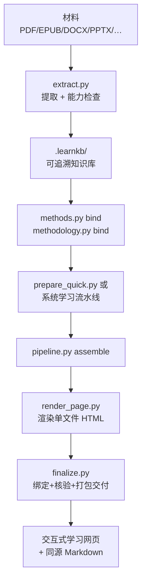

# 01 材料到学习网页：转换机制

> 对应事实：F-010~F-022、F-034~F-039、F-041
> 核验状态：✅ 机制描述以官方 README（EN/CN 双份）为准

## 整体链路

这是一条**单一顺序工作流**：每一步都有对应脚本，随时可中断、可从中间产物继续。

## 支持的材料格式

原文列举"PDF、EPUB、Word、PPT 等"（F-010），官方 README 给出的**完整清单更宽**（F-011，EN/CN 双份一致）：

| 类别 | 格式 |
|------|------|
| 文档 | PDF、DOCX、EPUB、MOBI / AZW / AZW3、RTF、TXT、Markdown |
| 演示 | PPTX / PPTM |
| 网页 | HTML |
| 组合 | 多材料集合（交叉分析） |

> 原文为**列举式概述而非完整清单**，属"不完整而非错误"。涉及扫描件时另需 OCR/视觉能力（见下）。

## 拆解：三个阶段

### 1. 提取阶段（extract）

`extract.py` 既做材料提取，也做**能力检查**——确认当前环境是否具备解析该格式所需依赖。缺依赖时不会静默失败，而是把对应范围标记出来。

可选增强依赖与回退（F-041）：

| 材料类型 | 可选依赖 | 回退策略 |
|----------|----------|----------|
| 文字型 PDF | `pdftotext` / `PyPDF2` / `pdfminer.six` / `PDFKit` | 多后端可回退 |
| 技术型 PDF | Docling | — |
| 扫描 PDF | `OCRmyPDF` + `pdftotext` | 无 OCR 时标记未核验 |
| EPUB | `ebooklib` + BeautifulSoup | — |
| DOCX | `python-docx` | — |
| RTF | `striprtf` | — |
| MOBI/AZW/AZW3 | Calibre `ebook-convert` | **无内置回退** |

### 2. 组装阶段（bind / assemble）

- `.learnkb/`：**可追溯的知识库**（中间产物，机器可读）——这是"同源"的落点，所有后续产物都从它派生
- `methods.py bind` / `methodology.py bind`：把**方法论候选**绑定到材料结构
- `prepare_quick.py`：快速了解路径的预备
- `pipeline.py assemble`：把内容与结构组装成待渲染的页面数据

### 3. 渲染与交付阶段（render / finalize）

- `render_page.py`：生成**单文件 HTML**（自带主题、样式、交互，不需要外部 CDN）
- `finalize.py`：一次完成**绑定 + 核验 + 打包交付**

## 学习网页的六类板块（F-017）

| 板块 | 作用 | 原文佐证 |
|------|------|----------|
| **核心框架** | 材料的内容框架总览 | 原文"首页先看报告的内容框架"（F-018） |
| **内容导学** | 按章节组织整理好的观点 | 原文"进入「内容导学」后，可以按章节阅读整理好的观点"（F-018） |
| **术语大全** | 专业名词解释 + 材料中的实际用法 | 原文"不熟悉的词可以到「术语大全」里翻看解释，报告里的用法也放在一起"（F-020） |
| **行动规则** | 可执行的行动项 | README |
| **动态自检** | 自测/检查 | README |
| **本地笔记** | 页面内笔记（仅存本地浏览器） | README |

## 来源映射：为什么能"翻回原文"

这是本 Skill 区别于普通 AI 摘要的**核心机制**（F-019）：

- 为 **PDF 页码 / PPT 幻灯片 / EPUB 章节**建立**细粒度来源映射**
- 原文佐证："导学里还保留了报告正文页码和 PDF 页序，看到想核对的内容，可以照着页码翻回原报告"

也就是说，学习网页上的每条观点都能**回溯**到材料的具体位置，而不是无从查证的一段生成文本。

## 四类内容区分（F-021）

生成内容会显式标出**依据来源**，避免"模型补的东西被当成材料原文"：

| 标记 | 含义 |
|------|------|
| **材料依据** | 来自材料本身 |
| **材料未覆盖** | 材料中没有、但读者可能关心 |
| **模型补充** | 模型为讲清楚而添加 |
| **外部核验** | 经外部信源核实的内容 |

> 原文表述为"区分报告内容与模型补充"（F-021），对应其中的两类；官方 README 的完整四分类更细。

实践中的用法（F-024 提示词逐字）："…**区分报告内容与模型补充**。"

## 三套阅读主题（F-022）

海盐云纱（Sea Salt）、黑白水墨（Ink Wash）、竹月清（Bamboo Moon），**动效可关闭**。README EN 用英文名、README_CN 用中文名，双份对应。

## 离线优先与隐私（F-037）

- 默认**不联网、不自动安装依赖**
- 页面笔记、画像和错题**仅保存在当前浏览器本地**

> 这意味着生成的 HTML 既可离线打开，也不会上传读者的笔记内容。

## 相关知识包

- [02 两种深度与方法论库](02-two-depths-and-methodology.md) — 机制的上层：生成到什么程度
- [03 宿主集成与兼容边界](03-host-integration-and-boundaries.md) — 机制的运行前提
