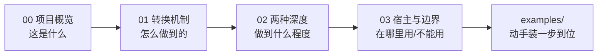

# 概念学习路径

本知识包包含 4 篇概念文档，从项目定位到转换机制，再到两种深度与宿主边界。

## 学习路径

| 顺序 | 文档 | 核心内容 | 预计阅读 |
|------|------|----------|----------|
| 1 | [00 项目概览](00-project-overview.md) | 定位、仓库画像、许可与语言、开源状态 | 5 min |
| 2 | [01 材料到学习网页的机制](01-material-to-learning-page.md) | 单一顺序工作流、六板块、`.learnkb/`、来源映射、四类内容区分 | 8 min |
| 3 | [02 两种深度与方法论库](02-two-depths-and-methodology.md) | 快速了解 / 系统学习、方法与方法论绑定、交付物 | 7 min |
| 4 | [03 宿主集成与兼容边界](03-host-integration-and-boundaries.md) | 宿主清单、安装目录表、运行要求、不可用场景 | 6 min |

## 路径图



阅读完概念层后，进入 [examples/](../examples/index.md) 动手实践。

```{toctree}
:hidden:

00-project-overview
01-material-to-learning-page
02-two-depths-and-methodology
03-host-integration-and-boundaries
```
