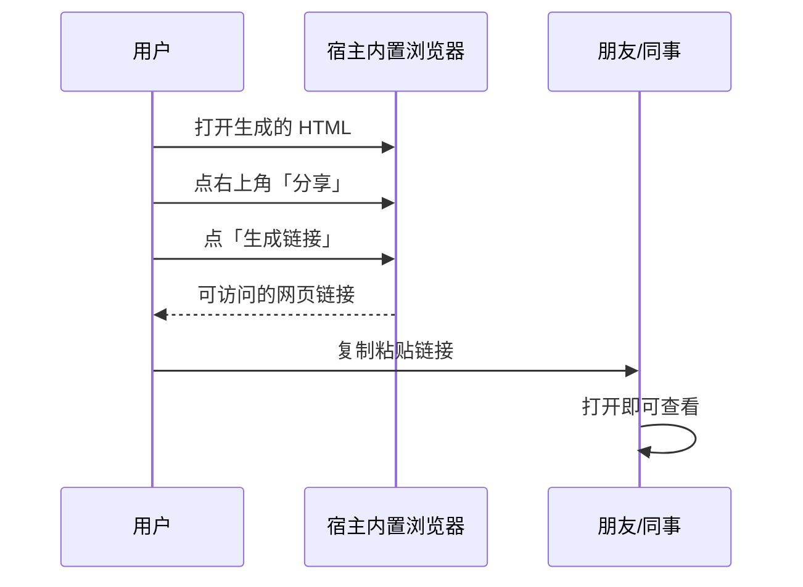

# 示例 01：产出与分享

> 对应事实：F-017~F-022、F-026~F-028、F-037
> 前置：已完成 [安装与三步实操](00-install-and-three-steps.md)

## 你会得到什么

一次转换产出三类**同源**结果（F-016）：

- `.learnkb/` 结构化知识库（中间产物，机器可读）
- **交互式单文件 HTML**（主交付物）
- **同源 Markdown**

## 学习网页怎么读（六板块）

原文作者在豆包工作内置浏览器里的实际阅读路径（F-018~F-020）：

```mermaid
flowchart TD
    O[打开 HTML] --> A[① 核心框架<br/>先看内容框架]
    A --> B[② 内容导学<br/>按章节读整理好的观点]
    B --> C{需要核对原文?}
    C -->|是| D[照"正文页码/PDF 页序"翻回原报告]
    C -->|否| E[继续]
    E --> F[③ 术语大全<br/>专业词解释 + 材料中的用法]
    F --> G[④ 行动规则]
    G --> H[⑤ 动态自检]
    H --> I[⑥ 本地笔记]
```

| 板块 | 原文佐证 |
|------|----------|
| 核心框架 | "首页先看报告的内容框架" |
| 内容导学 | "进入「内容导学」后，可以按章节阅读整理好的观点" |
| 术语大全 | "不熟悉的词可以到「术语大全」里翻看解释，报告里的用法也放在了一起" |
| 行动规则 / 动态自检 / 本地笔记 | 官方 README 六板块清单（原文未逐一展开） |

### 关键体验：可回溯

导学保留了**报告正文页码与 PDF 页序**（F-019）——"看到想核对的内容，可以照着页码翻回原报告"。这是本 Skill 与"让 AI 写摘要"的根本差别：**结论可核验**。

### 关键体验：来源可辨

页面把内容分为**材料依据 / 材料未覆盖 / 模型补充 / 外部核验**四类（F-021），不会把模型补的东西混作材料原文。

## 两种深度的产出差异

| 深度 | 产出特征 |
|------|----------|
| **快速了解** | 概览式六板块页面，适合几十页报告快速掌握 |
| **系统学习** | 逐块覆盖到材料末尾、方法候选去向审计，产出更完整的学习资产；官方明确"卡片数量不作为完成证明"（F-015） |

> 原文演示的是**快速概览**（F-024 提示词含"做一次快速概览"）。

## 分享流程



> ⚠️ 这是**宿主产品能力**（F-026/F-027 为原文单源登记），不是本 Skill 官方文档描述的功能。换宿主则分享入口可能不同或不存在。

## 离线与隐私

- 默认**不联网、不自动安装依赖**（F-037）
- 页面笔记、画像和错题**仅存在当前浏览器本地**——不会上传，换设备/清缓存会丢

## 效果与边界

**适合**：

- 长篇报告、电子书、论文、演示稿的深度学习
- 需要"读完能回查原文"的可核验阅读

**注意**：

- **纯聊天环境**（无文件系统/Python）只能走部分提示流程，拿不到完整网页（F-035）
- **扫描 PDF 与图片型幻灯片**需 OCR/视觉能力，缺失时对应范围标记为未核验（F-036）
- 官方 showcase 的 16 张截图是**设计展示**，非质量验收报告；仓库不含原始材料与完整生成结果（F-040）

## 相关知识包

- [概念 01：材料到学习网页的机制](../concepts/01-material-to-learning-page.md) — 六板块与来源映射原理
- [概念 03：宿主集成与兼容边界](../concepts/03-host-integration-and-boundaries.md) — 宿主口径差异与限制
