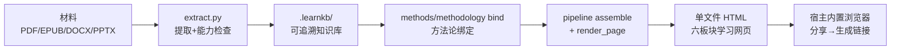

# learn-from-materials

> **来源**：微信公众号"GitHubDaily"，2026-11-03 15:35 发布
> **原文**：[《一个神级学习 Skill，开源了！》](https://mp.weixin.qq.com/s/MUvHmFc4ItWfN57tuNjZkQ)
> **开源仓库**：https://github.com/dmoshehun-prog/learn-from-materials
> **P0核验**：10 项中 9 项 ✅ 通过、1 项 ⚠️ 口径差异双源并列（详见 [verification.md](references/verification.md)）

> **⏰ 时效性提示**：本知识包基于 **v1.1.0**（核验时点 2026-11-04）。Skill 与宿主生态迭代较快，`stale_after` 设为 2027-02-03——届时请复核版本号、宿主清单与支持格式。

## 项目一句话

把 PDF、电子书、论文等材料，**转成一张为这份材料定制生成的学习网页**：核心框架、内容导学、术语大全、行动规则、动态自检、本地笔记六板块齐全，**保留原文页码可回查**，并显式区分"材料依据"与"模型补充"。

## 核心机制



## 知识结构

```
learn-from-materials/
├── index.md
├── concepts/
│   ├── index.md
│   ├── 00-project-overview.md                ← 项目是什么：定位、仓库画像
│   ├── 01-material-to-learning-page.md       ← 材料→学习网页机制
│   ├── 02-two-depths-and-methodology.md      ← 两种深度 + 方法论库
│   └── 03-host-integration-and-boundaries.md ← 宿主集成与兼容边界
├── examples/
│   ├── index.md
│   ├── 00-install-and-three-steps.md         ← 安装 + 三步实操（逐字提示词）
│   └── 01-output-and-sharing.md              ← 六板块读法 + 分享流程
├── references/
│   ├── index.md
│   ├── article-source.md                     ← F-001~F-041 事实登记
│   └── verification.md                       ← P0核验报告
└── log.md
```

## 分层导航

### 概念层（4篇）

1. [项目概览](concepts/00-project-overview.md) — 定位、仓库画像（MIT/Python）、跨 Agent 开放规范
2. [材料到学习网页的机制](concepts/01-material-to-learning-page.md) — 单一顺序工作流、六板块、来源映射、四类内容区分
3. [两种深度与方法论库](concepts/02-two-depths-and-methodology.md) — 快速了解 / 系统学习、`methods.json`/`methodology.json`、三类同源产出
4. [宿主集成与兼容边界](concepts/03-host-integration-and-boundaries.md) — 宿主清单、安装目录表、运行要求、不可用场景

### 实战层（2篇）

1. [安装与三步实操](examples/00-install-and-three-steps.md) — 三种安装法、原文逐字提示词、CLI 链
2. [产出与分享](examples/01-output-and-sharing.md) — 六板块读法、两种深度差异、分享链接与边界

### 信源层（2篇）

- [事实登记](references/article-source.md) — F-001~F-041
- [核验报告](references/verification.md) — 9项P0全✅ + 1项⚠️口径差异 + 4项单源登记

## 信任与生命周期

- **事实基数**：41 条（F-001~F-041）
- **P0 核验**：10 项（9 ✅ + 1 ⚠️ 口径差异 + 0 ❌）
- **单源/一手实测登记**：4 项（F-023/025/026/027）
- **官方补充（宽于原文）**：3 项（支持格式面、版本号 1.1.0、命令行链）
- **status**: verified
- **stale_after**: 2027-02-03（Skill 与宿主生态变化快，3 个月后复核）

## 已知边界

1. **宿主口径差异**：文章称装在「豆包工作」，官方 README 宿主清单为 WorkBuddy / Codex / Claude Code / GitHub Copilot CLI，未列豆包工作——**双源并列登记，不判定原文有误**（豆包工作确有官方技能安装机制）
2. **分享入口为宿主能力**：内置浏览器「分享→生成链接」是原文单源表述，属宿主产品功能，非本 Skill 官方文档描述
3. **纯聊天环境不可用**：无文件系统访问或无法执行 Python 时，材料提取、覆盖校验、HTML 渲染均无法完成
4. **扫描件需 OCR/视觉能力**：缺失时对应范围被标记为未核验
5. **MOBI/AZW/AZW3 无内置回退**：依赖 Calibre `ebook-convert`
6. **showcase 非验收证据**：官方 16 张截图为设计展示；仓库不含原始材料与完整生成结果

```{toctree}
:hidden:
:maxdepth: 2

concepts/index
examples/index
references/index
log
```
