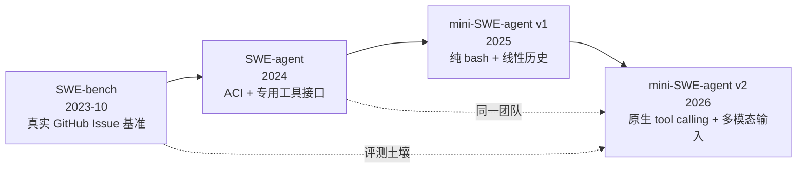

# 项目概览：100 行 Agent 的身份、谱系与硬指标

> **事实基础**：本文所有具体数据均带 F 编号，完整清单见 [references/blog-source.md](../references/blog-source.md) 与 [references/repo-source.md](../references/repo-source.md)，核验结论见 [references/verification.md](../references/verification.md)。

## 1. 一句话定位

mini-SWE-agent 是普林斯顿与斯坦福团队（SWE-bench / SWE-agent 原班人马）做的**极简软件工程 Agent**：核心 Agent 类约 100 行 Python，只给模型一个 bash 工具，用完全线性的消息历史完成“读 Issue → 改代码 → 跑测试 → 提交”的闭环（F-001、F-008、F-040）。

它不是“更小的 SWE-agent 配置”，而是一次**反向实验**：如果去掉精心设计的 Agent-Computer Interface（ACI）、工具调用协议与状态机，只留下 bash 与消息历史，Agent 还能不能工作？团队的答案是可以，而且在强模型上接近甚至超过复杂框架（F-009、F-023）。

## 2. 谱系：从 SWE-bench 到 mini

| 时间 | 事件 | 证据 |
|---|---|---|
| 2023-10-10 | SWE-bench 论文提交（arXiv 2310.06770） | F-085 |
| 2024 | SWE-agent 发布（ACI、专用工具格式、SWE-bench SOTA） | F-008 |
| 2025-06-28 | mini-swe-agent GitHub 仓库创建 | F-035 |
| 2025-11-19 | 官方记录 Gemini 3 Pro 在 mini 上达到 74% verified | F-070 |
| 2026-03-22 | 本博客发布（描述 v1 时代设计） | F-002 |
| 2026-09-03 | 本知识包锁定的 v2.4.6 提交 | F-038 |

> **谱系勘误**：博客说“2024 年发布 SWE-bench”，实际 SWE-bench 论文 2023-10-10 提交，2024 年发布的是 SWE-agent（F-085，E-2）。两个项目的年份容易混淆，读旧文时要特别小心。

## 3. 版本与仓库硬指标

| 项目 | 值 | 来源 |
|---|---|---|
| 仓库 | `SWE-agent/mini-swe-agent` | F-035 |
| GitHub repo id | 1010318950 | F-035 |
| 创建时间 | 2025-06-28T20:18:15Z | F-035 |
| 本地锁定 commit | `04d809ceab9df28f9adaed044884180159172930`（2026-09-03） | F-038 |
| 包版本 | 2.4.6 | F-038 |
| 许可证 | MIT | F-037 |
| 主要语言 | Python | F-037 |
| 快照（2026-11-10） | stars 9,496 / forks 1,306 / open issues 140 | F-036 |
| Python 要求 | >= 3.10 | F-045 |
| 核心文件 | `agents/default.py` 190 行（非空 172）；`environments/local.py` 92 行（非空 80）；`models/litellm_model.py` 164 行（非空 147）；`run/mini.py` 109 行（非空 86） | F-075 |

> **Stars 勘误**：博客写“26k+ Stars”，2026-11-10 的 GitHub API 实际为 9,496（F-004、F-036、F-084，E-1）。差距 16,504，不可能是正常增长/回落，正文统一采用实测值。

## 4. 为什么它值得学

1. **它是“减去一切”的对照组**：大多数 Agent 框架在加工具、加状态、加编排；mini 反其道而行，用最小脚手架把模型能力暴露出来（F-023）。
2. **它是可调试的**：消息历史就是完整轨迹，没有隐藏状态机；想复现一次运行，把 messages 交给另一个模型即可（F-024、F-074）。
3. **它是可替换的**：Agent / Model / Environment 三个 Protocol 把“循环”“模型”“执行”拆开，换模型或换沙箱不需要改 Agent（F-049 ~ F-062）。
4. **它是被大规模采用的基线**：README 自述 Meta、NVIDIA、IBM 等在使用（F-041，机构自述，P1 单源）。

## 5. 三个必须校正的流行说法

| 流行说法 | 实际情况 | 证据 |
|---|---|---|
| “26k+ Stars” | 9,496（2026-11-10） | E-1 |
| “没有工具、不用 tool-calling” | v1/文本模式成立；v2 默认使用 bash tool call | E-4、F-060 |
| “核心就是 100 行” | README 概数；`default.py` 190 行（非空 172），核心方法约 100 行 | F-079 |

## 6. 阅读建议

先读 [01-design-philosophy](01-design-philosophy.md) 理解“为什么敢减”，再读 [02-architecture-and-code](02-architecture-and-code.md) 看“减到什么程度还能跑”，最后按需进入环境、模型、配置与评测篇。想直接动手，跳到 [examples/01-install-and-cli](../examples/01-install-and-cli.md)。
