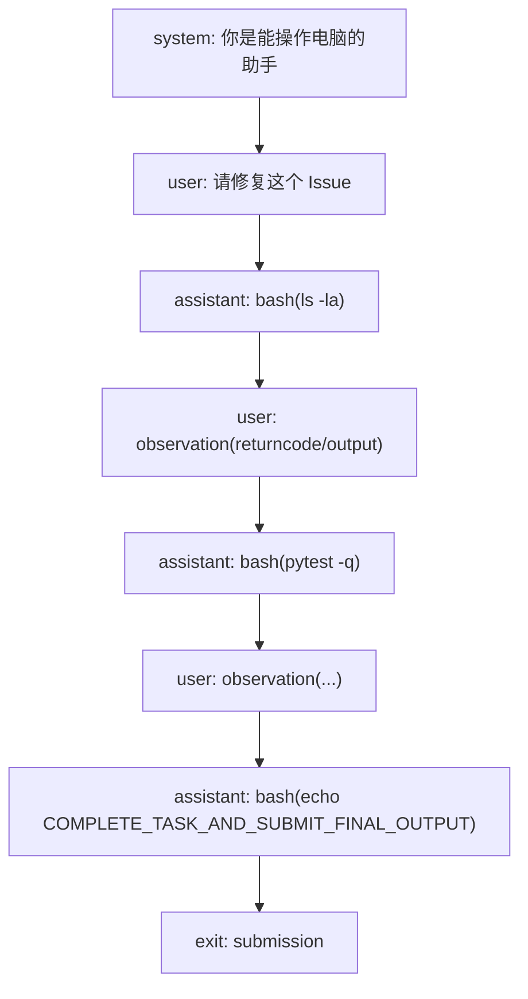

# 设计哲学：bash-only、线性历史、无状态 subprocess

> 一句话：**把 Agent 框架减到只剩“模型看历史、发一条 bash、看输出、再发一条”**（F-010 ~ F-012）。三条原则不是风格偏好，而是相互支撑的工程取舍。

## 1. 原则一：没有工具，只有 bash

mini 不实现 `read_file`、`edit_file`、`search` 等专用工具，只让模型发一条 shell 命令（F-010）。在 v1 与文本模式下，模型输出一个三反引号代码块；在 v2 默认模式下，模型调用唯一的 `bash` 工具（F-060、F-061）。

```text
模型看到的“工具列表”：
  bash(command: string) -> {output, returncode, exception_info}
```

这样做的好处：

1. **零安装负担**：沙箱里只要有 bash，不需要 Python SDK、不需要工具运行时（F-072）。
2. **能力上限由模型决定**：模型可以用 `sed`、`python -c`、`git`、`pytest` 组合出任意操作，不需要为每种操作预先实现工具（F-023）。
3. **格式错误更少**：v2 的工具 schema 只有一个必填字符串参数，解析失败的面比多工具 JSON schema 小（F-060）。

代价：

1. 模型必须会写 shell；对不熟悉终端的模型不友好。
2. 复杂编辑（大段替换、结构化重构）依赖模型自己拼 heredoc/sed，稳定性不如专用编辑器。
3. 安全边界完全由环境提供；Agent 本身不拦截危险命令（见 [03-execution-environments](03-execution-environments.md)）。

## 2. 原则二：完全线性历史

mini 的 `messages` 是一条只追加的列表：system → user(task) → assistant(action) → user(observation) → assistant(action) → …（F-011、F-049）。



没有树、没有分支、没有 checkpoint、没有“历史压缩器”作为默认层。好处是：

1. **轨迹 = 消息**：`serialize()` 直接把 `messages` 写进 JSON，格式为 `mini-swe-agent-1.1`（F-074）。
2. **可复现**：把同一串 messages 交给另一个模型，就能重放上下文（F-024）。
3. **可微调**：训练数据不需要从复杂状态机里重建（README 动机，F-040）。

代价是上下文会线性增长；长任务必须依赖模型自己的上下文窗口，或外部的 step/cost 限制（F-048）。

## 3. 原则三：每个动作完全独立

`LocalEnvironment.execute()` 每次都用 `subprocess.Popen(shell=True)` 起一个新进程，执行完即结束（F-054）。不维持常驻 shell，因此：

1. `cd` 不会跨动作保留；要换目录就写 `cd /path && ...`。
2. `export` 不会跨动作保留；要设变量就写 `FOO=bar command` 或写进文件（F-072）。
3. 超时会杀掉整个进程组（POSIX），避免子进程孤儿（F-054）。

### 为什么不做 shell session

官方 FAQ 给了三条理由（F-073）：

| 问题 | 常驻 shell 的麻烦 | mini 的解法 |
|---|---|---|
| 命令何时结束 | 粘贴输入后，难以判断输出流何时停止；盯 PID/盯提示符都不稳 | 进程退出即结束，`communicate()` 一次性收口 |
| 坏命令杀死会话 | 模型一条 `exit`/崩溃命令就可能让整个会话失效 | 每条命令独立进程，坏了只影响这一条 |
| 中断污染输出 | Ctrl-C 可能打乱 shell 状态，后续输出混入噪声 | 超时杀进程组，下一条从干净状态开始 |

这不是“省事”，而是把**不确定性从协议层移到进程边界**：进程边界是操作系统保证的，shell 提示符不是。

## 4. v1 与 v2：同一条哲学，不同的接口

| 维度 | v1 / textbased | v2 默认 |
|---|---|---|
| 动作表达 | 三反引号代码块 ` ```mswea_bash_command ` | 原生 `bash` tool call |
| 解析方式 | 正则提取，必须恰好 1 个动作 | 解析 tool_calls，校验 `command` 参数 |
| 模型要求 | 任何能输出文本的模型 | 支持 tool calling 的模型（或走 textbased 兼容层） |
| 历史 | 线性 | 线性 |
| 执行 | 独立 subprocess | 独立 subprocess |
| 完成信号 | `COMPLETE_TASK_AND_SUBMIT_FINAL_OUTPUT` | 同左 |

> **重要边界**：博客写于 2026-03-22，描述的是 v1 的“无工具”形态；v2.4.6 默认已经切到 tool calling（F-060、F-062、E-4）。README 与 FAQ 仍保留“不需要 tool-calling”的旧句（F-078），读官方文档时要交叉看源码。

## 5. 这套哲学适合谁

适合：想要一个**可读、可改、可复现**的 coding agent 基线；做 FT/RL 不想过拟合复杂脚手架；需要快速换沙箱/换模型的研究者（F-026、F-040）。

不适合：需要复杂多工具编排、严格权限审批、长程多 Agent 协作的生产系统（F-027）。这些需求应该看 SWE-agent 或更完整的 harness，而不是把 mini 硬改成大框架。

## 6. 一句话总结

mini 的设计不是“少写代码”，而是**把复杂度从框架转移到模型与环境**：模型负责规划与命令构造，环境负责隔离与执行，框架只负责把两者接成一条线。
